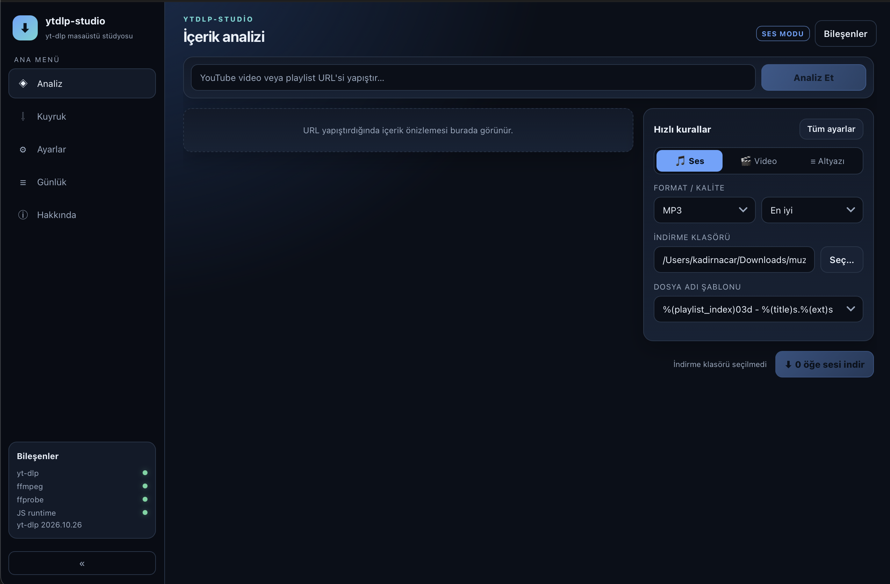

# Link Downloader

**Link Downloader** (`ytdlp-studio`), YouTube video ve playlist içeriklerini analiz etmek, ses/video/altyazı seçeneklerini belirlemek ve indirmeleri kuyruk üzerinden yönetmek için geliştirilen açık kaynak masaüstü uygulamasıdır.

<p align="center">
  <a href="https://ytdlp.bengsoft.com/">Ürün sitesi</a> ·
  <a href="https://github.com/kadirnacar/link-downloader/releases">İndir / Releases</a> ·
  <a href="https://github.com/kadirnacar/link-downloader">Kaynak kod</a> ·
  <a href="website/docs.html">Web dokümantasyonu</a>
</p>



## Özellikler

- **YouTube URL analizi:** video, playlist, Shorts, canlı yayın ve mix bağlantılarını ayrıştırma.
- **Playlist önizleme:** içerikleri başlık, sıra numarası, küçük resim ve süreyle listeleme; arama ve çoklu seçim.
- **Ses indirme:** MP3, M4A, OPUS, FLAC ve WAV formatları ile kalite seçenekleri.
- **Video indirme:** çözünürlük ve MP4, MKV veya WebM kapsayıcı seçenekleri.
- **Altyazı:** mevcut dil seçeneklerini listeleme, manuel/otomatik altyazı ayarları ve videoya gömme seçenekleri.
- **Kuyruk yönetimi:** birden fazla worker, tekil/toplu duraklatma, sürdürme, iptal, yeniden deneme ve temizleme.
- **Canlı ilerleme:** görev yüzdesi, hız, tahmini süre, durum ve playlist toplam ilerlemesi.
- **Bağımlılık yönetimi:** yt-dlp, FFmpeg, FFprobe ve JavaScript runtime durumunu görüntüleme; eksikleri uygulamadan kurma.
- **Gelişmiş ayarlar:** çıktı dizini, dosya adı şablonları, format/kalite, ağ, çerez, playlist ve yt-dlp argümanları.
- **Günlük ve bildirimler:** işlem günlüklerini görüntüleme/filtreleme ve batch tamamlanma bildirimleri.

## Teknoloji yığını

| Katman | Teknoloji |
| --- | --- |
| Masaüstü kabuk | Wails v3.0.0 |
| Backend | Go 1.27 |
| Frontend | React 18, TypeScript, Zustand, Vite 8 |
| Binding | Wails tarafından üretilen TypeScript servis binding'leri |
| Medya motoru | yt-dlp, FFmpeg, FFprobe |

## Kullanıcılar için indirme

Güncel kurulum ve taşınabilir paketler GitHub Releases sayfasında yayınlanır:

**[GitHub Releases — Link Downloader](https://github.com/kadirnacar/link-downloader/releases)**

Paket adları ve platform varlıkları sürüme göre değişebilir. İndirmeden önce release notlarını ve paket açıklamalarını kontrol edin. Kullanım adımları için [Kurulum ve Kullanım](docs/INSTALLATION.md) belgesine bakın.

## Geliştirme ortamı

Projeyi kaynak koddan çalıştırmak için:

- Go **1.27** (modülün `go.mod` hedefi)
- Node.js **20.19+** veya **22.12+** ve npm (Vite 8 toolchain gereksinimi)
- Wails CLI **v3.0.0**
- Task CLI (Taskfile görevlerini kullanmak için)
- Platforma özgü native WebView/build araçları

### Platform araçları

- **Windows:** WebView2 Runtime (Windows 10/11 sistemlerinde genellikle hazırdır).
- **macOS:** macOS 13.0+, Xcode Command Line Tools.
- **Linux:** GCC/build-essential, pkg-config, GTK4, WebKitGTK 6.0 ve libsoup 3.0 geliştirme paketleri. Varsayılan Wails v3.0 yolu Ubuntu 24.04+, Debian 13+ ve Fedora 40+ gibi güncel dağıtımları hedefler; dağıtım bazlı paket adları için `wails3 doctor` kullanın.

### Kurulum

```bash
git clone https://github.com/kadirnacar/link-downloader.git
cd link-downloader

# Wails CLI v3.0.0
go install github.com/wailsapp/wails/v3/cmd/wails3@v3.0.0

# Go modülleri
go mod download

# Frontend bağımlılıkları
cd frontend
npm ci
cd ..

# Go servislerinden TypeScript binding üretimi
wails3 generate bindings -clean=true -ts -i
```

### Geliştirme modunda çalıştırma

```bash
wails3 dev
# veya Task CLI kuruluysa
task dev
```

### Üretim derlemesi

```bash
wails3 build
# veya
task build
```

Örnek cross-target derlemeleri Taskfile üzerinden yapılır:

```bash
GOOS=windows GOARCH=amd64 task build
GOOS=linux GOARCH=amd64 task build
GOOS=darwin GOARCH=arm64 task build
```

Linux GUI derlemeleri CGO, GTK ve WebKitGTK geliştirme bağımlılıkları gerektirebilir. Farklı host/target kombinasyonlarında Taskfile Docker cross-compile yolunu kullanabilir.

### Testler ve statik doğrulama

Depodaki doğrulama akışının kullandığı Go test kapsamı:

```bash
go test ./internal/... ./services/...
go vet ./internal/... ./services/...
```

Tam uygulama binary'si derlenmeden önce `main.go` tarafından `go:embed` ile paketlenen `frontend/dist` çıktısı oluşturulmalıdır:

```bash
cd frontend
npm ci
npm run build
cd ..
wails3 build
```

`frontend/tsconfig.json`, `noUnusedLocals` denetimini etkinleştirir; kullanılmayan import ve selector'lar TypeScript build hatasıdır.

## Environment değişkenleri

| Değişken | Açıklama |
| --- | --- |
| `WAILS_VITE_PORT` | Taskfile tarafından kullanılan Vite geliştirme sunucusu portu; varsayılan `9245`. |
| `GOOS` | Cross-compile hedef işletim sistemi; ör. `windows`, `linux`, `darwin`. |
| `GOARCH` | Cross-compile hedef mimarisi; ör. `amd64`, `arm64`. |
| `CGO_ENABLED` | CGO kullanımını belirler; platform build görevleri kendi varsayılanlarını uygular. |
| `XDG_CONFIG_HOME` | Linux'ta kullanıcı yapılandırma kökünü belirler; boşsa `~/.config` kullanılır. |
| `VERSION` | `release.sh` paket sürümünü belirler; varsayılan `1.0.1`. |
| `TARGETS` | `release.sh` hedef listesi; varsayılan `darwin windows linux`. |
| `MACOSX_DEPLOYMENT_TARGET` | macOS release minimum sürümü; varsayılan `13.0`. |
| `CODESIGN_IDENTITY` | macOS imza kimliği; varsayılan `-` (ad-hoc). |
| `APPLE_ID`, `APPLE_TEAM_ID`, `APPLE_APP_PASSWORD` | macOS notarization için isteğe bağlı gizli bilgiler; `docs/RELEASES.md` açıklamasına bakın. |

## Dokümantasyon

| Belge | İçerik |
| --- | --- |
| [Genel Bakış](docs/OVERVIEW.md) | Amaç, yetenekler, sınırlar ve teknoloji yığını |
| [Kurulum ve Kullanım](docs/INSTALLATION.md) | Son kullanıcı kurulumu, ilk çalıştırma, ekranlar ve sorun giderme |
| [Geliştirme ve Derleme](docs/DEVELOPMENT.md) | Toolchain, komutlar, platform önkoşulları ve environment |
| [Mimari](docs/ARCHITECTURE.md) | Katmanlar, Go servisleri, Wails binding ve frontend akışı |
| [Yapılandırma](docs/CONFIGURATION.md) | Ayar dosyaları, saklama konumları ve bağımlılık yönetimi |
| [Release ve Yayınlama](docs/RELEASES.md) | Sürüm varlıkları ve dağıtım notları |
| [Ürün sitesi](website/README.md) | `ytdlp.bengsoft.com` statik site dosyaları ve yayınlama |

## Proje yapısı

```text
.
├── main.go
├── internal/
│   ├── engine/              # yt-dlp argüman oluşturma ve process yürütme
│   └── model/               # DTO, ayarlar ve doğrulama
├── services/                # Analyze, Download, Deps, Settings, queue store ve lifecycle
├── frontend/
│   ├── src/                 # React arayüzü ve Zustand store'ları
│   └── bindings/            # Üretilen Wails TypeScript binding'leri
├── build/                   # Wails platform yapılandırmaları ve Taskfile'lar
├── docs/                    # Proje dokümantasyonu ve ekran görüntüsü
└── website/                 # Tanıtım/indirme sitesi ve web dokümantasyonu
```

## Veri ve gizlilik

Uygulama ayarları ve araç binary'leri yerel kullanıcı yapılandırma dizininde tutulur. İndirme hedefi, kullanıcının seçtiği çıktı klasörüdür. Kaynakta bir uygulama hesabı veya bulut indirme servisi bulunmaz. URL analizi ve indirme için internet bağlantısı gerekir.

## Yasal not

Link Downloader, yt-dlp kullanan bir istemci uygulamasıdır. İçeriklerin indirilmesinde ilgili platformların kullanım koşullarına, telif haklarına ve geçerli mevzuata uyulmalıdır. İndirilen içeriğin kullanımından kullanıcı sorumludur.

## Katkı ve hata bildirimi

Kaynak kod, değişiklik önerileri ve hata bildirimleri için [GitHub deposunu](https://github.com/kadirnacar/link-downloader) kullanın. Hata raporuna işletim sistemi, uygulama sürümü, Go/Node/Wails sürümleri (kaynak kurulumunda) ve yeniden üretilebilir tam hata çıktısını ekleyin.


## Persistent queue and shutdown recovery

Masaüstü uygulaması indirme kuyruğunu kullanıcının uygulama yapılandırma klasöründeki `queue.json` dosyasında saklar. Dosya atomik olarak güncellenir. Bekleyen görevler yeniden açılışta özgün sırayla yüklenir; uygulama kapandığında indirme/dönüştürme aşamasında olanlar `paused` olarak geri yüklenir ve kullanıcı tarafından sürdürülebilir. Wails kapanış callback'i durumu kaydeder, worker context'lerini iptal eder ve desteklenen platformlarda yt-dlp/FFmpeg proses ağaçlarını sonlandırır.

Bağımlılık kurma/güncelleme işlemleri exclusive tool-operation kilidi alır. İndirme ve metadata analizi shared erişim alır; bu sayede araç kullanımdayken yt-dlp güncellenemez.

Kuyruk dosyası tek çalışan uygulama örneği için tasarlanmıştır. Çok süreçli veritabanı değildir ve süreçler arası kilit sağlamaz.
