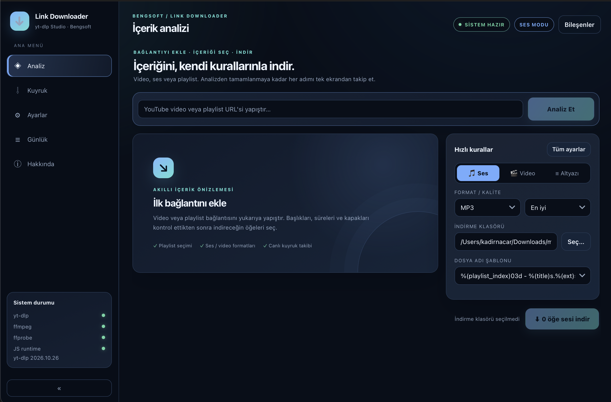

# 📂 Çoklu Dizin Proje Raporu

- **Tarih:** 20.11.2026 03:35:28
- **Taranan Dizinler:** `./`

## 📑 İçindekiler
| # | Kaynak Dizin | Dosya Yolu | Tür | Satır |
|---|--------------|------------|-----|-------|
| 1 | link-downloader | [build-all-linux.sh](#link-downloader-build-all-linux-sh) | .SH | 79 |
| 2 | link-downloader | [go.mod](#link-downloader-go-mod) | .MOD | 22 |
| 3 | link-downloader | [new-release.ps1](#link-downloader-new-release-ps1) | .PS1 | 4 |
| 4 | link-downloader | [new-release.sh](#link-downloader-new-release-sh) | .SH | 5 |
| 5 | link-downloader | [fix-macos-app.sh](#link-downloader-fix-macos-app-sh) | .SH | 33 |
| 6 | link-downloader | [window_other.go](#link-downloader-window_other-go) | .GO | 20 |
| 7 | link-downloader | [export.py](#link-downloader-export-py) | .PY | 240 |
| 8 | link-downloader | [release.ps1](#link-downloader-release-ps1) | .PS1 | 48 |
| 9 | link-downloader | [README.md](#link-downloader-README-md) | .MD | 234 |
| 10 | link-downloader | [build-all.sh](#link-downloader-build-all-sh) | .SH | 86 |
| 11 | link-downloader | [window_darwin.go](#link-downloader-window_darwin-go) | .GO | 11 |
| 12 | link-downloader | [release.sh](#link-downloader-release-sh) | .SH | 200 |
| 13 | link-downloader | [Taskfile.yml](#link-downloader-Taskfile-yml) | .YML | 70 |
| 14 | link-downloader | [build-all-windows.bat](#link-downloader-build-all-windows-bat) | .BAT | 4 |
| 15 | link-downloader | [build-all-windows.ps1](#link-downloader-build-all-windows-ps1) | .PS1 | 88 |
| 16 | link-downloader | [main.go](#link-downloader-main-go) | .GO | 58 |
| 17 | link-downloader | [frontend/index.html](#link-downloader-frontend-index-html) | .HTML | 13 |
| 18 | link-downloader | [frontend/package.json](#link-downloader-frontend-package-json) | .JSON | 25 |
| 19 | link-downloader | [frontend/tsconfig.json](#link-downloader-frontend-tsconfig-json) | .JSON | 25 |
| 20 | link-downloader | [frontend/vite.config.ts](#link-downloader-frontend-vite-config-ts) | .TS | 13 |
| 21 | link-downloader | [frontend/bindings/ytdlp-studio/internal/model/index.ts](#link-downloader-frontend-bindings-ytdlp-studio-internal-model-index-ts) | .TS | 10 |
| 22 | link-downloader | [frontend/bindings/ytdlp-studio/internal/model/models.ts](#link-downloader-frontend-bindings-ytdlp-studio-internal-model-models-ts) | .TS | 104 |
| 23 | link-downloader | [frontend/bindings/ytdlp-studio/services/downloadservice.ts](#link-downloader-frontend-bindings-ytdlp-studio-services-downloadservice-ts) | .TS | 81 |
| 24 | link-downloader | [frontend/bindings/ytdlp-studio/services/depsservice.ts](#link-downloader-frontend-bindings-ytdlp-studio-services-depsservice-ts) | .TS | 37 |
| 25 | link-downloader | [frontend/bindings/ytdlp-studio/services/analyzeservice.ts](#link-downloader-frontend-bindings-ytdlp-studio-services-analyzeservice-ts) | .TS | 29 |
| 26 | link-downloader | [frontend/bindings/ytdlp-studio/services/index.ts](#link-downloader-frontend-bindings-ytdlp-studio-services-index-ts) | .TS | 23 |
| 27 | link-downloader | [frontend/bindings/ytdlp-studio/services/models.ts](#link-downloader-frontend-bindings-ytdlp-studio-services-models-ts) | .TS | 64 |
| 28 | link-downloader | [frontend/bindings/ytdlp-studio/services/settingsservice.ts](#link-downloader-frontend-bindings-ytdlp-studio-services-settingsservice-ts) | .TS | 45 |
| 29 | link-downloader | [frontend/bindings/github.com/wailsapp/wails/v3/internal/eventcreate.ts](#link-downloader-frontend-bindings-github-com-wailsapp-wails-v3-internal-eventcreate-ts) | .TS | 9 |
| 30 | link-downloader | [frontend/bindings/github.com/wailsapp/wails/v3/internal/eventdata.d.ts](#link-downloader-frontend-bindings-github-com-wailsapp-wails-v3-internal-eventdata-d-ts) | .TS | 22 |
| 31 | link-downloader | [frontend/bindings/events/index.ts](#link-downloader-frontend-bindings-events-index-ts) | .TS | 35 |
| 32 | link-downloader | [frontend/src/App.tsx](#link-downloader-frontend-src-App-tsx) | .TSX | 122 |
| 33 | link-downloader | [frontend/src/logStore.ts](#link-downloader-frontend-src-logStore-ts) | .TS | 21 |
| 34 | link-downloader | [frontend/src/main.tsx](#link-downloader-frontend-src-main-tsx) | .TSX | 9 |
| 35 | link-downloader | [frontend/src/index.css](#link-downloader-frontend-src-index-css) | .CSS | 263 |
| 36 | link-downloader | [frontend/src/api.ts](#link-downloader-frontend-src-api-ts) | .TS | 3 |
| 37 | link-downloader | [frontend/src/types.ts](#link-downloader-frontend-src-types-ts) | .TS | 58 |
| 38 | link-downloader | [frontend/src/vite-env.d.ts](#link-downloader-frontend-src-vite-env-d-ts) | .TS | 1 |
| 39 | link-downloader | [frontend/src/taskStore.ts](#link-downloader-frontend-src-taskStore-ts) | .TS | 70 |
| 40 | link-downloader | [frontend/src/store.ts](#link-downloader-frontend-src-store-ts) | .TS | 60 |
| 41 | link-downloader | [frontend/src/settings/catalog.ts](#link-downloader-frontend-src-settings-catalog-ts) | .TS | 117 |
| 42 | link-downloader | [frontend/src/components/Toasts.tsx](#link-downloader-frontend-src-components-Toasts-tsx) | .TSX | 34 |
| 43 | link-downloader | [frontend/src/components/DownloadButton.tsx](#link-downloader-frontend-src-components-DownloadButton-tsx) | .TSX | 43 |
| 44 | link-downloader | [frontend/src/components/Field.tsx](#link-downloader-frontend-src-components-Field-tsx) | .TSX | 76 |
| 45 | link-downloader | [frontend/src/components/PreviewList.tsx](#link-downloader-frontend-src-components-PreviewList-tsx) | .TSX | 56 |
| 46 | link-downloader | [frontend/src/components/QueuePanel.tsx](#link-downloader-frontend-src-components-QueuePanel-tsx) | .TSX | 219 |
| 47 | link-downloader | [frontend/src/components/PasteBar.tsx](#link-downloader-frontend-src-components-PasteBar-tsx) | .TSX | 72 |
| 48 | link-downloader | [frontend/src/components/Sidebar.tsx](#link-downloader-frontend-src-components-Sidebar-tsx) | .TSX | 63 |
| 49 | link-downloader | [frontend/src/components/SubtitlePicker.tsx](#link-downloader-frontend-src-components-SubtitlePicker-tsx) | .TSX | 70 |
| 50 | link-downloader | [frontend/src/components/OptionsPanel.tsx](#link-downloader-frontend-src-components-OptionsPanel-tsx) | .TSX | 117 |
| 51 | link-downloader | [frontend/src/lib/brand.ts](#link-downloader-frontend-src-lib-brand-ts) | .TS | 12 |
| 52 | link-downloader | [frontend/src/lib/format.ts](#link-downloader-frontend-src-lib-format-ts) | .TS | 33 |
| 53 | link-downloader | [frontend/src/pages/LogsPage.tsx](#link-downloader-frontend-src-pages-LogsPage-tsx) | .TSX | 27 |
| 54 | link-downloader | [frontend/src/pages/SettingsPage.tsx](#link-downloader-frontend-src-pages-SettingsPage-tsx) | .TSX | 147 |
| 55 | link-downloader | [frontend/src/pages/AboutPage.tsx](#link-downloader-frontend-src-pages-AboutPage-tsx) | .TSX | 36 |
| 56 | link-downloader | [internal/model/media.go](#link-downloader-internal-model-media-go) | .GO | 28 |
| 57 | link-downloader | [internal/model/options.go](#link-downloader-internal-model-options-go) | .GO | 206 |
| 58 | link-downloader | [internal/model/options_test.go](#link-downloader-internal-model-options_test-go) | .GO | 33 |
| 59 | link-downloader | [internal/model/appsettings.go](#link-downloader-internal-model-appsettings-go) | .GO | 78 |
| 60 | link-downloader | [internal/engine/exec.go](#link-downloader-internal-engine-exec-go) | .GO | 212 |
| 61 | link-downloader | [internal/engine/args_test.go](#link-downloader-internal-engine-args_test-go) | .GO | 84 |
| 62 | link-downloader | [internal/engine/builder.go](#link-downloader-internal-engine-builder-go) | .GO | 302 |
| 63 | link-downloader | [scripts/check.sh](#link-downloader-scripts-check-sh) | .SH | 31 |
| 64 | link-downloader | [scripts/new_release.py](#link-downloader-scripts-new_release-py) | .PY | 272 |
| 65 | link-downloader | [.github/workflows/release.yml](#link-downloader--github-workflows-release-yml) | .YML | 127 |
| 66 | link-downloader | [build/Taskfile.yml](#link-downloader-build-Taskfile-yml) | .YML | 398 |
| 67 | link-downloader | [build/config.yml](#link-downloader-build-config-yml) | .YML | 87 |
| 68 | link-downloader | [build/ios/Info.dev.plist](#link-downloader-build-ios-Info-dev-plist) | .PLIST | 61 |
| 69 | link-downloader | [build/ios/entitlements.plist](#link-downloader-build-ios-entitlements-plist) | .PLIST | 11 |
| 70 | link-downloader | [build/ios/main_ios.go](#link-downloader-build-ios-main_ios-go) | .GO | 23 |
| 71 | link-downloader | [build/ios/Taskfile.yml](#link-downloader-build-ios-Taskfile-yml) | .YML | 365 |
| 72 | link-downloader | [build/ios/app_options_default.go](#link-downloader-build-ios-app_options_default-go) | .GO | 10 |
| 73 | link-downloader | [build/ios/Info.plist](#link-downloader-build-ios-Info-plist) | .PLIST | 80 |
| 74 | link-downloader | [build/ios/app_options_ios.go](#link-downloader-build-ios-app_options_ios-go) | .GO | 11 |
| 75 | link-downloader | [build/ios/scripts/deps/install_deps.go](#link-downloader-build-ios-scripts-deps-install_deps-go) | .GO | 319 |
| 76 | link-downloader | [build/appicon.icon/icon.json](#link-downloader-build-appicon-icon-icon-json) | .JSON | 51 |
| 77 | link-downloader | [build/linux/Taskfile.yml](#link-downloader-build-linux-Taskfile-yml) | .YML | 220 |
| 78 | link-downloader | [build/linux/nfpm/scripts/preremove.sh](#link-downloader-build-linux-nfpm-scripts-preremove-sh) | .SH | 1 |
| 79 | link-downloader | [build/linux/nfpm/scripts/postinstall.sh](#link-downloader-build-linux-nfpm-scripts-postinstall-sh) | .SH | 21 |
| 80 | link-downloader | [build/linux/nfpm/scripts/postremove.sh](#link-downloader-build-linux-nfpm-scripts-postremove-sh) | .SH | 1 |
| 81 | link-downloader | [build/linux/nfpm/scripts/preinstall.sh](#link-downloader-build-linux-nfpm-scripts-preinstall-sh) | .SH | 1 |
| 82 | link-downloader | [build/linux/appimage/build.sh](#link-downloader-build-linux-appimage-build-sh) | .SH | 35 |
| 83 | link-downloader | [build/android/main_android.go](#link-downloader-build-android-main_android-go) | .GO | 11 |
| 84 | link-downloader | [build/android/Taskfile.yml](#link-downloader-build-android-Taskfile-yml) | .YML | 464 |
| 85 | link-downloader | [build/android/gradlew.bat](#link-downloader-build-android-gradlew-bat) | .BAT | 93 |
| 86 | link-downloader | [build/android/app/proguard-rules.pro](#link-downloader-build-android-app-proguard-rules-pro) | .PRO | 12 |
| 87 | link-downloader | [build/android/app/src/main/AndroidManifest.xml](#link-downloader-build-android-app-src-main-AndroidManifest-xml) | .XML | 64 |
| 88 | link-downloader | [build/android/app/src/main/res/layout/activity_main.xml](#link-downloader-build-android-app-src-main-res-layout-activity_main-xml) | .XML | 12 |
| 89 | link-downloader | [build/android/app/src/main/res/values/colors.xml](#link-downloader-build-android-app-src-main-res-values-colors-xml) | .XML | 8 |
| 90 | link-downloader | [build/android/app/src/main/res/values/themes.xml](#link-downloader-build-android-app-src-main-res-values-themes-xml) | .XML | 14 |
| 91 | link-downloader | [build/android/app/src/main/res/values/strings.xml](#link-downloader-build-android-app-src-main-res-values-strings-xml) | .XML | 4 |
| 92 | link-downloader | [build/android/app/src/main/res/xml/file_paths.xml](#link-downloader-build-android-app-src-main-res-xml-file_paths-xml) | .XML | 6 |
| 93 | link-downloader | [build/android/scripts/deps/install_deps.go](#link-downloader-build-android-scripts-deps-install_deps-go) | .GO | 266 |
| 94 | link-downloader | [build/darwin/Info.dev.plist](#link-downloader-build-darwin-Info-dev-plist) | .PLIST | 34 |
| 95 | link-downloader | [build/darwin/Taskfile.yml](#link-downloader-build-darwin-Taskfile-yml) | .YML | 230 |
| 96 | link-downloader | [build/darwin/Info.plist](#link-downloader-build-darwin-Info-plist) | .PLIST | 48 |
| 97 | link-downloader | [build/windows/Taskfile.yml](#link-downloader-build-windows-Taskfile-yml) | .YML | 195 |
| 98 | link-downloader | [build/windows/info.json](#link-downloader-build-windows-info-json) | .JSON | 27 |
| 99 | link-downloader | [build/windows/msix/app_manifest.xml](#link-downloader-build-windows-msix-app_manifest-xml) | .XML | 55 |
| 100 | link-downloader | [build/windows/msix/template.xml](#link-downloader-build-windows-msix-template-xml) | .XML | 54 |
| 101 | link-downloader | [services/deps.go](#link-downloader-services-deps-go) | .GO | 367 |
| 102 | link-downloader | [services/analyze_test.go](#link-downloader-services-analyze_test-go) | .GO | 39 |
| 103 | link-downloader | [services/download.go](#link-downloader-services-download-go) | .GO | 756 |
| 104 | link-downloader | [services/playlist_all.go](#link-downloader-services-playlist_all-go) | .GO | 321 |
| 105 | link-downloader | [services/events.go](#link-downloader-services-events-go) | .GO | 13 |
| 106 | link-downloader | [services/settings.go](#link-downloader-services-settings-go) | .GO | 105 |
| 107 | link-downloader | [services/analyze.go](#link-downloader-services-analyze-go) | .GO | 280 |


---
### 📄 link-downloader / build-all-linux.sh <a name='link-downloader-build-all-linux-sh'></a>
📏 **Satır:** 79 | 📂 **Kök:** `/Volumes/Veri/github/link-downloader`
```bash
# ytdlp-studio:build-all-linux v1
#!/bin/bash
set -euo pipefail

GREEN='\033[0;32m'; YELLOW='\033[1;33m'; RED='\033[0;31m'; NC='\033[0m'
success() { echo -e "${GREEN}✓ $1${NC}"; }
warn()    { echo -e "${YELLOW}⚠ $1${NC}"; }
error()   { echo -e "${RED}✗ $1${NC}"; exit 1; }

echo "=========================================="
echo "ytdlp-studio · Linux Host · Build All"
echo "=========================================="

command -v task >/dev/null 2>&1 || error "Task CLI kurulu değil (brew/go install github.com/go-task/task/v3/cmd/task@latest)"
command -v go   >/dev/null 2>&1 || error "Go kurulu değil (>= 1.27)"
command -v npm  >/dev/null 2>&1 || error "npm kurulu değil"

HAS_DOCKER=0
if command -v docker >/dev/null 2>&1 && docker info >/dev/null 2>&1; then HAS_DOCKER=1; fi

# Native Linux GUI build için WebKitGTK dev paketleri (CGO) şart
if ! pkg-config --exists gtk4 webkitgtk-6.0 libsoup-3.0 2>/dev/null; then
  echo "webkit2gtk-4.1 dev paketleri bulunamadı:"
  echo "  Debian/Ubuntu: sudo apt install libgtk-4-dev libwebkitgtk-6.0-dev libsoup-3.0-dev build-essential pkg-config"
  echo "  Fedora:        sudo dnf install gtk4-devel webkitgtk6.0-devel libsoup3-devel pkg-config"
  echo "  Arch:          sudo pacman -S gtk4 webkitgtk-6.0 libsoup3 pkg-config base-devel"
  error "Wails v3 Linux build için GTK4 + WebKitGTK 6.0 + libsoup-3.0 dev paketleri gerekli"
fi

mkdir -p dist/linux-amd64 dist/linux-arm64 dist/windows-amd64 dist/windows-arm64

echo ""
echo "1/6 · Frontend bağımlılıkları..."
if [ ! -d "frontend/node_modules" ]; then
  (cd frontend && npm install)
fi
success "Frontend hazır"

echo ""
echo "2/6 · Linux amd64 (native)..."
task build || error "Linux amd64 build başarısız"
cp -f bin/ytdlp-studio dist/linux-amd64/
success "Linux amd64 → dist/linux-amd64/ytdlp-studio"

echo ""
echo "3/6 · Windows amd64 (cross, CGO'suz)..."
GOOS=windows GOARCH=amd64 task build || error "Windows amd64 build başarısız"
cp -f bin/ytdlp-studio.exe dist/windows-amd64/
success "Windows amd64 → dist/windows-amd64/ytdlp-studio.exe"

echo ""
echo "4/6 · Windows arm64 (cross)..."
GOOS=windows GOARCH=arm64 task build || error "Windows arm64 build başarısız"
cp -f bin/ytdlp-studio.exe dist/windows-arm64/
success "Windows arm64 → dist/windows-arm64/ytdlp-studio.exe"

echo ""
echo "5/6 · Linux arm64 (Docker cross)..."
if [ "$HAS_DOCKER" -eq 1 ]; then
  task setup:docker
  GOOS=linux GOARCH=arm64 task build || warn "Linux arm64 build başarısız (atlandı)"
  if [ -f bin/ytdlp-studio ]; then cp -f bin/ytdlp-studio dist/linux-arm64/; success "Linux arm64 → dist/linux-arm64/"; fi
else
  warn "Docker çalışmıyor: Linux arm64 cross-build atlandı"
fi

echo ""
echo "6/6 · Linux paketleme (AppImage/deb · build/linux/Taskfile.yml)..."
GOOS=linux task package || warn "Linux paketleme başarısız (binary'ler yine de hazır)"

echo ""
echo "=========================================="
success "Build tamamlandı"
ls -lh bin/ 2>/dev/null || true
ls -lh dist/*/ 2>/dev/null || true
echo ""
echo "Notlar:"
echo "  - Windows MSIX paketi yalnızca Windows'ta: task install:msix:tools && task package"
echo "  - macOS hedefi (opsiyonel, Docker imajı SDK içerir): GOOS=darwin task build"

```

---
### 📄 link-downloader / go.mod <a name='link-downloader-go-mod'></a>
📏 **Satır:** 22 | 📂 **Kök:** `/Volumes/Veri/github/link-downloader`
```
module ytdlp-studio

go 1.27

require (
	github.com/lrstanley/go-ytdlp v1.5.6
	github.com/wailsapp/wails/v3 v3.0.0
)

require (
	github.com/ProtonMail/go-crypto v1.5.2 // indirect
	github.com/adrg/xdg v0.5.3 // indirect
	github.com/cloudflare/circl v1.6.5 // indirect
	github.com/coder/websocket v1.8.14 // indirect
	github.com/go-ole/go-ole v1.3.0 // indirect
	github.com/godbus/dbus/v5 v5.2.2 // indirect
	github.com/mattn/go-colorable v0.1.14 // indirect
	github.com/mattn/go-isatty v0.0.20 // indirect
	github.com/ulikunitz/xz v0.5.17 // indirect
	golang.org/x/crypto v0.58.0 // indirect
	golang.org/x/sys v0.49.0 // indirect
)

```

---
### 📄 link-downloader / new-release.ps1 <a name='link-downloader-new-release-ps1'></a>
📏 **Satır:** 4 | 📂 **Kök:** `/Volumes/Veri/github/link-downloader`
```
# ytdlp-studio:new-release-ps1 v1
$ErrorActionPreference = "Stop"
$here = Split-Path -Parent $MyInvocation.MyCommand.Path
python (Join-Path $here "scripts/new_release.py") @args

```

---
### 📄 link-downloader / new-release.sh <a name='link-downloader-new-release-sh'></a>
📏 **Satır:** 5 | 📂 **Kök:** `/Volumes/Veri/github/link-downloader`
```bash
#!/bin/bash
# ytdlp-studio:new-release-sh v1
set -euo pipefail
HERE="$(cd "$(dirname "$0")" && pwd)"
exec python3 "$HERE/scripts/new_release.py" "$@"

```

---
### 📄 link-downloader / fix-macos-app.sh <a name='link-downloader-fix-macos-app-sh'></a>
📏 **Satır:** 33 | 📂 **Kök:** `/Volumes/Veri/github/link-downloader`
```bash
#!/bin/bash
# ytdlp-studio:fix-macos v1
# Mevcut bir .app'i macOS 15+/26.x Gatekeeper'a uygun hale getirir.
# Kullanım: ./fix-macos-app.sh [/Applications/ytdlp-studio.app]
set -euo pipefail

APP="${1:-/Applications/ytdlp-studio.app}"
if [ ! -d "$APP" ]; then
  echo "HATA: bulunamadı: $APP"
  echo "Kullanım: ./fix-macos-app.sh /Applications/ytdlp-studio.app"
  exit 1
fi

echo "Hedef: $APP"
echo "1/4 · Karantina ve genişletilmiş öznitelikler temizleniyor"
xattr -dr com.apple.quarantine "$APP" 2>/dev/null || true
xattr -cr "$APP" 2>/dev/null || true

echo "2/4 · Bundle yeniden imzalanıyor (ad-hoc)"
codesign --force --deep --sign - "$APP"

echo "3/4 · Doğrulama"
codesign --verify --deep --strict --verbose=2 "$APP" || true
codesign -dv --verbose=2 "$APP" 2>&1 | head -n 12 || true

echo "4/4 · Açılıyor"
open "$APP" || {
  echo ""
  echo "Açılamadıysa: Sistem Ayarları > Gizlilik ve Güvenlik > 'Yine de Aç'."
  echo "Kalıcı çözüm: Developer ID ile imza + notarization (release.sh bunu destekler)."
  exit 1
}
echo "Tamam."

```

---
### 📄 link-downloader / window_other.go <a name='link-downloader-window_other-go'></a>
📏 **Satır:** 20 | 📂 **Kök:** `/Volumes/Veri/github/link-downloader`
```
// ytdlp-studio:generated v1
//go:build !darwin

package main

import (
	"runtime"

	"github.com/wailsapp/wails/v3/pkg/application"
)

func tuneWindow(o *application.WebviewWindowOptions) {
	if runtime.GOOS == "windows" {
		o.Width, o.Height = 1366, 860
		o.MinWidth, o.MinHeight = 1024, 680
		return
	}
	o.Width, o.Height = 1280, 800
	o.MinWidth, o.MinHeight = 940, 600
}

```

---
### 📄 link-downloader / export.py <a name='link-downloader-export-py'></a>
📏 **Satır:** 240 | 📂 **Kök:** `/Volumes/Veri/github/link-downloader`
```python
#!/usr/bin/env python3
import os
import sys
import fnmatch
import argparse
from pathlib import Path
from datetime import datetime

# ==============================================================================
# ⚙️ VARSAYILAN YAPILANDIRMA
# ==============================================================================
DEFAULT_EXCLUDES = [
    "node_modules",
    "dist",
    ".git",
    "coverage",
    ".next",
    "__pycache__",
    "package-lock.json",
    "yarn.lock",
    "venv",
    ".env",
    ".DS_Store",
    "styles",
    ".pio",
    ".vscode",
    "embed",
    "vendor",
    ".cxx",
    "Pods",
    ".idea",
    "tests",
    "project_report.md"
]

DEFAULT_INCLUDES = [
    "*.hpp", 
    "*.cpp", 
    "*.c",
    "*.h", 
    "*.go", 
    "*.ini", 
    "*.json", 
    "*.js", 
    "*.ts", 
    "*.tsx", 
    "*.jsx", 
    "*.go", 
    "*.mod", 
    "*.py", 
    "*.plist", 
    "*.css", 
    # "*.gradle",
    "*.pro",
    "*.kt",
    "*.xml",
    "*.yml",
    "*.example",
    "*.sh",
    "*.bat",
    "*.ps1",
    "*.md",
    "*.html",
    "Dockerfile"
    # "*.swift",
    # "*.plist",
    # "*.storyboard",
    # "Podfile",
    # "*.bat"
    ]

LANG_MAP = {
    ".tsx": "tsx",
    ".ts": "typescript",
    ".css": "css",
    ".js": "javascript",
    ".py": "python",
    ".sh": "bash",
    ".zsh": "zsh",
    ".json": "json",
    ".md": "markdown",
}

# ==============================================================================
# 🛠️ YARDIMCI FONKSİYONLAR
# ==============================================================================


def is_ignored(path: Path, root: Path, excludes: list) -> bool:
    """Dosya veya dizinin exclude listesinde olup olmadığını kontrol eder."""
    try:
        # Dosyanın tarama köküne göre göreceli yolunu al
        rel_parts = path.relative_to(root).parts
        for part in rel_parts:
            if any(fnmatch.fnmatch(part, pattern) for pattern in excludes):
                return True
    except ValueError:
        # Eğer dosya root dışında bir yerdeyse (teorik olarak rglob'da zor ama güvenli)
        pass

    if any(fnmatch.fnmatch(path.name, pattern) for pattern in excludes):
        return True
    return False


def is_included(path: Path, includes: list) -> bool:
    if not includes or "*" in includes:
        return True
    return any(fnmatch.fnmatch(path.name, pattern) for pattern in includes)


# ==============================================================================
# 🚀 ANA SCRIPT
# ==============================================================================


def main():
    parser = argparse.ArgumentParser(
        description="🚀 Birden fazla dizini tarayıp tek bir Markdown raporu oluşturur.",
        formatter_class=argparse.RawTextHelpFormatter,
    )

    # 'dir' artık liste kabul ediyor (nargs='+')
    parser.add_argument(
        "dirs", nargs="+", help="Taranacak dizinler (Örn: ./src ./lib ./config)"
    )
    parser.add_argument(
        "-o", "--output", default="project_report.md", help="Çıktı dosya adı"
    )
    parser.add_argument(
        "-i",
        "--include",
        nargs="+",
        default=DEFAULT_INCLUDES,
        help="Dahil edilecek desenler",
    )
    parser.add_argument(
        "-e",
        "--exclude",
        nargs="+",
        default=DEFAULT_EXCLUDES,
        help="Hariç tutulacak desenler",
    )
    parser.add_argument(
        "-s", "--max-size", type=int, default=500, help="Maksimum dosya boyutu (KB)"
    )
    parser.add_argument(
        "-d", "--days", type=int, default=0, help="Son X günde değişenler"
    )

    args = parser.parse_args()

    all_found_files = []

    # 1. Her bir dizini sırayla tara
    for d in args.dirs:
        search_path = Path(d).resolve()
        if not search_path.is_dir():
            print(f"⚠️ Uyarı: '{d}' geçerli bir dizin değil, atlanıyor.")
            continue

        print(f"🔍 Tarama: {search_path}")

        for file_path in search_path.rglob("*"):
            if not file_path.is_file():
                continue

            if is_ignored(file_path, search_path, args.exclude):
                continue
            if not is_included(file_path, args.include):
                continue
            if file_path.stat().st_size > args.max_size * 1024:
                continue
            if args.days > 0:
                mtime = datetime.fromtimestamp(file_path.stat().st_mtime)
                if (datetime.now() - mtime).days > args.days:
                    continue

            # (Dosya objesi, arandığı kök dizin) şeklinde sakla ki relative_path doğru hesaplansın
            all_found_files.append((file_path, search_path))

    if not all_found_files:
        print("❌ Kriterlere uygun dosya bulunamadı!")
        return

    # 2. Markdown Yazımı
    with open(args.output, "w", encoding="utf-8") as f:
        f.write(f"# 📂 Çoklu Dizin Proje Raporu\n\n")
        f.write(f"- **Tarih:** {datetime.now().strftime('%d.%m.%Y %H:%M:%S')}\n")
        f.write(f"- **Taranan Dizinler:** `{', '.join(args.dirs)}`\n\n")

        f.write("## 📑 İçindekiler\n")
        f.write("| # | Kaynak Dizin | Dosya Yolu | Tür | Satır |\n")
        f.write("|---|--------------|------------|-----|-------|\n")

        details = []
        total_lines = 0

        for idx, (path, root) in enumerate(all_found_files, 1):
            rel_path = path.relative_to(root)
            root_name = root.name
            ext = path.suffix.lower()
            lang = LANG_MAP.get(ext, "")

            try:
                raw_content = path.read_text(encoding="utf-8")
                line_count = len(raw_content.splitlines())
            except Exception:
                raw_content = "⚠️ Dosya okunamadı veya binary."
                line_count = 0

            total_lines += line_count
            # Çakışmaları önlemek için anchor'a root ismini de ekleyelim
            anchor = (
                f"{root_name}-{str(rel_path)}".replace(".", "-")
                .replace("/", "-")
                .replace("\\", "-")
            )

            f.write(
                f"| {idx} | {root_name} | [{rel_path}](#{anchor}) | {ext.upper()} | {line_count} |\n"
            )

            details.append(
                f"\n---\n### 📄 {root_name} / {rel_path} <a name='{anchor}'></a>\n"
            )
            details.append(f"📏 **Satır:** {line_count} | 📂 **Kök:** `{root}`\n")
            details.append(f"```{lang}\n{raw_content}\n```\n")
            print(f" ✅ İşlendi: {root_name}/{rel_path}")

        f.write("\n" + "".join(details))
        f.write(
            f"\n---\n## 📊 Özet\n- Toplam Dosya: {len(all_found_files)}\n- Toplam Satır: {total_lines}\n"
        )

    print(f"\n✨ İşlem tamamlandı! {args.output} oluşturuldu.")


if __name__ == "__main__":
    main()

```

---
### 📄 link-downloader / release.ps1 <a name='link-downloader-release-ps1'></a>
📏 **Satır:** 48 | 📂 **Kök:** `/Volumes/Veri/github/link-downloader`
```
# ytdlp-studio:release-ps1 v1
# Windows host: exe + zip (+ MSIX araçları varsa paket)
$ErrorActionPreference = "Stop"
$APP = "ytdlp-studio"
$OUT = "release"
New-Item -ItemType Directory -Force -Path $OUT | Out-Null

function Fail($m){ Write-Host "x $m" -ForegroundColor Red; exit 1 }
function Say($m){ Write-Host "`n== $m" -ForegroundColor Cyan }

foreach ($c in @("go","npm")) { if (-not (Get-Command $c -ErrorAction SilentlyContinue)) { Fail "$c yok" } }

Say "Frontend"
Push-Location frontend; npm install --no-audit --no-fund; npm run build; Pop-Location

if (Get-Command wails3 -ErrorAction SilentlyContinue) {
  Say "Bindings"; wails3 generate bindings -clean=true -ts -i
}

foreach ($arch in @("amd64","arm64")) {
  Say "Windows $arch"
  if ((Get-Command wails3 -ErrorAction SilentlyContinue) -and (Test-Path "build/windows/icon.ico")) {
    wails3 generate syso -arch $arch -icon build/windows/icon.ico `
      -manifest build/windows/wails.exe.manifest -info build/windows/info.json `
      -out "wails_windows_$arch.syso"
  }
  $env:GOOS="windows"; $env:GOARCH=$arch; $env:CGO_ENABLED="0"
  go build -tags production -trimpath -buildvcs=false -ldflags="-w -s -H windowsgui" `
    -o "$OUT/${APP}_windows_$arch.exe"
  if ($LASTEXITCODE -ne 0) { Fail "windows/$arch build" }
  Remove-Item Env:GOARCH -ErrorAction SilentlyContinue
  Remove-Item *.syso -ErrorAction SilentlyContinue
  Compress-Archive -Force -Path "$OUT/${APP}_windows_$arch.exe" `
    -DestinationPath "$OUT/${APP}_windows_$arch.zip"
}

if (Get-Command task -ErrorAction SilentlyContinue) {
  Say "MSIX (araçlar varsa)"
  task install:msix:tools
  task package
  if ($LASTEXITCODE -ne 0) { Write-Host "! MSIX atlandı" -ForegroundColor Yellow }
}

Say "Checksums"
Get-ChildItem $OUT -File | Get-FileHash -Algorithm SHA256 |
  ForEach-Object { "$($_.Hash.ToLower())  $(Split-Path $_.Path -Leaf)" } |
  Set-Content "$OUT/checksums.txt"
Get-ChildItem $OUT | Format-Table Name,Length -AutoSize

```

---
### 📄 link-downloader / README.md <a name='link-downloader-README-md'></a>
📏 **Satır:** 234 | 📂 **Kök:** `/Volumes/Veri/github/link-downloader`
```markdown

# ytdlp-studio 🎧

YouTube video ve playlist'lerinden ses/video indirmek için tasarlanmış masaüstü stüdyosu.
[Wails v3](https://wails.io) üzerinde Go backend + React/TypeScript frontend ile geliştirilmiştir;
indirme motoru olarak [yt-dlp](https://github.com/yt-dlp/yt-dlp) ve ffmpeg kullanır.



---

## ✨ Özellikler

- 🔗 **Akıllı URL analizi** — video, playlist, shorts, live ve mix URL'lerini otomatik ayrıştırır.
- 📋 **Playlist önizleme** — tüm öğeler kapak görseli, sıra no ve süre ile listelenir; arama + toplu seçim.
- 🎵 **Ses / Video kuralları** — MP3/M4A/OPUS/FLAC/WAV + kalite; video için çözünürlük ve kap (mp4/mkv/webm).
- 📁 **Dosya adı şablonları** — `%(playlist_index)03d - %(title)s.%(ext)s` vb.; playlist indeksi uygulama
  tarafında gerçek sıra numarasıyla doldurulur (dosya adında `NA`/`000` oluşmaz).
- ⬇️ **Çok iş parçacıklı kuyruk** — 3 eşzamanlı indirme worker'ı.
- ⏯️ **Görev kontrolleri** — Duraklat, Devam, İptal, Yeniden dene, Finder'da göster, Tekil sil.
- 🧹 **Toplu işlemler** — Tümünü iptal et, Bitenleri temizle, Tümünü temizle.
- 📊 **Canlı ilerleme** — dosya bazında yüzde/hız/ETA; playlist bazında toplam ilerleme
  (başarısız öğeler de ilerlemeye dahil) ve işlem bitince toast bildirimi.
- 🧰 **Bağımlılık yönetimi** — yt-dlp / ffmpeg / ffprobe / JS runtime eksikse uygulama içinden
  tek tıkla otomatik kurulum; "yt-dlp Güncelle" ile sürüm tazeleme.
- 💾 **Kalıcı ayarlar** — seçenekler OS kullanıcı yapılandırma dizininde saklanır.

## 🧱 Teknoloji Yığını

| Katman          | Teknoloji                                    |
| --------------- | -------------------------------------------- |
| Masaüstü kabuk  | Wails v3 (native webview)                    |
| Backend         | Go 1.27, [go-ytdlp](https://github.com/lrstanley/go-ytdlp) |
| Frontend        | React 18, TypeScript, Zustand, Vite          |
| İndirme motoru  | yt-dlp + ffmpeg / ffprobe                    |

## 📦 Gereksinimler

- macOS (geliştirme hedefi; Wails v3 çoklu platform destekler)
- Go **≥ 1.27**
- Node.js **≥ 18** + npm
- Wails v3 CLI:
  ```bash
  go install github.com/wailsapp/wails/v3/cmd/wails3@latest
  ```
- yt-dlp / ffmpeg / ffprobe: **zorunlu değil** — uygulama ilk açılışta eksikleri otomatik kurabilir.

---

## 🚀 Kurulum

```bash
# 1) Depoyu klonla
git clone https://github.com/KULLANICI_ADI/link-downloader.git
cd link-downloader

# 2) Go bağımlılıklarını çöz
go mod tidy

# 3) Frontend bağımlılıklarını kur
cd frontend && npm install && cd ..

# 4) Wails TypeScript binding'lerini üret
wails3 generate bindings -clean=true -ts -i
```

## 🔨 Derleme

### Geliştirme modu (hot-reload)
```bash
wails3 dev
# veya
task dev
```

### Üretim derlemesi
```bash
wails3 build
# veya
task build
```

#### Windows
```bash
GOOS=windows GOARCH=amd64 wails3 build
```

### macOS paketleme (.app)
```bash
task package
```

### Testler
```bash
go test ./...
cd frontend && npm run build:dev
```

---

## 🖥️ Kullanım

1. **URL yapıştır** — Analiz sekmesindeki kutuya YouTube bağlantısını yapıştır
   (yapıştırınca analiz otomatik başlar) ya da `Enter` / **Analiz Et** düğmesini kullan.
2. **Kapsam seç** — URL hem video hem playlist içeriyorsa *Sadece video / Tüm playlist* seçicisi görünür.
3. **Öğeleri seç** — Önizleme listesinde arama yap; tek tek veya başlıktaki checkbox ile tümünü işaretle.
   Private/silinmiş öğeler pasif gösterilir ve seçilemez.
4. **Kuralları ayarla** — Sağ panelden Ses/Video modu, format, kalite, çıktı klasörü ve dosya adı şablonunu belirle.
   "Gelişmiş" bölümünde hız limiti, eşzamanlı parça sayısı ve çerez kaynağı bulunur.
5. **İndir** — `⬇ N öğeyi indir` düğmesi kuyruğu başlatır ve otomatik olarak Kuyruk sekmesine geçer.
6. **Kuyruğu yönet** — Her görev satırında: Duraklat / Devam / İptal / Yeniden / Finder'da göster / Sil.
   Üst çubukta: *Tümünü iptal et*, *Bitenleri temizle*, *Tümünü temizle*.
7. **Playlist ilerlemesini izle** — Kuyruk üstündeki özet kartı `tamamlanan/toplam` ve yüzde ilerlemeyi gösterir;
   başarısız öğeler ilerlemeye dahil edilir, işlem bitince sağ altta toast bildirimi çıkar.

### Dosya adı şablonları
| Şablon | Açıklama |
| --- | --- |
| `%(playlist_index)03d - %(title)s.%(ext)s` | Varsayılan; playlistte `001 - Şarkı.mp3` üretir |
| `%(title)s.%(ext)s` | İndeksiz sade ad |
| `%(uploader)s/%(title)s.%(ext)s` | Kanal adıyla alt klasör |

> Playlist indeksi uygulama tarafından doldurulur; tekil video indirmelerinde indeks parçası otomatik kaldırılır.

## ⚙️ Ayarlar

Seçenekler kalıcı olarak şu dosyada saklanır:

- macOS: `~/Library/Application Support/ytdlp-studio/settings.json`

## 🗂️ Proje Yapısı

```
.
├── main.go                    # Wails uygulaması + servis kayıtları
├── internal/
│   ├── engine/builder.go      # yt-dlp komut satırı kurulumu + şablon çözümü
│   └── model/                 # Ortak modeller ve doğrulama (options, media)
├── services/
│   ├── analyze.go             # URL ayrıştırma + playlist analizi
│   ├── download.go            # Kuyruk, pause/resume, batch ilerleme, olaylar
│   ├── deps.go                # yt-dlp/ffmpeg/ffprobe kurulumu ve güncelleme
│   ├── settings.go            # Kalıcı ayarlar servisi
│   └── events.go              # Wails özel olay kayıtları
└── frontend/
    ├── src/                   # React uygulaması (store, componentler)
    └── bindings/              # Wails tarafından üretilen TS binding'leri
```

<!-- ytdlp-studio:xcompile v1 -->
## 🌍 Cross-Compile (macOS → Windows / Linux)

Wails v3, kök `Taskfile.yml` üzerindeki `GOOS` değişkeni ile görevleri platform
Taskfile'lerine dispatch eder (`windows:`, `linux:`, `darwin:`…). Host işletim
sisteminden farklı bir hedef seçildiğinde derleme, `task setup:docker` ile kurulan
cross-compile Docker imajı içinde gerçekleştirilir.

### Ön hazırlık (tek seferlik)

```bash
task setup:docker     # ~800 MB cross-compile imajı (Linux/Windows araç zincirleri)
wails3 doctor         # ortam doğrulaması
```

### Windows hedefi (macOS üzerinden)

```bash
# Derleme (portable EXE)
GOOS=windows GOARCH=amd64 task build
# eşdeğeri:
wails3 build GOOS=windows GOARCH=amd64
# çıktı: bin/ytdlp-studio.exe
```

- Windows hedefi CGO gerektirmez; hedef makinede **WebView2 Runtime** bulunmalıdır.
- **Paketleme (MSIX):** `makeappx`/`signtool` gibi Windows SDK araçları gerektirir, macOS'ta
  üretilemez. MSIX için bir Windows makinesinde veya CI'da (GitHub Actions `windows-latest`)
  `task install:msix:tools` + `task package` çalıştırın; ya da `bin/ytdlp-studio.exe`
  dosyasını portable olarak dağıtın.

### Linux hedefi (macOS üzerinden)

```bash
# Derleme
GOOS=linux GOARCH=amd64 task build
# Paketleme (çıktı yolu için build/linux/Taskfile.yml / task --list-all)
GOOS=linux GOARCH=amd64 task package
```

- Linux GUI hedefi CGO + WebKitGTK başlıkları gerektirdiğinden **Docker imajı zorunludur**
  (`task setup:docker`).
- Hedef makinede `libwebkit2gtk-4.1` çalışma zamanı kütüphaneleri bulunmalıdır.

### Mimari varyantları

```bash
GOOS=linux GOARCH=arm64 task build      # örn. Raspberry Pi / ARM sunucu
GOOS=windows GOARCH=arm64 task build    # Windows on ARM
```

### Headless / server modu (GUI'siz, CGO'suz)

```bash
GOOS=linux GOARCH=amd64 task build:server   # yalnızca HTTP sunucu
task build:docker                            # server modu için Docker imajı
task run:docker                              # imajı çalıştır
```

Server modu WebKit/CGO gerektirmez; düz Go cross-compile ile her platforma üretilebilir.

### Cross-compile notları

- Frontend (`frontend/dist`) platformdan bağımsızdır ve binary'ye gömülür (`//go:embed`).
- yt-dlp / ffmpeg / ffprobe / bun, hedef platforma uygun sürümleriyle **çalışma zamanında**
  otomatik indirilir; cross-build imajına dahil etmenize gerek yoktur.
- `DownloadService.Reveal` ("Finder'da göster") şu an yalnızca macOS'ta çalışır;
  Windows/Linux hedeflerinde hata döner.
- CI önerisi: matrix kullanarak `windows-latest` üzerinde `task package` (MSIX dahil),
  `ubuntu-latest` + Docker imajı ile `GOOS=linux task build/package`.
<!-- ytdlp-studio:xcompile v1:end -->

## 🧯 Sorun Giderme

| Sorun | Çözüm |
| --- | --- |
| "Eksik bileşenler" bandı görünüyor | Banttaki **Otomatik Kur** düğmesini kullanın |
| İndirme hataları / yaşlı yt-dlp | Üst çubuktan **yt-dlp Güncelle** |
| TS binding hataları | `wails3 generate bindings -clean=true -ts -i` komutunu yeniden çalıştırın |
| Kuyruk takıldı | Görev satırındaki **İptal** ardından **Yeniden** düğmesini kullanın |

## ⚖️ Yasal Uyarı

Bu araç kişisel kullanım amaçlıdır. Telif hakkıyla korunan içerikleri indirmeden önce
ilgili platformun hizmet şartlarını ve yerel yasaları kontrol etmek kullanıcının sorumluluğundadır.
```

---
### 📄 link-downloader / build-all.sh <a name='link-downloader-build-all-sh'></a>
📏 **Satır:** 86 | 📂 **Kök:** `/Volumes/Veri/github/link-downloader`
```bash
# ytdlp-studio:build-all-macos v3
#!/bin/bash
set -euo pipefail

GREEN='\033[0;32m'; YELLOW='\033[1;33m'; RED='\033[0;31m'; NC='\033[0m'
success() { echo -e "${GREEN}✓ $1${NC}"; }
warn()    { echo -e "${YELLOW}⚠ $1${NC}"; }
error()   { echo -e "${RED}✗ $1${NC}"; exit 1; }

echo "=========================================="
echo "ytdlp-studio · macOS Host · Build All"
echo "=========================================="

command -v task   >/dev/null 2>&1 || error "Task CLI kurulu değil"
command -v docker >/dev/null 2>&1 || error "Docker kurulu değil"
docker info >/dev/null 2>&1       || error "Docker çalışmıyor"

mkdir -p bin dist/macos dist/windows-amd64 dist/windows-arm64 dist/linux-amd64

echo ""
echo "1/7 · Frontend production build (host)..."
if [ ! -d "frontend/node_modules" ]; then
  (cd frontend && npm install --no-audit --no-fund)
fi
(cd frontend && npm run build) || error "Frontend production build başarısız"
[ -f frontend/dist/index.html ] || error "frontend/dist/index.html üretilemedi"
success "frontend/dist hazır (container içinde npm çalışmayacak)"

echo ""
echo "2/7 · Docker imajları hazırlanıyor..."
task setup:docker || warn "wails-cross imajı kurulamadı (Windows build native olduğu için devam ediliyor)"
echo "Linux builder imajı (GTK4 + WebKitGTK 6.0) hazırlanıyor..."
docker build --platform linux/amd64 \
  -t ytdlp-linux-builder \
  -f build/docker/Dockerfile.linux build/docker/ || error "Linux builder imajı build edilemedi"
success "Docker imajları hazır"

echo ""
echo "3/7 · macOS build (native)..."
task build || error "macOS build başarısız"
cp -f bin/ytdlp-studio dist/macos/ 2>/dev/null || true
success "macOS → dist/macos/ytdlp-studio"

echo ""
echo "4/7 · Windows amd64 build..."
GOOS=windows GOARCH=amd64 task build || error "Windows amd64 build başarısız"
cp -f bin/ytdlp-studio.exe dist/windows-amd64/
success "Windows amd64 → dist/windows-amd64/"

echo ""
echo "5/7 · Windows arm64 build..."
GOOS=windows GOARCH=arm64 task build || error "Windows arm64 build başarısız"
cp -f bin/ytdlp-studio.exe dist/windows-arm64/
success "Windows arm64 → dist/windows-arm64/"

echo ""
echo "6/7 · Linux amd64 build (Docker x86_64 · GTK4/WebKitGTK6)..."
docker run --rm --platform linux/amd64 \
  -v "$PWD:/app" -w /app \
  -v ytdlp-go-mod:/go/pkg/mod \
  -v ytdlp-go-build:/root/.cache/go-build \
  -e CGO_ENABLED=1 -e GOOS=linux -e GOARCH=amd64 \
  ytdlp-linux-builder \
  go build -tags production -trimpath -buildvcs=false -ldflags="-w -s" -o bin/ytdlp-studio-linux-amd64 \
  || error "Linux amd64 build başarısız"
cp -f bin/ytdlp-studio-linux-amd64 dist/linux-amd64/ytdlp-studio
chmod +x dist/linux-amd64/ytdlp-studio
if command -v file >/dev/null 2>&1; then
  file dist/linux-amd64/ytdlp-studio | grep -q "ELF 64-bit" \
    && success "Linux binary ELF 64-bit olarak doğrulandı" \
    || warn "Linux binary mimarisi doğrulanamadı"
fi
success "Linux amd64 → dist/linux-amd64/ytdlp-studio"

echo ""
echo "7/7 · Temizlik..."
rm -f bin/ytdlp-studio-linux-amd64

echo ""
echo "=========================================="
success "Tüm platformlar için build tamamlandı!"
echo ""
ls -lh dist/*/ 2>/dev/null || true
echo ""
echo "Linux hedef makinede çalışma zamanı gereksinimleri:"
echo "  sudo apt install libgtk-4-1 libwebkitgtk-6.0-4 libsoup-3.0-0"

```

---
### 📄 link-downloader / window_darwin.go <a name='link-downloader-window_darwin-go'></a>
📏 **Satır:** 11 | 📂 **Kök:** `/Volumes/Veri/github/link-downloader`
```
// ytdlp-studio:generated v1
//go:build darwin

package main

import "github.com/wailsapp/wails/v3/pkg/application"

func tuneWindow(o *application.WebviewWindowOptions) {
	o.Width, o.Height = 1280, 840
	o.MinWidth, o.MinHeight = 960, 620
}

```

---
### 📄 link-downloader / release.sh <a name='link-downloader-release-sh'></a>
📏 **Satır:** 200 | 📂 **Kök:** `/Volumes/Veri/github/link-downloader`
```bash
#!/bin/bash
# ytdlp-studio:release-sh v3
# macOS host · os_arch paketleri + doğru .app imzalama/notarization
# KRİTİK: tüm teşhis çıktısı stderr'e gider; make_app global APP_PATH set eder.
set -euo pipefail

APP="ytdlp-studio"
DISPLAY_NAME="ytdlp-studio"
OUT="release"
WORK="build/_release"
IDENTITY="${CODESIGN_IDENTITY:--}"
TARGETS="${TARGETS:-darwin windows linux}"
MIN_MACOS="${MACOSX_DEPLOYMENT_TARGET:-13.0}"

export MACOSX_DEPLOYMENT_TARGET="$MIN_MACOS"
export CGO_CFLAGS="${CGO_CFLAGS:-} -mmacosx-version-min=$MIN_MACOS"
export CGO_LDFLAGS="${CGO_LDFLAGS:-} -mmacosx-version-min=$MIN_MACOS"

VER="${VERSION:-1.0.1}"
if [ -z "$VER" ] && [ -x /usr/libexec/PlistBuddy ] && [ -f build/darwin/Info.plist ]; then
  VER="$(/usr/libexec/PlistBuddy -c 'Print :CFBundleShortVersionString' build/darwin/Info.plist 2>/dev/null || true)"
fi
VER="${VER:-1.0.0}"
LDFLAGS="-w -s"

say(){ printf "\n\033[1;36m== %s\033[0m\n" "$1" >&2; }
warn(){ printf "\033[1;33m! %s\033[0m\n" "$1" >&2; }
die(){ printf "\033[1;31mx %s\033[0m\n" "$1" >&2; exit 1; }
info(){ printf "  %s\n" "$1" >&2; }

command -v go >/dev/null || die "go yok"
command -v npm >/dev/null || die "npm yok"
[ -f build/darwin/Info.plist ] || die "build/darwin/Info.plist yok"
[ -f build/darwin/icons.icns ] || die "build/darwin/icons.icns yok"

rm -rf "$OUT" "$WORK"; mkdir -p "$OUT" "$WORK"
OUT_ABS="$(cd "$OUT" && pwd)"
WORK_ABS="$(cd "$WORK" && pwd)"
say "Sürüm $VER · hedefler: $TARGETS · minOS $MIN_MACOS"

say "Frontend (production)"
(cd frontend && npm install --no-audit --no-fund >&2 && npm run build >&2)
[ -f frontend/dist/index.html ] || die "frontend/dist yok"

if command -v wails3 >/dev/null; then
  say "Bindings"
  wails3 generate bindings -clean=true -ts -i >&2 || warn "bindings üretilemedi"
fi

APP_PATH=""

sign_target(){
  local target="$1"
  xattr -cr "$target" >&2 2>/dev/null || true
  if [ "$IDENTITY" = "-" ]; then
    codesign --force --deep --sign - "$target" >&2
  else
    codesign --force --deep --options runtime --timestamp --sign "$IDENTITY" "$target" >&2
  fi
  codesign --verify --deep --strict "$target" >&2 || die "imza doğrulanamadı: $target"
}

notarize_app(){
  local app="$1"
  if [ "$IDENTITY" = "-" ]; then
    warn "Ad-hoc imza: notarization yok. DMG içindeki 'Kurulum.command' quarantine'i temizler."
    return 0
  fi
  if [ -z "${APPLE_ID:-}" ] || [ -z "${APPLE_TEAM_ID:-}" ] || [ -z "${APPLE_APP_PASSWORD:-}" ]; then
    warn "APPLE_ID/APPLE_TEAM_ID/APPLE_APP_PASSWORD yok: notarization atlandı"
    return 0
  fi
  say "Notarization: $(basename "$app")"
  local zip="$WORK_ABS/notarize.zip"
  rm -f "$zip"
  ditto -c -k --keepParent "$app" "$zip"
  xcrun notarytool submit "$zip" --apple-id "$APPLE_ID" --team-id "$APPLE_TEAM_ID" \
    --password "$APPLE_APP_PASSWORD" --wait >&2 || die "notarization başarısız"
  xcrun stapler staple "$app" >&2 || warn "staple başarısız"
  xcrun stapler validate "$app" >&2 || true
}

# APP_PATH globalini set eder; stdout'a HİÇBİR ŞEY yazmaz.
make_app(){
  local arch="$1" bin="$2"
  local app="$WORK_ABS/${DISPLAY_NAME}_${arch}.app"
  rm -rf "$app"
  mkdir -p "$app/Contents/MacOS" "$app/Contents/Resources"
  cp "$bin" "$app/Contents/MacOS/$APP"
  chmod +x "$app/Contents/MacOS/$APP"
  cp build/darwin/Info.plist "$app/Contents/Info.plist"
  cp build/darwin/icons.icns "$app/Contents/Resources/icons.icns"
  printf 'APPL????' > "$app/Contents/PkgInfo"
  plutil -lint "$app/Contents/Info.plist" >&2 || die "Info.plist geçersiz"
  sign_target "$app"
  notarize_app "$app"
  APP_PATH="$app"
}

package_dmg(){
  local app="$1" arch="$2"
  [ -d "$app" ] || die "app bundle yok: $app"
  local root="$WORK_ABS/dmg_$arch"
  rm -rf "$root"; mkdir -p "$root"
  ditto "$app" "$root/$DISPLAY_NAME.app"
  ln -s /Applications "$root/Applications"
  if [ -f build/darwin/Kurulum.command ]; then
    cp build/darwin/Kurulum.command "$root/Kurulum.command"
    chmod +x "$root/Kurulum.command"
  fi
  local dmg="$OUT_ABS/${APP}_darwin_${arch}.dmg"
  hdiutil create -volname "$DISPLAY_NAME" -srcfolder "$root" -ov -format UDZO "$dmg" >&2 >/dev/null
  if [ "$IDENTITY" != "-" ]; then
    codesign --force --sign "$IDENTITY" "$dmg" >&2 || warn "DMG imzalanamadı"
  fi
  (cd "$WORK_ABS" && ditto -c -k --keepParent "$(basename "$app")" "$OUT_ABS/${APP}_darwin_${arch}.app.zip")
  info "-> ${APP}_darwin_${arch}.dmg / .app.zip"
}

case " $TARGETS " in *" darwin "*)
  command -v codesign >/dev/null || die "codesign yok (Xcode CLT)"
  say "macOS (darwin arm64 + amd64)"
  for arch in arm64 amd64; do
    BIN="$OUT_ABS/${APP}_darwin_${arch}"
    GOOS=darwin GOARCH="$arch" CGO_ENABLED=1 \
      go build -tags production -trimpath -buildvcs=false -ldflags="$LDFLAGS" -o "$BIN"
    info "-> $BIN"
    make_app "$arch" "$BIN"
    package_dmg "$APP_PATH" "$arch"
  done
;; esac

case " $TARGETS " in *" windows "*)
  say "Windows (amd64 + arm64)"
  for arch in amd64 arm64; do
    if command -v wails3 >/dev/null && [ -f build/windows/icon.ico ]; then
      wails3 generate syso -arch "$arch" -icon build/windows/icon.ico \
        -manifest build/windows/wails.exe.manifest -info build/windows/info.json \
        -out "wails_windows_${arch}.syso" >&2 2>/dev/null || true
    fi
    GOOS=windows GOARCH="$arch" CGO_ENABLED=0 \
      go build -tags production -trimpath -buildvcs=false -ldflags="$LDFLAGS -H windowsgui" \
      -o "$OUT_ABS/${APP}_windows_${arch}.exe"
    rm -f ./*.syso
    (cd "$OUT_ABS" && zip -qy "${APP}_windows_${arch}.zip" "${APP}_windows_${arch}.exe")
    info "-> ${APP}_windows_${arch}.exe / .zip"
  done
;; esac

case " $TARGETS " in *" linux "*)
  say "Linux (Docker · GTK4 + WebKitGTK 6.0)"
  if command -v docker >/dev/null && docker info >/dev/null 2>&1; then
    for arch in amd64 arm64; do
      IMG="${APP}-linux-${arch}"
      if ! docker build --platform "linux/${arch}" --build-arg GOARCH="$arch" \
        -t "$IMG" -f build/docker/Dockerfile.linux build/docker/ >&2; then
        warn "linux/$arch imajı kurulamadı"; continue
      fi
      if ! docker run --rm --platform "linux/${arch}" -v "$PWD:/app" -w /app \
        -v "${APP}-gomod-${arch}:/go/pkg/mod" -v "${APP}-gobuild-${arch}:/root/.cache/go-build" \
        -e CGO_ENABLED=1 -e GOOS=linux -e GOARCH="$arch" "$IMG" \
        go build -tags production -trimpath -buildvcs=false -ldflags="$LDFLAGS" \
        -o "$OUT/${APP}_linux_${arch}" >&2; then
        warn "linux/$arch derlenemedi"; continue
      fi
      chmod +x "$OUT_ABS/${APP}_linux_${arch}"
      tar -czf "$OUT_ABS/${APP}_linux_${arch}.tar.gz" -C "$OUT_ABS" "${APP}_linux_${arch}"
      if command -v dpkg-deb >/dev/null; then
        D="$WORK_ABS/deb_$arch"; rm -rf "$D"
        mkdir -p "$D/DEBIAN" "$D/usr/bin" "$D/usr/share/applications"
        cp "$OUT_ABS/${APP}_linux_${arch}" "$D/usr/bin/$APP"
        for s in 16 32 48 64 128 256 512; do
          f="build/linux/icons/hicolor/${s}x${s}/apps/${APP}.png"
          [ -f "$f" ] && install -Dm644 "$f" "$D/usr/share/icons/hicolor/${s}x${s}/apps/${APP}.png"
        done
        [ -f build/linux/ytdlp-studio.desktop ] && \
          install -Dm644 build/linux/ytdlp-studio.desktop "$D/usr/share/applications/${APP}.desktop"
        printf 'Package: %s\nVersion: %s\nArchitecture: %s\nMaintainer: Kadir Niyazi ACAR <kadirnacar@kadirnacar.com>\nDepends: libgtk-4-1, libwebkitgtk-6.0-4, libsoup-3.0-0\nDescription: yt-dlp desktop download studio (Bengsoft)\n' \
          "$APP" "$VER" "$arch" > "$D/DEBIAN/control"
        dpkg-deb --build "$D" "$OUT_ABS/${APP}_linux_${arch}.deb" >&2 >/dev/null && info "-> ${APP}_linux_${arch}.deb"
        rm -rf "$D"
      fi
      info "-> ${APP}_linux_${arch} / .tar.gz"
    done
  else
    warn "Docker yok: Linux paketleri atlandı"
  fi
;; esac

say "Checksums"
(cd "$OUT_ABS" && shasum -a 256 * > checksums.txt)
rm -rf "$WORK_ABS"
ls -lh "$OUT_ABS" >&2

say "Bitti"
info "release/ klasörünü GitHub Release'e yükleyebilirsiniz."
if [ "$IDENTITY" = "-" ]; then
  info "Ad-hoc imza: macOS 26.x'te açılmazsa DMG içindeki 'Kurulum.command' veya ./fix-macos-app.sh"
  info "Kalıcı: CODESIGN_IDENTITY + APPLE_ID/APPLE_TEAM_ID/APPLE_APP_PASSWORD ile ./release.sh"
fi

```

---
### 📄 link-downloader / Taskfile.yml <a name='link-downloader-Taskfile-yml'></a>
📏 **Satır:** 70 | 📂 **Kök:** `/Volumes/Veri/github/link-downloader`
```
version: '3'

vars:
  APP_NAME: "ytdlp-studio"
  BIN_DIR: "bin"
  PACKAGE_MANAGER: '{{.PACKAGE_MANAGER | default "npm"}}'
  VITE_PORT: '{{.WAILS_VITE_PORT | default 9245}}'
  # Target OS for build/package/run. Defaults to the host OS, and is overridden
  # by `wails3 build GOOS=...` (or the GOOS env var) for cross-compilation. The
  # tasks below dispatch to the matching platform Taskfile via this variable.
  GOOS: '{{.GOOS | default OS}}'

includes:
  common: ./build/Taskfile.yml
  windows: ./build/windows/Taskfile.yml
  darwin: ./build/darwin/Taskfile.yml
  linux: ./build/linux/Taskfile.yml
  ios: ./build/ios/Taskfile.yml
  android: ./build/android/Taskfile.yml

tasks:
  build:
    summary: Builds the application
    cmds:
      - task: "{{.GOOS}}:build"

  package:
    summary: Packages a production build of the application
    cmds:
      - task: "{{.GOOS}}:package"

  run:
    summary: Runs the application
    cmds:
      - task: "{{.GOOS}}:run"

  dev:
    summary: Runs the application in development mode
    cmds:
      - wails3 dev -config ./build/config.yml -port {{.VITE_PORT}}

  install:msix:tools:
    summary: Installs tools required for Windows MSIX packaging
    cmds:
      - task: windows:install:msix:tools

  setup:docker:
    summary: Builds Docker image for cross-compilation (~800MB download)
    cmds:
      - task: common:setup:docker

  build:server:
    summary: Builds the application in server mode (no GUI, HTTP server only)
    cmds:
      - task: common:build:server

  run:server:
    summary: Runs the application in server mode
    cmds:
      - task: common:run:server

  build:docker:
    summary: Builds a Docker image for server mode deployment
    cmds:
      - task: common:build:docker

  run:docker:
    summary: Builds and runs the Docker image
    cmds:
      - task: common:run:docker

```

---
### 📄 link-downloader / build-all-windows.bat <a name='link-downloader-build-all-windows-bat'></a>
📏 **Satır:** 4 | 📂 **Kök:** `/Volumes/Veri/github/link-downloader`
```
rem ytdlp-studio:build-all-bat v1
@echo off
rem build-all-windows.ps1 dosyasini PowerShell ile calistirir
powershell -NoProfile -ExecutionPolicy Bypass -File "%~dp0build-all-windows.ps1" %*

```

---
### 📄 link-downloader / build-all-windows.ps1 <a name='link-downloader-build-all-windows-ps1'></a>
📏 **Satır:** 88 | 📂 **Kök:** `/Volumes/Veri/github/link-downloader`
```
# ytdlp-studio:build-all-windows v1
# PowerShell 5.1+ uyumlu · Windows host için tüm platform build'leri
$ErrorActionPreference = "Stop"

function Success($m) { Write-Host ("OK  " + $m) -ForegroundColor Green }
function Warn($m)    { Write-Host ("WARN " + $m) -ForegroundColor Yellow }
function Fail($m)    { Write-Host ("ERR " + $m) -ForegroundColor Red; exit 1 }

Write-Host "=========================================="
Write-Host "ytdlp-studio - Windows Host - Build All"
Write-Host "=========================================="

foreach ($cmd in @("task", "go", "npm")) {
  if (-not (Get-Command $cmd -ErrorAction SilentlyContinue)) { Fail "$cmd kurulu değil" }
}

$HasDocker = $false
if (Get-Command docker -ErrorAction SilentlyContinue) {
  docker info *> $null
  if ($LASTEXITCODE -eq 0) { $HasDocker = $true }
}

New-Item -ItemType Directory -Force -Path "dist/windows-amd64", "dist/windows-arm64", "dist/linux-amd64", "dist/linux-arm64" | Out-Null

Write-Host ""
Write-Host "1/6 - Frontend bagimliliklari..."
if (-not (Test-Path "frontend/node_modules")) {
  Push-Location frontend; npm install; Pop-Location
}
Success "Frontend hazir"

Write-Host ""
Write-Host "2/6 - Windows amd64 (native)..."
task build
if ($LASTEXITCODE -ne 0) { Fail "Windows amd64 build basarisiz" }
Copy-Item "bin/ytdlp-studio.exe" "dist/windows-amd64/" -Force
Success "Windows amd64 -> dist/windows-amd64/"

Write-Host ""
Write-Host "3/6 - Windows arm64..."
$env:GOOS = "windows"; $env:GOARCH = "arm64"
task build
$rc = $LASTEXITCODE
Remove-Item Env:GOARCH -ErrorAction SilentlyContinue
if ($rc -ne 0) { Fail "Windows arm64 build basarisiz" }
Copy-Item "bin/ytdlp-studio.exe" "dist/windows-arm64/" -Force
Success "Windows arm64 -> dist/windows-arm64/"

Write-Host ""
Write-Host "4/6 - Linux amd64 (Docker cross)..."
if ($HasDocker) {
  task setup:docker
  $env:GOOS = "linux"; $env:GOARCH = "amd64"
  task build
  $rc = $LASTEXITCODE
  if ($rc -eq 0) { Copy-Item "bin/ytdlp-studio" "dist/linux-amd64/" -Force; Success "Linux amd64 -> dist/linux-amd64/" }
  Remove-Item Env:GOOS -ErrorAction SilentlyContinue; Remove-Item Env:GOARCH -ErrorAction SilentlyContinue
  if ($rc -ne 0) { Warn "Linux amd64 build basarisiz (atlandi)" }
} else {
  Warn "Docker calismiyor: Linux cross-build atlandi"
}

Write-Host ""
Write-Host "5/6 - Linux arm64 (Docker cross)..."
if ($HasDocker) {
  $env:GOOS = "linux"; $env:GOARCH = "arm64"
  task build
  $rc = $LASTEXITCODE
  if ($rc -eq 0) { Copy-Item "bin/ytdlp-studio" "dist/linux-arm64/" -Force; Success "Linux arm64 -> dist/linux-arm64/" }
  Remove-Item Env:GOOS -ErrorAction SilentlyContinue; Remove-Item Env:GOARCH -ErrorAction SilentlyContinue
  if ($rc -ne 0) { Warn "Linux arm64 build basarisiz (atlandi)" }
} else {
  Warn "Docker calismiyor: Linux arm64 atlandi"
}

Write-Host ""
Write-Host "6/6 - Windows MSIX paket..."
task install:msix:tools
task package
if ($LASTEXITCODE -ne 0) { Warn "MSIX paketleme basarisiz (binary'ler yine de hazir)" } else { Success "MSIX paketi uretildi" }

Write-Host ""
Write-Host "=========================================="
Success "Build tamamlandi"
Get-ChildItem -Recurse "dist" | Select-Object FullName, Length | Format-Table -AutoSize
Write-Host "Notlar:"
Write-Host "  - Linux native GUI build WebKitGTK gerektirir; cross-build Docker imaji bunu icinde cozumler."
Write-Host "  - macOS hedefi (opsiyonel): GOOS=darwin task build (Docker imaji SDK icerir)"

```

---
### 📄 link-downloader / main.go <a name='link-downloader-main-go'></a>
📏 **Satır:** 58 | 📂 **Kök:** `/Volumes/Veri/github/link-downloader`
```
// ytdlp-studio:generated v1
// ytdlp-studio:main v4
package main

import (
	"embed"
	"log"

	"github.com/wailsapp/wails/v3/pkg/application"
	"ytdlp-studio/services"
)

//go:embed frontend/dist
var assets embed.FS

func main() {
	settings := services.NewSettingsService()
	appCfg := settings.LoadApp()

	deps := services.NewDepsService()
	download := services.NewDownloadService(appCfg.Workers)
	analyze := &services.AnalyzeService{}

	app := application.New(application.Options{
		Name: "ytdlp-studio",
		Services: []application.Service{
			application.NewService(analyze),
			application.NewService(download),
			application.NewService(settings),
			application.NewService(deps),
		},
		Assets: application.AssetOptions{
			Handler: application.AssetFileServerFS(assets),
		},
	})

	opts := application.WebviewWindowOptions{
		Title:     "ytdlp-studio",
		Width:     1280,
		Height:    840,
		MinWidth:  960,
		MinHeight: 620,
		URL:       "/",
	}
	tuneWindow(&opts)
	app.Window.NewWithOptions(opts)

	if appCfg.CheckDepsOnStart {
		go deps.EnsureDeps()
	}
	if appCfg.YtDlpAutoUpdate {
		go func() { _, _ = deps.UpdateYtDlp(appCfg.YtDlpChannel) }()
	}

	if err := app.Run(); err != nil {
		log.Fatal(err)
	}
}

```

---
### 📄 link-downloader / frontend/index.html <a name='link-downloader-frontend-index-html'></a>
📏 **Satır:** 13 | 📂 **Kök:** `/Volumes/Veri/github/link-downloader`
```
<!DOCTYPE html>
<html lang="tr" data-theme="dark" data-accent="blue" data-ui="ytdlp-studio:ui v3">
  <head>
    <meta charset="UTF-8" />
    <meta name="color-scheme" content="dark light" />
    <meta name="viewport" content="width=device-width, initial-scale=1.0, viewport-fit=cover" />
    <title>ytdlp-studio</title>
  </head>
  <body>
    <div id="root"></div>
    <script type="module" src="/src/main.tsx"></script>
  </body>
</html>

```

---
### 📄 link-downloader / frontend/package.json <a name='link-downloader-frontend-package-json'></a>
📏 **Satır:** 25 | 📂 **Kök:** `/Volumes/Veri/github/link-downloader`
```json
{
  "name": "react-ts-latest",
  "private": true,
  "version": "1.0.1",
  "type": "module",
  "scripts": {
    "dev": "vite",
    "build:dev": "tsc && vite build --minify false --mode development",
    "build": "tsc && vite build --mode production",
    "preview": "vite preview"
  },
  "dependencies": {
    "@wailsio/runtime": "3.0.0",
    "react": "^18.2.0",
    "react-dom": "^18.2.0",
    "zustand": "^5.0.0"
  },
  "devDependencies": {
    "@types/react": "^18.2.43",
    "@types/react-dom": "^18.2.17",
    "@vitejs/plugin-react": "^6.0.0",
    "typescript": "^5.2.2",
    "vite": "^8.2.4"
  }
}

```

---
### 📄 link-downloader / frontend/tsconfig.json <a name='link-downloader-frontend-tsconfig-json'></a>
📏 **Satır:** 25 | 📂 **Kök:** `/Volumes/Veri/github/link-downloader`
```json
{
  "compilerOptions": {
    "target": "ES2020",
    "useDefineForClassFields": true,
    "lib": ["ES2020", "DOM", "DOM.Iterable"],
    "module": "ESNext",
    "skipLibCheck": true,

    /* Bundler mode */
    "moduleResolution": "bundler",
    "allowImportingTsExtensions": true,
    "resolveJsonModule": true,
    "isolatedModules": true,
    "noEmit": true,
    "jsx": "react-jsx",

    /* Linting */
    "strict": true,
    "noUnusedLocals": true,
    "noUnusedParameters": false,
    "noImplicitAny": false,
    "noFallthroughCasesInSwitch": true
  },
  "include": ["src", "bindings"],
}

```

---
### 📄 link-downloader / frontend/vite.config.ts <a name='link-downloader-frontend-vite-config-ts'></a>
📏 **Satır:** 13 | 📂 **Kök:** `/Volumes/Veri/github/link-downloader`
```typescript
import { defineConfig } from "vite";
import react from "@vitejs/plugin-react";
import wails from "@wailsio/runtime/plugins/vite";

// https://vitejs.dev/config/
export default defineConfig({
  server: {
    host: "127.0.0.1",
    port: Number(process.env.WAILS_VITE_PORT) || 9245,
    strictPort: true,
  },
  plugins: [react(), wails("./bindings")],
});

```

---
### 📄 link-downloader / frontend/bindings/ytdlp-studio/internal/model/index.ts <a name='link-downloader-frontend-bindings-ytdlp-studio-internal-model-index-ts'></a>
📏 **Satır:** 10 | 📂 **Kök:** `/Volumes/Veri/github/link-downloader`
```typescript
// Cynhyrchwyd y ffeil hon yn awtomatig. PEIDIWCH Â MODIWL
// This file is automatically generated. DO NOT EDIT

export type {
    AppSettings,
    DownloadOptions,
    MediaEntry,
    MediaInfo,
    ParsedURL
} from "./models.js";

```

---
### 📄 link-downloader / frontend/bindings/ytdlp-studio/internal/model/models.ts <a name='link-downloader-frontend-bindings-ytdlp-studio-internal-model-models-ts'></a>
📏 **Satır:** 104 | 📂 **Kök:** `/Volumes/Veri/github/link-downloader`
```typescript
// Cynhyrchwyd y ffeil hon yn awtomatig. PEIDIWCH Â MODIWL
// This file is automatically generated. DO NOT EDIT

/**
 * AppSettings uygulama davranışını ve görünümünü yönetir.
 */
export interface AppSettings {
    "workers": number;
    "theme": string;
    "accent": string;
    "language": string;
    "notifications": boolean;
    "confirmClearQueue": boolean;
    "clipboardAutoAnalyze": boolean;
    "checkDepsOnStart": boolean;
    "ytDlpAutoUpdate": boolean;
    "ytDlpChannel": string;
    "logLevel": string;
    "maxLogLines": number;
    "defaultTab": string;
    "sidebarCollapsed": boolean;
}

/**
 * DownloadOptions, yt-dlp'nin uygulamaya uygun bayraklarını taşır.
 */
export interface DownloadOptions {
    /**
     * audio | video | subtitle
     */
    "mode": string;
    "audioFormat": string;
    "audioQuality": string;
    "keepVideo": boolean;
    "videoHeight": number;
    "videoFPS": number;
    "videoContainer": string;
    "remuxVideo": string;
    "formatSort": string;
    "allowAudioMultistreams": boolean;
    "subtitlesEnabled": boolean;
    "subLangs": string;
    "subAutoGenerated": boolean;
    "subFormat": string;
    "embedSubtitles": boolean;
    "outputDir": string;
    "nameTemplate": string;
    "restrictFilenames": boolean;
    "noOverwrites": boolean;
    "continueDownloads": boolean;
    "noMtime": boolean;
    "embedThumbnail": boolean;
    "writeThumbnail": boolean;
    "embedMetadata": boolean;
    "embedChapters": boolean;
    "embedInfoJSON": boolean;
    "writeInfoJSON": boolean;
    "concurrentFragments": number;
    "rateLimit": string;
    "retries": number;
    "fragmentRetries": number;
    "socketTimeout": number;
    "proxy": string;
    "forceIPv4": boolean;
    "forceIPv6": boolean;
    "geoBypass": boolean;
    "userAgent": string;
    "referer": string;
    "cookiesBrowser": string;
    "cookiesFile": string;
    "playlistItems": string;
    "playlistReverse": boolean;
    "sponsorblockRemove": string;
    "sponsorblockMark": string;
    "sleepInterval": number;
    "maxSleepInterval": number;
    "extraArgs": string;
}

export interface MediaEntry {
    "id": string;
    "url": string;
    "title": string;
    "durationSec": number;
    "thumbnail": string;
    "index": number;
    "available": boolean;
}

export interface MediaInfo {
    "kind": string;
    "id": string;
    "title": string;
    "entries": MediaEntry[] | null;
}

export interface ParsedURL {
    "kind": string;
    "videoId": string;
    "listId": string;
    "canonicalUrl": string;
    "ambiguous": boolean;
    "isMix": boolean;
}

```

---
### 📄 link-downloader / frontend/bindings/ytdlp-studio/services/downloadservice.ts <a name='link-downloader-frontend-bindings-ytdlp-studio-services-downloadservice-ts'></a>
📏 **Satır:** 81 | 📂 **Kök:** `/Volumes/Veri/github/link-downloader`
```typescript
// Cynhyrchwyd y ffeil hon yn awtomatig. PEIDIWCH Â MODIWL
// This file is automatically generated. DO NOT EDIT

// eslint-disable-next-line @typescript-eslint/ban-ts-comment
// @ts-ignore: Unused imports
import { Call as $Call, CancellablePromise as $CancellablePromise } from "@wailsio/runtime";

// eslint-disable-next-line @typescript-eslint/ban-ts-comment
// @ts-ignore: Unused imports
import * as model$0 from "../internal/model/models.js";

// eslint-disable-next-line @typescript-eslint/ban-ts-comment
// @ts-ignore: Unused imports
import * as $models from "./models.js";

export function Batches(): $CancellablePromise<$models.BatchProgress[] | null> {
    return $Call.ByID(546918673);
}

export function Cancel(taskID: string): $CancellablePromise<void> {
    return $Call.ByID(4020361725, taskID);
}

export function CancelAll(): $CancellablePromise<void> {
    return $Call.ByID(3115124652);
}

export function ClearAll(): $CancellablePromise<void> {
    return $Call.ByID(2422241791);
}

export function ClearFinished(): $CancellablePromise<void> {
    return $Call.ByID(176299922);
}

export function Enqueue(entries: model$0.MediaEntry[] | null, opts: model$0.DownloadOptions, batch: $models.BatchInfo): $CancellablePromise<string[] | null> {
    return $Call.ByID(4164065459, entries, opts, batch);
}

export function Pause(taskID: string): $CancellablePromise<void> {
    return $Call.ByID(3130149619, taskID);
}

export function PauseAll(): $CancellablePromise<void> {
    return $Call.ByID(2539368038);
}

export function PickFile(): $CancellablePromise<string> {
    return $Call.ByID(1104627528);
}

export function PickFolder(): $CancellablePromise<string> {
    return $Call.ByID(3214344798);
}

export function Remove(taskID: string): $CancellablePromise<void> {
    return $Call.ByID(1145029991, taskID);
}

export function Resume(taskID: string): $CancellablePromise<void> {
    return $Call.ByID(4128064992, taskID);
}

export function ResumeAll(): $CancellablePromise<void> {
    return $Call.ByID(1164478835);
}

export function Retry(taskID: string): $CancellablePromise<void> {
    return $Call.ByID(2612158899, taskID);
}

export function Reveal(path: string): $CancellablePromise<void> {
    return $Call.ByID(4248829118, path);
}

/**
 * Snapshot UI'ın backend gerçeğiyle eşitlenmesini sağlar.
 */
export function Snapshot(): $CancellablePromise<$models.TaskProgress[] | null> {
    return $Call.ByID(1227548555);
}

```

---
### 📄 link-downloader / frontend/bindings/ytdlp-studio/services/depsservice.ts <a name='link-downloader-frontend-bindings-ytdlp-studio-services-depsservice-ts'></a>
📏 **Satır:** 37 | 📂 **Kök:** `/Volumes/Veri/github/link-downloader`
```typescript
// Cynhyrchwyd y ffeil hon yn awtomatig. PEIDIWCH Â MODIWL
// This file is automatically generated. DO NOT EDIT

// eslint-disable-next-line @typescript-eslint/ban-ts-comment
// @ts-ignore: Unused imports
import { Call as $Call, CancellablePromise as $CancellablePromise } from "@wailsio/runtime";

// eslint-disable-next-line @typescript-eslint/ban-ts-comment
// @ts-ignore: Unused imports
import * as $models from "./models.js";

export function CheckDeps(): $CancellablePromise<$models.DepStatus> {
    return $Call.ByID(1756083341);
}

/**
 * EnsureDeps eksikleri indirir, kurar ve binary'leri gerçekten çalıştırarak doğrular.
 */
export function EnsureDeps(): $CancellablePromise<$models.DepStatus> {
    return $Call.ByID(3335499005);
}

export function InstallDeps(): $CancellablePromise<$models.DepStatus> {
    return $Call.ByID(900204982);
}

export function ToolDirectory(): $CancellablePromise<string> {
    return $Call.ByID(2175332222);
}

export function UpdateYtDlp(channel: string): $CancellablePromise<string> {
    return $Call.ByID(1706510323, channel);
}

export function YtDlpVersion(): $CancellablePromise<string> {
    return $Call.ByID(2652385436);
}

```

---
### 📄 link-downloader / frontend/bindings/ytdlp-studio/services/analyzeservice.ts <a name='link-downloader-frontend-bindings-ytdlp-studio-services-analyzeservice-ts'></a>
📏 **Satır:** 29 | 📂 **Kök:** `/Volumes/Veri/github/link-downloader`
```typescript
// Cynhyrchwyd y ffeil hon yn awtomatig. PEIDIWCH Â MODIWL
// This file is automatically generated. DO NOT EDIT

// eslint-disable-next-line @typescript-eslint/ban-ts-comment
// @ts-ignore: Unused imports
import { Call as $Call, CancellablePromise as $CancellablePromise } from "@wailsio/runtime";

// eslint-disable-next-line @typescript-eslint/ban-ts-comment
// @ts-ignore: Unused imports
import * as model$0 from "../internal/model/models.js";

// eslint-disable-next-line @typescript-eslint/ban-ts-comment
// @ts-ignore: Unused imports
import * as $models from "./models.js";

export function Analyze(raw: string, scope: string, playlistItems: string): $CancellablePromise<model$0.MediaInfo | null> {
    return $Call.ByID(2519199345, raw, scope, playlistItems);
}

export function ParseURL(raw: string): $CancellablePromise<model$0.ParsedURL> {
    return $Call.ByID(2674426019, raw);
}

/**
 * Subtitles bir videonun mevcut altyazı dillerini listeler.
 */
export function Subtitles(raw: string): $CancellablePromise<$models.SubtitleInfo | null> {
    return $Call.ByID(238193800, raw);
}

```

---
### 📄 link-downloader / frontend/bindings/ytdlp-studio/services/index.ts <a name='link-downloader-frontend-bindings-ytdlp-studio-services-index-ts'></a>
📏 **Satır:** 23 | 📂 **Kök:** `/Volumes/Veri/github/link-downloader`
```typescript
// Cynhyrchwyd y ffeil hon yn awtomatig. PEIDIWCH Â MODIWL
// This file is automatically generated. DO NOT EDIT

import * as AnalyzeService from "./analyzeservice.js";
import * as DepsService from "./depsservice.js";
import * as DownloadService from "./downloadservice.js";
import * as SettingsService from "./settingsservice.js";
export {
    AnalyzeService,
    DepsService,
    DownloadService,
    SettingsService
};

export type {
    BatchInfo,
    BatchProgress,
    DepStatus,
    LogLine,
    SubtitleInfo,
    SubtitleTrack,
    TaskProgress
} from "./models.js";

```

---
### 📄 link-downloader / frontend/bindings/ytdlp-studio/services/models.ts <a name='link-downloader-frontend-bindings-ytdlp-studio-services-models-ts'></a>
📏 **Satır:** 64 | 📂 **Kök:** `/Volumes/Veri/github/link-downloader`
```typescript
// Cynhyrchwyd y ffeil hon yn awtomatig. PEIDIWCH Â MODIWL
// This file is automatically generated. DO NOT EDIT

export interface BatchInfo {
    "title": string;
    "id": string;
    "kind": string;
}

export interface BatchProgress {
    "batchId": string;
    "title": string;
    "kind": string;
    "total": number;
    "completed": number;
    "failed": number;
    "current": number;
    "percent": number;
    "done": boolean;
}

export interface DepStatus {
    "ytDlp": boolean;
    "ffmpeg": boolean;
    "ffprobe": boolean;
    "jsRuntime": string;
    "ytDlpPath": string;
    "ytDlpVersion": string;
    "ffmpegPath": string;
    "ffprobePath": string;
    "toolDir": string;
    "missing": string[] | null;
    "notes": string[] | null;
}

export interface LogLine {
    "time": string;
    "taskId"?: string;
    "text": string;
}

export interface SubtitleInfo {
    "manual": SubtitleTrack[] | null;
    "auto": SubtitleTrack[] | null;
}

export interface SubtitleTrack {
    "lang": string;
    "name": string;
    "exts": string[] | null;
    "auto": boolean;
}

export interface TaskProgress {
    "taskId": string;
    "state": string;
    "percent": number;
    "speedBps": number;
    "etaSec": number;
    "error"?: string;
    "filePath"?: string;
    "batchId"?: string;
    "batchTitle"?: string;
}

```

---
### 📄 link-downloader / frontend/bindings/ytdlp-studio/services/settingsservice.ts <a name='link-downloader-frontend-bindings-ytdlp-studio-services-settingsservice-ts'></a>
📏 **Satır:** 45 | 📂 **Kök:** `/Volumes/Veri/github/link-downloader`
```typescript
// Cynhyrchwyd y ffeil hon yn awtomatig. PEIDIWCH Â MODIWL
// This file is automatically generated. DO NOT EDIT

// eslint-disable-next-line @typescript-eslint/ban-ts-comment
// @ts-ignore: Unused imports
import { Call as $Call, CancellablePromise as $CancellablePromise } from "@wailsio/runtime";

// eslint-disable-next-line @typescript-eslint/ban-ts-comment
// @ts-ignore: Unused imports
import * as model$0 from "../internal/model/models.js";

export function ConfigPath(): $CancellablePromise<string> {
    return $Call.ByID(1189900099);
}

export function Load(): $CancellablePromise<model$0.DownloadOptions> {
    return $Call.ByID(1712621426);
}

export function LoadApp(): $CancellablePromise<model$0.AppSettings> {
    return $Call.ByID(3291920273);
}

/**
 * PreviewArgs seçili ayarlarla üretilecek yt-dlp komutunu gösterir.
 */
export function PreviewArgs(o: model$0.DownloadOptions): $CancellablePromise<string[] | null> {
    return $Call.ByID(3280501647, o);
}

export function Reset(): $CancellablePromise<model$0.DownloadOptions> {
    return $Call.ByID(2997875165);
}

export function ResetApp(): $CancellablePromise<model$0.AppSettings> {
    return $Call.ByID(3395919764);
}

export function Save(o: model$0.DownloadOptions): $CancellablePromise<void> {
    return $Call.ByID(43310279, o);
}

export function SaveApp(a: model$0.AppSettings): $CancellablePromise<void> {
    return $Call.ByID(4212984546, a);
}

```

---
### 📄 link-downloader / frontend/bindings/github.com/wailsapp/wails/v3/internal/eventcreate.ts <a name='link-downloader-frontend-bindings-github-com-wailsapp-wails-v3-internal-eventcreate-ts'></a>
📏 **Satır:** 9 | 📂 **Kök:** `/Volumes/Veri/github/link-downloader`
```typescript
//@ts-check
// Cynhyrchwyd y ffeil hon yn awtomatig. PEIDIWCH Â MODIWL
// This file is automatically generated. DO NOT EDIT

// eslint-disable-next-line @typescript-eslint/ban-ts-comment
// @ts-ignore: Unused imports
import { Create as $Create } from "@wailsio/runtime";

Object.freeze($Create.Events);

```

---
### 📄 link-downloader / frontend/bindings/github.com/wailsapp/wails/v3/internal/eventdata.d.ts <a name='link-downloader-frontend-bindings-github-com-wailsapp-wails-v3-internal-eventdata-d-ts'></a>
📏 **Satır:** 22 | 📂 **Kök:** `/Volumes/Veri/github/link-downloader`
```typescript
// Cynhyrchwyd y ffeil hon yn awtomatig. PEIDIWCH Â MODIWL
// This file is automatically generated. DO NOT EDIT

// eslint-disable-next-line @typescript-eslint/ban-ts-comment
// @ts-ignore: Unused imports
import type { Events } from "@wailsio/runtime";

// eslint-disable-next-line @typescript-eslint/ban-ts-comment
// @ts-ignore: Unused imports
import type * as services$0 from "../../../../../ytdlp-studio/services/models.js";

declare module "@wailsio/runtime" {
    namespace Events {
        interface CustomEvents {
            "batch:completed": services$0.BatchProgress;
            "batch:progress": services$0.BatchProgress;
            "deps:status": services$0.DepStatus;
            "log:line": services$0.LogLine;
            "task:progress": services$0.TaskProgress;
        }
    }
}

```

---
### 📄 link-downloader / frontend/bindings/events/index.ts <a name='link-downloader-frontend-bindings-events-index-ts'></a>
📏 **Satır:** 35 | 📂 **Kök:** `/Volumes/Veri/github/link-downloader`
```typescript
// Cynhyrchwyd y ffeil hon yn awtomatig. PEIDIWCH Â MODIWL
// This file is automatically generated. DO NOT EDIT

// eslint-disable-next-line @typescript-eslint/ban-ts-comment
// @ts-ignore: Unused imports
import type {} from "../github.com/wailsapp/wails/v3/internal/eventdata.js";

// Make sure event data creation code is registered with the runtime.
import "../github.com/wailsapp/wails/v3/internal/eventcreate.js";

/**
 * Name of the custom event "batch:completed".
 */
export const BatchCompleted = "batch:completed";

/**
 * Name of the custom event "batch:progress".
 */
export const BatchProgress = "batch:progress";

/**
 * Name of the custom event "deps:status".
 */
export const DepsStatus = "deps:status";

/**
 * Name of the custom event "log:line".
 */
export const LogLine = "log:line";

/**
 * Name of the custom event "task:progress".
 */
export const TaskProgress = "task:progress";


```

---
### 📄 link-downloader / frontend/src/App.tsx <a name='link-downloader-frontend-src-App-tsx'></a>
📏 **Satır:** 122 | 📂 **Kök:** `/Volumes/Veri/github/link-downloader`
```tsx
// ytdlp-studio:generated v1
// ytdlp-studio:app v3
import { useEffect } from "react";
import { Events } from "@wailsio/runtime";
import { DepsService, SettingsService } from "./api";
import { useStore } from "./store";
import { useTasks } from "./taskStore";
import { useLogs } from "./logStore";
import type { BatchProgress, DepStatus, LogLine, TaskProgress } from "./types";
import { Sidebar } from "./components/Sidebar";
import { PasteBar } from "./components/PasteBar";
import { PreviewList } from "./components/PreviewList";
import { OptionsPanel } from "./components/OptionsPanel";
import { SubtitlePicker } from "./components/SubtitlePicker";
import { DownloadButton } from "./components/DownloadButton";
import { QueuePanel } from "./components/QueuePanel";
import { SettingsPage } from "./pages/SettingsPage";
import { LogsPage } from "./pages/LogsPage";
import { AboutPage } from "./pages/AboutPage";
import { Toasts } from "./components/Toasts";

const TITLES: Record<string, string> = {
  analyze: "İçerik analizi", queue: "İndirme kuyruğu",
  settings: "Ayarlar", logs: "Günlük", about: "Hakkında",
};

export default function App() {
  const tab = useStore((s) => s.tab);
  const app = useStore((s) => s.app);
  const deps = useStore((s) => s.deps);
  const mode = useStore((s) => s.options.mode);
  const installing = useStore((s) => s.installing);
  const notice = useStore((s) => s.notice);
  const set = useStore((s) => s.set);
  const upsertBatch = useStore((s) => s.upsertBatch);
  const upsert = useTasks((s) => s.upsert);
  const pushLog = useLogs((s) => s.push);
  const setLogLimit = useLogs((s) => s.setLimit);

  useEffect(() => {
    const offs = [
      Events.On("task:progress", (ev) => upsert(ev.data as TaskProgress)),
      Events.On("batch:progress", (ev) => upsertBatch(ev.data as BatchProgress)),
      Events.On("batch:completed", (ev) => upsertBatch(ev.data as BatchProgress)),
      Events.On("deps:status", (ev) => set({ deps: ev.data as DepStatus })),
      Events.On("log:line", (ev) => pushLog(ev.data as LogLine)),
    ];
    return () => offs.forEach((off) => off());
  }, [upsert, upsertBatch, pushLog, set]);

  useEffect(() => {
    SettingsService.Load().then((o) => set({ options: o })).catch(() => undefined);
    SettingsService.LoadApp().then((a) => { set({ app: a, tab: a.defaultTab as any }); setLogLimit(a.maxLogLines); }).catch(() => undefined);
    DepsService.CheckDeps().then((d) => set({ deps: d })).catch(() => undefined);
  }, [set, setLogLimit]);

  useEffect(() => {
    document.documentElement.dataset.theme = app.theme;
    document.documentElement.dataset.accent = app.accent;
  }, [app.theme, app.accent]);

  useEffect(() => {
    const ua = navigator.userAgent.toLowerCase();
    const os = ua.includes("windows") ? "windows" : ua.includes("linux") ? "linux" : "mac";
    document.documentElement.dataset.os = os;
  }, []);

  const missing = deps?.missing ?? [];

  return (
    <div className="app">
      <Sidebar />
      <main className="main">
        <header className="topbar">
          <div>
            <div className="eyebrow">ytdlp-studio</div>
            <h1>{TITLES[tab]}</h1>
          </div>
          <div className="inline">
            {tab === "analyze" && <span className="tag info">{mode === "audio" ? "Ses modu" : mode === "video" ? "Video modu" : "Altyazı modu"}</span>}
            <button className="btn ghost" onClick={() => set({ tab: "settings", settingsSection: "deps" })}>Bileşenler</button>
          </div>
        </header>

        {missing.length > 0 && (
          <div className="banner">
            <span>Eksik bileşenler: {missing.join(", ")}</span>
            <button className="btn danger" disabled={installing}
              onClick={async () => {
                set({ installing: true });
                try { set({ deps: await DepsService.InstallDeps(), notice: "Bileşenler hazır." }); }
                catch (e) { set({ notice: String(e) }); }
                finally { set({ installing: false }); }
              }}>{installing ? "Kuruluyor…" : "Otomatik Kur"}</button>
          </div>
        )}
        {notice && <div className="notice" onClick={() => set({ notice: undefined })}>{notice}</div>}

        <div className="page">
          {tab === "analyze" && (
            <>
              <PasteBar />
              <div className="analyze-grid">
                <div className="analyze-left">
                  <PreviewList />
                  {mode !== "audio" && <SubtitlePicker />}
                </div>
                <OptionsPanel />
              </div>
              <DownloadButton />
            </>
          )}
          {tab === "queue" && <QueuePanel />}
          {tab === "settings" && <SettingsPage />}
          {tab === "logs" && <LogsPage />}
          {tab === "about" && <AboutPage />}
        </div>
      </main>
      <Toasts />
    </div>
  );
}

```

---
### 📄 link-downloader / frontend/src/logStore.ts <a name='link-downloader-frontend-src-logStore-ts'></a>
📏 **Satır:** 21 | 📂 **Kök:** `/Volumes/Veri/github/link-downloader`
```typescript
// ytdlp-studio:generated v1
import { create } from "zustand";
import type { LogLine } from "./types";

interface LogState {
  lines: LogLine[];
  limit: number;
  push: (l: LogLine) => void;
  setLimit: (n: number) => void;
  clear: () => void;
}

export const useLogs = create<LogState>((set) => ({
  lines: [], limit: 2000,
  push: (l) => set((s) => {
    const lines = [...s.lines, l];
    return { lines: lines.length > s.limit ? lines.slice(lines.length - s.limit) : lines };
  }),
  setLimit: (n) => set({ limit: n }),
  clear: () => set({ lines: [] }),
}));

```

---
### 📄 link-downloader / frontend/src/main.tsx <a name='link-downloader-frontend-src-main-tsx'></a>
📏 **Satır:** 9 | 📂 **Kök:** `/Volumes/Veri/github/link-downloader`
```tsx
// ytdlp-studio:generated v1
import React from "react";
import { createRoot } from "react-dom/client";
import App from "./App";
import "./index.css";

createRoot(document.getElementById("root")!).render(
  <React.StrictMode><App /></React.StrictMode>
);

```

---
### 📄 link-downloader / frontend/src/index.css <a name='link-downloader-frontend-src-index-css'></a>
📏 **Satır:** 263 | 📂 **Kök:** `/Volumes/Veri/github/link-downloader`
```css
/* ytdlp-studio:ui v3 */
:root{
  --bg:#0a0f19; --panel:#111a29; --panel2:#162236; --stroke:#26354a;
  --text:#eaf1fb; --muted:#98a9bf; --blue:#64a4ff; --cyan:#61d6d2;
  --green:#63d6a0; --amber:#f5c46a; --red:#ff7d89; --violet:#b39bff;
  --accent:var(--blue); --radius:14px; --shadow:0 10px 28px #00000040;
  --sidebar:236px;
}
:root[data-accent="cyan"]{--accent:var(--cyan)}
:root[data-accent="green"]{--accent:var(--green)}
:root[data-accent="amber"]{--accent:var(--amber)}
:root[data-accent="violet"]{--accent:var(--violet)}
:root[data-theme="light"]{
  --bg:#f2f5fa; --panel:#ffffff; --panel2:#eef2f8; --stroke:#d3dced;
  --text:#16202e; --muted:#5d6b80; --shadow:0 8px 22px #0b1a3315;
}
*{box-sizing:border-box}
html,body,#root{margin:0;padding:0;width:100%;height:100%;overflow:hidden}
body{
  background:radial-gradient(ellipse at 12% -10%,#173052 0,transparent 40%),var(--bg);
  color:var(--text);font:14px/1.45 Inter,-apple-system,BlinkMacSystemFont,"Segoe UI",sans-serif;
  -webkit-font-smoothing:antialiased;
}
:root[data-theme="light"] body{background:radial-gradient(ellipse at 12% -10%,#dbe7fb 0,transparent 40%),var(--bg)}
button,input,select,textarea{font:inherit;color:inherit}
button{cursor:pointer;transition:.12s}
button:disabled{opacity:.45;cursor:not-allowed}
code{font:12px ui-monospace,SFMono-Regular,Menlo,monospace;color:var(--accent)}

.app{display:grid;grid-template-columns:var(--sidebar) 1fr;height:100vh;width:100vw;overflow:hidden}
.app:has(.sidebar.collapsed){--sidebar:74px}

.sidebar{border-right:1px solid var(--stroke);background:color-mix(in srgb,var(--bg) 82%,#000);
  padding:18px 12px;display:flex;flex-direction:column;gap:18px;min-height:0}
.brand{display:flex;align-items:center;gap:11px;padding:0 6px}
.brand-mark{width:36px;height:36px;border-radius:11px;display:grid;place-items:center;font-size:17px;font-weight:900;
  background:linear-gradient(140deg,var(--accent),var(--cyan));color:#081320;flex:0 0 auto}
.brand strong{display:block;font-size:14px}
.brand span{color:var(--muted);font-size:10px}
.nav-wrap{min-height:0;overflow:auto}
.nav-label{font-size:10px;letter-spacing:1.5px;text-transform:uppercase;color:var(--muted);padding:0 8px 6px}
.nav{display:grid;gap:4px}
.nav button{display:flex;align-items:center;gap:10px;padding:10px;border-radius:10px;border:1px solid transparent;
  background:transparent;color:var(--muted);text-align:left;font-size:13px}
.nav button:hover{background:var(--panel2)}
.nav button.active{color:var(--text);background:var(--panel);border-color:var(--stroke)}
.nav .ico{width:20px;text-align:center;font-size:15px;flex:0 0 auto}
.nav-badge{margin-left:auto;background:var(--accent);color:#081320;border-radius:99px;padding:1px 7px;font-size:10px;font-weight:800}
.sidebar.collapsed .nav button{justify-content:center;padding:10px 0}
.sidebar-bottom{margin-top:auto;background:var(--panel);border:1px solid var(--stroke);border-radius:12px;padding:11px;font-size:11px;color:var(--muted)}
.sidebar-bottom strong{display:block;color:var(--text);margin-bottom:6px;font-size:12px}
.dep-row{display:flex;align-items:center;justify-content:space-between;padding:2px 0}
.dot{width:7px;height:7px;border-radius:50%;background:#66788f}
.dot.online{background:var(--green);box-shadow:0 0 8px #63d6a066}
.collapse-btn{background:transparent;border:1px solid var(--stroke);color:var(--muted);border-radius:9px;padding:6px}

.main{display:flex;flex-direction:column;min-width:0;min-height:0;padding:18px clamp(14px,2.4vw,26px) 16px;gap:14px}
.topbar{display:flex;align-items:flex-end;justify-content:space-between;gap:14px;flex:0 0 auto}
.eyebrow{font-size:10px;letter-spacing:1.7px;text-transform:uppercase;color:var(--cyan);font-weight:800}
.topbar h1{margin:3px 0 0;font-size:21px;letter-spacing:-.4px}
.page{flex:1 1 auto;min-height:0;overflow:auto;display:flex;flex-direction:column;gap:14px;padding-right:4px}

.card{background:linear-gradient(180deg,var(--panel),var(--panel2));border:1px solid var(--stroke);
  border-radius:var(--radius);padding:14px;box-shadow:var(--shadow);min-width:0}
.card-head{display:flex;align-items:center;justify-content:space-between;gap:10px;margin-bottom:11px;flex-wrap:wrap}
.card h3{margin:0;font-size:13px;font-weight:750;overflow:hidden;text-overflow:ellipsis;white-space:nowrap}
.empty{padding:22px 12px;text-align:center;color:var(--muted);font-size:12px;border:1px dashed var(--stroke);border-radius:12px}
.inline{display:flex;gap:7px;align-items:center;flex-wrap:wrap}
.divider{border:0;border-top:1px solid var(--stroke);margin:12px 0}
.hint{font-size:11px;color:var(--muted);line-height:1.5}
.muted{color:var(--muted)}

input,select,textarea{width:100%;background:var(--bg);border:1px solid var(--stroke);border-radius:10px;padding:9px 11px;outline:none}
input:focus,select:focus{border-color:var(--accent);box-shadow:0 0 0 3px color-mix(in srgb,var(--accent) 18%,transparent)}
.btn{border:1px solid var(--stroke);background:var(--panel2);border-radius:10px;padding:8px 12px;font-size:13px;white-space:nowrap}
.btn:hover{border-color:var(--accent)}
.btn.primary{background:linear-gradient(135deg,var(--accent),color-mix(in srgb,var(--accent) 65%,#000));border-color:var(--accent);color:#081320;font-weight:800}
.btn.ghost{background:transparent}
.btn.danger{color:var(--red);border-color:color-mix(in srgb,var(--red) 45%,var(--stroke))}
.btn.small{padding:5px 9px;font-size:12px}

.tag{font-size:10px;font-weight:700;letter-spacing:.7px;text-transform:uppercase;border:1px solid var(--stroke);
  border-radius:8px;padding:3px 7px;color:var(--muted);background:var(--bg);white-space:nowrap}
.tag.good{color:var(--green);border-color:color-mix(in srgb,var(--green) 40%,var(--stroke))}
.tag.warn{color:var(--amber);border-color:color-mix(in srgb,var(--amber) 40%,var(--stroke))}
.tag.bad{color:var(--red);border-color:color-mix(in srgb,var(--red) 40%,var(--stroke))}
.tag.info{color:var(--accent);border-color:color-mix(in srgb,var(--accent) 40%,var(--stroke))}

.pastebar{display:flex;flex-wrap:wrap;align-items:center;gap:8px;background:linear-gradient(180deg,var(--panel),var(--panel2));
  border:1px solid var(--stroke);border-radius:var(--radius);padding:10px;box-shadow:var(--shadow);flex:0 0 auto}
.pastebar-field{flex:1 1 320px;min-width:220px;display:flex}
.pastebar-field .url-input{flex:1 1 auto;min-width:0}
.pastebar-side{display:flex;gap:8px;align-items:center;flex:0 0 auto}
.pastebar-btn{min-width:140px}
.pastebar-scope{width:150px}
.pastebar-error{flex:1 1 100%}

.analyze-grid{display:grid;grid-template-columns:minmax(0,1fr) 330px;gap:14px;align-items:start}
.analyze-left{display:flex;flex-direction:column;gap:14px;min-width:0}
.preview .rows{max-height:46vh;overflow:auto;display:grid;gap:4px}
.select-all{display:flex;align-items:center;gap:8px;min-width:0}
.select-all input{width:auto}
.filter{width:150px;padding:6px 9px;font-size:12px}
.row{display:grid;grid-template-columns:auto 46px 40px minmax(0,1fr) auto;align-items:center;gap:9px;
  padding:6px 8px;border:1px solid var(--stroke);border-radius:9px;background:var(--bg);font-size:12px;cursor:pointer}
.row:hover{border-color:var(--accent)}
.row.unavailable{opacity:.45;cursor:not-allowed}
.row input{width:auto}
.row img,.thumb-placeholder{width:44px;height:26px;border-radius:4px;object-fit:cover;background:var(--panel2)}
.row .idx,.row .dur{color:var(--muted);font-variant-numeric:tabular-nums}
.row .title{overflow:hidden;text-overflow:ellipsis;white-space:nowrap}

.seg{display:grid;grid-template-columns:1fr 1fr;gap:4px;padding:3px;background:var(--bg);border:1px solid var(--stroke);border-radius:10px;margin-bottom:11px}
.seg.three{grid-template-columns:repeat(3,1fr)}
.seg button{background:transparent;border:0;border-radius:8px;padding:7px;font-size:12px;color:var(--muted)}
.seg button.active{background:var(--accent);color:#081320;font-weight:800}

.field{display:grid;gap:5px;margin-bottom:11px;min-width:0}
.field>label{font-size:11px;letter-spacing:.6px;text-transform:uppercase;color:var(--muted)}
.field-bool{margin-bottom:8px}
.switch{display:flex;align-items:center;gap:8px;font-size:13px;cursor:pointer}
.switch input{width:auto}
.path-row{display:grid;grid-template-columns:minmax(0,1fr) auto;gap:6px}
.chips{display:flex;flex-wrap:wrap;gap:6px}
.chips.scroll{max-height:130px;overflow:auto}
.chip{border:1px solid var(--stroke);background:var(--bg);color:var(--muted);border-radius:99px;padding:4px 10px;font-size:11px}
.chip.on{background:var(--accent);color:#081320;border-color:var(--accent);font-weight:700}
.sub-label{font-size:11px;color:var(--muted);margin:8px 0 5px;text-transform:uppercase;letter-spacing:.7px}

.actionbar{display:flex;align-items:center;justify-content:flex-end;gap:12px;flex:0 0 auto}
.download{padding:10px 18px}

.queue-panel{display:flex;flex-direction:column;gap:12px;min-height:0}
.queue-rows{display:grid;gap:8px}
.meter{height:7px;background:var(--panel2);border-radius:99px;overflow:hidden;margin:6px 0}
.meter span{display:block;height:100%;background:linear-gradient(90deg,var(--accent),var(--cyan));transition:width .2s}
.task{background:var(--bg);border:1px solid var(--stroke);border-radius:11px;padding:10px}
.task-line{display:flex;align-items:center;gap:8px;flex-wrap:wrap;margin-bottom:7px}
.task-line .title{flex:1 1 240px;min-width:0;overflow:hidden;text-overflow:ellipsis;white-space:nowrap;font-size:12px}
.task-line .meta{color:var(--cyan);font-size:11px;font-variant-numeric:tabular-nums}
.task-btns{display:inline-flex;gap:5px;flex-wrap:wrap}
.bar{height:5px;background:var(--panel2);border-radius:99px;overflow:hidden}
.bar .fill{height:100%;background:linear-gradient(90deg,var(--accent),var(--cyan));transition:width .2s}
.bar.done .fill{background:var(--green)}
.bar.error .fill{background:var(--red)}
.bar.paused .fill{background:var(--amber)}
.error{color:var(--red);font-size:11px;margin-top:6px;word-break:break-word}

.settings{display:grid;grid-template-columns:212px minmax(0,1fr);gap:14px;min-height:0}
.settings-nav{display:flex;flex-direction:column;gap:4px;align-content:start}
.settings-nav button{display:flex;align-items:center;gap:9px;padding:9px 10px;border-radius:10px;border:1px solid transparent;
  background:transparent;color:var(--muted);font-size:13px;text-align:left}
.settings-nav button:hover{background:var(--panel2)}
.settings-nav button.active{background:var(--panel);border-color:var(--stroke);color:var(--text)}
.settings-nav .ico{width:18px;text-align:center}
.settings-body{min-width:0}
.fields-grid{display:grid;grid-template-columns:repeat(auto-fit,minmax(260px,1fr));gap:10px 16px}
.deps-grid{display:grid;gap:8px}
.status-row{display:flex;align-items:center;justify-content:space-between;gap:10px;padding:7px 0;border-bottom:1px solid var(--stroke);font-size:12px}
.status-row:last-of-type{border-bottom:0}
.status-row span:first-child{color:var(--muted)}
.console{background:#070d16;border:1px solid var(--stroke);border-radius:11px;padding:10px;
  font:11px/1.6 ui-monospace,SFMono-Regular,Menlo,monospace;color:#9fb6d0;white-space:pre-wrap;overflow-wrap:anywhere;
  max-height:260px;overflow:auto}
.console.tall{max-height:none;height:60vh}

.banner{display:flex;align-items:center;justify-content:space-between;gap:10px;padding:10px 12px;border-radius:11px;
  border:1px solid color-mix(in srgb,var(--red) 40%,var(--stroke));background:color-mix(in srgb,var(--red) 12%,var(--panel));font-size:12px;flex:0 0 auto}
.notice{padding:10px 12px;border-radius:11px;border:1px solid color-mix(in srgb,var(--amber) 40%,var(--stroke));
  background:color-mix(in srgb,var(--amber) 12%,var(--panel));font-size:12px;cursor:pointer;flex:0 0 auto}
.toast-wrap{position:fixed;right:16px;bottom:16px;z-index:99;display:grid;gap:8px;width:min(360px,calc(100vw - 32px))}
.toast{padding:11px 13px;border:1px solid var(--stroke);background:var(--panel);border-radius:11px;font-size:12px;box-shadow:var(--shadow)}
.toast.good{border-color:color-mix(in srgb,var(--green) 45%,var(--stroke))}
.toast.bad{border-color:color-mix(in srgb,var(--red) 45%,var(--stroke))}

@media(max-width:1180px){
  .analyze-grid{grid-template-columns:1fr}
  .settings{grid-template-columns:1fr}
  .settings-nav{flex-direction:row;overflow:auto}
}
@media(max-width:820px){
  .app{grid-template-columns:74px 1fr}
  .sidebar .brand div,.sidebar .nav-text,.sidebar-bottom,.nav-label{display:none}
  .sidebar .nav button{justify-content:center}
}

/* ytdlp-studio:input-unify v1 */
:root{
  --ctl-h:38px; --ctl-h-sm:30px; --ctl-pad-x:12px; --ctl-radius:10px;
  --ctl-font:13px; --ctl-bg:var(--bg); --ctl-fg:var(--text); --ctl-border:var(--stroke);
}
html[data-os="mac"] body{font-family:-apple-system,BlinkMacSystemFont,"SF Pro Text","Segoe UI",Inter,sans-serif}
html[data-os="windows"] body{font-family:"Segoe UI Variable Text","Segoe UI",system-ui,Inter,sans-serif}
html[data-os="linux"] body{font-family:Inter,system-ui,"Noto Sans","DejaVu Sans",sans-serif}

input:not([type="checkbox"]):not([type="radio"]):not([type="range"]),
select, textarea, .btn, .chip{
  font-family:inherit;
  font-size:var(--ctl-font);
  line-height:1.4;
  color:var(--ctl-fg);
  background:var(--ctl-bg);
  border:1px solid var(--ctl-border);
  border-radius:var(--ctl-radius);
  padding:0 var(--ctl-pad-x);
  margin:0;
  min-height:var(--ctl-h);
  height:var(--ctl-h);
  box-sizing:border-box;
  vertical-align:middle;
}
textarea{height:auto;min-height:84px;padding:9px var(--ctl-pad-x);resize:vertical}
input::placeholder,textarea::placeholder{color:var(--muted)}
input:focus,select:focus,textarea:focus{
  outline:none;border-color:var(--accent);
  box-shadow:0 0 0 3px color-mix(in srgb,var(--accent) 18%,transparent);
}
select{
  appearance:none;-webkit-appearance:none;-moz-appearance:none;
  padding-right:32px;cursor:pointer;
  background-image:url("data:image/svg+xml;utf8,<svg xmlns='http://www.w3.org/2000/svg' width='12' height='8' viewBox='0 0 12 8'><path d='M1 1l5 5 5-5' fill='none' stroke='%2398a9bf' stroke-width='2' stroke-linecap='round'/></svg>");
  background-repeat:no-repeat;background-position:right 11px center;
}
select option{background:var(--panel);color:var(--text)}
.btn{display:inline-flex;align-items:center;justify-content:center;gap:6px;background:var(--panel2);font-weight:600}
.btn.small,.chip{height:var(--ctl-h-sm);min-height:var(--ctl-h-sm);font-size:12px;padding:0 10px}
.btn.primary{background:linear-gradient(135deg,var(--accent),color-mix(in srgb,var(--accent) 65%,#000));color:#081320}
.chip{display:inline-flex;align-items:center;border-radius:99px;background:var(--bg)}
.chip.on{background:var(--accent);color:#081320;border-color:var(--accent)}

.field{display:grid;gap:6px;margin:0 0 12px}
.field>label{font-size:11px;letter-spacing:.6px;text-transform:uppercase;color:var(--muted);margin:0}
.field .hint{margin:0}
.grid-2{display:grid;grid-template-columns:1fr 1fr;gap:8px}
.path-row{display:grid;grid-template-columns:minmax(0,1fr) auto;gap:8px;align-items:center}
.switch{display:flex;align-items:center;gap:8px;min-height:var(--ctl-h-sm);font-size:13px}
.switch input[type="checkbox"]{width:16px;height:16px;min-height:0;margin:0;accent-color:var(--accent)}
.row input[type="checkbox"],.select-all input[type="checkbox"]{width:16px;height:16px;min-height:0;margin:0;accent-color:var(--accent)}

.pastebar{align-items:center}
.pastebar-field .url-input,
.pastebar-btn,
.pastebar-scope,
.filter,
.settings .btn,
.queue-panel .btn{height:var(--ctl-h);min-height:var(--ctl-h)}
.pastebar-btn{min-width:150px}
.pastebar-scope{width:170px}
.filter{width:170px}
.task-btns .btn{height:var(--ctl-h-sm);min-height:var(--ctl-h-sm)}
.console{font-size:11px}
/* ytdlp-studio:input-unify v1:end */

/* ytdlp-studio:queue-modal v1 */
.modal-backdrop{
  position:fixed;inset:0;z-index:120;display:grid;place-items:center;
  background:color-mix(in srgb,#000 55%,transparent);backdrop-filter:blur(2px);
}
.modal{width:min(420px,calc(100vw - 32px))}
.modal-actions{justify-content:flex-end;margin-top:12px}
.queue-summary .inline{gap:6px}
.task-btns .btn:disabled{opacity:.5}
/* ytdlp-studio:queue-modal v1:end */

```

---
### 📄 link-downloader / frontend/src/api.ts <a name='link-downloader-frontend-src-api-ts'></a>
📏 **Satır:** 3 | 📂 **Kök:** `/Volumes/Veri/github/link-downloader`
```typescript
// ytdlp-studio:generated v1
import { AnalyzeService, DepsService, DownloadService, SettingsService } from "../bindings/ytdlp-studio/services";
export { AnalyzeService, DepsService, DownloadService, SettingsService };

```

---
### 📄 link-downloader / frontend/src/types.ts <a name='link-downloader-frontend-src-types-ts'></a>
📏 **Satır:** 58 | 📂 **Kök:** `/Volumes/Veri/github/link-downloader`
```typescript
// ytdlp-studio:generated v1
// ytdlp-studio:types v3
export interface ParsedURL {
  kind: string; videoId: string; listId: string;
  canonicalUrl: string; ambiguous: boolean; isMix: boolean;
}
export interface MediaEntry {
  id: string; url: string; title: string; durationSec: number;
  thumbnail: string; index: number; available: boolean;
}
export interface MediaInfo { kind: string; id: string; title: string; entries: MediaEntry[] | null; }

export interface DownloadOptions {
  mode: string;
  audioFormat: string; audioQuality: string; keepVideo: boolean;
  videoHeight: number; videoFPS: number; videoContainer: string;
  remuxVideo: string; formatSort: string; allowAudioMultistreams: boolean;
  subtitlesEnabled: boolean; subLangs: string; subAutoGenerated: boolean;
  subFormat: string; embedSubtitles: boolean;
  outputDir: string; nameTemplate: string; restrictFilenames: boolean;
  noOverwrites: boolean; continueDownloads: boolean; noMtime: boolean;
  embedThumbnail: boolean; writeThumbnail: boolean; embedMetadata: boolean;
  embedChapters: boolean; embedInfoJSON: boolean; writeInfoJSON: boolean;
  concurrentFragments: number; rateLimit: string; retries: number;
  fragmentRetries: number; socketTimeout: number; proxy: string;
  forceIPv4: boolean; forceIPv6: boolean; geoBypass: boolean;
  userAgent: string; referer: string;
  cookiesBrowser: string; cookiesFile: string;
  playlistItems: string; playlistReverse: boolean;
  sponsorblockRemove: string; sponsorblockMark: string;
  sleepInterval: number; maxSleepInterval: number;
  extraArgs: string;
}

export interface AppSettings {
  workers: number; theme: string; accent: string; language: string;
  notifications: boolean; confirmClearQueue: boolean; clipboardAutoAnalyze: boolean;
  checkDepsOnStart: boolean; ytDlpAutoUpdate: boolean; ytDlpChannel: string;
  logLevel: string; maxLogLines: number; defaultTab: string; sidebarCollapsed: boolean;
}

export interface TaskProgress {
  taskId: string; state: string; percent: number; speedBps: number; etaSec: number;
  error?: string; filePath?: string; batchId?: string; batchTitle?: string;
}
export interface BatchProgress {
  batchId: string; title: string; kind: string; total: number;
  completed: number; failed: number; current: number; percent: number; done: boolean;
}
export interface BatchInfo { title: string; id: string; kind: string; }
export interface DepStatus {
  ytDlp: boolean; ffmpeg: boolean; ffprobe: boolean; jsRuntime: string;
  ytDlpPath: string; ytDlpVersion: string; missing: string[] | null;
}
export interface LogLine { time: string; taskId?: string; text: string; }
export interface SubtitleTrack { lang: string; name: string; exts: string[] | null; auto: boolean; }
export interface SubtitleInfo { manual: SubtitleTrack[] | null; auto: SubtitleTrack[] | null; }
export type Tab = "analyze" | "queue" | "settings" | "logs" | "about";

```

---
### 📄 link-downloader / frontend/src/vite-env.d.ts <a name='link-downloader-frontend-src-vite-env-d-ts'></a>
📏 **Satır:** 1 | 📂 **Kök:** `/Volumes/Veri/github/link-downloader`
```typescript
/// <reference types="vite/client" />

```

---
### 📄 link-downloader / frontend/src/taskStore.ts <a name='link-downloader-frontend-src-taskStore-ts'></a>
📏 **Satır:** 70 | 📂 **Kök:** `/Volumes/Veri/github/link-downloader`
```typescript
// ytdlp-studio:generated v1
// ytdlp-studio:taskstore v3
import { create } from "zustand";
import type { MediaEntry, TaskProgress } from "./types";

export interface TaskItem extends TaskProgress { title: string; }

interface TaskState {
  tasks: Record<string, TaskItem>;
  order: string[];
  addMany: (ids: string[], entries: MediaEntry[], batchId?: string, batchTitle?: string) => void;
  upsert: (p: TaskProgress) => void;
  removeOne: (id: string) => void;
  clearFinished: () => void;
  clearAll: () => void;
}

const blank = (id: string): TaskItem => ({
  taskId: id, title: id, state: "queued", percent: 0, speedBps: 0, etaSec: 0,
});

export const useTasks = create<TaskState>((set) => ({
  tasks: {}, order: [],
  addMany: (ids, entries, batchId, batchTitle) =>
    set((s) => {
      const tasks = { ...s.tasks };
      const order = [...s.order];
      ids.forEach((id, i) => {
        const prev = tasks[id];
        tasks[id] = {
          ...blank(id), ...prev, taskId: id,
          title: entries[i]?.title || prev?.title || id,
          batchId: prev?.batchId || batchId, batchTitle: prev?.batchTitle || batchTitle,
        };
        if (!order.includes(id)) order.push(id);
      });
      return { tasks, order };
    }),
  upsert: (p) =>
    set((s) => {
      const prev = s.tasks[p.taskId];
      const item: TaskItem = {
        ...(prev ?? blank(p.taskId)), ...p,
        title: prev?.title || p.batchTitle || p.taskId,
        batchId: p.batchId || prev?.batchId,
        error: p.state === "error" ? p.error : undefined,
      };
      return {
        tasks: { ...s.tasks, [p.taskId]: item },
        order: prev ? s.order : [...s.order, p.taskId],
      };
    }),
  removeOne: (id) =>
    set((s) => {
      const tasks = { ...s.tasks };
      delete tasks[id];
      return { tasks, order: s.order.filter((x) => x !== id) };
    }),
  clearFinished: () =>
    set((s) => {
      const order = s.order.filter((id) => {
        const t = s.tasks[id];
        return t && t.state !== "done" && t.state !== "canceled";
      });
      const tasks: Record<string, TaskItem> = {};
      order.forEach((id) => { if (s.tasks[id]) tasks[id] = s.tasks[id]; });
      return { tasks, order };
    }),
  clearAll: () => set({ tasks: {}, order: [] }),
}));

```

---
### 📄 link-downloader / frontend/src/store.ts <a name='link-downloader-frontend-src-store-ts'></a>
📏 **Satır:** 60 | 📂 **Kök:** `/Volumes/Veri/github/link-downloader`
```typescript
// ytdlp-studio:generated v1
// ytdlp-studio:store v3
import { create } from "zustand";
import type { AppSettings, BatchProgress, DepStatus, DownloadOptions, MediaInfo, ParsedURL, SubtitleInfo, Tab } from "./types";

export const DEFAULT_OPTIONS: DownloadOptions = {
  mode: "audio", audioFormat: "mp3", audioQuality: "0", keepVideo: false,
  videoHeight: 1080, videoFPS: 0, videoContainer: "mp4", remuxVideo: "",
  formatSort: "", allowAudioMultistreams: false,
  subtitlesEnabled: false, subLangs: "tr,en", subAutoGenerated: false, subFormat: "srt", embedSubtitles: true,
  outputDir: "", nameTemplate: "%(playlist_index)03d - %(title)s.%(ext)s",
  restrictFilenames: false, noOverwrites: false, continueDownloads: true, noMtime: false,
  embedThumbnail: true, writeThumbnail: false, embedMetadata: true,
  embedChapters: false, embedInfoJSON: false, writeInfoJSON: false,
  concurrentFragments: 4, rateLimit: "", retries: 10, fragmentRetries: 10, socketTimeout: 30,
  proxy: "", forceIPv4: false, forceIPv6: false, geoBypass: false, userAgent: "", referer: "",
  cookiesBrowser: "", cookiesFile: "", playlistItems: "", playlistReverse: false,
  sponsorblockRemove: "", sponsorblockMark: "", sleepInterval: 0, maxSleepInterval: 0, extraArgs: "",
};

export const DEFAULT_APP: AppSettings = {
  workers: 3, theme: "dark", accent: "blue", language: "tr",
  notifications: true, confirmClearQueue: true, clipboardAutoAnalyze: false,
  checkDepsOnStart: true, ytDlpAutoUpdate: false, ytDlpChannel: "stable",
  logLevel: "info", maxLogLines: 2000, defaultTab: "analyze", sidebarCollapsed: false,
};

interface AppState {
  tab: Tab;
  settingsSection: string;
  url: string;
  parsed?: ParsedURL;
  info?: MediaInfo;
  subs?: SubtitleInfo;
  subsLoading: boolean;
  scope: "video" | "playlist";
  selected: Set<string>;
  options: DownloadOptions;
  app: AppSettings;
  analyzing: boolean;
  installing: boolean;
  error?: string;
  notice?: string;
  deps?: DepStatus;
  batches: Record<string, BatchProgress>;
  set: (p: Partial<AppState>) => void;
  patchOptions: (p: Partial<DownloadOptions>) => void;
  patchApp: (p: Partial<AppSettings>) => void;
  upsertBatch: (b: BatchProgress) => void;
}

export const useStore = create<AppState>((set) => ({
  tab: "analyze", settingsSection: "app", url: "", scope: "video",
  selected: new Set<string>(), options: DEFAULT_OPTIONS, app: DEFAULT_APP,
  analyzing: false, installing: false, subsLoading: false, batches: {},
  set: (p) => set(p),
  patchOptions: (p) => set((s) => ({ options: { ...s.options, ...p } })),
  patchApp: (p) => set((s) => ({ app: { ...s.app, ...p } })),
  upsertBatch: (b) => set((s) => ({ batches: { ...s.batches, [b.batchId]: b } })),
}));

```

---
### 📄 link-downloader / frontend/src/settings/catalog.ts <a name='link-downloader-frontend-src-settings-catalog-ts'></a>
📏 **Satır:** 117 | 📂 **Kök:** `/Volumes/Veri/github/link-downloader`
```typescript
// ytdlp-studio:generated v1
// yt-dlp usage-and-options sayfasından uygulamaya uyarlanan ayar kataloğu
export type FieldType = "bool" | "text" | "num" | "select" | "multi" | "path";
export interface Choice { v: string | number; l: string; }
export interface FieldDef {
  k: string; t: FieldType; label: string; help?: string; flag?: string;
  min?: number; max?: number; ph?: string; choices?: Choice[];
}
export interface SectionDef {
  id: string; title: string; icon: string; target: "app" | "options"; fields: FieldDef[];
}

const sel = (vals: (string | number)[], labels?: string[]): Choice[] =>
  vals.map((v, i) => ({ v, l: labels ? labels[i] : String(v) }));

export const SB_CATS = ["sponsor", "intro", "outro", "selfpromo", "preview", "filler", "interaction", "music_offtopic"];

export const SECTIONS: SectionDef[] = [
  {
    id: "app", title: "Uygulama", icon: "◈", target: "app", fields: [
      { k: "workers", t: "num", label: "Eşzamanlı indirme", min: 1, max: 8, help: "Değişiklik yeniden başlatınca etkin olur." },
      { k: "defaultTab", t: "select", label: "Başlangıç ekranı", choices: sel(["analyze", "queue", "settings", "logs", "about"], ["Analiz", "Kuyruk", "Ayarlar", "Günlük", "Hakkında"]) },
      { k: "theme", t: "select", label: "Tema", choices: sel(["dark", "light"], ["Koyu", "Açık"]) },
      { k: "accent", t: "select", label: "Vurgu rengi", choices: sel(["blue", "cyan", "green", "amber", "violet"], ["Mavi", "Turkuaz", "Yeşil", "Kehribar", "Menekşe"]) },
      { k: "language", t: "select", label: "Dil", choices: sel(["tr", "en"], ["Türkçe", "English"]) },
      { k: "notifications", t: "bool", label: "Bitiş bildirimleri" },
      { k: "confirmClearQueue", t: "bool", label: "Kuyruk temizlemede onay iste" },
      { k: "clipboardAutoAnalyze", t: "bool", label: "Yapıştırınca otomatik analiz" },
      { k: "sidebarCollapsed", t: "bool", label: "Kenar çubuğu dar" },
      { k: "maxLogLines", t: "num", label: "Günlük satır limiti", min: 100, max: 20000 },
      { k: "logLevel", t: "select", label: "Günlük seviyesi", choices: sel(["info", "debug"]) },
    ],
  },
  {
    id: "download", title: "İndirme", icon: "⇩", target: "options", fields: [
      { k: "mode", t: "select", label: "Varsayılan mod", choices: sel(["audio", "video", "subtitle"], ["Ses", "Video", "Sadece altyazı"]), flag: "-x / -f / --skip-download" },
      { k: "audioFormat", t: "select", label: "Ses formatı", choices: sel(["mp3", "m4a", "opus", "flac", "wav", "aac", "vorbis"]), flag: "--audio-format" },
      { k: "audioQuality", t: "select", label: "Ses kalitesi", choices: sel(["0", "320K", "256K", "192K", "128K"], ["En iyi (VBR)", "320K", "256K", "192K", "128K"]), flag: "--audio-quality" },
      { k: "keepVideo", t: "bool", label: "Ses çıkarımında videoyu sakla", flag: "--keep-video" },
      { k: "videoHeight", t: "select", label: "Çözünürlük", choices: sel([0, 4320, 2160, 1440, 1080, 720, 480, 360], ["En iyi", "4320p", "2160p", "1440p", "1080p", "720p", "480p", "360p"]), flag: "-f height<=" },
      { k: "videoFPS", t: "select", label: "FPS üst sınırı", choices: sel([0, 60, 50, 30, 25, 24], ["Sınırsız", "60", "50", "30", "25", "24"]), flag: "-f fps<=" },
      { k: "videoContainer", t: "select", label: "Video kabı", choices: sel(["mp4", "mkv", "webm"]), flag: "--merge-output-format" },
      { k: "remuxVideo", t: "select", label: "Yeniden kaplama", choices: sel(["", "mp4", "mkv", "webm"], ["Yapma", "mp4", "mkv", "webm"]), flag: "--remux-video" },
      { k: "formatSort", t: "text", label: "Format sıralama", ph: "res,ext:mp4:m4a,codec:vp9", flag: "-S" },
      { k: "allowAudioMultistreams", t: "bool", label: "Çoklu ses akışına izin ver", flag: "--audio-multistreams" },
    ],
  },
  {
    id: "subs", title: "Altyazı", icon: "≡", target: "options", fields: [
      { k: "subtitlesEnabled", t: "bool", label: "Video ile altyazı indir", flag: "--write-subs" },
      { k: "subLangs", t: "text", label: "Altyazı dilleri", ph: "tr,en veya all", help: "Virgülle ayırın. 'all' tüm dilleri indirir.", flag: "--sub-langs" },
      { k: "subAutoGenerated", t: "bool", label: "Otomatik altyazıları da al", flag: "--write-auto-subs" },
      { k: "subFormat", t: "select", label: "Altyazı formatı", choices: sel(["srt", "vtt", "ass", "lrc", "best"]), flag: "--sub-format / --convert-subs" },
      { k: "embedSubtitles", t: "bool", label: "Altyazıyı videoya göm", flag: "--embed-subs" },
    ],
  },
  {
    id: "files", title: "Dosya & Adlandırma", icon: "▤", target: "options", fields: [
      { k: "outputDir", t: "path", label: "İndirme klasörü", flag: "--paths" },
      { k: "nameTemplate", t: "text", label: "Dosya adı şablonu", help: "playlist_index uygulama tarafında doldurulur.", flag: "-o" },
      { k: "restrictFilenames", t: "bool", label: "ASCII/güvenli dosya adları", flag: "--restrict-filenames" },
      { k: "noOverwrites", t: "bool", label: "Var olan dosyanın üzerine yazma", flag: "--no-overwrites" },
      { k: "continueDownloads", t: "bool", label: "Yarım kalanı devam ettir", flag: "--continue" },
      { k: "noMtime", t: "bool", label: "Dosya tarihini koruma (mtime)", flag: "--no-mtime" },
      { k: "embedThumbnail", t: "bool", label: "Kapak göm", flag: "--embed-thumbnail" },
      { k: "writeThumbnail", t: "bool", label: "Kapağı ayrı dosya yaz", flag: "--write-thumbnail" },
      { k: "embedMetadata", t: "bool", label: "Metadata göm", flag: "--embed-metadata" },
      { k: "embedChapters", t: "bool", label: "Bölümleri göm", flag: "--embed-chapters" },
      { k: "embedInfoJSON", t: "bool", label: "info.json göm", flag: "--embed-info-json" },
      { k: "writeInfoJSON", t: "bool", label: "info.json yaz", flag: "--write-info-json" },
    ],
  },
  {
    id: "network", title: "Ağ & Limitler", icon: "⌁", target: "options", fields: [
      { k: "rateLimit", t: "text", label: "Hız limiti", ph: "5M (boş = limitsiz)", flag: "--limit-rate" },
      { k: "concurrentFragments", t: "num", label: "Eşzamanlı parça", min: 1, max: 16, flag: "--concurrent-fragments" },
      { k: "retries", t: "num", label: "Deneme sayısı", min: 0, max: 100, flag: "--retries" },
      { k: "fragmentRetries", t: "num", label: "Parça denemesi", min: 0, max: 100, flag: "--fragment-retries" },
      { k: "socketTimeout", t: "num", label: "Soket zaman aşımı (sn)", min: 1, max: 600, flag: "--socket-timeout" },
      { k: "proxy", t: "text", label: "Proxy", ph: "socks5://127.0.0.1:1080", flag: "--proxy" },
      { k: "forceIPv4", t: "bool", label: "IPv4 zorla", flag: "--force-ipv4" },
      { k: "forceIPv6", t: "bool", label: "IPv6 zorla", flag: "--force-ipv6" },
      { k: "geoBypass", t: "bool", label: "Coğrafi kısıtı atla", flag: "--geo-bypass" },
      { k: "userAgent", t: "text", label: "User-Agent", flag: "--user-agent" },
      { k: "referer", t: "text", label: "Referer", flag: "--referer" },
    ],
  },
  {
    id: "auth", title: "Çerez & Kimlik", icon: "⚿", target: "options", fields: [
      { k: "cookiesBrowser", t: "select", label: "Tarayıcı çerezleri", choices: sel(["", "chrome", "safari", "firefox", "brave", "edge"], ["Kullanma", "Chrome", "Safari", "Firefox", "Brave", "Edge"]), flag: "--cookies-from-browser" },
      { k: "cookiesFile", t: "path", label: "cookies.txt dosyası", flag: "--cookies" },
    ],
  },
  {
    id: "playlist", title: "Playlist", icon: "▦", target: "options", fields: [
      { k: "playlistItems", t: "text", label: "Öğe aralığı", ph: "1-10,15 (boş = tümü)", flag: "--playlist-items" },
      { k: "playlistReverse", t: "bool", label: "Ters sıralı analiz", flag: "--playlist-reverse" },
    ],
  },
  {
    id: "sponsor", title: "SponsorBlock", icon: "⏭", target: "options", fields: [
      { k: "sponsorblockRemove", t: "multi", label: "Kaldırılacak kategoriler", choices: sel(SB_CATS), flag: "--sponsorblock-remove" },
      { k: "sponsorblockMark", t: "multi", label: "Bölüm olarak işaretlenecekler", choices: sel(SB_CATS), flag: "--sponsorblock-mark" },
    ],
  },
  {
    id: "timing", title: "Zamanlama", icon: "◷", target: "options", fields: [
      { k: "sleepInterval", t: "num", label: "İstek arası bekleme (sn)", min: 0, max: 3600, flag: "--sleep-interval" },
      { k: "maxSleepInterval", t: "num", label: "Maksimum bekleme (sn)", min: 0, max: 3600, flag: "--max-sleep-interval" },
    ],
  },
  {
    id: "advanced", title: "Gelişmiş", icon: "⌘", target: "options", fields: [
      { k: "extraArgs", t: "text", label: "Ek yt-dlp argümanları", ph: "--write-comments --limit-rate 2M", help: "Tırnak desteklenir. Dikkatli kullanın." },
    ],
  },
];

```

---
### 📄 link-downloader / frontend/src/components/Toasts.tsx <a name='link-downloader-frontend-src-components-Toasts-tsx'></a>
📏 **Satır:** 34 | 📂 **Kök:** `/Volumes/Veri/github/link-downloader`
```tsx
// ytdlp-studio:generated v1
import { useEffect, useState } from "react";
import { Events } from "@wailsio/runtime";
import { useStore } from "../store";
import type { BatchProgress } from "../types";

interface T { id: number; text: string; kind: string; }
let seq = 0;

export function Toasts() {
  const [items, setItems] = useState<T[]>([]);
  const notifications = useStore((s) => s.app.notifications);

  useEffect(() => {
    const off = Events.On("batch:completed", (ev) => {
      const b = ev.data as BatchProgress;
      if (!b || !notifications) return;
      const id = ++seq;
      const text = b.failed > 0
        ? `İndirme bitti: ${b.completed} başarılı, ${b.failed} hatalı.`
        : `İndirme tamamlandı: ${b.completed}/${b.total} hazır.`;
      setItems((p) => [...p, { id, text, kind: b.failed > 0 ? "bad" : "good" }]);
      setTimeout(() => setItems((p) => p.filter((x) => x.id !== id)), 5000);
    });
    return () => { off(); };
  }, [notifications]);

  if (items.length === 0) return null;
  return (
    <div className="toast-wrap">
      {items.map((t) => <div key={t.id} className={"toast " + t.kind}>{t.text}</div>)}
    </div>
  );
}

```

---
### 📄 link-downloader / frontend/src/components/DownloadButton.tsx <a name='link-downloader-frontend-src-components-DownloadButton-tsx'></a>
📏 **Satır:** 43 | 📂 **Kök:** `/Volumes/Veri/github/link-downloader`
```tsx
// ytdlp-studio:generated v1
import { DownloadService, SettingsService } from "../api";
import { useStore } from "../store";
import { useTasks } from "../taskStore";
import type { BatchInfo } from "../types";

export function DownloadButton() {
  const info = useStore((s) => s.info);
  const selected = useStore((s) => s.selected);
  const options = useStore((s) => s.options);
  const set = useStore((s) => s.set);
  const addMany = useTasks((s) => s.addMany);

  const entries = (info?.entries ?? []).filter((e) => selected.has(e.id) && e.available);
  const ready = entries.length > 0 && options.outputDir.trim() !== "";
  const label = options.mode === "subtitle" ? "altyazıyı indir" : options.mode === "audio" ? "sesi indir" : "videoyu indir";

  async function start() {
    set({ error: undefined });
    try {
      const batch: BatchInfo = {
        title: info?.title || entries[0]?.title || "İndirme",
        id: info?.id || "",
        kind: (info?.kind ?? "file") === "playlist" || entries.length > 1 ? "playlist" : "file",
      };
      const ids = await DownloadService.Enqueue(entries, options, batch);
      addMany(ids ?? [], entries, undefined, batch.title);
      void SettingsService.Save(options);
      set({ tab: "queue" });
    } catch (e) {
      set({ error: String(e) });
    }
  }

  return (
    <div className="actionbar">
      <span className="hint">{ready ? options.outputDir : "İndirme klasörü seçilmedi"}</span>
      <button className="btn primary download" disabled={!ready} onClick={() => void start()}>
        ⬇ {entries.length} öğe {label}
      </button>
    </div>
  );
}

```

---
### 📄 link-downloader / frontend/src/components/Field.tsx <a name='link-downloader-frontend-src-components-Field-tsx'></a>
📏 **Satır:** 76 | 📂 **Kök:** `/Volumes/Veri/github/link-downloader`
```tsx
// ytdlp-studio:generated v1
import type { FieldDef } from "../settings/catalog";
import { DownloadService } from "../api";

interface Props {
  def: FieldDef;
  value: any;
  onChange: (v: any) => void;
}

export function Field({ def, value, onChange }: Props) {
  const id = "f_" + def.k;
  const multi: string[] = typeof value === "string" && value ? value.split(",").map((s) => s.trim()) : [];

  async function pick(kind: "dir" | "file") {
    try {
      const p = kind === "dir" ? await DownloadService.PickFolder() : await DownloadService.PickFile();
      if (p) onChange(p);
    } catch { /* iptal */ }
  }

  return (
    <div className={"field" + (def.t === "bool" ? " field-bool" : "")}>
      {def.t === "bool" ? (
        <label className="switch" htmlFor={id}>
          <input id={id} type="checkbox" checked={Boolean(value)} onChange={(e) => onChange(e.target.checked)} />
          <span>{def.label}</span>
        </label>
      ) : (
        <label htmlFor={id}>{def.label}</label>
      )}

      {def.t === "text" && (
        <input id={id} value={String(value ?? "")} placeholder={def.ph} onChange={(e) => onChange(e.target.value)} />
      )}
      {def.t === "num" && (
        <input id={id} type="number" min={def.min} max={def.max} value={Number(value ?? 0)}
          onChange={(e) => onChange(Number(e.target.value))} />
      )}
      {def.t === "select" && (
        <select id={id} value={String(value ?? "")}
          onChange={(e) => {
            const raw = e.target.value;
            const choice = def.choices?.find((c) => String(c.v) === raw);
            onChange(typeof choice?.v === "number" ? Number(raw) : raw);
          }}>
          {def.choices?.map((c) => <option key={String(c.v)} value={String(c.v)}>{c.l}</option>)}
        </select>
      )}
      {def.t === "path" && (
        <div className="path-row">
          <input id={id} value={String(value ?? "")} placeholder="Seçilmedi" onChange={(e) => onChange(e.target.value)} />
          <button className="btn" onClick={() => void pick(def.k === "cookiesFile" ? "file" : "dir")}>Seç…</button>
        </div>
      )}
      {def.t === "multi" && (
        <div className="chips">
          {def.choices?.map((c) => {
            const key = String(c.v);
            const on = multi.includes(key);
            return (
              <button key={key} type="button" className={on ? "chip on" : "chip"}
                onClick={() => {
                  const next = on ? multi.filter((m) => m !== key) : [...multi, key];
                  onChange(next.join(","));
                }}>{c.l}</button>
            );
          })}
        </div>
      )}
      {(def.help || def.flag) && (
        <div className="hint">{def.help}{def.help && def.flag ? " · " : ""}{def.flag && <code>{def.flag}</code>}</div>
      )}
    </div>
  );
}

```

---
### 📄 link-downloader / frontend/src/components/PreviewList.tsx <a name='link-downloader-frontend-src-components-PreviewList-tsx'></a>
📏 **Satır:** 56 | 📂 **Kök:** `/Volumes/Veri/github/link-downloader`
```tsx
// ytdlp-studio:generated v1
import { useState } from "react";
import { useStore } from "../store";
import { fmtDuration } from "../lib/format";

export function PreviewList() {
  const info = useStore((s) => s.info);
  const selected = useStore((s) => s.selected);
  const set = useStore((s) => s.set);
  const [filter, setFilter] = useState("");

  if (!info) return <section className="card empty">URL yapıştırdığında içerik önizlemesi burada görünür.</section>;

  const entries = info.entries ?? [];
  const visible = entries.filter((e) => (e.title || "").toLowerCase().includes(filter.toLowerCase()));
  const avail = visible.filter((e) => e.available);
  const all = avail.length > 0 && avail.every((e) => selected.has(e.id));

  const toggle = (id: string) => {
    const next = new Set(selected);
    next.has(id) ? next.delete(id) : next.add(id);
    set({ selected: next });
  };
  const toggleAll = () => {
    const next = new Set(selected);
    avail.forEach((e) => (all ? next.delete(e.id) : next.add(e.id)));
    set({ selected: next });
  };

  return (
    <section className="card preview">
      <div className="card-head">
        <label className="select-all">
          <input type="checkbox" checked={all} onChange={toggleAll} />
          <h3 title={info.title}>{info.title}</h3>
        </label>
        <div className="inline">
          <input className="filter" placeholder="Ara…" value={filter} onChange={(e) => setFilter(e.target.value)} />
          <span className="tag">{selected.size}/{entries.length}</span>
        </div>
      </div>
      <div className="rows">
        {visible.map((e) => (
          <label key={e.id} className={e.available ? "row" : "row unavailable"}>
            <input type="checkbox" checked={selected.has(e.id)} disabled={!e.available} onChange={() => toggle(e.id)} />
            {e.thumbnail ?  : <div className="thumb-placeholder" />}
            <span className="idx">{String(e.index).padStart(3, "0")}</span>
            <span className="title">{e.title}</span>
            <span className="dur">{fmtDuration(e.durationSec)}</span>
          </label>
        ))}
        {visible.length === 0 && <div className="empty">Eşleşen öğe yok.</div>}
      </div>
    </section>
  );
}

```

---
### 📄 link-downloader / frontend/src/components/QueuePanel.tsx <a name='link-downloader-frontend-src-components-QueuePanel-tsx'></a>
📏 **Satır:** 219 | 📂 **Kök:** `/Volumes/Veri/github/link-downloader`
```tsx
// ytdlp-studio:generated v1
// ytdlp-studio:queue v5
import { useEffect, useState } from "react";
import { DownloadService } from "../api";
import { useStore } from "../store";
import { useTasks } from "../taskStore";
import { fmtEta, fmtSpeed, pct, STATE_LABEL, stateClass } from "../lib/format";

type Pending = { text: string; run: () => void } | null;

export function QueuePanel() {
  const tasks = useTasks((s) => s.tasks);
  const order = useTasks((s) => s.order);
  const upsert = useTasks((s) => s.upsert);
  const removeOne = useTasks((s) => s.removeOne);
  const clearFinishedLocal = useTasks((s) => s.clearFinished);
  const clearAllLocal = useTasks((s) => s.clearAll);
  const batches = useStore((s) => s.batches);
  const upsertBatch = useStore((s) => s.upsertBatch);
  const confirmClear = useStore((s) => s.app.confirmClearQueue);
  const set = useStore((s) => s.set);
  const [pending, setPending] = useState<Pending>(null);
  const [busy, setBusy] = useState(false);

  // Backend gerçeğiyle eşitle (kaçan event'leri telafi eder).
  useEffect(() => {
    void (async () => {
      try {
        const svc: any = DownloadService;
        if (typeof svc.Snapshot === "function") {
          const snap = await svc.Snapshot();
          (snap ?? []).forEach((p: any) => upsert(p));
        }
        if (typeof svc.Batches === "function") {
          const bs = await svc.Batches();
          (bs ?? []).forEach((b: any) => upsertBatch(b));
        }
      } catch { /* yoksay */ }
    })();
  }, [upsert, upsertBatch]);

  function has(name: string): boolean {
    if (typeof (DownloadService as any)[name] !== "function") {
      set({
        notice:
          `Backend'de "${name}" metodu yok. Bindings bayat: ` +
          `'wails3 generate bindings -clean=true -ts -i' çalıştırıp uygulamayı yeniden başlatın.`,
      });
      return false;
    }
    return true;
  }

  async function call(name: string, fn: () => Promise<unknown>, after?: () => void) {
    if (!has(name)) return;
    setBusy(true);
    try {
      await fn();
      after?.();
    } catch (e) {
      set({ notice: `${name} başarısız: ${String(e)}` });
    } finally {
      setBusy(false);
    }
  }

  function ask(text: string, run: () => void) {
    if (confirmClear) setPending({ text, run });
    else run();
  }

  const svc: any = DownloadService;
  const ids = new Set<string>();
  order.forEach((id) => { const b = tasks[id]?.batchId; if (b) ids.add(b); });
  const list = [...ids].map((id) => batches[id]).filter(Boolean);

  const total = list.reduce((a, b) => a + b.total, 0);
  const done = list.reduce((a, b) => a + b.completed, 0);
  const failed = list.reduce((a, b) => a + b.failed, 0);
  const current = list.reduce((a, b) => a + b.current, 0);
  const percent = total > 0 ? (current / total) * 100 : 0;
  const finished = list.length > 0 && list.every((b) => b.done);

  if (order.length === 0) {
    return <section className="card empty">Kuyruk boş. Analiz ekranından indirme başlatın.</section>;
  }

  return (
    <section className="queue-panel">
      <div className="card queue-summary">
        <div className="card-head">
          <h3>
            {finished
              ? failed > 0
                ? `Tamamlandı · ${done} başarılı, ${failed} hatalı`
                : "✓ İndirme tamamlandı"
              : `İndiriliyor · ${current}/${total}`}
          </h3>
          <div className="inline">
            <button className="btn small" disabled={busy}
              onClick={() => void call("PauseAll", () => svc.PauseAll(), () => {
                order.forEach((id) => {
                  const t = tasks[id];
                  if (t && (t.state === "queued" || t.state === "downloading" || t.state === "converting")) {
                    upsert({ taskId: id, state: "paused", percent: t.percent, speedBps: 0, etaSec: 0 });
                  }
                });
              })}>Tümünü duraklat</button>

            <button className="btn small" disabled={busy}
              onClick={() => void call("ResumeAll", () => svc.ResumeAll(), () => {
                order.forEach((id) => {
                  const t = tasks[id];
                  if (t && (t.state === "paused" || t.state === "error" || t.state === "canceled")) {
                    upsert({ taskId: id, state: "queued", percent: 0, speedBps: 0, etaSec: 0 });
                  }
                });
              })}>Tümünü sürdür</button>

            <button className="btn small danger" disabled={busy}
              onClick={() => ask("Tüm görevler iptal edilsin mi?", () => {
                void call("CancelAll", () => svc.CancelAll(), () => {
                  order.forEach((id) => {
                    const t = tasks[id];
                    if (t && t.state !== "done") {
                      upsert({ taskId: id, state: "canceled", percent: t.percent, speedBps: 0, etaSec: 0 });
                    }
                  });
                });
              })}>Tümünü iptal</button>

            <button className="btn small" disabled={busy}
              onClick={() => ask("Biten görevler temizlensin mi?", () => {
                void call("ClearFinished", () => svc.ClearFinished(), clearFinishedLocal);
              })}>Bitenleri temizle</button>

            <button className="btn small" disabled={busy}
              onClick={() => ask("Tüm kuyruk temizlensin mi? Aktif indirmeler iptal edilir.", () => {
                void call("ClearAll", () => svc.ClearAll(), clearAllLocal);
              })}>Tümünü temizle</button>
          </div>
        </div>
        <div className="meter"><span style={{ width: pct(percent) + "%" }} /></div>
        <div className="hint">%{Math.round(pct(percent))} · {done} başarılı · {failed} hatalı · {total} toplam</div>
      </div>

      <div className="rows queue-rows">
        {order.map((id) => {
          const t = tasks[id];
          if (!t) return null;
          const active = t.state === "queued" || t.state === "downloading" || t.state === "converting";
          const terminal = t.state === "done" || t.state === "error" || t.state === "canceled";
          return (
            <div key={id} className="task">
              <div className="task-line">
                <span className="title">{t.title || id}</span>
                <span className={stateClass(t.state)}>{STATE_LABEL[t.state] ?? t.state}</span>
                {t.state === "downloading" && (
                  <span className="meta">{fmtSpeed(t.speedBps)} · {fmtEta(t.etaSec)}</span>
                )}
                <span className="task-btns">
                  {active && (
                    <button className="btn small" disabled={busy}
                      onClick={() => void call("Pause", () => svc.Pause(id), () =>
                        upsert({ taskId: id, state: "paused", percent: t.percent, speedBps: 0, etaSec: 0 })
                      )}>Duraklat</button>
                  )}
                  {t.state === "paused" && (
                    <button className="btn small" disabled={busy}
                      onClick={() => void call("Resume", () => svc.Resume(id), () =>
                        upsert({ taskId: id, state: "queued", percent: 0, speedBps: 0, etaSec: 0 })
                      )}>Devam</button>
                  )}
                  {(active || t.state === "paused") && (
                    <button className="btn small danger" disabled={busy}
                      onClick={() => void call("Cancel", () => svc.Cancel(id), () =>
                        upsert({ taskId: id, state: "canceled", percent: t.percent, speedBps: 0, etaSec: 0 })
                      )}>İptal</button>
                  )}
                  {(t.state === "error" || t.state === "canceled") && (
                    <button className="btn small" disabled={busy}
                      onClick={() => void call("Retry", () => svc.Retry(id), () =>
                        upsert({ taskId: id, state: "queued", percent: 0, speedBps: 0, etaSec: 0 })
                      )}>Yeniden</button>
                  )}
                  {t.state === "done" && (
                    <button className="btn small" disabled={busy}
                      onClick={() => void call("Reveal", () => svc.Reveal(t.filePath ?? ""))}>Klasörde göster</button>
                  )}
                  {terminal && (
                    <button className="btn small ghost" disabled={busy}
                      onClick={() => void call("Remove", () => svc.Remove(id), () => removeOne(id))}>Sil</button>
                  )}
                </span>
              </div>
              <div className={"bar " + t.state}><div className="fill" style={{ width: pct(t.percent) + "%" }} /></div>
              {t.error && <div className="error small">{t.error}</div>}
            </div>
          );
        })}
      </div>

      {pending && (
        <div className="modal-backdrop" role="dialog" aria-modal="true">
          <div className="modal card">
            <div className="card-head"><h3>Onay</h3></div>
            <p className="hint">{pending.text}</p>
            <div className="inline modal-actions">
              <button className="btn" onClick={() => setPending(null)}>Vazgeç</button>
              <button className="btn primary" onClick={() => { const r = pending.run; setPending(null); r(); }}>
                Onayla
              </button>
            </div>
          </div>
        </div>
      )}
    </section>
  );
}

```

---
### 📄 link-downloader / frontend/src/components/PasteBar.tsx <a name='link-downloader-frontend-src-components-PasteBar-tsx'></a>
📏 **Satır:** 72 | 📂 **Kök:** `/Volumes/Veri/github/link-downloader`
```tsx
// ytdlp-studio:generated v1
import { AnalyzeService } from "../api";
import { useStore } from "../store";

export function PasteBar() {
  const url = useStore((s) => s.url);
  const parsed = useStore((s) => s.parsed);
  const scope = useStore((s) => s.scope);
  const analyzing = useStore((s) => s.analyzing);
  const error = useStore((s) => s.error);
  const options = useStore((s) => s.options);
  const app = useStore((s) => s.app);
  const set = useStore((s) => s.set);

  async function analyze(raw: string, sc: "video" | "playlist") {
    const trimmed = raw.trim();
    if (!trimmed) return;
    set({ analyzing: true, error: undefined, info: undefined, subs: undefined });
    try {
      const p = await AnalyzeService.ParseURL(trimmed);
      const info = await AnalyzeService.Analyze(trimmed, sc, options.playlistItems);
      set({
        url: trimmed, parsed: p, info: info ?? undefined,
        selected: new Set((info?.entries ?? []).filter((e) => e.available).map((e) => e.id)),
      });
    } catch (e) {
      set({ error: String(e) });
    } finally {
      set({ analyzing: false });
    }
  }

  return (
    <section className="pastebar">
      <div className="pastebar-field">
        <input className="url-input" placeholder="YouTube video veya playlist URL'si yapıştır…"
          value={url} disabled={analyzing}
          onChange={(e) => set({ url: e.target.value })}
          onPaste={(e) => {
            const text = e.clipboardData.getData("text").trim();
            if (app.clipboardAutoAnalyze && text.startsWith("http")) {
              e.preventDefault();
              set({ url: text });
              void analyze(text, scope);
            }
          }}
          onKeyDown={(e) => { if (e.key === "Enter") void analyze(url, scope); }} />
      </div>
      <div className="pastebar-side">
        <button className="btn primary pastebar-btn" disabled={analyzing || !url.trim()} onClick={() => void analyze(url, scope)}>
          {analyzing ? "Analiz ediliyor…" : "Analiz Et"}
        </button>
        {parsed?.ambiguous && (
          <select className="pastebar-scope" value={scope}
            onChange={(e) => {
              const sc = e.target.value as "video" | "playlist";
              set({ scope: sc });
              void analyze(url, sc);
            }}>
            <option value="video">Sadece video</option>
            <option value="playlist">Tüm playlist</option>
          </select>
        )}
        {parsed && !parsed.ambiguous && (
          <span className="tag info">{parsed.kind === "playlist" ? "Playlist" : parsed.kind === "video" ? "Video" : "Diğer"}</span>
        )}
        {parsed?.isMix && <span className="tag warn">Mix</span>}
      </div>
      {error && <div className="pastebar-error error">{error}</div>}
    </section>
  );
}

```

---
### 📄 link-downloader / frontend/src/components/Sidebar.tsx <a name='link-downloader-frontend-src-components-Sidebar-tsx'></a>
📏 **Satır:** 63 | 📂 **Kök:** `/Volumes/Veri/github/link-downloader`
```tsx
// ytdlp-studio:generated v1
import { useStore } from "../store";
import { useTasks } from "../taskStore";
import type { Tab } from "../types";

const NAV: { id: Tab; icon: string; label: string }[] = [
  { id: "analyze", icon: "◈", label: "Analiz" },
  { id: "queue", icon: "⇩", label: "Kuyruk" },
  { id: "settings", icon: "⚙", label: "Ayarlar" },
  { id: "logs", icon: "≡", label: "Günlük" },
  { id: "about", icon: "ⓘ", label: "Hakkında" },
];

export function Sidebar() {
  const tab = useStore((s) => s.tab);
  const app = useStore((s) => s.app);
  const deps = useStore((s) => s.deps);
  const set = useStore((s) => s.set);
  const patchApp = useStore((s) => s.patchApp);
  const active = useTasks((s) => s.order.filter((id) => {
    const t = s.tasks[id];
    return t && (t.state === "downloading" || t.state === "converting" || t.state === "queued");
  }).length);

  return (
    <aside className={app.sidebarCollapsed ? "sidebar collapsed" : "sidebar"}>
      <div className="brand">
        <div className="brand-mark">⬇</div>
        {!app.sidebarCollapsed && (
          <div><strong>ytdlp-studio</strong><span>yt-dlp masaüstü stüdyosu</span></div>
        )}
      </div>

      <div className="nav-wrap">
        {!app.sidebarCollapsed && <div className="nav-label">Ana menü</div>}
        <nav className="nav">
          {NAV.map((n) => (
            <button key={n.id} className={tab === n.id ? "active" : ""} onClick={() => set({ tab: n.id })} title={n.label}>
              <span className="ico">{n.icon}</span>
              {!app.sidebarCollapsed && <span className="nav-text">{n.label}</span>}
              {n.id === "queue" && active > 0 && <span className="nav-badge">{active}</span>}
            </button>
          ))}
        </nav>
      </div>

      {!app.sidebarCollapsed && (
        <div className="sidebar-bottom">
          <strong>Bileşenler</strong>
          <div className="dep-row"><span>yt-dlp</span><i className={deps?.ytDlp ? "dot online" : "dot"} /></div>
          <div className="dep-row"><span>ffmpeg</span><i className={deps?.ffmpeg ? "dot online" : "dot"} /></div>
          <div className="dep-row"><span>ffprobe</span><i className={deps?.ffprobe ? "dot online" : "dot"} /></div>
          <div className="dep-row"><span>JS runtime</span><i className={deps?.jsRuntime ? "dot online" : "dot"} /></div>
          {deps?.ytDlpVersion && <div className="hint">yt-dlp {deps.ytDlpVersion}</div>}
        </div>
      )}

      <button className="collapse-btn" onClick={() => patchApp({ sidebarCollapsed: !app.sidebarCollapsed })}>
        {app.sidebarCollapsed ? "»" : "«"}
      </button>
    </aside>
  );
}

```

---
### 📄 link-downloader / frontend/src/components/SubtitlePicker.tsx <a name='link-downloader-frontend-src-components-SubtitlePicker-tsx'></a>
📏 **Satır:** 70 | 📂 **Kök:** `/Volumes/Veri/github/link-downloader`
```tsx
// ytdlp-studio:generated v1
import { AnalyzeService } from "../api";
import { useStore } from "../store";

export function SubtitlePicker() {
  const url = useStore((s) => s.url);
  const subs = useStore((s) => s.subs);
  const loading = useStore((s) => s.subsLoading);
  const options = useStore((s) => s.options);
  const set = useStore((s) => s.set);
  const patch = useStore((s) => s.patchOptions);

  const chosen = (options.subLangs || "").split(",").map((s) => s.trim()).filter(Boolean);

  async function load() {
    if (!url.trim()) return;
    set({ subsLoading: true, error: undefined });
    try {
      const info = await AnalyzeService.Subtitles(url.trim());
      set({ subs: info ?? undefined });
    } catch (e) {
      set({ error: String(e) });
    } finally {
      set({ subsLoading: false });
    }
  }

  function toggle(lang: string, auto: boolean) {
    const next = chosen.includes(lang) ? chosen.filter((l) => l !== lang) : [...chosen, lang];
    patch({ subLangs: next.join(","), subAutoGenerated: auto ? true : options.subAutoGenerated });
  }

  const manual = subs?.manual ?? [];
  const auto = subs?.auto ?? [];

  return (
    <section className="card subpicker">
      <div className="card-head">
        <h3>Altyazı dilleri</h3>
        <button className="btn small" disabled={loading || !url.trim()} onClick={() => void load()}>
          {loading ? "Listeleniyor…" : "Dilleri listele"}
        </button>
      </div>
      <div className="hint">Seçilenler: <code>{options.subLangs || "—"}</code></div>
      {manual.length > 0 && (
        <>
          <div className="sub-label">Manuel altyazılar</div>
          <div className="chips">
            {manual.map((t) => (
              <button key={t.lang} className={chosen.includes(t.lang) ? "chip on" : "chip"}
                onClick={() => toggle(t.lang, false)} title={(t.exts ?? []).join(", ")}>{t.lang}</button>
            ))}
          </div>
        </>
      )}
      {auto.length > 0 && (
        <>
          <div className="sub-label">Otomatik altyazılar</div>
          <div className="chips scroll">
            {auto.slice(0, 80).map((t) => (
              <button key={t.lang} className={chosen.includes(t.lang) ? "chip on" : "chip"}
                onClick={() => toggle(t.lang, true)}>{t.lang}</button>
            ))}
          </div>
        </>
      )}
      {subs && manual.length === 0 && auto.length === 0 && <div className="empty">Bu içerikte altyazı bulunamadı.</div>}
    </section>
  );
}

```

---
### 📄 link-downloader / frontend/src/components/OptionsPanel.tsx <a name='link-downloader-frontend-src-components-OptionsPanel-tsx'></a>
📏 **Satır:** 117 | 📂 **Kök:** `/Volumes/Veri/github/link-downloader`
```tsx
// ytdlp-studio:generated v1
// ytdlp-studio:options v4
import { DownloadService } from "../api";
import { useStore } from "../store";

const NAME_PRESETS = [
  "%(playlist_index)03d - %(title)s.%(ext)s",
  "%(playlist_title)s/%(playlist_index)03d - %(title)s.%(ext)s",
  "%(title)s.%(ext)s",
  "%(uploader)s/%(title)s.%(ext)s",
];

export function OptionsPanel() {
  const o = useStore((s) => s.options);
  const patch = useStore((s) => s.patchOptions);
  const set = useStore((s) => s.set);

  async function pickFolder() {
    try {
      const dir = await DownloadService.PickFolder();
      if (dir) patch({ outputDir: dir });
    } catch { /* iptal */ }
  }

  const presets = NAME_PRESETS.includes(o.nameTemplate) ? NAME_PRESETS : [o.nameTemplate, ...NAME_PRESETS];

  return (
    <aside className="card options">
      <div className="card-head">
        <h3>Hızlı kurallar</h3>
        <button className="btn small" onClick={() => set({ tab: "settings", settingsSection: "download" })}>Tüm ayarlar</button>
      </div>

      <div className="seg three">
        <button className={o.mode === "audio" ? "active" : ""} onClick={() => patch({ mode: "audio" })}>🎵 Ses</button>
        <button className={o.mode === "video" ? "active" : ""} onClick={() => patch({ mode: "video" })}>🎬 Video</button>
        <button className={o.mode === "subtitle" ? "active" : ""} onClick={() => patch({ mode: "subtitle" })}>≡ Altyazı</button>
      </div>

      {o.mode === "audio" && (
        <div className="field">
          <label>Format / kalite</label>
          <div className="grid-2">
            <select value={o.audioFormat} onChange={(e) => patch({ audioFormat: e.target.value })}>
              {["mp3", "m4a", "opus", "flac", "wav"].map((f) => <option key={f} value={f}>{f.toUpperCase()}</option>)}
            </select>
            <select value={o.audioQuality} onChange={(e) => patch({ audioQuality: e.target.value })}>
              <option value="0">En iyi</option>
              {["320K", "256K", "192K", "128K"].map((q) => <option key={q} value={q}>{q}</option>)}
            </select>
          </div>
        </div>
      )}

      {o.mode === "video" && (
        <div className="field">
          <label>Çözünürlük / kap</label>
          <div className="grid-2">
            <select value={o.videoHeight} onChange={(e) => patch({ videoHeight: Number(e.target.value) })}>
              <option value={0}>En iyi</option>
              {[2160, 1440, 1080, 720, 480].map((h) => <option key={h} value={h}>{h}p</option>)}
            </select>
            <select value={o.videoContainer} onChange={(e) => patch({ videoContainer: e.target.value })}>
              {["mp4", "mkv", "webm"].map((c) => <option key={c} value={c}>{c.toUpperCase()}</option>)}
            </select>
          </div>
        </div>
      )}

      {o.mode !== "audio" && (
        <>
          <div className="field">
            <label>Altyazı dilleri</label>
            <input value={o.subLangs} placeholder="tr,en" onChange={(e) => patch({ subLangs: e.target.value })} />
          </div>
          <div className="field">
            <label>Altyazı formatı</label>
            <select value={o.subFormat} onChange={(e) => patch({ subFormat: e.target.value })}>
              {["srt", "vtt", "ass", "lrc", "best"].map((f) => <option key={f} value={f}>{f.toUpperCase()}</option>)}
            </select>
          </div>
          <label className="switch">
            <input type="checkbox" checked={o.subAutoGenerated} onChange={(e) => patch({ subAutoGenerated: e.target.checked })} />
            <span>Otomatik altyazıları da al</span>
          </label>
          {o.mode === "video" && (
            <>
              <label className="switch">
                <input type="checkbox" checked={o.subtitlesEnabled} onChange={(e) => patch({ subtitlesEnabled: e.target.checked })} />
                <span>Altyazı indir</span>
              </label>
              <label className="switch">
                <input type="checkbox" checked={o.embedSubtitles} onChange={(e) => patch({ embedSubtitles: e.target.checked })} />
                <span>Videoya göm</span>
              </label>
            </>
          )}
        </>
      )}

      <div className="field">
        <label>İndirme klasörü</label>
        <div className="path-row">
          <input value={o.outputDir} placeholder="Klasör seçilmedi" onChange={(e) => patch({ outputDir: e.target.value })} />
          <button className="btn" onClick={() => void pickFolder()}>Seç…</button>
        </div>
      </div>

      <div className="field">
        <label>Dosya adı şablonu</label>
        <select value={o.nameTemplate} onChange={(e) => patch({ nameTemplate: e.target.value })}>
          {presets.map((t) => <option key={t} value={t}>{t}</option>)}
        </select>
      </div>
    </aside>
  );
}

```

---
### 📄 link-downloader / frontend/src/lib/brand.ts <a name='link-downloader-frontend-src-lib-brand-ts'></a>
📏 **Satır:** 12 | 📂 **Kök:** `/Volumes/Veri/github/link-downloader`
```typescript
// ytdlp-studio:generated v1
// ytdlp-studio:brand v1
export const BRAND = {
  app: "ytdlp-studio",
  display: "ytdlp-studio",
  version: "1.0.1",
  company: "Bengsoft",
  developer: "Kadir Niyazi AÇAR",
  email: "kadirnacar@kadirnacar.com",
  copyright: "© 2026 Bengsoft · Kadir Niyazi AÇAR",
  bundleId: "com.bengsoft.ytdlp-studio",
} as const;

```

---
### 📄 link-downloader / frontend/src/lib/format.ts <a name='link-downloader-frontend-src-lib-format-ts'></a>
📏 **Satır:** 33 | 📂 **Kök:** `/Volumes/Veri/github/link-downloader`
```typescript
// ytdlp-studio:generated v1
export function fmtDuration(sec: number): string {
  if (!sec || sec <= 0) return "—";
  const t = Math.floor(sec), h = Math.floor(t / 3600), m = Math.floor((t % 3600) / 60), s = t % 60;
  return h > 0 ? `${h}:${String(m).padStart(2, "0")}:${String(s).padStart(2, "0")}` : `${m}:${String(s).padStart(2, "0")}`;
}
export function fmtSpeed(bps: number): string {
  if (!bps || bps <= 0) return "—";
  if (bps >= 1048576) return (bps / 1048576).toFixed(1) + " MB/s";
  return Math.round(bps / 1024) + " KB/s";
}
export function fmtEta(sec: number): string {
  if (!sec || sec <= 0 || !isFinite(sec)) return "—";
  const t = Math.ceil(sec);
  if (t < 60) return t + " sn";
  const m = Math.floor(t / 60);
  return m < 60 ? `${m} dk` : `${Math.floor(m / 60)} sa ${m % 60} dk`;
}
export function pct(v: number): number {
  if (!isFinite(v) || v <= 0) return 0;
  return Math.min(100, v);
}
export const STATE_LABEL: Record<string, string> = {
  queued: "Sırada", downloading: "İndiriliyor", converting: "Dönüştürülüyor",
  paused: "Duraklatıldı", done: "Tamamlandı", error: "Hata", canceled: "İptal",
};
export function stateClass(s: string): string {
  if (s === "done") return "tag good";
  if (s === "error") return "tag bad";
  if (s === "canceled" || s === "paused") return "tag warn";
  if (s === "downloading" || s === "converting") return "tag info";
  return "tag";
}

```

---
### 📄 link-downloader / frontend/src/pages/LogsPage.tsx <a name='link-downloader-frontend-src-pages-LogsPage-tsx'></a>
📏 **Satır:** 27 | 📂 **Kök:** `/Volumes/Veri/github/link-downloader`
```tsx
// ytdlp-studio:generated v1
import { useState } from "react";
import { useLogs } from "../logStore";

export function LogsPage() {
  const lines = useLogs((s) => s.lines);
  const clear = useLogs((s) => s.clear);
  const [q, setQ] = useState("");
  const visible = lines.filter((l) => l.text.toLowerCase().includes(q.toLowerCase()));

  return (
    <section className="card logs">
      <div className="card-head">
        <h3>Günlük ({visible.length})</h3>
        <div className="inline">
          <input className="filter" placeholder="Filtrele…" value={q} onChange={(e) => setQ(e.target.value)} />
          <button className="btn small" onClick={() => void navigator.clipboard.writeText(visible.map((l) => `[${l.time}] ${l.text}`).join("\n"))}>Kopyala</button>
          <button className="btn small ghost" onClick={clear}>Temizle</button>
        </div>
      </div>
      <div className="console tall">
        {visible.map((l, i) => <div key={i}>[{l.time}] {l.text}</div>)}
        {visible.length === 0 && <div className="empty">Kayıt yok.</div>}
      </div>
    </section>
  );
}

```

---
### 📄 link-downloader / frontend/src/pages/SettingsPage.tsx <a name='link-downloader-frontend-src-pages-SettingsPage-tsx'></a>
📏 **Satır:** 147 | 📂 **Kök:** `/Volumes/Veri/github/link-downloader`
```tsx
// ytdlp-studio:generated v1
import { useEffect, useState } from "react";
import { DepsService, SettingsService } from "../api";
import { useStore } from "../store";
import { SECTIONS } from "../settings/catalog";
import { Field } from "../components/Field";

export function SettingsPage() {
  const section = useStore((s) => s.settingsSection);
  const options = useStore((s) => s.options);
  const app = useStore((s) => s.app);
  const deps = useStore((s) => s.deps);
  const installing = useStore((s) => s.installing);
  const set = useStore((s) => s.set);
  const patchOptions = useStore((s) => s.patchOptions);
  const patchApp = useStore((s) => s.patchApp);
  const [preview, setPreview] = useState<string[] | null>(null);
  const [msg, setMsg] = useState("");
  const [cfgPath, setCfgPath] = useState("");

  useEffect(() => { SettingsService.ConfigPath().then(setCfgPath).catch(() => undefined); }, []);

  async function save() {
    try {
      await SettingsService.Save(options);
      await SettingsService.SaveApp(app);
      setMsg("Ayarlar kaydedildi.");
    } catch (e) { setMsg(String(e)); }
  }
  async function reset() {
    const o = await SettingsService.Reset();
    const a = await SettingsService.ResetApp();
    set({ options: o, app: a });
    setMsg("Varsayılanlara dönüldü.");
  }
  async function showPreview() {
    setPreview(await SettingsService.PreviewArgs(options));
  }
  async function install() {
    set({ installing: true });
    try { set({ deps: await DepsService.InstallDeps() }); setMsg("Bileşenler hazır."); }
    catch (e) { setMsg(String(e)); }
    finally { set({ installing: false }); }
  }
  async function ensure() {
    set({ installing: true });
    try {
      const d = await (DepsService as any).EnsureDeps();
      set({ deps: d });
      setMsg("Bileşenler kuruldu ve doğrulandı.");
    } catch (e) { setMsg(String(e)); }
    finally { set({ installing: false }); }
  }

  async function update() {
    setMsg("yt-dlp güncelleniyor…");
    try { setMsg((await DepsService.UpdateYtDlp(app.ytDlpChannel)).trim() || "Güncel."); }
    catch (e) { setMsg(String(e)); }
  }

  const active = SECTIONS.find((s) => s.id === section) ?? SECTIONS[0];
  const store: any = active.target === "app" ? app : options;
  const patch = active.target === "app" ? patchApp : patchOptions;

  return (
    <div className="settings">
      <nav className="settings-nav">
        {SECTIONS.map((s) => (
          <button key={s.id} className={s.id === active.id ? "active" : ""} onClick={() => set({ settingsSection: s.id })}>
            <span className="ico">{s.icon}</span>{s.title}
          </button>
        ))}
        <button className={section === "deps" ? "active" : ""} onClick={() => set({ settingsSection: "deps" })}>
          <span className="ico">⚒</span>Bileşenler
        </button>
      </nav>

      <div className="settings-body">
        <div className="card">
          <div className="card-head">
            <h3>{section === "deps" ? "Bileşenler" : active.title}</h3>
            <div className="inline">
              <button className="btn small" onClick={() => void showPreview()}>Komut önizleme</button>
              <button className="btn small" onClick={() => void reset()}>Sıfırla</button>
              <button className="btn small primary" onClick={() => void save()}>Kaydet</button>
            </div>
          </div>

          {msg && <div className="notice" onClick={() => setMsg("")}>{msg}</div>}

          {section === "deps" ? (
            <div className="deps-grid">
              <div className="status-row"><span>yt-dlp</span><span className={deps?.ytDlp ? "tag good" : "tag bad"}>{deps?.ytDlp ? "Kurulu" : "Eksik"}</span></div>
              <div className="status-row"><span>Sürüm</span><strong>{deps?.ytDlpVersion || "—"}</strong></div>
              <div className="status-row"><span>Yol</span><code>{deps?.ytDlpPath || "—"}</code></div>
              <div className="status-row"><span>ffmpeg</span><span className={deps?.ffmpeg ? "tag good" : "tag bad"}>{deps?.ffmpeg ? "Kurulu" : "Eksik"}</span></div>
              <div className="status-row"><span>ffprobe</span><span className={deps?.ffprobe ? "tag good" : "tag bad"}>{deps?.ffprobe ? "Kurulu" : "Eksik"}</span></div>
              <div className="status-row"><span>JS runtime</span><strong>{deps?.jsRuntime || "—"}</strong></div>
              <div className="status-row"><span>ffmpeg</span><code>{(deps as any)?.ffmpegPath || "—"}</code></div>
              <div className="status-row"><span>ffprobe</span><code>{(deps as any)?.ffprobePath || "—"}</code></div>
              <div className="status-row"><span>Araç dizini</span><code>{(deps as any)?.toolDir || "—"}</code></div>
              {((deps as any)?.notes ?? []).map((n: string, i: number) => (
                <div key={i} className="hint">{n}</div>
              ))}
              <div className="field">
                <label>Güncelleme kanalı</label>
                <select value={app.ytDlpChannel} onChange={(e) => patchApp({ ytDlpChannel: e.target.value })}>
                  <option value="stable">stable</option><option value="nightly">nightly</option><option value="master">master</option>
                </select>
              </div>
              <label className="switch">
                <input type="checkbox" checked={app.ytDlpAutoUpdate} onChange={(e) => patchApp({ ytDlpAutoUpdate: e.target.checked })} />
                <span>Açılışta yt-dlp güncelle</span>
              </label>
              <label className="switch">
                <input type="checkbox" checked={app.checkDepsOnStart} onChange={(e) => patchApp({ checkDepsOnStart: e.target.checked })} />
                <span>Açılışta bileşenleri denetle</span>
              </label>
              <div className="inline">
                <button className="btn" onClick={() => void DepsService.CheckDeps().then((d) => set({ deps: d }))}>Yeniden denetle</button>
                <button className="btn primary" disabled={installing} onClick={() => void install()}>{installing ? "Kuruluyor…" : "Eksikleri kur"}</button>
                <button className="btn" disabled={installing} onClick={() => void ensure()}>Kur ve doğrula</button>
                <button className="btn" onClick={() => void update()}>yt-dlp güncelle</button>
              </div>
            </div>
          ) : (
            <div className="fields-grid">
              {active.fields.map((f) => (
                <Field key={f.k} def={f} value={store[f.k]} onChange={(v) => patch({ [f.k]: v } as any)} />
              ))}
            </div>
          )}

          {preview && (
            <>
              <hr className="divider" />
              <div className="card-head"><h3>yt-dlp komut önizleme</h3>
                <button className="btn small ghost" onClick={() => setPreview(null)}>Kapat</button></div>
              <pre className="console">yt-dlp {preview.join(" ")}</pre>
            </>
          )}
          {cfgPath && <div className="hint">Yapılandırma: <code>{cfgPath}</code></div>}
        </div>
      </div>
    </div>
  );
}

```

---
### 📄 link-downloader / frontend/src/pages/AboutPage.tsx <a name='link-downloader-frontend-src-pages-AboutPage-tsx'></a>
📏 **Satır:** 36 | 📂 **Kök:** `/Volumes/Veri/github/link-downloader`
```tsx
// ytdlp-studio:generated v1
// ytdlp-studio:about v2
import { useStore } from "../store";
import { BRAND } from "../lib/brand";

export function AboutPage() {
  const deps = useStore((s) => s.deps);
  return (
    <section className="card about">
      <div className="card-head">
        <h3>{BRAND.display}</h3>
        <span className="tag info">{BRAND.company}</span>
      </div>
      <p className="hint">
        yt-dlp tabanlı ses, video ve altyazı indirme stüdyosu. Playlist analizi, kuyruk yönetimi
        ve ayrıntılı yt-dlp ayarları sunar.
      </p>
      <div className="status-row"><span>Sürüm</span><strong>{BRAND.version}</strong></div>
      <div className="status-row"><span>Geliştirici</span><strong>{BRAND.developer}</strong></div>
      <div className="status-row"><span>Şirket</span><strong>{BRAND.company}</strong></div>
      <div className="status-row">
        <span>E-posta</span>
        <a href={`mailto:${BRAND.email}`}><code>{BRAND.email}</code></a>
      </div>
      <div className="status-row"><span>Bundle ID</span><code>{BRAND.bundleId}</code></div>
      <hr className="divider" />
      <div className="status-row"><span>yt-dlp sürümü</span><strong>{deps?.ytDlpVersion || "—"}</strong></div>
      <div className="status-row"><span>ffmpeg</span><strong>{deps?.ffmpeg ? "hazır" : "eksik"}</strong></div>
      <div className="status-row"><span>ffprobe</span><strong>{deps?.ffprobe ? "hazır" : "eksik"}</strong></div>
      <div className="status-row"><span>JS runtime</span><strong>{deps?.jsRuntime || "—"}</strong></div>
      <hr className="divider" />
      <div className="hint">{BRAND.copyright}</div>
      <div className="hint">İndirilen içeriklerin telif hakkı sorumluluğu kullanıcıya aittir.</div>
    </section>
  );
}

```

---
### 📄 link-downloader / internal/model/media.go <a name='link-downloader-internal-model-media-go'></a>
📏 **Satır:** 28 | 📂 **Kök:** `/Volumes/Veri/github/link-downloader`
```
// ytdlp-studio:generated v1
package model

type ParsedURL struct {
	Kind         string `json:"kind"`
	VideoID      string `json:"videoId"`
	ListID       string `json:"listId"`
	CanonicalURL string `json:"canonicalUrl"`
	Ambiguous    bool   `json:"ambiguous"`
	IsMix        bool   `json:"isMix"`
}

type MediaEntry struct {
	ID          string  `json:"id"`
	URL         string  `json:"url"`
	Title       string  `json:"title"`
	DurationSec float64 `json:"durationSec"`
	Thumbnail   string  `json:"thumbnail"`
	Index       int     `json:"index"`
	Available   bool    `json:"available"`
}

type MediaInfo struct {
	Kind    string       `json:"kind"`
	ID      string       `json:"id"`
	Title   string       `json:"title"`
	Entries []MediaEntry `json:"entries"`
}

```

---
### 📄 link-downloader / internal/model/options.go <a name='link-downloader-internal-model-options-go'></a>
📏 **Satır:** 206 | 📂 **Kök:** `/Volumes/Veri/github/link-downloader`
```
// ytdlp-studio:generated v1
// ytdlp-studio:options v3
package model

import (
	"errors"
	"fmt"
	"os"
	"path/filepath"
	"regexp"
	"strings"
)

// DownloadOptions, yt-dlp'nin uygulamaya uygun bayraklarını taşır.
type DownloadOptions struct {
	Mode string `json:"mode"` // audio | video | subtitle

	AudioFormat  string `json:"audioFormat"`
	AudioQuality string `json:"audioQuality"`
	KeepVideo    bool   `json:"keepVideo"`

	VideoHeight            int    `json:"videoHeight"`
	VideoFPS               int    `json:"videoFPS"`
	VideoContainer         string `json:"videoContainer"`
	RemuxVideo             string `json:"remuxVideo"`
	FormatSort             string `json:"formatSort"`
	AllowAudioMultistreams bool   `json:"allowAudioMultistreams"`

	SubtitlesEnabled bool   `json:"subtitlesEnabled"`
	SubLangs         string `json:"subLangs"`
	SubAutoGenerated bool   `json:"subAutoGenerated"`
	SubFormat        string `json:"subFormat"`
	EmbedSubtitles   bool   `json:"embedSubtitles"`

	OutputDir         string `json:"outputDir"`
	NameTemplate      string `json:"nameTemplate"`
	RestrictFilenames bool   `json:"restrictFilenames"`
	NoOverwrites      bool   `json:"noOverwrites"`
	ContinueDownloads bool   `json:"continueDownloads"`
	NoMtime           bool   `json:"noMtime"`

	EmbedThumbnail bool `json:"embedThumbnail"`
	WriteThumbnail bool `json:"writeThumbnail"`
	EmbedMetadata  bool `json:"embedMetadata"`
	EmbedChapters  bool `json:"embedChapters"`
	EmbedInfoJSON  bool `json:"embedInfoJSON"`
	WriteInfoJSON  bool `json:"writeInfoJSON"`

	ConcurrentFragments int    `json:"concurrentFragments"`
	RateLimit           string `json:"rateLimit"`
	Retries             int    `json:"retries"`
	FragmentRetries     int    `json:"fragmentRetries"`
	SocketTimeout       int    `json:"socketTimeout"`
	Proxy               string `json:"proxy"`
	ForceIPv4           bool   `json:"forceIPv4"`
	ForceIPv6           bool   `json:"forceIPv6"`
	GeoBypass           bool   `json:"geoBypass"`
	UserAgent           string `json:"userAgent"`
	Referer             string `json:"referer"`

	CookiesBrowser string `json:"cookiesBrowser"`
	CookiesFile    string `json:"cookiesFile"`

	PlaylistItems   string `json:"playlistItems"`
	PlaylistReverse bool   `json:"playlistReverse"`

	SponsorblockRemove string `json:"sponsorblockRemove"`
	SponsorblockMark   string `json:"sponsorblockMark"`

	SleepInterval    int `json:"sleepInterval"`
	MaxSleepInterval int `json:"maxSleepInterval"`

	ExtraArgs string `json:"extraArgs"`
}

func DefaultOptions() DownloadOptions {
	home, _ := os.UserHomeDir()
	out := ""
	if home != "" {
		out = filepath.Join(home, "Downloads")
	}
	return DownloadOptions{
		Mode:                "audio",
		AudioFormat:         "mp3",
		AudioQuality:        "0",
		VideoHeight:         1080,
		VideoContainer:      "mp4",
		OutputDir:           out,
		NameTemplate:        "%(playlist_index)03d - %(title)s.%(ext)s",
		ContinueDownloads:   true,
		EmbedThumbnail:      true,
		EmbedMetadata:       true,
		SubLangs:            "tr,en",
		SubFormat:           "srt",
		EmbedSubtitles:      true,
		ConcurrentFragments: 4,
		Retries:             10,
		FragmentRetries:     10,
		SocketTimeout:       30,
	}
}

var qualityRe = regexp.MustCompile("^(?:[0-9]|10|[0-9]+K)$")

var sbCats = map[string]bool{
	"sponsor": true, "intro": true, "outro": true, "selfpromo": true,
	"preview": true, "filler": true, "interaction": true, "music_offtopic": true,
	"poi_highlight": true, "chapter": true, "all": true,
}

func validSubFormat(f string) bool {
	switch f {
	case "", "best", "srt", "vtt", "ass", "lrc", "ttml":
		return true
	}
	return false
}

func validSB(list string) bool {
	if strings.TrimSpace(list) == "" {
		return true
	}
	for _, c := range strings.Split(list, ",") {
		if !sbCats[strings.TrimSpace(c)] {
			return false
		}
	}
	return true
}

func Validate(o DownloadOptions) error {
	switch o.Mode {
	case "audio":
		switch o.AudioFormat {
		case "mp3", "m4a", "opus", "flac", "wav", "aac", "vorbis":
		default:
			return fmt.Errorf("geçersiz ses formatı: %q", o.AudioFormat)
		}
		if !qualityRe.MatchString(o.AudioQuality) {
			return fmt.Errorf("geçersiz ses kalitesi: %q", o.AudioQuality)
		}
	case "video":
		switch o.VideoContainer {
		case "mp4", "mkv", "webm":
		default:
			return fmt.Errorf("geçersiz video kabı: %q", o.VideoContainer)
		}
		switch o.VideoHeight {
		case 0, 144, 240, 360, 480, 720, 1080, 1440, 2160, 4320:
		default:
			return fmt.Errorf("geçersiz çözünürlük: %d", o.VideoHeight)
		}
		switch o.VideoFPS {
		case 0, 24, 25, 30, 48, 50, 60:
		default:
			return fmt.Errorf("geçersiz FPS: %d", o.VideoFPS)
		}
	case "subtitle":
		if strings.TrimSpace(o.SubLangs) == "" {
			return errors.New("altyazı modu için en az bir dil girin")
		}
	default:
		return fmt.Errorf("geçersiz indirme tipi: %q", o.Mode)
	}

	if o.Mode == "subtitle" || o.SubtitlesEnabled {
		if strings.TrimSpace(o.SubLangs) == "" {
			return errors.New("altyazı dili boş olamaz")
		}
		if !validSubFormat(o.SubFormat) {
			return fmt.Errorf("geçersiz altyazı formatı: %q", o.SubFormat)
		}
	}
	if o.RemuxVideo != "" {
		switch o.RemuxVideo {
		case "mp4", "mkv", "webm":
		default:
			return fmt.Errorf("geçersiz remux hedefi: %q", o.RemuxVideo)
		}
	}
	if strings.TrimSpace(o.OutputDir) == "" {
		return errors.New("indirme klasörü seçilmedi")
	}
	if !strings.Contains(o.NameTemplate, ".%(ext)s") {
		return errors.New("dosya adı şablonu .%(ext)s içermeli")
	}
	if o.ConcurrentFragments < 1 || o.ConcurrentFragments > 16 {
		return errors.New("concurrentFragments 1-16 arası olmalı")
	}
	if o.Retries < 0 || o.Retries > 100 || o.FragmentRetries < 0 || o.FragmentRetries > 100 {
		return errors.New("retry değerleri 0-100 arası olmalı")
	}
	if o.SocketTimeout < 1 || o.SocketTimeout > 600 {
		return errors.New("socketTimeout 1-600 arası olmalı")
	}
	if o.SleepInterval < 0 || o.MaxSleepInterval < o.SleepInterval {
		return errors.New("maxSleepInterval, sleepInterval'dan küçük olamaz")
	}
	if o.ForceIPv4 && o.ForceIPv6 {
		return errors.New("IPv4 ve IPv6 aynı anda zorlanamaz")
	}
	if !validSB(o.SponsorblockRemove) || !validSB(o.SponsorblockMark) {
		return errors.New("geçersiz SponsorBlock kategorisi")
	}
	return nil
}

```

---
### 📄 link-downloader / internal/model/options_test.go <a name='link-downloader-internal-model-options_test-go'></a>
📏 **Satır:** 33 | 📂 **Kök:** `/Volumes/Veri/github/link-downloader`
```
// ytdlp-studio:generated v1
package model

import "testing"

func TestDefaultOptionsValid(t *testing.T) {
	o := DefaultOptions()
	if o.OutputDir == "" {
		t.Skip("home dizini bulunamadı")
	}
	if err := Validate(o); err != nil {
		t.Fatalf("varsayılanlar geçersiz: %v", err)
	}
}

func TestValidateRejects(t *testing.T) {
	base := DefaultOptions()
	muts := []func(o *DownloadOptions){
		func(o *DownloadOptions) { o.Mode = "gif" },
		func(o *DownloadOptions) { o.AudioFormat = "ogg" },
		func(o *DownloadOptions) { o.AudioQuality = "99" },
		func(o *DownloadOptions) { o.OutputDir = "" },
		func(o *DownloadOptions) { o.NameTemplate = "%(title)s" },
		func(o *DownloadOptions) { o.ConcurrentFragments = 0 },
	}
	for i, mut := range muts {
		o := base
		mut(&o)
		if err := Validate(o); err == nil {
			t.Fatalf("case %d: hata bekleniyordu", i)
		}
	}
}

```

---
### 📄 link-downloader / internal/model/appsettings.go <a name='link-downloader-internal-model-appsettings-go'></a>
📏 **Satır:** 78 | 📂 **Kök:** `/Volumes/Veri/github/link-downloader`
```
// ytdlp-studio:generated v1
package model

import "fmt"

// AppSettings uygulama davranışını ve görünümünü yönetir.
type AppSettings struct {
	Workers              int    `json:"workers"`
	Theme                string `json:"theme"`
	Accent               string `json:"accent"`
	Language             string `json:"language"`
	Notifications        bool   `json:"notifications"`
	ConfirmClearQueue    bool   `json:"confirmClearQueue"`
	ClipboardAutoAnalyze bool   `json:"clipboardAutoAnalyze"`
	CheckDepsOnStart     bool   `json:"checkDepsOnStart"`
	YtDlpAutoUpdate      bool   `json:"ytDlpAutoUpdate"`
	YtDlpChannel         string `json:"ytDlpChannel"`
	LogLevel             string `json:"logLevel"`
	MaxLogLines          int    `json:"maxLogLines"`
	DefaultTab           string `json:"defaultTab"`
	SidebarCollapsed     bool   `json:"sidebarCollapsed"`
}

func DefaultAppSettings() AppSettings {
	return AppSettings{
		Workers:           3,
		Theme:             "dark",
		Accent:            "blue",
		Language:          "tr",
		Notifications:     true,
		ConfirmClearQueue: true,
		CheckDepsOnStart:  true,
		YtDlpChannel:      "stable",
		LogLevel:          "info",
		MaxLogLines:       2000,
		DefaultTab:        "analyze",
	}
}

func ValidateAppSettings(a AppSettings) error {
	if a.Workers < 1 || a.Workers > 8 {
		return fmt.Errorf("workers 1-8 arası olmalı")
	}
	switch a.Theme {
	case "dark", "light":
	default:
		return fmt.Errorf("geçersiz tema: %q", a.Theme)
	}
	switch a.Accent {
	case "blue", "cyan", "green", "amber", "violet":
	default:
		return fmt.Errorf("geçersiz vurgu rengi: %q", a.Accent)
	}
	switch a.Language {
	case "tr", "en":
	default:
		return fmt.Errorf("geçersiz dil: %q", a.Language)
	}
	switch a.YtDlpChannel {
	case "stable", "nightly", "master":
	default:
		return fmt.Errorf("geçersiz yt-dlp kanalı: %q", a.YtDlpChannel)
	}
	switch a.LogLevel {
	case "info", "debug":
	default:
		return fmt.Errorf("geçersiz log seviyesi: %q", a.LogLevel)
	}
	switch a.DefaultTab {
	case "analyze", "queue", "settings", "logs", "about":
	default:
		return fmt.Errorf("geçersiz başlangıç sekmesi: %q", a.DefaultTab)
	}
	if a.MaxLogLines < 100 || a.MaxLogLines > 20000 {
		return fmt.Errorf("maxLogLines 100-20000 arası olmalı")
	}
	return nil
}

```

---
### 📄 link-downloader / internal/engine/exec.go <a name='link-downloader-internal-engine-exec-go'></a>
📏 **Satır:** 212 | 📂 **Kök:** `/Volumes/Veri/github/link-downloader`
```
// ytdlp-studio:generated v1
// ytdlp-studio:exec v4
package engine

import (
	"bufio"
	"bytes"
	"context"
	"errors"
	"io"
	"os/exec"
	"strconv"
	"strings"
	"sync"
)

type Progress struct {
	Downloaded float64
	Total      float64
	Speed      float64
	ETA        float64
	Filename   string
}

type Hooks struct {
	OnProgress    func(Progress)
	OnPostprocess func(string)
	OnFile        func(string)
	OnLog         func(string)
}

func num(s string) float64 {
	s = strings.TrimSpace(s)
	if s == "" || s == "NA" || s == "None" {
		return 0
	}
	v, err := strconv.ParseFloat(s, 64)
	if err != nil {
		return 0
	}
	return v
}

func binary() (string, error) {
	b := YtDlpPath()
	if b == "" {
		return "", errors.New("yt-dlp bulunamadı; Ayarlar > Bileşenler ekranından kurun")
	}
	return b, nil
}

// EntryURL indirilecek hedef URL'yi garanti eder.
func EntryURL(id, url string) string {
	u := strings.TrimSpace(url)
	if u != "" {
		return u
	}
	if strings.TrimSpace(id) != "" {
		return "https://www.youtube.com/watch?v=" + strings.TrimSpace(id)
	}
	return ""
}

// RunDownload argümanların SONUNA '-- <url>' ekleyerek çalıştırır.
func RunDownload(ctx context.Context, args []string, url string, h Hooks) error {
	bin, err := binary()
	if err != nil {
		return err
	}
	target := strings.TrimSpace(url)
	if target == "" {
		return errors.New("indirme URL'si boş; öğe çözümlenemedi")
	}

	final := make([]string, 0, len(args)+2)
	for _, a := range args {
		if a == "--" {
			continue
		}
		final = append(final, a)
	}
	final = append(final, "--", target)

	if h.OnLog != nil {
		h.OnLog("cmd: yt-dlp " + strings.Join(final, " "))
	}

	cmd := exec.CommandContext(ctx, bin, final...)
	stdout, err := cmd.StdoutPipe()
	if err != nil {
		return err
	}
	stderr, err := cmd.StderrPipe()
	if err != nil {
		return err
	}
	if err := cmd.Start(); err != nil {
		return err
	}

	var emu sync.Mutex
	var tail []string

	handle := func(line string, isErr bool) {
		switch {
		case strings.HasPrefix(line, "PROG|"):
			p := strings.SplitN(strings.TrimPrefix(line, "PROG|"), "|", 6)
			if len(p) >= 6 && h.OnProgress != nil {
				total := num(p[1])
				if total == 0 {
					total = num(p[2])
				}
				h.OnProgress(Progress{
					Downloaded: num(p[0]), Total: total,
					Speed: num(p[3]), ETA: num(p[4]), Filename: p[5],
				})
			}
		case strings.HasPrefix(line, "PP|"):
			p := strings.SplitN(strings.TrimPrefix(line, "PP|"), "|", 2)
			if len(p) >= 2 && h.OnPostprocess != nil {
				h.OnPostprocess(p[1])
			}
		case strings.HasPrefix(line, "FILE|"):
			if h.OnFile != nil {
				h.OnFile(strings.TrimSpace(strings.TrimPrefix(line, "FILE|")))
			}
		default:
			if strings.TrimSpace(line) == "" {
				return
			}
			if h.OnLog != nil {
				h.OnLog(line)
			}
			if isErr {
				emu.Lock()
				tail = append(tail, line)
				if len(tail) > 12 {
					tail = tail[len(tail)-12:]
				}
				emu.Unlock()
			}
		}
	}

	scan := func(r io.Reader, isErr bool) {
		sc := bufio.NewScanner(r)
		sc.Buffer(make([]byte, 0, 64*1024), 1024*1024)
		for sc.Scan() {
			handle(sc.Text(), isErr)
		}
	}

	var wg sync.WaitGroup
	wg.Add(2)
	go func() { defer wg.Done(); scan(stdout, false) }()
	go func() { defer wg.Done(); scan(stderr, true) }()
	wg.Wait()

	werr := cmd.Wait()
	if ctx.Err() != nil {
		return ctx.Err()
	}
	if werr != nil {
		emu.Lock()
		msg := strings.Join(tail, "\n")
		emu.Unlock()
		if msg == "" {
			msg = werr.Error()
		}
		return errors.New(msg)
	}
	return nil
}

func ExtractInfo(ctx context.Context, target string, extra ...string) ([]byte, error) {
	bin, err := binary()
	if err != nil {
		return nil, err
	}
	if strings.TrimSpace(target) == "" {
		return nil, errors.New("analiz URL'si boş")
	}
	args := []string{"--ignore-config", "--no-colors", "--no-warnings", "--dump-single-json"}
	for _, a := range extra {
		if a != "--" {
			args = append(args, a)
		}
	}
	args = append(args, "--", target)

	cmd := exec.CommandContext(ctx, bin, args...)
	var out, errb bytes.Buffer
	cmd.Stdout = &out
	cmd.Stderr = &errb
	if err := cmd.Run(); err != nil {
		msg := strings.TrimSpace(errb.String())
		if msg == "" {
			msg = err.Error()
		}
		return nil, errors.New(msg)
	}
	return out.Bytes(), nil
}

func Version(ctx context.Context) (string, error) {
	bin, err := binary()
	if err != nil {
		return "", err
	}
	out, err := exec.CommandContext(ctx, bin, "--version").Output()
	return strings.TrimSpace(string(out)), err
}

```

---
### 📄 link-downloader / internal/engine/args_test.go <a name='link-downloader-internal-engine-args_test-go'></a>
📏 **Satır:** 84 | 📂 **Kök:** `/Volumes/Veri/github/link-downloader`
```
// ytdlp-studio:generated v1
package engine

import (
	"strings"
	"testing"

	"ytdlp-studio/internal/model"
)

func has(args []string, flag string) bool {
	for _, a := range args {
		if a == flag {
			return true
		}
	}
	return false
}

func val(args []string, flag string) string {
	for i, a := range args {
		if a == flag && i+1 < len(args) {
			return args[i+1]
		}
	}
	return ""
}

func TestResolvePlaylistIndex(t *testing.T) {
	e := model.MediaEntry{Index: 7}
	pl := PlaylistContext{IsPlaylist: true, Title: "Mix"}
	got := ResolveNameTemplate("%(playlist_index)03d - %(title)s.%(ext)s", e, pl)
	if !strings.HasPrefix(got, "007 - ") || strings.Contains(got, "NA") {
		t.Fatalf("beklenmeyen şablon: %s", got)
	}
}

func TestResolveSingleDropsIndex(t *testing.T) {
	got := ResolveNameTemplate("%(playlist_index)03d - %(title)s.%(ext)s", model.MediaEntry{Index: 1}, PlaylistContext{})
	if got != "%(title)s.%(ext)s" {
		t.Fatalf("tekil şablon hatalı: %s", got)
	}
}

func TestSubtitleOnlyArgs(t *testing.T) {
	o := model.DefaultOptions()
	o.Mode = "subtitle"
	o.SubLangs = "tr,en"
	o.SubFormat = "srt"
	o.SubAutoGenerated = true
	a := BuildArgs(o, model.MediaEntry{ID: "x", Index: 1}, PlaylistContext{})
	if !has(a, "--skip-download") || !has(a, "--write-subs") || !has(a, "--write-auto-subs") {
		t.Fatalf("altyazı bayrakları eksik: %v", a)
	}
	if val(a, "--sub-langs") != "tr,en" || val(a, "--convert-subs") != "srt" {
		t.Fatalf("altyazı değerleri hatalı: %v", a)
	}
	if has(a, "-x") {
		t.Fatal("altyazı modunda ses çıkarımı olmamalı")
	}
}

func TestVideoWithSubtitles(t *testing.T) {
	o := model.DefaultOptions()
	o.Mode = "video"
	o.SubtitlesEnabled = true
	o.EmbedSubtitles = true
	a := BuildArgs(o, model.MediaEntry{ID: "x", Index: 1}, PlaylistContext{})
	if !has(a, "--embed-subs") || !has(a, "--write-subs") {
		t.Fatalf("video altyazı bayrakları eksik: %v", a)
	}
	if val(a, "--merge-output-format") != "mp4" {
		t.Fatal("video kabı hatalı")
	}
}

func TestValidateSubtitleMode(t *testing.T) {
	o := model.DefaultOptions()
	o.Mode = "subtitle"
	o.SubLangs = ""
	if err := model.Validate(o); err == nil {
		t.Fatal("boş altyazı dili reddedilmeli")
	}
}

```

---
### 📄 link-downloader / internal/engine/builder.go <a name='link-downloader-internal-engine-builder-go'></a>
📏 **Satır:** 302 | 📂 **Kök:** `/Volumes/Veri/github/link-downloader`
```
// ytdlp-studio:generated v1
// ytdlp-studio:args v3
package engine

import (
	"fmt"
	"regexp"
	"strconv"
	"strings"
	"sync"

	"ytdlp-studio/internal/model"
)

var (
	mu     sync.RWMutex
	ytPath string
	ffDir  string
)

func SetPaths(yt, ff string) {
	mu.Lock()
	defer mu.Unlock()
	ytPath, ffDir = yt, ff
}

func YtDlpPath() string {
	mu.RLock()
	defer mu.RUnlock()
	return ytPath
}

func FFmpegDir() string {
	mu.RLock()
	defer mu.RUnlock()
	return ffDir
}

// PlaylistContext, adlandırma şablonundaki playlist alanlarını çözer.
type PlaylistContext struct {
	IsPlaylist bool
	Title      string
	ID         string
}

var (
	idxRe     = regexp.MustCompile(`%\(playlist_index(?:[|&][^)]*)?\)(\d*)([sd]?)`)
	plTitleRe = regexp.MustCompile(`%\(playlist(?:_title)?(?:[|&][^)]*)?\)(\d*)([sd]?)`)
	plIDRe    = regexp.MustCompile(`%\(playlist_id(?:[|&][^)]*)?\)(\d*)([sd]?)`)
	unsafeRe  = regexp.MustCompile(`[\\/:*?"<>|%]`)
	spaceRe   = regexp.MustCompile(`\s{2,}`)
	dashRe    = regexp.MustCompile(`(\s*-\s*){2,}`)
	leadRe    = regexp.MustCompile(`^[\s\-_./]+`)
)

func SafeSegment(s string) string {
	v := unsafeRe.ReplaceAllString(strings.TrimSpace(s), "")
	v = spaceRe.ReplaceAllString(v, " ")
	v = strings.Trim(v, " .-_")
	if len(v) > 80 {
		v = strings.TrimSpace(v[:80])
	}
	return v
}

// ResolveNameTemplate playlist alanlarını uygulama tarafında doldurur; NA/000 üretmez.
func ResolveNameTemplate(tmpl string, e model.MediaEntry, pl PlaylistContext) string {
	src := strings.TrimSpace(tmpl)
	if src == "" {
		src = "%(title)s.%(ext)s"
	}
	idx := e.Index
	if idx <= 0 {
		idx = 1
	}
	src = idxRe.ReplaceAllStringFunc(src, func(m string) string {
		if !pl.IsPlaylist {
			return ""
		}
		g := idxRe.FindStringSubmatch(m)
		if g[2] == "s" || g[1] == "" {
			return strconv.Itoa(idx)
		}
		return fmt.Sprintf("%"+g[1]+"d", idx)
	})
	src = plTitleRe.ReplaceAllStringFunc(src, func(string) string {
		if pl.IsPlaylist {
			return SafeSegment(pl.Title)
		}
		return ""
	})
	src = plIDRe.ReplaceAllStringFunc(src, func(string) string {
		if pl.IsPlaylist {
			return SafeSegment(pl.ID)
		}
		return ""
	})
	src = spaceRe.ReplaceAllString(src, " ")
	src = dashRe.ReplaceAllString(src, " - ")
	src = leadRe.ReplaceAllString(src, "")
	if !strings.Contains(src, "%(ext)") {
		src = strings.TrimSuffix(src, ".") + ".%(ext)s"
	}
	return src
}

func subLangs(o model.DownloadOptions) string {
	v := strings.TrimSpace(o.SubLangs)
	if v == "" {
		return "en"
	}
	return v
}

// SplitExtraArgs basit tırnak farkındalıklı ayırıcı.
func SplitExtraArgs(s string) []string {
	var out []string
	var cur strings.Builder
	var quote rune
	for _, r := range s {
		switch {
		case quote != 0:
			if r == quote {
				quote = 0
			} else {
				cur.WriteRune(r)
			}
		case r == '"' || r == '\'':
			quote = r
		case r == ' ' || r == '\t' || r == '\n':
			if cur.Len() > 0 {
				out = append(out, cur.String())
				cur.Reset()
			}
		default:
			cur.WriteRune(r)
		}
	}
	if cur.Len() > 0 {
		out = append(out, cur.String())
	}
	return out
}

// BuildArgs yt-dlp argv listesini üretir.
func BuildArgs(o model.DownloadOptions, e model.MediaEntry, pl PlaylistContext) []string {
	a := []string{"--ignore-config", "--no-colors", "--no-playlist"}
	if d := FFmpegDir(); d != "" {
		a = append(a, "--ffmpeg-location", d)
	}
	// URL her zaman RunDownload tarafından '--' sonrasına eklenir.
	a = append(a,
		"--paths", "home:"+o.OutputDir,
		"-o", ResolveNameTemplate(o.NameTemplate, e, pl),
		"--no-simulate",
		"--print", "after_move:FILE|%(filepath)s",
		"--progress",
		"--progress-template", "download:PROG|%(progress.downloaded_bytes)s|%(progress.total_bytes)s|%(progress.total_bytes_estimate)s|%(progress.speed)s|%(progress.eta)s|%(progress.filename)s",
		"--progress-template", "postprocess:PP|%(progress.status)s|%(progress.postprocessor)s",
	)

	switch o.Mode {
	case "audio":
		a = append(a, "-x", "--audio-format", o.AudioFormat, "--audio-quality", o.AudioQuality)
		if o.KeepVideo {
			a = append(a, "--keep-video")
		}
	case "subtitle":
		a = append(a, "--skip-download", "--write-subs", "--sub-langs", subLangs(o), "--sub-format", o.SubFormat)
		if o.SubAutoGenerated {
			a = append(a, "--write-auto-subs")
		}
		if o.SubFormat != "" && o.SubFormat != "best" {
			a = append(a, "--convert-subs", o.SubFormat)
		}
	default:
		f := "bv*+ba/b"
		var filters []string
		if o.VideoHeight > 0 {
			filters = append(filters, fmt.Sprintf("height<=%d", o.VideoHeight))
		}
		if o.VideoFPS > 0 {
			filters = append(filters, fmt.Sprintf("fps<=%d", o.VideoFPS))
		}
		if len(filters) > 0 {
			f = "bv*[" + strings.Join(filters, "][") + "]+ba/b"
		}
		a = append(a, "-f", f, "--merge-output-format", o.VideoContainer)
		if o.RemuxVideo != "" {
			a = append(a, "--remux-video", o.RemuxVideo)
		}
		if o.AllowAudioMultistreams {
			a = append(a, "--audio-multistreams")
		}
		if o.SubtitlesEnabled {
			a = append(a, "--write-subs", "--sub-langs", subLangs(o), "--sub-format", o.SubFormat)
			if o.SubAutoGenerated {
				a = append(a, "--write-auto-subs")
			}
			if o.EmbedSubtitles {
				a = append(a, "--embed-subs")
			}
		}
	}

	if o.FormatSort != "" {
		a = append(a, "-S", o.FormatSort)
	}
	if o.RestrictFilenames {
		a = append(a, "--restrict-filenames")
	}
	if o.NoOverwrites {
		a = append(a, "--no-overwrites")
	}
	if !o.ContinueDownloads {
		a = append(a, "--no-continue")
	}
	if o.NoMtime {
		a = append(a, "--no-mtime")
	}
	if o.EmbedThumbnail {
		a = append(a, "--embed-thumbnail")
	}
	if o.WriteThumbnail {
		a = append(a, "--write-thumbnail")
	}
	if o.EmbedMetadata {
		a = append(a, "--embed-metadata")
	}
	if o.EmbedChapters {
		a = append(a, "--embed-chapters")
	}
	if o.EmbedInfoJSON {
		a = append(a, "--embed-info-json")
	}
	if o.WriteInfoJSON {
		a = append(a, "--write-info-json")
	}
	if o.ConcurrentFragments > 1 {
		a = append(a, "--concurrent-fragments", strconv.Itoa(o.ConcurrentFragments))
	}
	if strings.TrimSpace(o.RateLimit) != "" {
		a = append(a, "--limit-rate", strings.TrimSpace(o.RateLimit))
	}
	a = append(a,
		"--retries", strconv.Itoa(o.Retries),
		"--fragment-retries", strconv.Itoa(o.FragmentRetries),
		"--socket-timeout", strconv.Itoa(o.SocketTimeout),
	)
	if strings.TrimSpace(o.Proxy) != "" {
		a = append(a, "--proxy", strings.TrimSpace(o.Proxy))
	}
	if o.ForceIPv4 {
		a = append(a, "--force-ipv4")
	}
	if o.ForceIPv6 {
		a = append(a, "--force-ipv6")
	}
	if o.GeoBypass {
		a = append(a, "--geo-bypass")
	}
	if strings.TrimSpace(o.UserAgent) != "" {
		a = append(a, "--user-agent", strings.TrimSpace(o.UserAgent))
	}
	if strings.TrimSpace(o.Referer) != "" {
		a = append(a, "--referer", strings.TrimSpace(o.Referer))
	}
	if strings.TrimSpace(o.CookiesBrowser) != "" {
		a = append(a, "--cookies-from-browser", strings.TrimSpace(o.CookiesBrowser))
	}
	if strings.TrimSpace(o.CookiesFile) != "" {
		a = append(a, "--cookies", strings.TrimSpace(o.CookiesFile))
	}
	if strings.TrimSpace(o.SponsorblockRemove) != "" {
		a = append(a, "--sponsorblock-remove", strings.TrimSpace(o.SponsorblockRemove))
	}
	if strings.TrimSpace(o.SponsorblockMark) != "" {
		a = append(a, "--sponsorblock-mark", strings.TrimSpace(o.SponsorblockMark))
	}
	if o.SleepInterval > 0 {
		a = append(a, "--sleep-interval", strconv.Itoa(o.SleepInterval))
	}
	if o.MaxSleepInterval > 0 {
		a = append(a, "--max-sleep-interval", strconv.Itoa(o.MaxSleepInterval))
	}
	if extra := SplitExtraArgs(o.ExtraArgs); len(extra) > 0 {
		a = append(a, extra...)
	}
	return a
}

// AnalyzeArgs analiz için argv üretir.
func AnalyzeArgs(target, playlistItems string, reverse bool) []string {
	a := []string{"--flat-playlist"}
	if strings.TrimSpace(playlistItems) != "" {
		a = append(a, "--playlist-items", strings.TrimSpace(playlistItems))
	}
	if reverse {
		a = append(a, "--playlist-reverse")
	}
	return a
}

```

---
### 📄 link-downloader / scripts/check.sh <a name='link-downloader-scripts-check-sh'></a>
📏 **Satır:** 31 | 📂 **Kök:** `/Volumes/Veri/github/link-downloader`
```bash
#!/bin/bash
# ytdlp-studio:check v1
# go build ./... KULLANMAZ (build/ios, build/android main'siz). wails3 build kullanır.
set -euo pipefail
cd "$(dirname "$0")/.."

export MACOSX_DEPLOYMENT_TARGET="${MACOSX_DEPLOYMENT_TARGET:-13.0}"
if [ "$(uname)" = "Darwin" ]; then
  export CGO_CFLAGS="${CGO_CFLAGS:-} -mmacosx-version-min=$MACOSX_DEPLOYMENT_TARGET"
  export CGO_LDFLAGS="${CGO_LDFLAGS:-} -mmacosx-version-min=$MACOSX_DEPLOYMENT_TARGET"
  export GOFLAGS="${GOFLAGS:-} -ldflags=-extldflags=-mmacosx-version-min=$MACOSX_DEPLOYMENT_TARGET"
fi

echo "== frontend =="
(cd frontend && npm install --no-audit --no-fund && npm run build)

echo "== wails build =="
if command -v wails3 >/dev/null; then
  wails3 build
else
  echo "wails3 yok; kök paket derleniyor"
  go build -tags production .
fi

echo "== test (internal + services) =="
go test ./internal/... ./services/...

echo "== vet (internal + services) =="
go vet ./internal/... ./services/...

echo "OK: doğrulama tamam"

```

---
### 📄 link-downloader / scripts/new_release.py <a name='link-downloader-scripts-new_release-py'></a>
📏 **Satır:** 272 | 📂 **Kök:** `/Volumes/Veri/github/link-downloader`
```python
#!/usr/bin/env python3
"""
ytdlp-studio · Yeni release etiketi oluşturucu (Bengsoft)  [new-release v2]

Kullanım:
  python3 scripts/new_release.py patch
  python3 scripts/new_release.py minor --message "Altyazı modu"
  python3 scripts/new_release.py --version 1.4.0 --no-push
  python3 scripts/new_release.py major --skip-checks --dry-run

Neden `go build ./...` KULLANMIYORUZ:
  Wails, build/ios ve build/android altında `package main` ama `func main()`
  olmayan mobil stub paketleri üretir. `go build ./...` bu paketleri derlemeye
  çalışıp "function main is undeclared" ile KIRILIR. Doğru doğrulama `wails3 build`
  (veya kök paket için `go build -tags production .`) ve `go test ./internal/... ./services/...`
  şeklindedir. macOS linker minOS uyarıları MACOSX_DEPLOYMENT_TARGET + CGO_*FLAGS +
  -extldflags ile susturulur.

Yaptıkları:
  1) git durumu/branch kontrolü
  2) wails3 build (fallback: go build -tags production .) + dar kapsamlı go test + frontend build
  3) sürüm alanlarını günceller (Info.plist, info.json, brand.ts, package.json, release.sh, workflow)
  4) commit + annotated tag (vX.Y.Z) + push
  5) opsiyonel: gh ile workflow_dispatch tetikleme
Markdown dosyası üretmez, backup almaz.
"""

import argparse
import json
import os
import plistlib
import re
import shutil
import subprocess
import sys
from pathlib import Path

MARKER = "new-release v2"


def root():
    c = Path(__file__).resolve().parent
    for p in [c] + list(c.parents):
        if (p / "go.mod").exists() and (p / "Taskfile.yml").exists():
            return p
    raise SystemExit("ERROR: proje kökü bulunamadı")


ROOT = root()


def git(*args, check=True, capture=True):
    p = subprocess.run(["git", *args], cwd=ROOT, text=True, capture_output=capture)
    if check and p.returncode != 0:
        raise SystemExit(f"ERROR: git {' '.join(args)}\n{p.stderr or p.stdout}")
    return (p.stdout or "").strip()


def build_env():
    """macOS linker minOS uyarılarını gideren ortam."""
    e = dict(os.environ)
    if sys.platform == "darwin":
        minos = e.get("MACOSX_DEPLOYMENT_TARGET", "13.0")
        e["MACOSX_DEPLOYMENT_TARGET"] = minos
        e["CGO_CFLAGS"] = (e.get("CGO_CFLAGS", "") + f" -mmacosx-version-min={minos}").strip()
        e["CGO_LDFLAGS"] = (e.get("CGO_LDFLAGS", "") + f" -mmacosx-version-min={minos}").strip()
        e["GOFLAGS"] = (e.get("GOFLAGS", "") + f" -ldflags=-extldflags=-mmacosx-version-min={minos}").strip()
    return e


def sh(cmd, cwd=None, check=True, env=None):
    print("$ " + " ".join(map(str, cmd)))
    p = subprocess.run(list(map(str, cmd)), cwd=str(cwd or ROOT), env=env or build_env())
    if check and p.returncode != 0:
        raise SystemExit(f"ERROR: komut başarısız: {' '.join(map(str, cmd))}")
    return p.returncode


def current_version():
    pl = ROOT / "build" / "darwin" / "Info.plist"
    if pl.exists():
        try:
            v = plistlib.loads(pl.read_bytes()).get("CFBundleShortVersionString")
            if v:
                return str(v)
        except Exception:
            pass
    brand = ROOT / "frontend" / "src" / "lib" / "brand.ts"
    if brand.exists():
        m = re.search(r'version:\s*"([0-9]+\.[0-9]+\.[0-9]+)"', brand.read_text(encoding="utf-8"))
        if m:
            return m.group(1)
    return "0.0.0"


def bump(v, kind):
    parts = v.split(".")
    while len(parts) < 3:
        parts.append("0")
    try:
        major, minor, patch = (int(x) for x in parts[:3])
    except ValueError:
        raise SystemExit(f"ERROR: sürüm çözümlenemedi: {v}")
    if kind == "major":
        return f"{major + 1}.0.0"
    if kind == "minor":
        return f"{major}.{minor + 1}.0"
    return f"{major}.{minor}.{patch + 1}"


def run_checks():
    print("\n== Kontroller (wails3 build + dar kapsamlı test) ==")
    env = build_env()

    # 1) Frontend production build (embed için zorunlu)
    fe = ROOT / "frontend"
    if not (fe / "node_modules").exists():
        sh(["npm", "install", "--no-audit", "--no-fund"], cwd=fe, env=env)
    sh(["npm", "run", "build"], cwd=fe, env=env)

    # 2) Uygulama derlemesi: wails3 build tercih; yoksa kök paket
    if shutil.which("wails3"):
        sh(["wails3", "build"], env=env)
    else:
        print("NOT: wails3 CLI yok; kök paket tek başına derleniyor (build/ios, build/android atlanır)")
        sh(["go", "build", "-tags", "production", "."], env=env)

    # 3) Testler: SADECE kendi paketlerimiz (build/... hariç -> main yok)
    sh(["go", "test", "./internal/...", "./services/..."], env=env, check=False)

    # 4) go vet de aynı kapsamla
    sh(["go", "vet", "./internal/...", "./services/..."], env=env, check=False)


def set_text(path, pattern, repl, label, required=False):
    p = ROOT / path
    if not p.exists():
        if required:
            raise SystemExit(f"ERROR: {path} yok")
        print(f"SKIP    : {path} (yok)")
        return
    c = p.read_text(encoding="utf-8")
    new = re.sub(pattern, repl, c, count=1)
    if new == c:
        print(f"SKIP    : {path} ({label} kalıbı bulunamadı)")
        return
    p.write_text(new, encoding="utf-8")
    print(f"UPDATED : {path} ({label})")


def write_versions(ver):
    print("\n== Sürüm alanları ==")
    pl = ROOT / "build" / "darwin" / "Info.plist"
    if pl.exists():
        data = plistlib.loads(pl.read_bytes())
        data["CFBundleShortVersionString"] = ver
        try:
            data["CFBundleVersion"] = str(int(str(data.get("CFBundleVersion", "0"))) + 1)
        except ValueError:
            data["CFBundleVersion"] = "1"
        data["CFBundleGetInfoString"] = f"ytdlp-studio {ver} · Bengsoft"
        pl.write_bytes(plistlib.dumps(data))
        print(f"UPDATED : build/darwin/Info.plist ({ver}, build {data['CFBundleVersion']})")

    ij = ROOT / "build" / "windows" / "info.json"
    if ij.exists():
        j = json.loads(ij.read_text(encoding="utf-8"))
        sfi = j.setdefault("StringFileInfo", {})
        sfi["FileVersion"] = ver
        sfi["ProductVersion"] = ver
        ffi = j.get("FixedFileInfo")
        if isinstance(ffi, dict):
            nums = [int(x) for x in ver.split(".")] + [0]
            for key in ("FileVersion", "ProductVersion"):
                if isinstance(ffi.get(key), dict):
                    ffi[key] = {"Major": nums[0], "Minor": nums[1], "Patch": nums[2], "Build": 0}
        ij.write_text(json.dumps(j, indent=2, ensure_ascii=False), encoding="utf-8")
        print(f"UPDATED : build/windows/info.json ({ver})")

    set_text("frontend/src/lib/brand.ts", r'version:\s*"[0-9]+\.[0-9]+\.[0-9]+"',
             f'version: "{ver}"', "brand.ts")
    set_text("frontend/package.json", r'"version":\s*"[^"]+"',
             f'"version": "{ver}"', "package.json")
    set_text("release.sh", r'VER="\$\{VERSION:-[0-9.]*\}"',
             f'VER="${{VERSION:-{ver}}}"', "release.sh fallback")
    set_text(".github/workflows/release.yml", r"Version: [0-9]+\.[0-9]+\.[0-9]+",
             f"Version: {ver}", "workflow deb version")


def write_versions_preview(ver):
    print("Güncellenecek alanlar:")
    for p in ("build/darwin/Info.plist", "build/windows/info.json",
              "frontend/src/lib/brand.ts", "frontend/package.json",
              "release.sh", ".github/workflows/release.yml"):
        print(f"  - {p} -> {ver}")


def main():
    ap = argparse.ArgumentParser(description="ytdlp-studio release tag oluşturucu")
    ap.add_argument("bump", nargs="?", choices=["patch", "minor", "major"], default="patch")
    ap.add_argument("--version", dest="explicit", help="Açık sürüm (örn. 1.4.0)")
    ap.add_argument("--message", "-m", default="", help="Tag açıklaması")
    ap.add_argument("--no-push", action="store_true", help="Push yapma")
    ap.add_argument("--skip-checks", action="store_true", help="build/test atla")
    ap.add_argument("--allow-dirty", action="store_true", help="kirli working tree'ye izin ver")
    ap.add_argument("--dry-run", action="store_true", help="hiçbir şey yazma/commit yapma")
    ap.add_argument("--dispatch", action="store_true", help="gh ile workflow_dispatch tetikle")
    args = ap.parse_args()

    cur = current_version()
    ver = args.explicit or bump(cur, args.bump)
    if not re.fullmatch(r"[0-9]+\.[0-9]+\.[0-9]+", ver):
        raise SystemExit(f"ERROR: geçersiz sürüm: {ver}")
    tag = f"v{ver}"

    print(f"Proje: {ROOT}")
    print(f"Sürüm: {cur} -> {ver}  (tag {tag})")

    branch = git("rev-parse", "--abbrev-ref", "HEAD")
    print(f"Branch: {branch}")
    dirty = git("status", "--porcelain")
    if dirty and not args.allow_dirty:
        raise SystemExit("ERROR: working tree kirli. Commit edin veya --allow-dirty kullanın.\n" + dirty)
    if git("tag", "-l", tag):
        raise SystemExit(f"ERROR: {tag} etiketi zaten var.")

    if not args.skip_checks and not args.dry_run:
        run_checks()

    if args.dry_run:
        print("\nDRY-RUN: dosya/commit/tag işlemi yapılmadı.")
        write_versions_preview(ver)
        return

    write_versions(ver)

    print("\n== Git ==")
    sh(["git", "add", "-A"])
    msg = f"chore(release): {tag}"
    if args.message:
        msg += f"\n\n{args.message}"
    if git("diff", "--cached", "--name-only"):
        sh(["git", "commit", "-m", msg])
    else:
        print("NOT: sürüm dosyalarında değişiklik yok; sadece tag oluşturulacak.")
    tag_msg = f"ytdlp-studio {ver} · Bengsoft"
    if args.message:
        tag_msg += f"\n\n{args.message}"
    sh(["git", "tag", "-a", tag, "-m", tag_msg])

    if args.no_push:
        print(f"\nPush atlandı. Elle: git push origin {branch} && git push origin {tag}")
    else:
        sh(["git", "push", "origin", branch])
        sh(["git", "push", "origin", tag])
        print(f"\nTag pushed: {tag} → GitHub Actions release workflow tetiklenir.")

    if args.dispatch:
        if shutil.which("gh"):
            sh(["gh", "workflow", "run", "release.yml", "-f", f"tag={tag}"], check=False)
        else:
            print("NOT: gh CLI yok, workflow_dispatch tetiklenmedi.")

    print("\n== ÖZET ==")
    print(f"Sürüm : {ver}")
    print(f"Tag   : {tag}")
    print("Sonraki: GitHub > Releases sayfasında varlıkları kontrol edin.")
    print("Yerel paketleme için: ./release.sh")


if __name__ == "__main__":
    main()

```

---
### 📄 link-downloader / .github/workflows/release.yml <a name='link-downloader--github-workflows-release-yml'></a>
📏 **Satır:** 127 | 📂 **Kök:** `/Volumes/Veri/github/link-downloader`
```
# ytdlp-studio:release v2
name: release
on:
  push:
    tags: ["v*"]
  workflow_dispatch:
    inputs:
      tag: { description: "Etiket (v1.0.0)", required: true }
permissions: { contents: write }

jobs:
  build:
    name: ${{ matrix.goos }}_${{ matrix.goarch }}
    runs-on: ${{ matrix.runner }}
    strategy:
      fail-fast: false
      matrix:
        include:
          - { runner: macos-14,        goos: darwin,  goarch: arm64, ext: "" }
          - { runner: macos-14,        goos: darwin,  goarch: amd64, ext: "" }
          - { runner: ubuntu-24.04,    goos: linux,   goarch: amd64, ext: "" }
          - { runner: ubuntu-24.04-arm,goos: linux,   goarch: arm64, ext: "" }
          - { runner: windows-latest,  goos: windows, goarch: amd64, ext: ".exe" }
          - { runner: windows-latest,  goos: windows, goarch: arm64, ext: ".exe" }
    steps:
      - uses: actions/checkout@v4
      - uses: actions/setup-go@v5
        with: { go-version: "1.27.x", cache: true }
      - uses: actions/setup-node@v4
        with: { node-version: "22" }
      - run: go install github.com/wailsapp/wails/v3/cmd/wails3@latest

      - name: Linux GUI deps
        if: matrix.goos == 'linux'
        run: |
          sudo apt-get update
          sudo apt-get install -y libgtk-4-dev libwebkitgtk-6.0-dev libsoup-3.0-dev pkg-config build-essential

      - name: Frontend
        working-directory: frontend
        run: |
          npm install --no-audit --no-fund
          npm run build

      - run: wails3 generate bindings -clean=true -ts -i

      - name: Windows syso
        if: matrix.goos == 'windows'
        shell: bash
        run: |
          wails3 generate syso -arch ${{ matrix.goarch }} -icon build/windows/icon.ico \
            -manifest build/windows/wails.exe.manifest -info build/windows/info.json \
            -out wails_windows_${{ matrix.goarch }}.syso || true

      - name: Build
        shell: bash
        env:
          GOOS: ${{ matrix.goos }}
          GOARCH: ${{ matrix.goarch }}
          CGO_ENABLED: ${{ matrix.goos == 'windows' && '0' || '1' }}
        run: |
          mkdir -p release
          NAME="ytdlp-studio_${{ matrix.goos }}_${{ matrix.goarch }}${{ matrix.ext }}"
          LDFLAGS="-w -s"
          if [ "${{ matrix.goos }}" = "windows" ]; then LDFLAGS="$LDFLAGS -H windowsgui"; fi
          go build -tags production -trimpath -buildvcs=false -ldflags="$LDFLAGS" -o "release/$NAME"
          rm -f *.syso

      - name: Package macOS (.app + .dmg)
        if: matrix.goos == 'darwin'
        run: |
          codesign --force --sign - "release/ytdlp-studio_darwin_${{ matrix.goarch }}" || true
          A="release/ytdlp-studio_${{ matrix.goarch }}.app"
          mkdir -p "$A/Contents/MacOS" "$A/Contents/Resources"
          cp "release/ytdlp-studio_darwin_${{ matrix.goarch }}" "$A/Contents/MacOS/ytdlp-studio"
          cp build/darwin/Info.plist "$A/Contents/Info.plist"
          cp build/darwin/icons.icns "$A/Contents/Resources/icons.icns"
          (cd release && zip -qry "ytdlp-studio_darwin_${{ matrix.goarch }}.app.zip" "ytdlp-studio_${{ matrix.goarch }}.app")
          hdiutil create -volname ytdlp-studio -srcfolder "$A" -ov -format UDZO \
            "release/ytdlp-studio_darwin_${{ matrix.goarch }}.dmg"
          rm -rf "$A"

      - name: Package Windows (.zip)
        if: matrix.goos == 'windows'
        shell: bash
        run: |
          cd release
          7z a -tzip "ytdlp-studio_windows_${{ matrix.goarch }}.zip" "ytdlp-studio_windows_${{ matrix.goarch }}.exe"

      - name: Package Linux (.tar.gz + .deb)
        if: matrix.goos == 'linux'
        run: |
          chmod +x "release/ytdlp-studio_linux_${{ matrix.goarch }}"
          tar -czf "release/ytdlp-studio_linux_${{ matrix.goarch }}.tar.gz" -C release "ytdlp-studio_linux_${{ matrix.goarch }}"
          D="release/deb"; mkdir -p "$D/DEBIAN" "$D/usr/bin" "$D/usr/share/applications"
          cp "release/ytdlp-studio_linux_${{ matrix.goarch }}" "$D/usr/bin/ytdlp-studio"
          for s in 16 32 48 64 128 256 512; do
            f="build/linux/icons/hicolor/${s}x${s}/apps/ytdlp-studio.png"
            [ -f "$f" ] && install -Dm644 "$f" "$D/usr/share/icons/hicolor/${s}x${s}/apps/ytdlp-studio.png"
          done
          printf 'Package: ytdlp-studio\nVersion: 1.0.1\nArchitecture: ${{ matrix.goarch }}\nMaintainer: ytdlp-studio\nDepends: libgtk-4-1, libwebkitgtk-6.0-4, libsoup-3.0-0\nDescription: yt-dlp desktop download studio\n' > "$D/DEBIAN/control"
          printf '[Desktop Entry]\nType=Application\nName=ytdlp-studio\nExec=ytdlp-studio\nIcon=ytdlp-studio\nCategories=AudioVideo;Network;\nTerminal=false\n' > "$D/usr/share/applications/ytdlp-studio.desktop"
          dpkg-deb --build "$D" "release/ytdlp-studio_linux_${{ matrix.goarch }}.deb"
          rm -rf "$D"

      - uses: actions/upload-artifact@v4
        with:
          name: ytdlp-studio_${{ matrix.goos }}_${{ matrix.goarch }}
          path: release/*
          if-no-files-found: error

  release:
    needs: build
    runs-on: ubuntu-latest
    steps:
      - uses: actions/download-artifact@v4
        with: { path: artifacts, merge-multiple: true }
      - run: |
          cd artifacts
          sha256sum ytdlp-studio_* > checksums.txt
          ls -lh
      - uses: softprops/action-gh-release@v2
        with:
          tag_name: ${{ github.event.inputs.tag || github.ref_name }}
          name: ${{ github.event.inputs.tag || github.ref_name }}
          generate_release_notes: true
          files: artifacts/*

```

---
### 📄 link-downloader / build/Taskfile.yml <a name='link-downloader-build-Taskfile-yml'></a>
📏 **Satır:** 398 | 📂 **Kök:** `/Volumes/Veri/github/link-downloader`
```
version: '3'

tasks:
  go:mod:tidy:
    summary: Runs `go mod tidy`
    internal: true
    # Universal/multi-arch builds invoke this concurrently from parallel deps;
    # two `go mod tidy` processes racing on go.mod can corrupt it (#4637).
    run: once
    cmds:
      - go mod tidy

  install:frontend:deps:
    summary: Install frontend dependencies
    run: once
    cmds:
      - task: install:frontend:deps:{{.PACKAGE_MANAGER}}

  install:frontend:deps:npm:
    dir: frontend
    sources:
      - package.json
      - package-lock.json
    generates:
      - node_modules
    preconditions:
      - sh: npm version
        msg: "Looks like npm isn't installed. Npm is part of the Node installer: https://nodejs.org/en/download/"
    cmds:
      - npm install

  install:frontend:deps:bun:
    dir: frontend
    sources:
      - package.json
      - bun.lock
      - bun.lockb
    generates:
      - node_modules
    preconditions:
      - sh: bun --version
        msg: "bun not found"
    cmds:
      - bun install

  install:frontend:deps:pnpm:
    dir: frontend
    sources:
      - package.json
      - pnpm-lock.yaml
    generates:
      - node_modules
    preconditions:
      - sh: pnpm --version
        msg: "pnpm not found"
    cmds:
      - pnpm install

  install:frontend:deps:yarn:
    dir: frontend
    sources:
      - package.json
      - yarn.lock
    status:
      - test -d node_modules || test -f .pnp.cjs
    preconditions:
      - sh: yarn --version
        msg: "yarn not found"
    cmds:
      - yarn install

  build:frontend:
    label: build:frontend (DEV={{.DEV}} RUNNER={{.PACKAGE_MANAGER}})
    summary: Build the frontend project
    # darwin:build:universal runs its per-arch builds as parallel deps, each of
    # which depends on this task. Without run:once the two executions race:
    # one regenerates frontend/bindings (-clean deletes it first) while the
    # other's bundler is reading it, failing intermittently with
    # 'Could not resolve "./bindings/<pkg>"' (#4637).
    run: once
    dir: frontend
    sources:
      - "**/*"
      - exclude: node_modules/**/*
    generates:
      - dist/**/*
    deps:
      - task: install:frontend:deps
      - task: generate:bindings
        vars:
          BUILD_FLAGS:
            ref: .BUILD_FLAGS
          OBFUSCATED:
            ref: .OBFUSCATED
    cmds:
      - task: frontend:run
        vars:
          SCRIPT: '{{if eq .DEV "true"}}build:dev{{else}}build{{end}}'
    env:
      PRODUCTION: '{{if eq .DEV "true"}}false{{else}}true{{end}}'

  frontend:run:
    summary: Run a frontend script with selected runner
    cmds:
      - task: frontend:run:{{.PACKAGE_MANAGER}}
        vars:
          SCRIPT: "{{.SCRIPT}}"
    vars:
      SCRIPT: "{{.SCRIPT}}"

  frontend:run:npm:
    dir: frontend
    cmds:
      - npm run {{.SCRIPT}} -q
    vars:
      SCRIPT: "{{.SCRIPT}}"

  frontend:run:yarn:
    dir: frontend
    cmds:
      - yarn {{.SCRIPT}}
    vars:
      SCRIPT: "{{.SCRIPT}}"

  frontend:run:pnpm:
    dir: frontend
    cmds:
      - pnpm run {{.SCRIPT}}
    vars:
      SCRIPT: "{{.SCRIPT}}"

  frontend:run:bun:
    dir: frontend
    cmds:
      - bun run {{.SCRIPT}}
    vars:
      SCRIPT: "{{.SCRIPT}}"

  frontend:vendor:puppertino:
    summary: Fetches Puppertino CSS into frontend/public for consistent mobile styling
    sources:
      - frontend/public/puppertino/puppertino.css
    generates:
      - frontend/public/puppertino/puppertino.css
    cmds:
      - |
        set -euo pipefail
        mkdir -p frontend/public/puppertino
        # If bundled Puppertino exists, prefer it. Otherwise, try to fetch, but don't fail build on error.
        if [ ! -f frontend/public/puppertino/puppertino.css ]; then
          echo "No bundled Puppertino found. Attempting to fetch from GitHub..."
          if curl -fsSL https://raw.githubusercontent.com/codedgar/Puppertino/main/dist/css/full.css -o frontend/public/puppertino/puppertino.css; then
            curl -fsSL https://raw.githubusercontent.com/codedgar/Puppertino/main/LICENSE -o frontend/public/puppertino/LICENSE || true
            echo "Puppertino CSS downloaded to frontend/public/puppertino/puppertino.css"
          else
            echo "Warning: Could not fetch Puppertino CSS. Proceeding without download since template may bundle it."
          fi
        else
          echo "Using bundled Puppertino at frontend/public/puppertino/puppertino.css"
        fi
        # Ensure index.html includes Puppertino CSS and button classes
        INDEX_HTML=frontend/index.html
        if [ -f "$INDEX_HTML" ]; then
          if ! grep -q 'href="/puppertino/puppertino.css"' "$INDEX_HTML"; then
            # Insert Puppertino link tag after style.css link
            awk '
              /href="\/style.css"\/?/ && !x { print; print "    <link rel=\"stylesheet\" href=\"/puppertino/puppertino.css\"/>"; x=1; next }1
            ' "$INDEX_HTML" > "$INDEX_HTML.tmp" && mv "$INDEX_HTML.tmp" "$INDEX_HTML"
          fi
          # Replace default .btn with Puppertino primary button classes if present
          sed -E -i'' 's/class=\"btn\"/class=\"p-btn p-prim-col\"/g' "$INDEX_HTML" || true
        fi


  generate:bindings:
    summary: Generates bindings for the frontend
    run: once
    deps:
      - task: go:mod:tidy
    sources:
      - "**/*.[jt]s"
      - exclude: frontend/**/*
      - frontend/bindings/**/*  # Rerun when switching between dev/production mode causes changes in output
      - "**/*.go"
      - go.mod
      - go.sum
    generates:
      - frontend/bindings/**/*
    cmds:
      - wails3 generate bindings -f '{{.BUILD_FLAGS}}' -clean=true{{if eq .OBFUSCATED "true"}} -obfuscated{{end}} -ts -i

  generate:icons:
    summary: Generates Windows `.ico` and Mac `.icns` from an image; on macOS, `-iconcomposerinput appicon.icon -macassetdir darwin` also produces `Assets.car` from a `.icon` file (skipped on other platforms).
    run: once
    dir: build
    sources:
      - "appicon.png"
      - "appicon.icon"
    generates:
      - "darwin/icons.icns"
      - "windows/icon.ico"
    cmds:
      - wails3 generate icons -input appicon.png -macfilename darwin/icons.icns -windowsfilename windows/icon.ico -iconcomposerinput appicon.icon -macassetdir darwin

  dev:frontend:
    summary: Runs the frontend in development mode
    deps:
      - task: install:frontend:deps
    cmds:
      - task: frontend:dev:{{.PACKAGE_MANAGER}}

  frontend:dev:npm:
    dir: frontend
    cmds:
      - npm run dev -- --port {{.VITE_PORT}} --strictPort

  frontend:dev:yarn:
    dir: frontend
    cmds:
      - yarn dev --port {{.VITE_PORT}} --strictPort

  frontend:dev:pnpm:
    dir: frontend
    cmds:
      - pnpm dev --port {{.VITE_PORT}} --strictPort

  frontend:dev:bun:
    dir: frontend
    cmds:
      - bun run dev --port {{.VITE_PORT}} --strictPort

  update:build-assets:
    summary: Updates the build assets
    dir: build
    cmds:
      - wails3 update build-assets -name "{{.APP_NAME}}" -binaryname "{{.APP_NAME}}" -config config.yml -dir .

  build:server:
    summary: Builds the application in server mode (no GUI, HTTP server only)
    desc: |
      Builds a production server binary by default: -tags server,production,
      -trimpath and a stripped binary, mirroring the desktop `build` task.
      Server mode runs as a pure HTTP server without native GUI dependencies.

      Usage: task build:server [DEV=true] [OBFUSCATED=true] [EXTRA_TAGS=tag1,tag2]
        DEV=true        development server (-tags server, no strip, inlining kept)
        OBFUSCATED=true obfuscated build via garble (requires garble installed)
        EXTRA_TAGS      additional comma-separated build tags
    deps:
      - task: build:frontend
        vars:
          DEV:
            ref: .DEV
          BUILD_FLAGS:
            ref: .BUILD_FLAGS
          OBFUSCATED:
            ref: .OBFUSCATED
    preconditions:
      - sh: '{{if eq .OBFUSCATED "true"}}command -v garble >/dev/null 2>&1{{else}}true{{end}}'
        msg: "garble is required for obfuscated builds. Install it with: go install mvdan.cc/garble@v0.16.0 (requires Go 1.24+). See https://github.com/burrowers/garble/releases for version/toolchain compatibility."
    cmds:
      - '{{if eq .OBFUSCATED "true"}}garble {{.GARBLE_ARGS}} build{{else}}go build{{end}} {{.BUILD_FLAGS}} -o "{{.BIN_DIR}}/{{.APP_NAME}}-server{{exeExt}}"'
    vars:
      BUILD_FLAGS: '-tags server{{if eq .DEV "true"}}{{if eq .OBFUSCATED "true"}},wails_obfuscated{{end}}{{if .EXTRA_TAGS}},{{.EXTRA_TAGS}}{{end}} -buildvcs=false -gcflags=all="-l"{{else}},production{{if eq .OBFUSCATED "true"}},wails_obfuscated{{end}}{{if .EXTRA_TAGS}},{{.EXTRA_TAGS}}{{end}} -trimpath -buildvcs=false -ldflags="-w -s"{{end}}'

  run:server:
    summary: Builds and runs a development server (DEV=true)
    deps:
      - task: build:server
        vars:
          DEV: "true"
    cmds:
      - '"./{{.BIN_DIR}}/{{.APP_NAME}}-server{{exeExt}}"'

  build:docker:
    summary: Builds a Docker image for server mode deployment
    desc: |
      Creates a minimal Docker image containing the production server binary.
      Defaults to a pure-Go static binary on a distroless/static base. The
      production frontend is built first so the embedded assets are current.

      Usage: task build:docker [TAG=myapp:latest] [CGO_ENABLED=1] [GO_IMAGE=...] [RUNTIME_IMAGE=...]
      For CGO apps, set CGO_ENABLED=1 with libc-compatible builder/runtime images, e.g.:
        task build:docker CGO_ENABLED=1 GO_IMAGE=golang:bookworm RUNTIME_IMAGE=gcr.io/distroless/base-debian12
    deps:
      # Build the production frontend so frontend/dist (embedded by the Go build
      # inside the image) is present and current in the Docker build context.
      # Pass the server,production tags so binding generation analyses the same
      # build the Docker image compiles, not the default-tag build.
      - task: build:frontend
        vars:
          BUILD_FLAGS: "-tags server,production"
    cmds:
      - >-
        docker build
        --build-arg CGO_ENABLED={{.CGO_ENABLED | default "0"}}
        --build-arg GO_IMAGE={{.GO_IMAGE | default "golang:alpine"}}
        --build-arg RUNTIME_IMAGE={{.RUNTIME_IMAGE | default "gcr.io/distroless/static-debian12"}}
        -t {{.TAG | default (printf "%s:latest" .APP_NAME)}}
        -f build/docker/Dockerfile.server .
    vars:
      TAG: "{{.TAG}}"
    preconditions:
      - sh: docker info > /dev/null 2>&1
        msg: "Docker is required. Please install Docker first."
      - sh: test -f build/docker/Dockerfile.server
        msg: "Dockerfile.server not found. Run 'wails3 update build-assets' to generate it."

  run:docker:
    summary: Builds and runs the Docker image
    desc: |
      Builds the Docker image and runs it, exposing port 8080.
      Usage: task run:docker [TAG=myapp:latest] [PORT=8080]
      Note: The internal container port is always 8080. The PORT variable
      only changes the host port mapping. Ensure your app uses port 8080
      or modify the Dockerfile to match your ServerOptions.Port setting.
    deps:
      - task: build:docker
        vars:
          TAG:
            ref: .TAG
    cmds:
      - docker run --rm -p {{.PORT | default "8080"}}:8080 {{.TAG | default (printf "%s:latest" .APP_NAME)}}
    vars:
      TAG: "{{.TAG}}"
      PORT: "{{.PORT}}"

  setup:docker:
    summary: Builds Docker image for cross-compilation (~800MB download)
    desc: |
      Builds the Docker image needed for cross-compiling to any platform.
      Run this once to enable cross-platform builds from any OS.
    cmds:
      - docker build -t wails-cross -f build/docker/Dockerfile.cross build/docker/
    preconditions:
      - sh: docker info > /dev/null 2>&1
        msg: "Docker is required. Please install Docker first."

  ios:device:list:
    summary: Lists connected iOS devices (UDIDs)
    cmds:
      - xcrun xcdevice list

  ios:run:device:
    summary: Build, install, and launch on a physical iPhone using Apple tools (xcodebuild/devicectl)
    vars:
      PROJECT: '{{.PROJECT}}'   # e.g., build/ios/xcode/<YourProject>.xcodeproj
      SCHEME: '{{.SCHEME}}'     # e.g., ios.dev
      CONFIG: '{{.CONFIG | default "Debug"}}'
      DERIVED: '{{.DERIVED | default "build/ios/DerivedData"}}'
      UDID: '{{.UDID}}'         # from `task ios:device:list`
      BUNDLE_ID: '{{.BUNDLE_ID}}' # e.g., com.yourco.wails.ios.dev
      TEAM_ID: '{{.TEAM_ID}}'   # optional, if your project is not already set up for signing
    preconditions:
      - sh: xcrun -f xcodebuild
        msg: "xcodebuild not found. Please install Xcode."
      - sh: xcrun -f devicectl
        msg: "devicectl not found. Please update to Xcode 15+ (which includes devicectl)."
      - sh: test -n '{{.PROJECT}}'
        msg: "Set PROJECT to your .xcodeproj path (e.g., PROJECT=build/ios/xcode/App.xcodeproj)."
      - sh: test -n '{{.SCHEME}}'
        msg: "Set SCHEME to your app scheme (e.g., SCHEME=ios.dev)."
      - sh: test -n '{{.UDID}}'
        msg: "Set UDID to your device UDID (see: task ios:device:list)."
      - sh: test -n '{{.BUNDLE_ID}}'
        msg: "Set BUNDLE_ID to your app's bundle identifier (e.g., com.yourco.wails.ios.dev)."
    cmds:
      - |
        set -euo pipefail
        echo "Building for device: UDID={{.UDID}} SCHEME={{.SCHEME}} PROJECT={{.PROJECT}}"
        XCB_ARGS=(
          -project "{{.PROJECT}}"
          -scheme "{{.SCHEME}}"
          -configuration "{{.CONFIG}}"
          -destination "id={{.UDID}}"
          -derivedDataPath "{{.DERIVED}}"
          -allowProvisioningUpdates
          -allowProvisioningDeviceRegistration
        )
        # Optionally inject signing identifiers if provided
        if [ -n '{{.TEAM_ID}}' ]; then XCB_ARGS+=(DEVELOPMENT_TEAM={{.TEAM_ID}}); fi
        if [ -n '{{.BUNDLE_ID}}' ]; then XCB_ARGS+=(PRODUCT_BUNDLE_IDENTIFIER={{.BUNDLE_ID}}); fi
        xcodebuild "${XCB_ARGS[@]}" build | xcpretty || true
        # If xcpretty isn't installed, run without it
        if [ "${PIPESTATUS[0]}" -ne 0 ]; then
          xcodebuild "${XCB_ARGS[@]}" build
        fi
        # Find built .app
        APP_PATH=$(find "{{.DERIVED}}/Build/Products" -type d -name "*.app" -maxdepth 3 | head -n 1)
        if [ -z "$APP_PATH" ]; then
          echo "Could not locate built .app under {{.DERIVED}}/Build/Products" >&2
          exit 1
        fi
        echo "Installing: $APP_PATH"
        xcrun devicectl device install app --device "{{.UDID}}" "$APP_PATH"
        echo "Launching: {{.BUNDLE_ID}}"
        xcrun devicectl device process launch --device "{{.UDID}}" --stderr console --stdout console "{{.BUNDLE_ID}}"

```

---
### 📄 link-downloader / build/config.yml <a name='link-downloader-build-config-yml'></a>
📏 **Satır:** 87 | 📂 **Kök:** `/Volumes/Veri/github/link-downloader`
```
# This file contains the configuration for this project.
# When you update `info` or `fileAssociations`, run `wails3 task common:update:build-assets` to update the assets.
# Note that this will overwrite any changes you have made to the assets.
version: '3'

# This information is used to generate the build assets.
info:
  companyName: "My Company" # The name of the company
  productName: "My Product" # The name of the application
  productIdentifier: "com.mycompany.myproduct" # The unique product identifier
  description: "A program that does X" # The application description
  copyright: "(c) 2025, My Company" # Copyright text
  comments: "Some Product Comments" # Comments
  version: "0.0.1" # The application version
  # cfBundleIconName: "appicon" # The macOS icon name in Assets.car icon bundles (optional)
  #                               # Should match the name of your .icon file without the extension
  #                               # If not set and Assets.car exists, defaults to "appicon"

# iOS build configuration (uncomment to customise iOS project generation)
# Note: Keys under `ios` OVERRIDE values under `info` when set.
# ios:
#   # The iOS bundle identifier used in the generated Xcode project (CFBundleIdentifier)
#   bundleID: "com.mycompany.myproduct"
#   # The display name shown under the app icon (CFBundleDisplayName/CFBundleName)
#   displayName: "My Product"
#   # The app version to embed in Info.plist (CFBundleShortVersionString/CFBundleVersion)
#   version: "0.0.1"
#   # The company/organisation name for templates and project settings
#   company: "My Company"
#   # Additional comments to embed in Info.plist metadata
#   comments: "Some Product Comments"

# Dev mode configuration
dev_mode:
  root_path: .
  log_level: warn
  debounce: 1000
  ignore:
    dir:
      - .git
      - node_modules
      - frontend
      - bin
    file:
      - .DS_Store
      - .gitignore
      - .gitkeep
      - "*_test.go"
    watched_extension:
      - "*.go"
      - "*.js" # Watch for changes to JS/TS files included using the //wails:include directive.
      - "*.ts" # The frontend directory will be excluded entirely by the setting above.
    git_ignore: true
  executes:
    - cmd: wails3 build DEV=true
      type: blocking
    - cmd: wails3 task common:dev:frontend
      type: background
      # The standard frontend task waits up to 60s for HTTP 200 from
      # FRONTEND_DEVSERVER_URL before starting the app. Override if needed;
      # custom background commands can opt in with the same readiness block.
      # readiness:
      #   http: "http://localhost:5173/"
      #   timeout: "60s"
      #   interval: "200ms"
    - cmd: wails3 task run
      type: primary
      exit_policy: shutdown

# File Associations
# More information at: https://v3.wails.io/noit/done/yet
fileAssociations:
#  - ext: wails
#    name: Wails
#    description: Wails Application File
#    iconName: wailsFileIcon
#    role: Editor
#  - ext: jpg
#    name: JPEG
#    description: Image File
#    iconName: jpegFileIcon
#    role: Editor
#    mimeType: image/jpeg  # (optional)

# Other data
other:
  - name: My Other Data

```

---
### 📄 link-downloader / build/ios/Info.dev.plist <a name='link-downloader-build-ios-Info-dev-plist'></a>
📏 **Satır:** 61 | 📂 **Kök:** `/Volumes/Veri/github/link-downloader`
```
<?xml version="1.0" encoding="UTF-8"?>
<!DOCTYPE plist PUBLIC "-//Apple//DTD PLIST 1.0//EN" "http://www.apple.com/DTDs/PropertyList-1.0.dtd">
<plist version="1.0">
<dict>
    <key>CFBundleExecutable</key>
    <string>ytdlp-studio</string>
    <key>CFBundleIdentifier</key>
    <string>com.example.ytdlpstudio.dev</string>
    <key>CFBundleName</key>
    <string>My Product (Dev)</string>
    <key>CFBundleDisplayName</key>
    <string>My Product (Dev)</string>
    <key>CFBundlePackageType</key>
    <string>APPL</string>
    <key>CFBundleShortVersionString</key>
    <string>0.1.0-dev</string>
    <key>CFBundleVersion</key>
    <string>0.1.0</string>
    <key>LSRequiresIPhoneOS</key>
    <true/>
    <key>MinimumOSVersion</key>
    <string>15.0</string>
    <key>UILaunchStoryboardName</key>
    <string>LaunchScreen</string>
    <key>UIRequiredDeviceCapabilities</key>
    <array>
        <string>arm64</string>
    </array>
    <key>UISupportedInterfaceOrientations</key>
    <array>
        <string>UIInterfaceOrientationPortrait</string>
        <string>UIInterfaceOrientationLandscapeLeft</string>
        <string>UIInterfaceOrientationLandscapeRight</string>
    </array>
    <key>UISupportedInterfaceOrientations~ipad</key>
    <array>
        <string>UIInterfaceOrientationPortrait</string>
        <string>UIInterfaceOrientationPortraitUpsideDown</string>
        <string>UIInterfaceOrientationLandscapeLeft</string>
        <string>UIInterfaceOrientationLandscapeRight</string>
    </array>
    <key>NSAppTransportSecurity</key>
    <dict>
        <key>NSAllowsArbitraryLoads</key>
        <true/>
        <key>NSAllowsLocalNetworking</key>
        <true/>
    </dict>
    <!-- Development mode enabled -->
    <key>WailsDevelopmentMode</key>
    <true/>
    
    <key>NSHumanReadableCopyright</key>
    <string>© 2026, My Company</string>
    
    
    <key>CFBundleGetInfoString</key>
    <string>This is a comment</string>
    
</dict>
</plist>
```

---
### 📄 link-downloader / build/ios/entitlements.plist <a name='link-downloader-build-ios-entitlements-plist'></a>
📏 **Satır:** 11 | 📂 **Kök:** `/Volumes/Veri/github/link-downloader`
```
<?xml version="1.0" encoding="UTF-8"?>
<!DOCTYPE plist PUBLIC "-//Apple//DTD PLIST 1.0//EN" "http://www.apple.com/DTDs/PropertyList-1.0.dtd">
<plist version="1.0">
<dict>
    <!-- iOS development entitlements. Applied to device builds only
         (task ios:package IOS_PLATFORM=device). Add capability keys here
         (e.g. aps-environment) as your app needs them. -->
    <key>get-task-allow</key>
    <true/>
</dict>
</plist>

```

---
### 📄 link-downloader / build/ios/main_ios.go <a name='link-downloader-build-ios-main_ios-go'></a>
📏 **Satır:** 23 | 📂 **Kök:** `/Volumes/Veri/github/link-downloader`
```
//go:build ios

package main

import (
	"C"
)

// For iOS builds we export a function the WailsAppDelegate can call.
// This wrapper keeps the user's main.go unmodified.

// WailsIOSMain runs the user's main() (application.New / app.Run). It is invoked
// by the WailsAppDelegate from didFinishLaunchingWithOptions — i.e. only AFTER
// UIKit has launched — on a BACKGROUND thread, so the Go runtime never starts
// concurrently with UIApplicationMain (that race intermittently corrupts the
// FrontBoard launch handshake on a physical device → blank cold launch /
// scene-create watchdog 0x8BADF00D). Keeping all app setup off the OS main
// thread also leaves UIApplicationMain unobstructed on the main thread.
//
//export WailsIOSMain
func WailsIOSMain() {
	main()
}

```

---
### 📄 link-downloader / build/ios/Taskfile.yml <a name='link-downloader-build-ios-Taskfile-yml'></a>
📏 **Satır:** 365 | 📂 **Kök:** `/Volumes/Veri/github/link-downloader`
```
version: '3'

includes:
  common: ../Taskfile.yml

# Platform selection:
#   task ios:package                          -> simulator bundle (ad-hoc signed)
#   task ios:package IOS_PLATFORM=device CODESIGN_IDENTITY="Apple Development: ..." \
#        [PROVISIONING_PROFILE=path.mobileprovision]
#                                             -> device bundle (real signing)
#   task ios:package:ipa IOS_PLATFORM=device ... -> .ipa for distribution/install
# For automatically managed signing & provisioning, use `task ios:xcode` and
# build from the generated Xcode project instead.
vars:
  BUNDLE_ID: '{{.BUNDLE_ID | default "com.wails.app"}}'
  IOS_PLATFORM: '{{.IOS_PLATFORM | default "simulator"}}'
  MIN_IOS_VERSION: '{{.MIN_IOS_VERSION | default "15.0"}}'
  IOS_SDK: '{{if eq .IOS_PLATFORM "device"}}iphoneos{{else}}iphonesimulator{{end}}'
  IOS_TARGET: 'arm64-apple-ios{{.MIN_IOS_VERSION}}{{if ne .IOS_PLATFORM "device"}}-simulator{{end}}'
  IOS_VERSION_MIN_FLAG: '{{if eq .IOS_PLATFORM "device"}}-miphoneos-version-min={{.MIN_IOS_VERSION}}{{else}}-mios-simulator-version-min={{.MIN_IOS_VERSION}}{{end}}'
  # "-" is ad-hoc signing: fine for the simulator, rejected by real devices.
  CODESIGN_IDENTITY: '{{.CODESIGN_IDENTITY | default "-"}}'
  # Optional path to a .mobileprovision embedded into device bundles
  PROVISIONING_PROFILE: '{{.PROVISIONING_PROFILE | default ""}}'
  # Optional entitlements applied at codesign time (generated default below)
  ENTITLEMENTS_FILE: '{{.ENTITLEMENTS_FILE | default "build/ios/entitlements.plist"}}'
  # SDK_PATH is computed lazily at task-level to avoid errors on non-macOS systems

tasks:
  install:deps:
    summary: Check and install iOS development dependencies
    cmds:
      - go run build/ios/scripts/deps/install_deps.go
    env:
      TASK_FORCE_YES: '{{if .YES}}true{{else}}false{{end}}'
    prompt: This will check and install iOS development dependencies. Continue?

  # Note: Bindings generation may show CGO warnings for iOS C imports.
  # These warnings are harmless and don't affect the generated bindings,
  # as the generator only needs to parse Go types, not C implementations.
  build:
    summary: Creates a build of the application for iOS
    deps:
      - task: generate:ios:overlay
      - task: generate:ios:xcode
      - task: common:go:mod:tidy
      - task: common:build:frontend
        vars:
          BUILD_FLAGS:
            ref: .BUILD_FLAGS
          PRODUCTION:
            ref: .PRODUCTION
    cmds:
      - echo "Building iOS app {{.APP_NAME}} ({{.IOS_PLATFORM}})..."
      - go build -buildmode=c-archive -overlay build/ios/xcode/overlay.json {{.BUILD_FLAGS}} -o {{.OUTPUT}}.a
    vars:
      BUILD_FLAGS: '{{if eq .PRODUCTION "true"}}-tags production,ios -trimpath -buildvcs=false -ldflags="-w -s"{{else}}-tags ios,debug -buildvcs=false -gcflags=all="-l"{{end}}'
      DEFAULT_OUTPUT: '{{.BIN_DIR}}/{{.APP_NAME}}'
      OUTPUT: '{{ .OUTPUT | default .DEFAULT_OUTPUT }}'
      SDK_PATH:
        sh: xcrun --sdk {{.IOS_SDK}} --show-sdk-path
    env:
      GOOS: ios
      CGO_ENABLED: 1
      GOARCH: '{{.ARCH | default "arm64"}}'
      PRODUCTION: '{{.PRODUCTION | default "false"}}'
      CGO_CFLAGS: '-isysroot {{.SDK_PATH}} -target {{.IOS_TARGET}} {{.IOS_VERSION_MIN_FLAG}}'
      CGO_LDFLAGS: '-isysroot {{.SDK_PATH}} -target {{.IOS_TARGET}}'

  package:
    summary: Packages a production build of the application into a `.app` bundle
    deps:
      - task: build
        vars:
          PRODUCTION: "true"
    cmds:
      - task: compile:ios:link
      - task: create:app:bundle

  package:ipa:
    summary: Packages a production build into an .ipa (requires IOS_PLATFORM=device and a real CODESIGN_IDENTITY)
    deps:
      - task: package
    cmds:
      - rm -rf "{{.BIN_DIR}}/Payload" "{{.BIN_DIR}}/{{.APP_NAME}}.ipa"
      - mkdir -p "{{.BIN_DIR}}/Payload"
      - cp -R "{{.BIN_DIR}}/{{.APP_NAME}}.app" "{{.BIN_DIR}}/Payload/"
      - cd "{{.BIN_DIR}}" && zip -qry "{{.APP_NAME}}.ipa" Payload
      - rm -rf "{{.BIN_DIR}}/Payload"
      - echo "Created {{.BIN_DIR}}/{{.APP_NAME}}.ipa"

  # Link the Go c-archive with main.m into the final executable.
  # Used by both the dev `run` flow and `package`.
  compile:ios:link:
    internal: true
    summary: Link the iOS executable from the Go archive and main.m
    vars:
      SDK_PATH:
        sh: xcrun --sdk {{.IOS_SDK}} --show-sdk-path
    cmds:
      - |
        MAIN_M=build/ios/xcode/main/main.m
        if [ ! -f "$MAIN_M" ]; then
          MAIN_M=build/ios/main.m
        fi
        xcrun -sdk {{.IOS_SDK}} clang \
          -target {{.IOS_TARGET}} \
          -isysroot {{.SDK_PATH}} \
          -framework Foundation -framework UIKit -framework WebKit \
          -framework Security -framework CoreFoundation \
          -framework UniformTypeIdentifiers \
          -framework LocalAuthentication -framework UserNotifications \
          -framework AVFoundation \
          -framework CoreLocation -framework CoreMotion -framework SystemConfiguration \
          -lresolv \
          -o "{{.BIN_DIR}}/{{.APP_NAME | lower}}" \
          "$MAIN_M" -Wl,-force_load,"{{.BIN_DIR}}/{{.APP_NAME}}.a"

  create:app:bundle:
    summary: Creates an iOS `.app` bundle
    cmds:
      - rm -rf "{{.BIN_DIR}}/{{.APP_NAME}}.app"
      - mkdir -p "{{.BIN_DIR}}/{{.APP_NAME}}.app"
      - cp "{{.BIN_DIR}}/{{.APP_NAME | lower}}" "{{.BIN_DIR}}/{{.APP_NAME}}.app/"
      - cp build/ios/Info.plist "{{.BIN_DIR}}/{{.APP_NAME}}.app/"
      - |
        # Embed the provisioning profile for device builds when provided
        if [ "{{.IOS_PLATFORM}}" = "device" ] && [ -n "{{.PROVISIONING_PROFILE}}" ]; then
          cp "{{.PROVISIONING_PROFILE}}" "{{.BIN_DIR}}/{{.APP_NAME}}.app/embedded.mobileprovision"
        fi
      - |
        # Compile asset catalog and embed icons in the app bundle
        APP_BUNDLE="{{.BIN_DIR}}/{{.APP_NAME}}.app"
        AC_IN="build/ios/xcode/main/Assets.xcassets"
        if [ -d "$AC_IN" ]; then
          TMP_AC=$(mktemp -d)
          xcrun actool \
            --compile "$TMP_AC" \
            --app-icon AppIcon \
            --platform {{.IOS_SDK}} \
            --minimum-deployment-target {{.MIN_IOS_VERSION}} \
            --product-type com.apple.product-type.application \
            --target-device iphone \
            --target-device ipad \
            --output-partial-info-plist "$APP_BUNDLE/assetcatalog_generated_info.plist" \
            "$AC_IN"
          if [ -f "$TMP_AC/Assets.car" ]; then
            cp -f "$TMP_AC/Assets.car" "$APP_BUNDLE/Assets.car"
          fi
          rm -rf "$TMP_AC"
          if [ -f "$APP_BUNDLE/assetcatalog_generated_info.plist" ]; then
            /usr/libexec/PlistBuddy -c "Merge $APP_BUNDLE/assetcatalog_generated_info.plist" "$APP_BUNDLE/Info.plist" || true
          fi
        fi
      - |
        # Sign the bundle. Ad-hoc ("-") works on the simulator only; device
        # builds need a real identity (and usually entitlements + profile).
        # Entitlements are only applied to device builds - simulator bundles
        # must not carry them (SpringBoard refuses to launch the app).
        if [ "{{.IOS_PLATFORM}}" = "device" ] && [ -f "{{.ENTITLEMENTS_FILE}}" ]; then
          codesign --force --sign "{{.CODESIGN_IDENTITY}}" --entitlements "{{.ENTITLEMENTS_FILE}}" "{{.BIN_DIR}}/{{.APP_NAME}}.app"
        else
          codesign --force --sign "{{.CODESIGN_IDENTITY}}" "{{.BIN_DIR}}/{{.APP_NAME}}.app"
        fi

  deploy-simulator:
    summary: Deploy to iOS Simulator
    deps: [package]
    cmds:
      - |
        # Read the real bundle id from the built bundle (it comes from
        # build/config.yml, not the BUNDLE_ID var, so it varies per project).
        APP="{{.BIN_DIR}}/{{.APP_NAME}}.app"
        BUNDLE_ID=$(/usr/libexec/PlistBuddy -c 'Print :CFBundleIdentifier' "$APP/Info.plist")
        xcrun simctl terminate booted "$BUNDLE_ID" 2>/dev/null || true
        xcrun simctl uninstall booted "$BUNDLE_ID" 2>/dev/null || true
        xcrun simctl install booted "$APP"
        xcrun simctl launch booted "$BUNDLE_ID"

  deploy-device:
    summary: Install and launch on a connected device (requires IOS_PLATFORM=device build and real signing)
    cmds:
      - |
        DEVICE="{{.DEVICE_ID}}"
        if [ -z "$DEVICE" ]; then
          DEVICE=$(xcrun devicectl list devices --hide-headers 2>/dev/null | awk 'NR==1 {print $3}')
        fi
        if [ -z "$DEVICE" ]; then
          echo "No connected device found. Pass DEVICE_ID=<identifier> (see: xcrun devicectl list devices)"
          exit 1
        fi
        xcrun devicectl device install app --device "$DEVICE" "{{.BIN_DIR}}/{{.APP_NAME}}.app"
        BUNDLE_ID=$(/usr/libexec/PlistBuddy -c 'Print :CFBundleIdentifier' "{{.BIN_DIR}}/{{.APP_NAME}}.app/Info.plist")
        xcrun devicectl device process launch --device "$DEVICE" "$BUNDLE_ID"

  compile:ios:
    summary: Compile the iOS executable from Go archive and main.m
    deps:
      - task: build
    cmds:
      - task: compile:ios:link

  generate:ios:bindings:
    internal: true
    summary: Generates bindings for iOS with proper CGO flags
    sources:
      - "**/*.go"
      - go.mod
      - go.sum
    generates:
      - frontend/bindings/**/*
    vars:
      SDK_PATH:
        sh: xcrun --sdk {{.IOS_SDK}} --show-sdk-path
    cmds:
      - wails3 generate bindings -f '{{.BUILD_FLAGS}}' -clean=true
    env:
      GOOS: ios
      CGO_ENABLED: 1
      GOARCH: '{{.ARCH | default "arm64"}}'
      CGO_CFLAGS: '-isysroot {{.SDK_PATH}} -target {{.IOS_TARGET}} {{.IOS_VERSION_MIN_FLAG}}'
      CGO_LDFLAGS: '-isysroot {{.SDK_PATH}} -target {{.IOS_TARGET}}'

  ensure-simulator:
    internal: true
    summary: Ensure iOS Simulator is running and booted
    silent: true
    cmds:
      - |
        if ! xcrun simctl list devices booted | grep -q "Booted"; then
          echo "Starting iOS Simulator..."
          # Get first available iPhone device
          DEVICE_ID=$(xcrun simctl list devices available | grep "iPhone" | head -1 | grep -o "[A-F0-9-]\{36\}" || true)
          if [ -z "$DEVICE_ID" ]; then
            echo "No iPhone simulator found. Creating one..."
            RUNTIME=$(xcrun simctl list runtimes | grep iOS | tail -1 | awk '{print $NF}')
            # Use the newest iPhone device type this Xcode knows about
            DEVICE_TYPE=$(xcrun simctl list devicetypes | grep -oE "iPhone [0-9][^(]*" | tail -1 | xargs)
            DEVICE_ID=$(xcrun simctl create "Wails iPhone" "${DEVICE_TYPE:-iPhone 15}" "$RUNTIME")
          fi
          # Boot the device
          echo "Booting device $DEVICE_ID..."
          xcrun simctl boot "$DEVICE_ID" 2>/dev/null || true
          # Open Simulator app
          open -a Simulator
          # Wait for boot (max 30 seconds)
          for i in {1..30}; do
            if xcrun simctl list devices booted | grep -q "Booted"; then
              echo "Simulator booted successfully"
              break
            fi
            sleep 1
          done
          # Final check
          if ! xcrun simctl list devices booted | grep -q "Booted"; then
            echo "Failed to boot simulator after 30 seconds"
            exit 1
          fi
        fi
    preconditions:
      - sh: command -v xcrun
        msg: "xcrun not found. Please run 'wails3 task ios:install:deps' to install iOS development dependencies"

  generate:ios:overlay:
    internal: true
    summary: Generate Go build overlay and iOS shim
    sources:
      - build/config.yml
    generates:
      - build/ios/xcode/overlay.json
      - build/ios/xcode/gen/main_ios.gen.go
    cmds:
      - wails3 ios overlay:gen -out build/ios/xcode/overlay.json -config build/config.yml

  generate:ios:xcode:
    internal: true
    summary: Generate iOS Xcode project structure and assets
    sources:
      - build/config.yml
      - build/appicon.png
    generates:
      - build/ios/xcode/main/main.m
      - build/ios/xcode/main/Assets.xcassets/**/*
      - build/ios/xcode/project.pbxproj
    cmds:
      - wails3 ios xcode:gen -outdir build/ios/xcode -config build/config.yml

  run:
    summary: Run the application in iOS Simulator
    deps:
      - task: ensure-simulator
      - task: compile:ios
    cmds:
      - rm -rf "{{.BIN_DIR}}/{{.APP_NAME}}.dev.app"
      - mkdir -p "{{.BIN_DIR}}/{{.APP_NAME}}.dev.app"
      - cp "{{.BIN_DIR}}/{{.APP_NAME | lower}}" "{{.BIN_DIR}}/{{.APP_NAME}}.dev.app/{{.APP_NAME | lower}}"
      - cp build/ios/Info.dev.plist "{{.BIN_DIR}}/{{.APP_NAME}}.dev.app/Info.plist"
      - |
        # Compile asset catalog and embed icons for dev bundle
        APP_BUNDLE="{{.BIN_DIR}}/{{.APP_NAME}}.dev.app"
        AC_IN="build/ios/xcode/main/Assets.xcassets"
        if [ -d "$AC_IN" ]; then
          TMP_AC=$(mktemp -d)
          xcrun actool \
            --compile "$TMP_AC" \
            --app-icon AppIcon \
            --platform iphonesimulator \
            --minimum-deployment-target {{.MIN_IOS_VERSION}} \
            --product-type com.apple.product-type.application \
            --target-device iphone \
            --target-device ipad \
            --output-partial-info-plist "$APP_BUNDLE/assetcatalog_generated_info.plist" \
            "$AC_IN"
          if [ -f "$TMP_AC/Assets.car" ]; then
            cp -f "$TMP_AC/Assets.car" "$APP_BUNDLE/Assets.car"
          fi
          rm -rf "$TMP_AC"
          if [ -f "$APP_BUNDLE/assetcatalog_generated_info.plist" ]; then
            /usr/libexec/PlistBuddy -c "Merge $APP_BUNDLE/assetcatalog_generated_info.plist" "$APP_BUNDLE/Info.plist" || true
          fi
        fi
      - codesign --force --sign - "{{.BIN_DIR}}/{{.APP_NAME}}.dev.app"
      - |
        # The dev bundle id comes from build/ios/Info.dev.plist (derived from
        # build/config.yml), so read it from the built bundle rather than
        # assuming a com.wails.* prefix.
        DEV_APP="{{.BIN_DIR}}/{{.APP_NAME}}.dev.app"
        BUNDLE_ID=$(/usr/libexec/PlistBuddy -c 'Print :CFBundleIdentifier' "$DEV_APP/Info.plist")
        xcrun simctl terminate booted "$BUNDLE_ID" 2>/dev/null || true
        xcrun simctl uninstall booted "$BUNDLE_ID" 2>/dev/null || true
        xcrun simctl install booted "$DEV_APP"
        xcrun simctl launch booted "$BUNDLE_ID"

  xcode:
    summary: Open the generated Xcode project for this app
    cmds:
      - task: generate:ios:xcode
      - open build/ios/xcode/main.xcodeproj

  logs:
    summary: Stream iOS Simulator logs filtered to this app
    cmds:
      - |
        xcrun simctl spawn booted log stream \
          --level debug \
          --style compact \
          --predicate 'senderImagePath CONTAINS[c] "{{.APP_NAME | lower}}.app/" OR composedMessage CONTAINS[c] "{{.APP_NAME | lower}}" OR eventMessage CONTAINS[c] "{{.APP_NAME | lower}}" OR process == "{{.APP_NAME | lower}}" OR category CONTAINS[c] "{{.APP_NAME | lower}}"'

  logs:dev:
    summary: Stream logs for the dev bundle (used by `task ios:run`)
    cmds:
      - |
        xcrun simctl spawn booted log stream \
          --level debug \
          --style compact \
          --predicate 'senderImagePath CONTAINS[c] ".dev.app/" OR subsystem == "com.wails.{{.APP_NAME | lower}}.dev" OR process == "{{.APP_NAME | lower}}"'

  logs:wide:
    summary: Wide log stream to help discover the exact process/bundle identifiers
    cmds:
      - |
        xcrun simctl spawn booted log stream \
          --level debug \
          --style compact \
          --predicate 'senderImagePath CONTAINS[c] ".app/"'

```

---
### 📄 link-downloader / build/ios/app_options_default.go <a name='link-downloader-build-ios-app_options_default-go'></a>
📏 **Satır:** 10 | 📂 **Kök:** `/Volumes/Veri/github/link-downloader`
```
//go:build !ios

package main

import "github.com/wailsapp/wails/v3/pkg/application"

// modifyOptionsForIOS is a no-op on non-iOS platforms
func modifyOptionsForIOS(opts *application.Options) {
	// No modifications needed for non-iOS platforms
}

```

---
### 📄 link-downloader / build/ios/Info.plist <a name='link-downloader-build-ios-Info-plist'></a>
📏 **Satır:** 80 | 📂 **Kök:** `/Volumes/Veri/github/link-downloader`
```
<?xml version="1.0" encoding="UTF-8"?>
<!DOCTYPE plist PUBLIC "-//Apple//DTD PLIST 1.0//EN" "http://www.apple.com/DTDs/PropertyList-1.0.dtd">
<plist version="1.0">
<dict>
    <key>CFBundleExecutable</key>
    <string>ytdlp-studio</string>
    <key>CFBundleIdentifier</key>
    <string>com.example.ytdlpstudio</string>
    <key>CFBundleName</key>
    <string>My Product</string>
    <key>CFBundleDisplayName</key>
    <string>My Product</string>
    <key>CFBundlePackageType</key>
    <string>APPL</string>
    <key>CFBundleShortVersionString</key>
    <string>0.1.0</string>
    <key>CFBundleVersion</key>
    <string>0.1.0</string>
    <key>LSRequiresIPhoneOS</key>
    <true/>
    <key>MinimumOSVersion</key>
    <string>15.0</string>
    <key>UILaunchStoryboardName</key>
    <string>LaunchScreen</string>
    <key>UIRequiredDeviceCapabilities</key>
    <array>
        <string>arm64</string>
    </array>
    <key>UISupportedInterfaceOrientations</key>
    <array>
        <string>UIInterfaceOrientationPortrait</string>
        <string>UIInterfaceOrientationLandscapeLeft</string>
        <string>UIInterfaceOrientationLandscapeRight</string>
    </array>
    <key>UISupportedInterfaceOrientations~ipad</key>
    <array>
        <string>UIInterfaceOrientationPortrait</string>
        <string>UIInterfaceOrientationPortraitUpsideDown</string>
        <string>UIInterfaceOrientationLandscapeLeft</string>
        <string>UIInterfaceOrientationLandscapeRight</string>
    </array>
    <key>NSAppTransportSecurity</key>
    <dict>
        <key>NSAllowsArbitraryLoads</key>
        <false/>
        <key>NSAllowsLocalNetworking</key>
        <true/>
    </dict>
    
    
    <key>NSHumanReadableCopyright</key>
    <string>© 2026, My Company</string>
    
    
    <key>CFBundleGetInfoString</key>
    <string>This is a comment</string>
    
    <!--
      Privacy usage descriptions. iOS hard-crashes (and the App Store rejects the
      build) the moment a permission-gated API is called without the matching
      key. The Wails runtime exposes camera, microphone, photo library, location,
      motion and biometric APIs; uncomment the key for each feature your app
      actually uses and replace the string with a real, user-facing reason. Only
      ship keys for features you use — unused keys draw App Store review scrutiny.

    <key>NSCameraUsageDescription</key>
    <string>This app uses the camera to capture photos and videos.</string>
    <key>NSMicrophoneUsageDescription</key>
    <string>This app uses the microphone when recording video.</string>
    <key>NSPhotoLibraryUsageDescription</key>
    <string>This app accesses your photo library to select images.</string>
    <key>NSLocationWhenInUseUsageDescription</key>
    <string>This app uses your location while you are using it.</string>
    <key>NSMotionUsageDescription</key>
    <string>This app uses motion data from device sensors.</string>
    <key>NSFaceIDUsageDescription</key>
    <string>This app uses Face ID to authenticate you.</string>
    -->
</dict>
</plist>
```

---
### 📄 link-downloader / build/ios/app_options_ios.go <a name='link-downloader-build-ios-app_options_ios-go'></a>
📏 **Satır:** 11 | 📂 **Kök:** `/Volumes/Veri/github/link-downloader`
```
//go:build ios

package main

import "github.com/wailsapp/wails/v3/pkg/application"

// modifyOptionsForIOS adjusts the application options for iOS
func modifyOptionsForIOS(opts *application.Options) {
	// Disable signal handlers on iOS to prevent crashes
	opts.DisableDefaultSignalHandler = true
}

```

---
### 📄 link-downloader / build/ios/scripts/deps/install_deps.go <a name='link-downloader-build-ios-scripts-deps-install_deps-go'></a>
📏 **Satır:** 319 | 📂 **Kök:** `/Volumes/Veri/github/link-downloader`
```
// install_deps.go - iOS development dependency checker
// This script checks for required iOS development tools.
// It's designed to be portable across different shells by using Go instead of shell scripts.
//
// Usage:
//   go run install_deps.go                      # Interactive mode
//   TASK_FORCE_YES=true go run install_deps.go  # Auto-accept prompts
//   CI=true go run install_deps.go              # CI mode (auto-accept)

package main

import (
	"bufio"
	"fmt"
	"os"
	"os/exec"
	"strings"
)

type Dependency struct {
	Name       string
	CheckFunc  func() (bool, string) // Returns (success, details)
	Required   bool
	InstallCmd []string
	InstallMsg string
	SuccessMsg string
	FailureMsg string
}

func main() {
	fmt.Println("Checking iOS development dependencies...")
	fmt.Println("=" + strings.Repeat("=", 50))
	fmt.Println()

	hasErrors := false
	dependencies := []Dependency{
		{
			Name: "Xcode",
			CheckFunc: func() (bool, string) {
				// Check if xcodebuild exists
				if !checkCommand([]string{"xcodebuild", "-version"}) {
					return false, ""
				}
				// Get version info
				out, err := exec.Command("xcodebuild", "-version").Output()
				if err != nil {
					return false, ""
				}
				lines := strings.Split(string(out), "\n")
				if len(lines) > 0 {
					return true, strings.TrimSpace(lines[0])
				}
				return true, ""
			},
			Required:   true,
			InstallMsg: "Please install Xcode from the Mac App Store:\n   https://apps.apple.com/app/xcode/id497799835\n   Xcode is REQUIRED for iOS development (includes iOS SDKs, simulators, and frameworks)",
			SuccessMsg: "✅ Xcode found",
			FailureMsg: "❌ Xcode not found (REQUIRED)",
		},
		{
			Name: "Xcode Developer Path",
			CheckFunc: func() (bool, string) {
				// Check if xcode-select points to a valid Xcode path
				out, err := exec.Command("xcode-select", "-p").Output()
				if err != nil {
					return false, "xcode-select not configured"
				}
				path := strings.TrimSpace(string(out))

				// Check if path exists and is in Xcode.app
				if _, err := os.Stat(path); err != nil {
					return false, "Invalid Xcode path"
				}

				// Verify it's pointing to Xcode.app (not just Command Line Tools)
				if !strings.Contains(path, "Xcode.app") {
					return false, fmt.Sprintf("Points to %s (should be Xcode.app)", path)
				}

				return true, path
			},
			Required:   true,
			InstallCmd: []string{"sudo", "xcode-select", "-s", "/Applications/Xcode.app/Contents/Developer"},
			InstallMsg: "Xcode developer path needs to be configured",
			SuccessMsg: "✅ Xcode developer path configured",
			FailureMsg: "❌ Xcode developer path not configured correctly",
		},
		{
			Name: "iOS SDK",
			CheckFunc: func() (bool, string) {
				// Get the iOS Simulator SDK path
				cmd := exec.Command("xcrun", "--sdk", "iphonesimulator", "--show-sdk-path")
				output, err := cmd.Output()
				if err != nil {
					return false, "Cannot find iOS SDK"
				}
				sdkPath := strings.TrimSpace(string(output))

				// Check if the SDK path exists
				if _, err := os.Stat(sdkPath); err != nil {
					return false, "iOS SDK path not found"
				}

				// Check for UIKit framework (essential for iOS development)
				uikitPath := fmt.Sprintf("%s/System/Library/Frameworks/UIKit.framework", sdkPath)
				if _, err := os.Stat(uikitPath); err != nil {
					return false, "UIKit.framework not found"
				}

				// Get SDK version
				versionCmd := exec.Command("xcrun", "--sdk", "iphonesimulator", "--show-sdk-version")
				versionOut, _ := versionCmd.Output()
				version := strings.TrimSpace(string(versionOut))

				return true, fmt.Sprintf("iOS %s SDK", version)
			},
			Required:   true,
			InstallMsg: "iOS SDK comes with Xcode. Please ensure Xcode is properly installed.",
			SuccessMsg: "✅ iOS SDK found with UIKit framework",
			FailureMsg: "❌ iOS SDK not found or incomplete",
		},
		{
			Name: "iOS Simulator Runtime",
			CheckFunc: func() (bool, string) {
				if !checkCommand([]string{"xcrun", "simctl", "help"}) {
					return false, ""
				}
				// Check if we can list runtimes
				out, err := exec.Command("xcrun", "simctl", "list", "runtimes").Output()
				if err != nil {
					return false, "Cannot access simulator"
				}
				// Count iOS runtimes
				lines := strings.Split(string(out), "\n")
				count := 0
				var versions []string
				for _, line := range lines {
					if strings.Contains(line, "iOS") && !strings.Contains(line, "unavailable") {
						count++
						// Extract version number
						if parts := strings.Fields(line); len(parts) > 2 {
							for _, part := range parts {
								if strings.HasPrefix(part, "(") && strings.HasSuffix(part, ")") {
									versions = append(versions, strings.Trim(part, "()"))
									break
								}
							}
						}
					}
				}
				if count > 0 {
					return true, fmt.Sprintf("%d runtime(s): %s", count, strings.Join(versions, ", "))
				}
				return false, "No iOS runtimes installed"
			},
			Required:   true,
			InstallMsg: "iOS Simulator runtimes come with Xcode. You may need to download them:\n   Xcode → Settings → Platforms → iOS",
			SuccessMsg: "✅ iOS Simulator runtime available",
			FailureMsg: "❌ iOS Simulator runtime not available",
		},
	}

	// Check each dependency
	for _, dep := range dependencies {
		success, details := dep.CheckFunc()
		if success {
			msg := dep.SuccessMsg
			if details != "" {
				msg = fmt.Sprintf("%s (%s)", dep.SuccessMsg, details)
			}
			fmt.Println(msg)
		} else {
			fmt.Println(dep.FailureMsg)
			if details != "" {
				fmt.Printf("   Details: %s\n", details)
			}
			if dep.Required {
				hasErrors = true
				if len(dep.InstallCmd) > 0 {
					fmt.Println()
					fmt.Println("   " + dep.InstallMsg)
					fmt.Printf("   Fix command: %s\n", strings.Join(dep.InstallCmd, " "))
					if promptUser("Do you want to run this command?") {
						fmt.Println("Running command...")
						cmd := exec.Command(dep.InstallCmd[0], dep.InstallCmd[1:]...)
						cmd.Stdout = os.Stdout
						cmd.Stderr = os.Stderr
						cmd.Stdin = os.Stdin
						if err := cmd.Run(); err != nil {
							fmt.Printf("Command failed: %v\n", err)
							os.Exit(1)
						}
						fmt.Println("✅ Command completed. Please run this check again.")
					} else {
						fmt.Printf("   Please run manually: %s\n", strings.Join(dep.InstallCmd, " "))
					}
				} else {
					fmt.Println("   " + dep.InstallMsg)
				}
			}
		}
	}

	// Check for iPhone simulators
	fmt.Println()
	fmt.Println("Checking for iPhone simulator devices...")
	if !checkCommand([]string{"xcrun", "simctl", "list", "devices"}) {
		fmt.Println("❌ Cannot check for iPhone simulators")
		hasErrors = true
	} else {
		out, err := exec.Command("xcrun", "simctl", "list", "devices").Output()
		if err != nil {
			fmt.Println("❌ Failed to list simulator devices")
			hasErrors = true
		} else if !strings.Contains(string(out), "iPhone") {
			fmt.Println("⚠️  No iPhone simulator devices found")
			fmt.Println()

			// Get the latest iOS runtime
			runtimeOut, err := exec.Command("xcrun", "simctl", "list", "runtimes").Output()
			if err != nil {
				fmt.Println("   Failed to get iOS runtimes:", err)
			} else {
				lines := strings.Split(string(runtimeOut), "\n")
				var latestRuntime string
				for _, line := range lines {
					if strings.Contains(line, "iOS") && !strings.Contains(line, "unavailable") {
						// Extract runtime identifier
						parts := strings.Fields(line)
						if len(parts) > 0 {
							latestRuntime = parts[len(parts)-1]
						}
					}
				}

				if latestRuntime == "" {
					fmt.Println("   No iOS runtime found. Please install iOS simulators in Xcode:")
					fmt.Println("   Xcode → Settings → Platforms → iOS")
				} else {
					fmt.Println("   Would you like to create an iPhone 15 Pro simulator?")
					createCmd := []string{"xcrun", "simctl", "create", "iPhone 15 Pro", "iPhone 15 Pro", latestRuntime}
					fmt.Printf("   Command: %s\n", strings.Join(createCmd, " "))
					if promptUser("Create simulator?") {
						cmd := exec.Command(createCmd[0], createCmd[1:]...)
						cmd.Stdout = os.Stdout
						cmd.Stderr = os.Stderr
						if err := cmd.Run(); err != nil {
							fmt.Printf("   Failed to create simulator: %v\n", err)
						} else {
							fmt.Println("   ✅ iPhone 15 Pro simulator created")
						}
					} else {
						fmt.Println("   Skipping simulator creation")
						fmt.Printf("   Create manually: %s\n", strings.Join(createCmd, " "))
					}
				}
			}
		} else {
			// Count iPhone devices
			count := 0
			lines := strings.Split(string(out), "\n")
			for _, line := range lines {
				if strings.Contains(line, "iPhone") && !strings.Contains(line, "unavailable") {
					count++
				}
			}
			fmt.Printf("✅ %d iPhone simulator device(s) available\n", count)
		}
	}

	// Final summary
	fmt.Println()
	fmt.Println("=" + strings.Repeat("=", 50))
	if hasErrors {
		fmt.Println("❌ Some required dependencies are missing or misconfigured.")
		fmt.Println()
		fmt.Println("Quick setup guide:")
		fmt.Println("1. Install Xcode from Mac App Store (if not installed)")
		fmt.Println("2. Open Xcode once and agree to the license")
		fmt.Println("3. Install additional components when prompted")
		fmt.Println("4. Run: sudo xcode-select -s /Applications/Xcode.app/Contents/Developer")
		fmt.Println("5. Download iOS simulators: Xcode → Settings → Platforms → iOS")
		fmt.Println("6. Run this check again")
		os.Exit(1)
	} else {
		fmt.Println("✅ All required dependencies are installed!")
		fmt.Println("   You're ready for iOS development with Wails!")
	}
}

func checkCommand(args []string) bool {
	if len(args) == 0 {
		return false
	}
	cmd := exec.Command(args[0], args[1:]...)
	cmd.Stdout = nil
	cmd.Stderr = nil
	err := cmd.Run()
	return err == nil
}

func promptUser(question string) bool {
	// Check if we're in a non-interactive environment
	if os.Getenv("CI") != "" || os.Getenv("TASK_FORCE_YES") == "true" {
		fmt.Printf("%s [y/N]: y (auto-accepted)\n", question)
		return true
	}

	reader := bufio.NewReader(os.Stdin)
	fmt.Printf("%s [y/N]: ", question)

	response, err := reader.ReadString('\n')
	if err != nil {
		return false
	}

	response = strings.ToLower(strings.TrimSpace(response))
	return response == "y" || response == "yes"
}

```

---
### 📄 link-downloader / build/appicon.icon/icon.json <a name='link-downloader-build-appicon-icon-icon-json'></a>
📏 **Satır:** 51 | 📂 **Kök:** `/Volumes/Veri/github/link-downloader`
```json
{
  "fill" : {
    "automatic-gradient" : "extended-gray:1.00000,1.00000"
  },
  "groups" : [
    {
      "layers" : [
        {
          "fill-specializations" : [
            {
              "appearance" : "dark",
              "value" : {
                "solid" : "srgb:0.92143,0.92145,0.92144,1.00000"
              }
            },
            {
              "appearance" : "tinted",
              "value" : {
                "solid" : "srgb:0.83742,0.83744,0.83743,1.00000"
              }
            }
          ],
          "image-name" : "wails_icon_vector.svg",
          "name" : "wails_icon_vector",
          "position" : {
            "scale" : 0.85,
            "translation-in-points" : [
              0.0,
              0.0
            ]
          }
        }
      ],
      "shadow" : {
        "kind" : "neutral",
        "opacity" : 0.5
      },
      "specular" : true,
      "translucency" : {
        "enabled" : true,
        "value" : 0.5
      }
    }
  ],
  "supported-platforms" : {
    "circles" : [
      "watchOS"
    ],
    "squares" : "shared"
  }
}

```

---
### 📄 link-downloader / build/linux/Taskfile.yml <a name='link-downloader-build-linux-Taskfile-yml'></a>
📏 **Satır:** 220 | 📂 **Kök:** `/Volumes/Veri/github/link-downloader`
```
version: '3'

includes:
  common: ../Taskfile.yml

vars:
  # Signing configuration - edit these values for your project
  # PGP_KEY: "path/to/signing-key.asc"
  # SIGN_ROLE: "builder"  # Options: origin, maint, archive, builder
  #
  # Password is stored securely in system keychain. Run: wails3 setup signing

  # Docker image for cross-compilation (used when building on non-Linux or no CC available)
  CROSS_IMAGE: wails-cross

tasks:
  build:
    summary: Builds the application for Linux
    cmds:
      # Linux requires CGO - use Docker when:
      # 1. Cross-compiling from non-Linux, OR
      # 2. No C compiler is available, OR
      # 3. Target architecture differs from host architecture (cross-arch compilation)
      - task: '{{if and (eq OS "linux") (eq .HAS_CC "true") (eq .TARGET_ARCH ARCH)}}build:native{{else}}build:docker{{end}}'
        vars:
          ARCH: '{{.ARCH}}'
          DEV: '{{.DEV}}'
          OUTPUT: '{{.OUTPUT}}'
          EXTRA_TAGS: '{{.EXTRA_TAGS}}'
          OBFUSCATED: '{{.OBFUSCATED}}'
          GARBLE_ARGS: '{{.GARBLE_ARGS}}'
    vars:
      DEFAULT_OUTPUT: '{{.BIN_DIR}}/{{.APP_NAME}}'
      OUTPUT: '{{ .OUTPUT | default .DEFAULT_OUTPUT }}'
      # Determine target architecture (defaults to host ARCH if not specified)
      TARGET_ARCH: '{{.ARCH | default ARCH}}'
      # Check if a C compiler is available (gcc or clang) — cross-platform via wails3 tool
      HAS_CC:
        sh: 'wails3 tool has "gcc|clang"'

  build:native:
    summary: Builds the application natively on Linux
    internal: true
    deps:
      - task: common:go:mod:tidy
      - task: common:build:frontend
        vars:
          BUILD_FLAGS:
            ref: .BUILD_FLAGS
          OBFUSCATED:
            ref: .OBFUSCATED
          DEV:
            ref: .DEV
      - task: common:generate:icons
      - task: generate:dotdesktop
    preconditions:
      - sh: '{{if eq .OBFUSCATED "true"}}command -v garble >/dev/null 2>&1{{else}}true{{end}}'
        msg: "garble is required for obfuscated builds. Install it with: go install mvdan.cc/garble@v0.16.0 (requires Go 1.24+). See https://github.com/burrowers/garble/releases for version/toolchain compatibility."
    cmds:
      - '{{if eq .OBFUSCATED "true"}}garble {{.GARBLE_ARGS}} build{{else}}go build{{end}} {{.BUILD_FLAGS}} -o {{.OUTPUT}}'
    vars:
      BUILD_FLAGS: '{{if eq .DEV "true"}}{{if or .EXTRA_TAGS (eq .OBFUSCATED "true")}}-tags {{if eq .OBFUSCATED "true"}}wails_obfuscated{{if .EXTRA_TAGS}},{{end}}{{end}}{{.EXTRA_TAGS}} {{end}}-buildvcs=false -gcflags=all="-l"{{else}}-tags production{{if eq .OBFUSCATED "true"}},wails_obfuscated{{end}}{{if .EXTRA_TAGS}},{{.EXTRA_TAGS}}{{end}} -trimpath -buildvcs=false -ldflags="-w -s"{{end}}'
      DEFAULT_OUTPUT: '{{.BIN_DIR}}/{{.APP_NAME}}'
      OUTPUT: '{{ .OUTPUT | default .DEFAULT_OUTPUT }}'
    env:
      GOOS: linux
      CGO_ENABLED: 1
      GOARCH: '{{.ARCH | default ARCH}}'

  build:docker:
    summary: Builds for Linux using Docker (for non-Linux hosts or when no C compiler available)
    internal: true
    deps:
      - task: common:build:frontend
        vars:
          OBFUSCATED:
            ref: .OBFUSCATED
      - task: common:generate:icons
      - task: generate:dotdesktop
    preconditions:
      - sh: docker info > /dev/null 2>&1
        msg: "Docker is required for cross-compilation to Linux. Please install Docker."
      - sh: docker image inspect {{.CROSS_IMAGE}} > /dev/null 2>&1
        msg: |
          Docker image '{{.CROSS_IMAGE}}' not found.
          Build it first: wails3 task setup:docker
    cmds:
      - docker run --rm -v "{{.ROOT_DIR}}:/app" {{.DOCKER_MOUNTS}} -e APP_NAME="{{.APP_NAME}}" {{if .EXTRA_TAGS}}-e EXTRA_TAGS="{{.EXTRA_TAGS}}"{{end}} {{if eq .OBFUSCATED "true"}}-e OBFUSCATED=true{{end}} {{if .GARBLE_ARGS}}-e GARBLE_ARGS="{{.GARBLE_ARGS}}"{{end}} "{{.CROSS_IMAGE}}" linux {{.DOCKER_ARCH}}
      - cmd: docker run --rm -v "{{.ROOT_DIR}}:/app" alpine chown -R $(id -u):$(id -g) /app/bin
        platforms: [linux, darwin]
      - mkdir -p {{.BIN_DIR}}
      - mv "bin/{{.APP_NAME}}-linux-{{.DOCKER_ARCH}}" "{{.OUTPUT}}"
    vars:
      DOCKER_ARCH: '{{.ARCH | default "amd64"}}'
      DEFAULT_OUTPUT: '{{.BIN_DIR}}/{{.APP_NAME}}'
      OUTPUT: '{{ .OUTPUT | default .DEFAULT_OUTPUT }}'
      # Generate Docker volume mounts: Go module cache + go.mod replace directives
      # Uses wails3 tool docker-mounts for cross-platform compatibility (Windows/Linux/macOS)
      DOCKER_MOUNTS:
        sh: 'wails3 tool docker-mounts'

  package:
    summary: Packages the application for Linux
    deps:
      - task: build
    cmds:
      - task: create:appimage
      - task: create:deb
      - task: create:rpm
      - task: create:aur

  create:appimage:
    summary: Creates an AppImage
    dir: build/linux/appimage
    deps:
      - task: build
      - task: generate:dotdesktop
    cmds:
      - cp "{{.APP_BINARY}}" "{{.APP_NAME}}"
      - cp ../../appicon.png "{{.APP_NAME}}.png"
      - wails3 generate appimage -binary "{{.APP_NAME}}" -icon {{.ICON}} -desktopfile {{.DESKTOP_FILE}} -outputdir {{.OUTPUT_DIR}} -builddir {{.ROOT_DIR}}/build/linux/appimage/build
    vars:
      APP_NAME: '{{.APP_NAME}}'
      APP_BINARY: '../../../bin/{{.APP_NAME}}'
      ICON: '{{.APP_NAME}}.png'
      DESKTOP_FILE: '../{{.APP_NAME}}.desktop'
      OUTPUT_DIR: '../../../bin'

  create:deb:
    summary: Creates a deb package
    deps:
      - task: build
    cmds:
      - task: generate:dotdesktop
      - task: generate:deb

  create:rpm:
    summary: Creates a rpm package
    deps:
      - task: build
    cmds:
      - task: generate:dotdesktop
      - task: generate:rpm

  create:aur:
    summary: Creates a arch linux packager package
    deps:
      - task: build
    cmds:
      - task: generate:dotdesktop
      - task: generate:aur

  generate:deb:
    summary: Creates a deb package
    cmds:
      - wails3 tool package -name "{{.APP_NAME}}" -format deb -config ./build/linux/nfpm/nfpm.yaml -out {{.ROOT_DIR}}/bin

  generate:rpm:
    summary: Creates a rpm package
    cmds:
      - wails3 tool package -name "{{.APP_NAME}}" -format rpm -config ./build/linux/nfpm/nfpm.yaml -out {{.ROOT_DIR}}/bin

  generate:aur:
    summary: Creates a arch linux packager package
    cmds:
      - wails3 tool package -name "{{.APP_NAME}}" -format archlinux -config ./build/linux/nfpm/nfpm.yaml -out {{.ROOT_DIR}}/bin

  generate:dotdesktop:
    summary: Generates a `.desktop` file
    dir: build
    cmds:
      - mkdir -p {{.ROOT_DIR}}/build/linux/appimage
      - wails3 generate .desktop -name "{{.APP_NAME}}" -exec "{{.EXEC}}" -icon "{{.ICON}}" -outputfile "{{.ROOT_DIR}}/build/linux/{{.APP_NAME}}.desktop" -categories "{{.CATEGORIES}}"
    vars:
      APP_NAME: '{{.APP_NAME}}'
      EXEC: '{{.APP_NAME}}'
      ICON: '{{.APP_NAME}}'
      CATEGORIES: 'Development;'
      OUTPUTFILE: '{{.ROOT_DIR}}/build/linux/{{.APP_NAME}}.desktop'

  run:
    cmds:
      - '{{.BIN_DIR}}/{{.APP_NAME}}'

  sign:deb:
    summary: Signs the DEB package
    desc: |
      Signs the .deb package with a PGP key.
      Set PGP_KEY in the vars section to override the key configured globally via
      `wails3 setup` (~/.config/wails/defaults.yaml).
      Password is retrieved from system keychain (run: wails3 setup signing)
    deps:
      - task: create:deb
    cmds:
      # PGP_KEY is optional: if unset, `wails3 tool sign` falls back to the key
      # configured globally via `wails3 setup`.
      - wails3 tool sign --input "{{.BIN_DIR}}/{{.APP_NAME}}*.deb" {{if .PGP_KEY}}--pgp-key "{{.PGP_KEY}}"{{end}} {{if .SIGN_ROLE}}--role "{{.SIGN_ROLE}}"{{end}}

  sign:rpm:
    summary: Signs the RPM package
    desc: |
      Signs the .rpm package with a PGP key.
      Set PGP_KEY in the vars section to override the key configured globally via
      `wails3 setup` (~/.config/wails/defaults.yaml).
      Password is retrieved from system keychain (run: wails3 setup signing)
    deps:
      - task: create:rpm
    cmds:
      - wails3 tool sign --input "{{.BIN_DIR}}/{{.APP_NAME}}*.rpm" {{if .PGP_KEY}}--pgp-key "{{.PGP_KEY}}"{{end}}

  sign:packages:
    summary: Signs all Linux packages (DEB and RPM)
    desc: |
      Signs both .deb and .rpm packages with a PGP key.
      Set PGP_KEY in the vars section to override the key configured globally via
      `wails3 setup` (~/.config/wails/defaults.yaml).
      Password is retrieved from system keychain (run: wails3 setup signing)
    cmds:
      - task: sign:deb
      - task: sign:rpm

```

---
### 📄 link-downloader / build/linux/nfpm/scripts/preremove.sh <a name='link-downloader-build-linux-nfpm-scripts-preremove-sh'></a>
📏 **Satır:** 1 | 📂 **Kök:** `/Volumes/Veri/github/link-downloader`
```bash
#!/bin/bash

```

---
### 📄 link-downloader / build/linux/nfpm/scripts/postinstall.sh <a name='link-downloader-build-linux-nfpm-scripts-postinstall-sh'></a>
📏 **Satır:** 21 | 📂 **Kök:** `/Volumes/Veri/github/link-downloader`
```bash
#!/bin/sh

# Update desktop database for .desktop file changes
# This makes the application appear in application menus and registers its capabilities.
if command -v update-desktop-database >/dev/null 2>&1; then
  echo "Updating desktop database..."
  update-desktop-database -q /usr/share/applications
else
  echo "Warning: update-desktop-database command not found. Desktop file may not be immediately recognized." >&2
fi

# Update MIME database for custom URL schemes (x-scheme-handler)
# This ensures the system knows how to handle your custom protocols.
if command -v update-mime-database >/dev/null 2>&1; then
  echo "Updating MIME database..."
  update-mime-database -n /usr/share/mime
else
  echo "Warning: update-mime-database command not found. Custom URL schemes may not be immediately recognized." >&2
fi

exit 0

```

---
### 📄 link-downloader / build/linux/nfpm/scripts/postremove.sh <a name='link-downloader-build-linux-nfpm-scripts-postremove-sh'></a>
📏 **Satır:** 1 | 📂 **Kök:** `/Volumes/Veri/github/link-downloader`
```bash
#!/bin/bash

```

---
### 📄 link-downloader / build/linux/nfpm/scripts/preinstall.sh <a name='link-downloader-build-linux-nfpm-scripts-preinstall-sh'></a>
📏 **Satır:** 1 | 📂 **Kök:** `/Volumes/Veri/github/link-downloader`
```bash
#!/bin/bash

```

---
### 📄 link-downloader / build/linux/appimage/build.sh <a name='link-downloader-build-linux-appimage-build-sh'></a>
📏 **Satır:** 35 | 📂 **Kök:** `/Volumes/Veri/github/link-downloader`
```bash
#!/usr/bin/env bash
# Copyright (c) 2018-Present Lea Anthony
# SPDX-License-Identifier: MIT

# Fail script on any error
set -euxo pipefail

# Define variables
APP_DIR="${APP_NAME}.AppDir"

# Create AppDir structure
mkdir -p "${APP_DIR}/usr/bin"
cp -r "${APP_BINARY}" "${APP_DIR}/usr/bin/"
cp "${ICON_PATH}" "${APP_DIR}/"
cp "${DESKTOP_FILE}" "${APP_DIR}/"

if [[ $(uname -m) == *x86_64* ]]; then
    # Download linuxdeploy and make it executable
    wget -q -4 -N https://github.com/linuxdeploy/linuxdeploy/releases/download/continuous/linuxdeploy-x86_64.AppImage
    chmod +x linuxdeploy-x86_64.AppImage

    # Run linuxdeploy to bundle the application
    ./linuxdeploy-x86_64.AppImage --appdir "${APP_DIR}" --output appimage
else
    # Download linuxdeploy and make it executable (arm64)
    wget -q -4 -N https://github.com/linuxdeploy/linuxdeploy/releases/download/continuous/linuxdeploy-aarch64.AppImage
    chmod +x linuxdeploy-aarch64.AppImage

    # Run linuxdeploy to bundle the application (arm64)
    ./linuxdeploy-aarch64.AppImage --appdir "${APP_DIR}" --output appimage
fi

# Rename the generated AppImage
mv "${APP_NAME}*.AppImage" "${APP_NAME}.AppImage"


```

---
### 📄 link-downloader / build/android/main_android.go <a name='link-downloader-build-android-main_android-go'></a>
📏 **Satır:** 11 | 📂 **Kök:** `/Volumes/Veri/github/link-downloader`
```
//go:build android

package main

import "github.com/wailsapp/wails/v3/pkg/application"

func init() {
	// Register main function to be called when the Android app initializes
	// This is necessary because in c-shared build mode, main() is not automatically called
	application.RegisterAndroidMain(main)
}

```

---
### 📄 link-downloader / build/android/Taskfile.yml <a name='link-downloader-build-android-Taskfile-yml'></a>
📏 **Satır:** 464 | 📂 **Kök:** `/Volumes/Veri/github/link-downloader`
```
version: '3'

includes:
  common: ../Taskfile.yml

vars:
  APP_ID: '{{.APP_ID | default "com.wails.app"}}'
  MIN_SDK: '21'
  TARGET_SDK: '35'
  # The emulator runs the host architecture; physical devices are arm64
  HOST_ARCH:
    sh: '[ "$(uname -m)" = "x86_64" ] && echo "amd64" || echo "arm64"'
  # System-image ABI for the host, used in the "create an AVD" hint below.
  ANDROID_ABI:
    sh: '[ "$(uname -m)" = "arm64" ] && echo "arm64-v8a" || echo "x86_64"'
  # SDK location: $ANDROID_HOME / $ANDROID_SDK_ROOT, else the per-OS default
  # (macOS: ~/Library/Android/sdk, Linux/other: ~/Android/Sdk)
  SDK_ROOT:
    sh: 'echo "${ANDROID_HOME:-${ANDROID_SDK_ROOT:-$([ -d "$HOME/Library/Android/sdk" ] && echo "$HOME/Library/Android/sdk" || echo "$HOME/Android/Sdk")}}"'
  ADB:
    sh: 'command -v adb || echo "${ANDROID_HOME:-${ANDROID_SDK_ROOT:-$([ -d "$HOME/Library/Android/sdk" ] && echo "$HOME/Library/Android/sdk" || echo "$HOME/Android/Sdk")}}/platform-tools/adb"'
  EMULATOR:
    sh: 'command -v emulator || echo "${ANDROID_HOME:-${ANDROID_SDK_ROOT:-$([ -d "$HOME/Library/Android/sdk" ] && echo "$HOME/Library/Android/sdk" || echo "$HOME/Android/Sdk")}}/emulator/emulator"'
  # avdmanager lives under cmdline-tools/<version>/bin; used to auto-create an
  # AVD when none exists (mirrors the iOS `ensure-simulator` auto-create flow).
  AVDMANAGER:
    sh: 'command -v avdmanager || ls "${ANDROID_HOME:-${ANDROID_SDK_ROOT:-$([ -d "$HOME/Library/Android/sdk" ] && echo "$HOME/Library/Android/sdk" || echo "$HOME/Android/Sdk")}}"/cmdline-tools/*/bin/avdmanager 2>/dev/null | sort -V | tail -1 || true'

tasks:
  install:deps:
    summary: Check and install Android development dependencies
    cmds:
      - go run build/android/scripts/deps/install_deps.go
    env:
      TASK_FORCE_YES: '{{if .YES}}true{{else}}false{{end}}'
    prompt: This will check and install Android development dependencies. Continue?

  build:
    summary: Creates a debug build of the application for Android
    deps:
      - task: common:go:mod:tidy
      - task: generate:android:overlay
      - task: common:build:frontend
        vars:
          BUILD_FLAGS:
            ref: .BUILD_FLAGS
          PRODUCTION:
            ref: .PRODUCTION
    cmds:
      - echo "Building Android app {{.APP_NAME}}..."
      - task: compile:go:shared
        vars:
          ARCH: '{{.ARCH | default .HOST_ARCH}}'
    vars:
      BUILD_FLAGS: '{{if eq .PRODUCTION "true"}}-tags production,android -trimpath -buildvcs=false -ldflags="-w -s"{{else}}-tags android,debug -buildvcs=false -gcflags=all="-l"{{end}}'
    env:
      PRODUCTION: '{{.PRODUCTION | default "false"}}'

  compile:go:shared:
    summary: Compile Go code to shared library (.so)
    cmds:
      - |
        # Locate the NDK: $ANDROID_NDK_HOME, or the newest installed NDK
        NDK_ROOT="$ANDROID_NDK_HOME"
        if [ -z "$NDK_ROOT" ]; then
          SDK_ROOT="{{.SDK_ROOT}}"
          NDK_ROOT=$(ls -d "$SDK_ROOT"/ndk/* 2>/dev/null | sort -V | tail -1)
        fi
        if [ -z "$NDK_ROOT" ] || [ ! -d "$NDK_ROOT" ]; then
          echo "Error: Android NDK not found"
          echo "Install one with: sdkmanager 'ndk;26.3.11579264' (or set ANDROID_NDK_HOME)"
          exit 1
        fi

        # Determine toolchain based on host OS
        case "$(uname -s)" in
          Darwin) HOST_TAG="darwin-x86_64" ;;
          Linux)  HOST_TAG="linux-x86_64" ;;
          *)      echo "Unsupported host OS"; exit 1 ;;
        esac

        TOOLCHAIN="$NDK_ROOT/toolchains/llvm/prebuilt/$HOST_TAG"

        # Set compiler based on architecture
        case "{{.ARCH}}" in
          arm64)
            export CC="$TOOLCHAIN/bin/aarch64-linux-android{{.MIN_SDK}}-clang"
            export CXX="$TOOLCHAIN/bin/aarch64-linux-android{{.MIN_SDK}}-clang++"
            export GOARCH=arm64
            JNI_DIR="arm64-v8a"
            ;;
          amd64|x86_64)
            export CC="$TOOLCHAIN/bin/x86_64-linux-android{{.MIN_SDK}}-clang"
            export CXX="$TOOLCHAIN/bin/x86_64-linux-android{{.MIN_SDK}}-clang++"
            export GOARCH=amd64
            JNI_DIR="x86_64"
            ;;
          *)
            echo "Unsupported architecture: {{.ARCH}}"
            exit 1
            ;;
        esac

        export CGO_ENABLED=1
        export GOOS=android

        mkdir -p {{.BIN_DIR}}
        mkdir -p build/android/app/src/main/jniLibs/$JNI_DIR

        go build -buildmode=c-shared -overlay build/android/overlay.json {{.BUILD_FLAGS}} \
          -o build/android/app/src/main/jniLibs/$JNI_DIR/libwails.so
    vars:
      BUILD_FLAGS: '{{if eq .PRODUCTION "true"}}-tags production,android -trimpath -buildvcs=false -ldflags="-w -s"{{else}}-tags android,debug -buildvcs=false -gcflags=all="-l"{{end}}'

  compile:go:all-archs:
    summary: Compile Go code for all Android architectures (fat APK)
    cmds:
      - task: compile:go:shared
        vars:
          ARCH: arm64
      - task: compile:go:shared
        vars:
          ARCH: amd64

  package:
    summary: Packages a production build of the application into a signed release APK
    desc: |
      Builds for arm64 by default (covers 99%+ of real devices). Set ARCH=amd64
      for emulator-only APKs, or use package:fat for a universal APK.
    deps:
      - task: build
        vars:
          PRODUCTION: "true"
          ARCH: '{{.ARCH | default "arm64"}}'
    cmds:
      - task: assemble:apk:release

  package:fat:
    summary: Packages a production build for all architectures (fat APK)
    deps:
      - task: build
        vars:
          PRODUCTION: "true"
          ARCH: arm64
    cmds:
      - task: compile:go:shared
        vars:
          ARCH: amd64
          PRODUCTION: "true"
      - task: assemble:apk:release

  bundle:
    summary: Packages a production AAB (Android App Bundle) for Play Store submission
    desc: |
      Builds for arm64 by default. Set ARCH=amd64 for emulator builds, or use
      bundle:fat for a universal AAB.
    deps:
      - task: build
        vars:
          PRODUCTION: "true"
          ARCH: '{{.ARCH | default "arm64"}}'
    cmds:
      - task: assemble:aab:release

  bundle:fat:
    summary: Packages a production AAB for all architectures
    deps:
      - task: build
        vars:
          PRODUCTION: "true"
          ARCH: arm64
    cmds:
      - task: compile:go:shared
        vars:
          ARCH: amd64
          PRODUCTION: "true"
      - task: assemble:aab:release

  assemble:apk:
    summary: Assembles a debug APK using Gradle
    preconditions:
      - sh: 'command -v java >/dev/null || [ -n "$JAVA_HOME" ]'
        msg: "Java not found. Install a JDK (e.g. brew install openjdk@21) and/or set JAVA_HOME"
    cmds:
      - |
        cd build/android
        # The exec bit is lost when gradlew is extracted from the embedded
        # build assets, so restore it before invoking the wrapper.
        chmod +x ./gradlew
        ./gradlew assembleDebug
        cp app/build/outputs/apk/debug/app-debug.apk "../../{{.BIN_DIR}}/{{.APP_NAME}}.apk"
        echo "APK created: {{.BIN_DIR}}/{{.APP_NAME}}.apk"

  assemble:apk:release:
    summary: Assembles a release APK using Gradle (signed with the debug keystore unless ANDROID_KEYSTORE_FILE is set)
    preconditions:
      - sh: 'command -v java >/dev/null || [ -n "$JAVA_HOME" ]'
        msg: "Java not found. Install a JDK (e.g. brew install openjdk@21) and/or set JAVA_HOME"
    cmds:
      - |
        cd build/android
        # The exec bit is lost when gradlew is extracted from the embedded
        # build assets, so restore it before invoking the wrapper.
        chmod +x ./gradlew
        ./gradlew assembleRelease
        cp app/build/outputs/apk/release/app-release.apk "../../{{.BIN_DIR}}/{{.APP_NAME}}.apk"
        echo "Release APK created: {{.BIN_DIR}}/{{.APP_NAME}}.apk"

  assemble:aab:
    summary: Assembles a debug AAB (Android App Bundle) using Gradle
    preconditions:
      - sh: 'command -v java >/dev/null || [ -n "$JAVA_HOME" ]'
        msg: "Java not found. Install a JDK (e.g. brew install openjdk@21) and/or set JAVA_HOME"
    cmds:
      - |
        cd build/android
        # The exec bit is lost when gradlew is extracted from the embedded
        # build assets, so restore it before invoking the wrapper.
        chmod +x ./gradlew
        ./gradlew bundleDebug
        cp app/build/outputs/bundle/debug/app-debug.aab "../../{{.BIN_DIR}}/{{.APP_NAME}}.aab"
        echo "AAB created: {{.BIN_DIR}}/{{.APP_NAME}}.aab"

  assemble:aab:release:
    summary: Assembles a release AAB for Play Store upload (signed with the debug keystore unless ANDROID_KEYSTORE_FILE is set)
    preconditions:
      - sh: 'command -v java >/dev/null || [ -n "$JAVA_HOME" ]'
        msg: "Java not found. Install a JDK (e.g. brew install openjdk@21) and/or set JAVA_HOME"
    cmds:
      - |
        # With Play App Signing, the keystore configured here is your UPLOAD
        # key: Google verifies the upload with it, then re-signs the app with
        # the app signing key it manages for distribution.
        if [ -z "$ANDROID_KEYSTORE_FILE" ]; then
          echo "WARNING: ANDROID_KEYSTORE_FILE is not set, so this AAB will be"
          echo "signed with the debug keystore. Google Play rejects debug-signed"
          echo "bundles. Set ANDROID_KEYSTORE_FILE, ANDROID_KEYSTORE_PASSWORD,"
          echo "ANDROID_KEY_ALIAS and ANDROID_KEY_PASSWORD before uploading."
        fi
        cd build/android
        # The exec bit is lost when gradlew is extracted from the embedded
        # build assets, so restore it before invoking the wrapper.
        chmod +x ./gradlew
        ./gradlew bundleRelease
        cp app/build/outputs/bundle/release/app-release.aab "../../{{.BIN_DIR}}/{{.APP_NAME}}.aab"
        echo "Release AAB created: {{.BIN_DIR}}/{{.APP_NAME}}.aab"

  generate:android:overlay:
    internal: true
    summary: Generate Go build overlay that registers the Android main
    sources:
      - build/config.yml
    generates:
      - build/android/overlay.json
      - build/android/gen/main_android.gen.go
    cmds:
      - wails3 android overlay:gen -out build/android/overlay.json -config build/config.yml

  generate:android:bindings:
    internal: true
    summary: Generates bindings for Android
    sources:
      - "**/*.go"
      - go.mod
      - go.sum
    generates:
      - frontend/bindings/**/*
    cmds:
      # Bindings are generated from the Go AST; CGO is disabled so the NDK
      # is not required for this step
      - wails3 generate bindings -f '-tags android' -clean=true
    env:
      GOOS: android
      CGO_ENABLED: 0

  ensure-emulator:
    internal: true
    summary: Ensure Android Emulator is running
    silent: true
    cmds:
      - |
        # Check if an emulator is already running
        if "{{.ADB}}" devices | grep -q "emulator"; then
          echo "Emulator already running"
          exit 0
        fi

        # Get first available AVD
        AVD_NAME=$("{{.EMULATOR}}" -list-avds | tail -1)
        if [ -z "$AVD_NAME" ]; then
          # No AVD yet. Mirror the iOS `ensure-simulator` flow and create one
          # automatically — but ONLY from a system image that is already
          # installed. We never trigger an sdkmanager download from a `run`
          # task (that would be a surprise multi-GB download + license prompt).
          # Pick the highest-API installed image matching the host ABI.
          SDK_ROOT="{{.SDK_ROOT}}"
          ABI="{{.ANDROID_ABI}}"
          IMG=$(ls -d "$SDK_ROOT"/system-images/android-*/*/"$ABI" 2>/dev/null | sort -V | tail -1)
          AVDMANAGER="{{.AVDMANAGER}}"
          if [ -n "$IMG" ] && [ -x "$AVDMANAGER" ]; then
            PKG="system-images;$(echo "$IMG" | sed "s|$SDK_ROOT/system-images/||" | tr '/' ';')"
            echo "No Android Virtual Devices found. Creating 'wails' from $PKG..."
            echo "no" | "$AVDMANAGER" create avd --name wails --package "$PKG" --device pixel_7 --force
            AVD_NAME=wails
          else
            echo "No Android Virtual Devices found, and no system image is installed to create one from."
            echo "Install a system image and create an AVD, e.g.:"
            echo "  sdkmanager 'system-images;android-35;google_apis;$ABI'"
            echo "  avdmanager create avd --name wails --package 'system-images;android-35;google_apis;$ABI' --device pixel_7"
            exit 1
          fi
        fi

        echo "Starting emulator: $AVD_NAME"
        # Start the emulator daemonized so it outlives this task step. go-task's
        # shell tracks background jobs by PID and reaps them when the command's
        # interpreter finishes (which nohup/setsid alone don't prevent — the kill
        # is direct), so a bare `emulator &` is gone before the later
        # install/launch steps run. Launch it from a short-lived child shell that
        # backgrounds the emulator and exits immediately: the emulator is then
        # reparented to init/launchd and go-task's shell has no handle to reap it.
        nohup sh -c "'{{.EMULATOR}}' -avd '$AVD_NAME' -no-snapshot-load </dev/null >/dev/null 2>&1 &" >/dev/null 2>&1

        # Wait for emulator to boot (max 120 seconds)
        echo "Waiting for emulator to boot..."
        "{{.ADB}}" wait-for-device

        for i in $(seq 1 120); do
          BOOT_COMPLETED=$("{{.ADB}}" shell getprop sys.boot_completed 2>/dev/null | tr -d '\r')
          if [ "$BOOT_COMPLETED" = "1" ]; then
            echo "Emulator booted successfully"
            exit 0
          fi
          sleep 1
        done

        echo "Emulator boot timeout"
        exit 1
    preconditions:
      - sh: '[ -x "{{.ADB}}" ] || command -v adb'
        msg: "adb not found. Install the Android SDK platform-tools (or set ANDROID_HOME)"
      - sh: '[ -x "{{.EMULATOR}}" ] || command -v emulator'
        msg: "emulator not found. Install the Android SDK emulator package (or set ANDROID_HOME)"

  deploy-emulator:
    summary: Deploy the packaged release APK to the Android Emulator
    deps:
      - task: package
        vars:
          ARCH: '{{.ARCH | default .HOST_ARCH}}'
    cmds:
      - task: ensure-emulator
      - '"{{.ADB}}" uninstall {{.APP_ID}} 2>/dev/null || true'
      - '"{{.ADB}}" install "{{.BIN_DIR}}/{{.APP_NAME}}.apk"'
      - '"{{.ADB}}" shell am start -n {{.APP_ID}}/com.wails.app.MainActivity'

  run:
    summary: Build, install and launch a debug build in the Android Emulator
    deps:
      - task: ensure-emulator
      - task: build
    cmds:
      - task: assemble:apk
      - '"{{.ADB}}" uninstall {{.APP_ID}} 2>/dev/null || true'
      - '"{{.ADB}}" install "{{.BIN_DIR}}/{{.APP_NAME}}.apk"'
      - '"{{.ADB}}" shell am start -n {{.APP_ID}}/com.wails.app.MainActivity'

  device:list:
    summary: Lists connected Android devices and emulators (serials)
    cmds:
      - '"{{.ADB}}" devices -l'

  run:device:
    summary: Build, install and launch a debug build on a connected physical Android device
    deps:
      - task: build
        vars:
          ARCH: arm64
    cmds:
      - task: assemble:apk
      - |
        DEVICE='{{.DEVICE_ID | default ""}}'
        if [ -z "$DEVICE" ]; then
          DEVICE="${DEVICE_ID:-}"
        fi
        if [ -z "$DEVICE" ]; then
          DEVICE=$("{{.ADB}}" devices | awk 'NR > 1 && $2 == "device" && $1 !~ /^emulator-/ { print $1; exit }')
        fi
        if [ -z "$DEVICE" ]; then
          echo "Error: no connected physical Android device found."
          echo "Pass DEVICE_ID=<serial> to target a device explicitly."
          echo "Find connected device serials with: {{.ADB}} devices"
          exit 1
        fi

        echo "Deploying {{.BIN_DIR}}/{{.APP_NAME}}.apk to device $DEVICE..."
        "{{.ADB}}" -s "$DEVICE" uninstall {{.APP_ID}} 2>/dev/null || true
        "{{.ADB}}" -s "$DEVICE" install "{{.BIN_DIR}}/{{.APP_NAME}}.apk"
        "{{.ADB}}" -s "$DEVICE" shell am start -n {{.APP_ID}}/com.wails.app.MainActivity
    preconditions:
      - sh: '[ -x "{{.ADB}}" ] || command -v adb'
        msg: "adb not found. Install the Android SDK platform-tools (or set ANDROID_HOME)"

  deploy-device:
    summary: Deploy the packaged release APK to a connected physical Android device
    deps:
      - task: package
        vars:
          ARCH: arm64
    cmds:
      - |
        DEVICE='{{.DEVICE_ID | default ""}}'
        if [ -z "$DEVICE" ]; then
          DEVICE="${DEVICE_ID:-}"
        fi
        if [ -z "$DEVICE" ]; then
          DEVICE=$("{{.ADB}}" devices | awk 'NR > 1 && $2 == "device" && $1 !~ /^emulator-/ { print $1; exit }')
        fi
        if [ -z "$DEVICE" ]; then
          echo "Error: no connected physical Android device found."
          echo "Pass DEVICE_ID=<serial> to target a device explicitly."
          echo "Find connected device serials with: {{.ADB}} devices"
          exit 1
        fi

        echo "Deploying {{.BIN_DIR}}/{{.APP_NAME}}.apk to device $DEVICE..."
        "{{.ADB}}" -s "$DEVICE" uninstall {{.APP_ID}} 2>/dev/null || true
        "{{.ADB}}" -s "$DEVICE" install "{{.BIN_DIR}}/{{.APP_NAME}}.apk"
        "{{.ADB}}" -s "$DEVICE" shell am start -n {{.APP_ID}}/com.wails.app.MainActivity
    preconditions:
      - sh: '[ -x "{{.ADB}}" ] || command -v adb'
        msg: "adb not found. Install the Android SDK platform-tools (or set ANDROID_HOME)"

  studio:
    summary: Open the generated Android project in Android Studio
    cmds:
      - |
        if command -v studio >/dev/null 2>&1; then
          studio build/android
        elif [ -d "/Applications/Android Studio.app" ]; then
          open -a "Android Studio" build/android
        else
          echo "Android Studio not found. Install it from https://developer.android.com/studio,"
          echo "then open the build/android directory."
          exit 1
        fi

  logs:
    summary: Stream Android logcat filtered to this app
    cmds:
      - '"{{.ADB}}" logcat -v time | grep -E "(Wails|{{.APP_NAME}})" || true'

  logs:all:
    summary: Stream all Android logcat (verbose)
    cmds:
      - '"{{.ADB}}" logcat -v time'

  clean:
    summary: Clean build artifacts
    cmds:
      - rm -rf {{.BIN_DIR}}
      - rm -rf build/android/app/build
      - rm -rf build/android/app/src/main/jniLibs/*/libwails.so
      - rm -rf build/android/.gradle

```

---
### 📄 link-downloader / build/android/gradlew.bat <a name='link-downloader-build-android-gradlew-bat'></a>
📏 **Satır:** 93 | 📂 **Kök:** `/Volumes/Veri/github/link-downloader`
```
@rem
@rem Copyright 2015 the original author or authors.
@rem
@rem Licensed under the Apache License, Version 2.0 (the "License");
@rem you may not use this file except in compliance with the License.
@rem You may obtain a copy of the License at
@rem
@rem      https://www.apache.org/licenses/LICENSE-2.0
@rem
@rem Unless required by applicable law or agreed to in writing, software
@rem distributed under the License is distributed on an "AS IS" BASIS,
@rem WITHOUT WARRANTIES OR CONDITIONS OF ANY KIND, either express or implied.
@rem See the License for the specific language governing permissions and
@rem limitations under the License.
@rem
@rem SPDX-License-Identifier: Apache-2.0
@rem

@if "%DEBUG%"=="" @echo off
@rem ##########################################################################
@rem
@rem  Gradle startup script for Windows
@rem
@rem ##########################################################################

@rem Set local scope for the variables with windows NT shell
if "%OS%"=="Windows_NT" setlocal

set DIRNAME=%~dp0
if "%DIRNAME%"=="" set DIRNAME=.
@rem This is normally unused
set APP_BASE_NAME=%~n0
set APP_HOME=%DIRNAME%

@rem Resolve any "." and ".." in APP_HOME to make it shorter.
for %%i in ("%APP_HOME%") do set APP_HOME=%%~fi

@rem Add default JVM options here. You can also use JAVA_OPTS and GRADLE_OPTS to pass JVM options to this script.
set DEFAULT_JVM_OPTS="-Xmx64m" "-Xms64m"

@rem Find java.exe
if defined JAVA_HOME goto findJavaFromJavaHome

set JAVA_EXE=java.exe
%JAVA_EXE% -version >NUL 2>&1
if %ERRORLEVEL% equ 0 goto execute

echo. 1>&2
echo ERROR: JAVA_HOME is not set and no 'java' command could be found in your PATH. 1>&2
echo. 1>&2
echo Please set the JAVA_HOME variable in your environment to match the 1>&2
echo location of your Java installation. 1>&2

goto fail

:findJavaFromJavaHome
set JAVA_HOME=%JAVA_HOME:"=%
set JAVA_EXE=%JAVA_HOME%/bin/java.exe

if exist "%JAVA_EXE%" goto execute

echo. 1>&2
echo ERROR: JAVA_HOME is set to an invalid directory: %JAVA_HOME% 1>&2
echo. 1>&2
echo Please set the JAVA_HOME variable in your environment to match the 1>&2
echo location of your Java installation. 1>&2

goto fail

:execute
@rem Setup the command line


@rem Execute Gradle
"%JAVA_EXE%" %DEFAULT_JVM_OPTS% %JAVA_OPTS% %GRADLE_OPTS% "-Dorg.gradle.appname=%APP_BASE_NAME%" -jar "%APP_HOME%\gradle\wrapper\gradle-wrapper.jar" %*

:end
@rem End local scope for the variables with windows NT shell
if %ERRORLEVEL% equ 0 goto mainEnd

:fail
rem Set variable GRADLE_EXIT_CONSOLE if you need the _script_ return code instead of
rem the _cmd.exe /c_ return code!
set EXIT_CODE=%ERRORLEVEL%
if %EXIT_CODE% equ 0 set EXIT_CODE=1
if not ""=="%GRADLE_EXIT_CONSOLE%" exit %EXIT_CODE%
exit /b %EXIT_CODE%

:mainEnd
if "%OS%"=="Windows_NT" endlocal

:omega

```

---
### 📄 link-downloader / build/android/app/proguard-rules.pro <a name='link-downloader-build-android-app-proguard-rules-pro'></a>
📏 **Satır:** 12 | 📂 **Kök:** `/Volumes/Veri/github/link-downloader`
```
# Add project specific ProGuard rules here.
# You can control the set of applied configuration files using the
# proguardFiles setting in build.gradle.

# Keep native methods
-keepclasseswithmembernames class * {
    native <methods>;
}

# Keep Wails bridge classes
-keep class com.wails.app.WailsBridge { *; }
-keep class com.wails.app.WailsJSBridge { *; }

```

---
### 📄 link-downloader / build/android/app/src/main/AndroidManifest.xml <a name='link-downloader-build-android-app-src-main-AndroidManifest-xml'></a>
📏 **Satır:** 64 | 📂 **Kök:** `/Volumes/Veri/github/link-downloader`
```
<?xml version="1.0" encoding="utf-8"?>
<manifest xmlns:android="http://schemas.android.com/apk/res/android"
    xmlns:tools="http://schemas.android.com/tools">

    <!-- Internet permission for WebView -->
    <uses-permission android:name="android.permission.INTERNET" />
    <uses-permission android:name="android.permission.VIBRATE" />
    <!-- Observe network connectivity / type for android:NetworkChanged events -->
    <uses-permission android:name="android.permission.ACCESS_NETWORK_STATE" />
    <uses-permission android:name="android.permission.USE_BIOMETRIC" />
    <uses-permission android:name="android.permission.POST_NOTIFICATIONS" />
    <uses-permission android:name="android.permission.ACCESS_FINE_LOCATION" />
    <uses-permission android:name="android.permission.ACCESS_COARSE_LOCATION" />
    <uses-permission android:name="android.permission.CAMERA" />
    <uses-permission android:name="android.permission.FOREGROUND_SERVICE" />
    <uses-permission android:name="android.permission.FOREGROUND_SERVICE_DATA_SYNC" />

    <queries>
        <intent>
            <action android:name="android.media.action.IMAGE_CAPTURE" />
        </intent>
        <intent>
            <action android:name="android.media.action.VIDEO_CAPTURE" />
        </intent>
    </queries>

    <application
        android:allowBackup="true"
        android:icon="@mipmap/ic_launcher"
        android:label="@string/app_name"
        android:roundIcon="@mipmap/ic_launcher_round"
        android:supportsRtl="true"
        android:theme="@style/Theme.WailsApp"
        tools:targetApi="31">

        <activity
            android:name=".MainActivity"
            android:exported="true"
            android:launchMode="singleTask"
            android:configChanges="orientation|screenSize|keyboardHidden|uiMode"
            android:windowSoftInputMode="adjustResize">
            <intent-filter>
                <action android:name="android.intent.action.MAIN" />
                <category android:name="android.intent.category.LAUNCHER" />
            </intent-filter>
        </activity>

        <provider
            android:name="androidx.core.content.FileProvider"
            android:authorities="${applicationId}.fileprovider"
            android:exported="false"
            android:grantUriPermissions="true">
            <meta-data
                android:name="android.support.FILE_PROVIDER_PATHS"
                android:resource="@xml/file_paths" />
        </provider>

        <service
            android:name=".WailsForegroundService"
            android:exported="false"
            android:foregroundServiceType="dataSync" />
    </application>

</manifest>

```

---
### 📄 link-downloader / build/android/app/src/main/res/layout/activity_main.xml <a name='link-downloader-build-android-app-src-main-res-layout-activity_main-xml'></a>
📏 **Satır:** 12 | 📂 **Kök:** `/Volumes/Veri/github/link-downloader`
```
<?xml version="1.0" encoding="utf-8"?>
<FrameLayout xmlns:android="http://schemas.android.com/apk/res/android"
    android:id="@+id/main_container"
    android:layout_width="match_parent"
    android:layout_height="match_parent">

    <WebView
        android:id="@+id/webview"
        android:layout_width="match_parent"
        android:layout_height="match_parent" />

</FrameLayout>

```

---
### 📄 link-downloader / build/android/app/src/main/res/values/colors.xml <a name='link-downloader-build-android-app-src-main-res-values-colors-xml'></a>
📏 **Satır:** 8 | 📂 **Kök:** `/Volumes/Veri/github/link-downloader`
```
<?xml version="1.0" encoding="utf-8"?>
<resources>
    <color name="wails_blue">#3574D4</color>
    <color name="wails_blue_dark">#2C5FB8</color>
    <color name="wails_background">#1B2636</color>
    <color name="white">#FFFFFFFF</color>
    <color name="black">#FF000000</color>
</resources>

```

---
### 📄 link-downloader / build/android/app/src/main/res/values/themes.xml <a name='link-downloader-build-android-app-src-main-res-values-themes-xml'></a>
📏 **Satır:** 14 | 📂 **Kök:** `/Volumes/Veri/github/link-downloader`
```
<?xml version="1.0" encoding="utf-8"?>
<resources>
    <style name="Theme.WailsApp" parent="Theme.MaterialComponents.DayNight.NoActionBar">
        <!-- Primary brand color. -->
        <item name="colorPrimary">@color/wails_blue</item>
        <item name="colorPrimaryVariant">@color/wails_blue_dark</item>
        <item name="colorOnPrimary">@android:color/white</item>
        <!-- Status bar color. -->
        <item name="android:statusBarColor">@color/wails_background</item>
        <item name="android:navigationBarColor">@color/wails_background</item>
        <!-- Window background -->
        <item name="android:windowBackground">@color/wails_background</item>
    </style>
</resources>

```

---
### 📄 link-downloader / build/android/app/src/main/res/values/strings.xml <a name='link-downloader-build-android-app-src-main-res-values-strings-xml'></a>
📏 **Satır:** 4 | 📂 **Kök:** `/Volumes/Veri/github/link-downloader`
```
<?xml version="1.0" encoding="utf-8"?>
<resources>
    <string name="app_name">Wails App</string>
</resources>

```

---
### 📄 link-downloader / build/android/app/src/main/res/xml/file_paths.xml <a name='link-downloader-build-android-app-src-main-res-xml-file_paths-xml'></a>
📏 **Satır:** 6 | 📂 **Kök:** `/Volumes/Veri/github/link-downloader`
```
<?xml version="1.0" encoding="utf-8"?>
<paths>
    <!-- Camera captures are written here and shared with the camera app via the
         FileProvider. -->
    <cache-path name="captures" path="captures/" />
</paths>

```

---
### 📄 link-downloader / build/android/scripts/deps/install_deps.go <a name='link-downloader-build-android-scripts-deps-install_deps-go'></a>
📏 **Satır:** 266 | 📂 **Kök:** `/Volumes/Veri/github/link-downloader`
```
package main

import (
	"bufio"
	"fmt"
	"os"
	"os/exec"
	"path/filepath"
	"runtime"
	"strconv"
	"strings"
)

func main() {
	fmt.Println("Checking Android development dependencies...")
	fmt.Println()

	errors := []string{}

	// Check Go
	if !checkCommand("go", "version") {
		errors = append(errors, "Go is not installed. Install from https://go.dev/dl/")
	} else {
		fmt.Println("✓ Go is installed")
	}

	// Check ANDROID_HOME
	androidHome := os.Getenv("ANDROID_HOME")
	if androidHome == "" {
		androidHome = os.Getenv("ANDROID_SDK_ROOT")
	}
	if androidHome == "" {
		// Try common default locations
		home, _ := os.UserHomeDir()
		possiblePaths := []string{
			filepath.Join(home, "Android", "Sdk"),
			filepath.Join(home, "Library", "Android", "sdk"),
			"/usr/local/share/android-sdk",
		}
		for _, p := range possiblePaths {
			if _, err := os.Stat(p); err == nil {
				androidHome = p
				break
			}
		}
	}

	if androidHome == "" {
		errors = append(errors, "ANDROID_HOME not set. Install Android Studio and set ANDROID_HOME environment variable")
	} else {
		fmt.Printf("✓ ANDROID_HOME: %s\n", androidHome)
	}

	// Check adb
	if !checkCommand("adb", "version") {
		if androidHome != "" {
			platformTools := filepath.Join(androidHome, "platform-tools")
			errors = append(errors, fmt.Sprintf("adb not found. Add %s to PATH", platformTools))
		} else {
			errors = append(errors, "adb not found. Install Android SDK Platform-Tools")
		}
	} else {
		fmt.Println("✓ adb is installed")
	}

	// Check emulator
	if !checkCommand("emulator", "-list-avds") {
		if androidHome != "" {
			emulatorPath := filepath.Join(androidHome, "emulator")
			errors = append(errors, fmt.Sprintf("emulator not found. Add %s to PATH", emulatorPath))
		} else {
			errors = append(errors, "emulator not found. Install Android Emulator via SDK Manager")
		}
	} else {
		fmt.Println("✓ Android Emulator is installed")
	}

	// Check NDK
	ndkHome := os.Getenv("ANDROID_NDK_HOME")
	if ndkHome == "" && androidHome != "" {
		// Look for NDK in default location
		ndkDir := filepath.Join(androidHome, "ndk")
		if entries, err := os.ReadDir(ndkDir); err == nil {
			for _, entry := range entries {
				if entry.IsDir() {
					ndkHome = filepath.Join(ndkDir, entry.Name())
					break
				}
			}
		}
	}

	if ndkHome == "" {
		errors = append(errors, "Android NDK not found. Install NDK via Android Studio > SDK Manager > SDK Tools > NDK (Side by side)")
	} else {
		fmt.Printf("✓ Android NDK: %s\n", ndkHome)
	}

	// Check Java
	if !checkCommand("java", "-version") {
		errors = append(errors, "Java not found. Install JDK 11+ (OpenJDK recommended)")
	} else {
		fmt.Println("✓ Java is installed")
	}

	// Check for AVD (Android Virtual Device)
	if checkCommand("emulator", "-list-avds") {
		cmd := exec.Command("emulator", "-list-avds")
		output, err := cmd.Output()
		if err == nil && len(strings.TrimSpace(string(output))) > 0 {
			avds := strings.Split(strings.TrimSpace(string(output)), "\n")
			fmt.Printf("✓ Found %d Android Virtual Device(s)\n", len(avds))
		} else {
			// Mirror the iOS installer, which offers to create a simulator when
			// none exist. Only create from an already-installed system image.
			offerCreateAVD(androidHome)
		}
	}

	fmt.Println()

	if len(errors) > 0 {
		fmt.Println("❌ Missing dependencies:")
		for _, err := range errors {
			fmt.Printf("   - %s\n", err)
		}
		fmt.Println()
		fmt.Println("Setup instructions:")
		fmt.Println("1. Install Android Studio: https://developer.android.com/studio")
		fmt.Println("2. Open SDK Manager and install:")
		fmt.Println("   - Android SDK Platform (API 35)")
		fmt.Println("   - Android SDK Build-Tools")
		fmt.Println("   - Android SDK Platform-Tools")
		fmt.Println("   - Android Emulator")
		fmt.Println("   - NDK (Side by side)")
		fmt.Println("3. Set environment variables:")
		if runtime.GOOS == "darwin" {
			fmt.Println("   export ANDROID_HOME=$HOME/Library/Android/sdk")
		} else {
			fmt.Println("   export ANDROID_HOME=$HOME/Android/Sdk")
		}
		fmt.Println("   export PATH=$PATH:$ANDROID_HOME/platform-tools:$ANDROID_HOME/emulator")
		fmt.Println("4. Create an AVD via Android Studio > Tools > Device Manager")
		os.Exit(1)
	}

	fmt.Println("✓ All Android development dependencies are installed!")
}

func checkCommand(name string, args ...string) bool {
	cmd := exec.Command(name, args...)
	cmd.Stdout = nil
	cmd.Stderr = nil
	return cmd.Run() == nil
}

// offerCreateAVD mirrors the iOS installer's simulator offer: when no AVD
// exists, offer to create one — but ONLY from a system image that is already
// installed. We never run sdkmanager here (a multi-GB download with a license
// prompt is a surprise the user should trigger themselves).
func offerCreateAVD(androidHome string) {
	abi := "x86_64"
	if runtime.GOARCH == "arm64" {
		abi = "arm64-v8a"
	}

	// Find the highest-API installed system image matching the host ABI.
	// The API level must be compared numerically: lexicographic sorting
	// would rank android-9 above android-35.
	var img string
	if androidHome != "" {
		matches, _ := filepath.Glob(filepath.Join(androidHome, "system-images", "android-*", "*", abi))
		bestAPI := -1
		for _, m := range matches {
			apiDir := filepath.Base(filepath.Dir(filepath.Dir(m)))
			api, err := strconv.Atoi(strings.TrimPrefix(apiDir, "android-"))
			if err != nil {
				continue // preview/extension images (e.g. android-35-ext14)
			}
			if api > bestAPI {
				bestAPI = api
				img = m
			}
		}
	}

	avdmanager := findAVDManager(androidHome)

	if img == "" || avdmanager == "" {
		fmt.Println("⚠ No Android Virtual Devices found.")
		fmt.Println("   Install a system image and create an AVD, e.g.:")
		fmt.Printf("     sdkmanager 'system-images;android-35;google_apis;%s'\n", abi)
		fmt.Printf("     avdmanager create avd --name wails --package 'system-images;android-35;google_apis;%s' --device pixel_7\n", abi)
		return
	}

	// Derive the package path from the installed image directory, e.g.
	//   <sdk>/system-images/android-35/google_apis/arm64-v8a
	//   -> system-images;android-35;google_apis;arm64-v8a
	rel := strings.TrimPrefix(img, filepath.Join(androidHome, "system-images")+string(os.PathSeparator))
	pkg := "system-images;" + strings.ReplaceAll(rel, string(os.PathSeparator), ";")

	fmt.Println("⚠ No Android Virtual Devices found.")
	fmt.Printf("   Would you like to create a 'wails' AVD from %s?\n", pkg)
	if !promptUser("Create AVD?") {
		fmt.Println("   Skipping AVD creation.")
		fmt.Printf("   Create manually: avdmanager create avd --name wails --package '%s' --device pixel_7\n", pkg)
		return
	}

	cmd := exec.Command(avdmanager, "create", "avd", "--name", "wails", "--package", pkg, "--device", "pixel_7", "--force")
	cmd.Stdin = strings.NewReader("no\n") // decline the custom hardware-profile prompt
	cmd.Stdout = os.Stdout
	cmd.Stderr = os.Stderr
	if err := cmd.Run(); err != nil {
		fmt.Printf("   Failed to create AVD: %v\n", err)
	} else {
		fmt.Println("   ✅ 'wails' AVD created")
	}
}

// findAVDManager returns the avdmanager path from PATH, or from the SDK's
// cmdline-tools (preferring the newest version), or "" if not found.
func findAVDManager(androidHome string) string {
	if p, err := exec.LookPath("avdmanager"); err == nil {
		return p
	}
	if androidHome != "" {
		matches, _ := filepath.Glob(filepath.Join(androidHome, "cmdline-tools", "*", "bin", "avdmanager"))
		// Prefer the "latest" alias; otherwise compare versions numerically
		// ("9.0" would lexicographically outrank "11.0").
		best := ""
		bestVersion := -1.0
		for _, m := range matches {
			version := filepath.Base(filepath.Dir(filepath.Dir(m)))
			if version == "latest" {
				return m
			}
			v, err := strconv.ParseFloat(version, 64)
			if err != nil {
				v = 0
			}
			if v > bestVersion {
				bestVersion = v
				best = m
			}
		}
		return best
	}
	return ""
}

func promptUser(question string) bool {
	if os.Getenv("CI") != "" || os.Getenv("TASK_FORCE_YES") == "true" {
		fmt.Printf("%s [y/N]: y (auto-accepted)\n", question)
		return true
	}
	reader := bufio.NewReader(os.Stdin)
	fmt.Printf("%s [y/N]: ", question)
	response, err := reader.ReadString('\n')
	if err != nil {
		return false
	}
	response = strings.ToLower(strings.TrimSpace(response))
	return response == "y" || response == "yes"
}

```

---
### 📄 link-downloader / build/darwin/Info.dev.plist <a name='link-downloader-build-darwin-Info-dev-plist'></a>
📏 **Satır:** 34 | 📂 **Kök:** `/Volumes/Veri/github/link-downloader`
```
<!DOCTYPE plist PUBLIC "-//Apple//DTD PLIST 1.0//EN" "http://www.apple.com/DTDs/PropertyList-1.0.dtd">
<plist version="1.0">
    <dict>
        <key>CFBundlePackageType</key>
            <string>APPL</string>
        <key>CFBundleName</key>
            <string>My Product</string>
        <key>CFBundleExecutable</key>
            <string>ytdlp-studio</string>
        <key>CFBundleIdentifier</key>
            <string>com.example.ytdlpstudio</string>
        <key>CFBundleVersion</key>
            <string>0.1.0</string>
        <key>CFBundleGetInfoString</key>
            <string>This is a comment</string>
        <key>CFBundleShortVersionString</key>
            <string>0.1.0</string>
        <key>CFBundleIconFile</key>
            <string>icons</string>
        <key>CFBundleIconName</key>
            <string>appicon</string>
        <key>LSMinimumSystemVersion</key>
            <string>12.0.0</string>
        <key>NSHighResolutionCapable</key>
            <string>true</string>
        <key>NSHumanReadableCopyright</key>
            <string>© 2026, My Company</string>
        <key>NSAppTransportSecurity</key>
        <dict>
            <key>NSAllowsLocalNetworking</key>
            <true/>
        </dict>
    </dict>
</plist>
```

---
### 📄 link-downloader / build/darwin/Taskfile.yml <a name='link-downloader-build-darwin-Taskfile-yml'></a>
📏 **Satır:** 230 | 📂 **Kök:** `/Volumes/Veri/github/link-downloader`
```
version: '3'

includes:
  common: ../Taskfile.yml

vars:
  # Docker image for cross-compilation (used when building on non-macOS)
  CROSS_IMAGE: wails-cross

tasks:
  build:
    summary: Builds the application
    cmds:
      - task: '{{if eq OS "darwin"}}build:native{{else}}build:docker{{end}}'
        vars:
          ARCH: '{{.ARCH}}'
          DEV: '{{.DEV}}'
          OUTPUT: '{{.OUTPUT}}'
          EXTRA_TAGS: '{{.EXTRA_TAGS}}'
          OBFUSCATED: '{{.OBFUSCATED}}'
          GARBLE_ARGS: '{{.GARBLE_ARGS}}'
    vars:
      DEFAULT_OUTPUT: '{{.BIN_DIR}}/{{.APP_NAME}}'
      OUTPUT: '{{ .OUTPUT | default .DEFAULT_OUTPUT }}'

  build:native:
    summary: Builds the application natively on macOS
    internal: true
    deps:
      - task: common:go:mod:tidy
      - task: common:build:frontend
        vars:
          BUILD_FLAGS:
            ref: .BUILD_FLAGS
          OBFUSCATED:
            ref: .OBFUSCATED
          DEV:
            ref: .DEV
      - task: common:generate:icons
    preconditions:
      - sh: '{{if eq .OBFUSCATED "true"}}command -v garble >/dev/null 2>&1{{else}}true{{end}}'
        msg: "garble is required for obfuscated builds. Install it with: go install mvdan.cc/garble@v0.16.0 (requires Go 1.24+). See https://github.com/burrowers/garble/releases for version/toolchain compatibility."
    cmds:
      - wails3 tool prepare-macos-output --dir "{{.BIN_DIR}}"
      - '{{if eq .OBFUSCATED "true"}}garble {{.GARBLE_ARGS}} build{{else}}go build{{end}} {{.BUILD_FLAGS}} -o "{{.OUTPUT}}"'
    vars:
      BUILD_FLAGS: '{{if eq .DEV "true"}}{{if or .EXTRA_TAGS (eq .OBFUSCATED "true")}}-tags {{if eq .OBFUSCATED "true"}}wails_obfuscated{{if .EXTRA_TAGS}},{{end}}{{end}}{{.EXTRA_TAGS}} {{end}}-buildvcs=false -gcflags=all="-l"{{else}}-tags production{{if eq .OBFUSCATED "true"}},wails_obfuscated{{end}}{{if .EXTRA_TAGS}},{{.EXTRA_TAGS}}{{end}} -trimpath -buildvcs=false -ldflags="-w -s"{{end}}'
      DEFAULT_OUTPUT: '{{.BIN_DIR}}/{{.APP_NAME}}'
      OUTPUT: '{{ .OUTPUT | default .DEFAULT_OUTPUT }}'
    env:
      GOOS: darwin
      CGO_ENABLED: 1
      GOARCH: '{{.ARCH | default ARCH}}'
      CGO_CFLAGS: "-mmacosx-version-min=12.0"
      CGO_LDFLAGS: "-mmacosx-version-min=12.0"
      MACOSX_DEPLOYMENT_TARGET: "12.0"

  build:docker:
    summary: Cross-compiles for macOS using Docker (for Linux/Windows hosts)
    internal: true
    deps:
      - task: common:build:frontend
        vars:
          OBFUSCATED:
            ref: .OBFUSCATED
      - task: common:generate:icons
    preconditions:
      - sh: docker info > /dev/null 2>&1
        msg: "Docker is required for cross-compilation. Please install Docker."
      - sh: docker image inspect {{.CROSS_IMAGE}} > /dev/null 2>&1
        msg: |
          Docker image '{{.CROSS_IMAGE}}' not found.
          Build it first: wails3 task setup:docker
    cmds:
      - docker run --rm -v "{{.ROOT_DIR}}:/app" {{.DOCKER_MOUNTS}} -e APP_NAME="{{.APP_NAME}}" {{if .EXTRA_TAGS}}-e EXTRA_TAGS="{{.EXTRA_TAGS}}"{{end}} {{if eq .OBFUSCATED "true"}}-e OBFUSCATED=true{{end}} {{if .GARBLE_ARGS}}-e GARBLE_ARGS="{{.GARBLE_ARGS}}"{{end}} {{.CROSS_IMAGE}} darwin {{.DOCKER_ARCH}}
      - cmd: docker run --rm -v "{{.ROOT_DIR}}:/app" alpine chown -R $(id -u):$(id -g) /app/bin
        platforms: [linux, darwin]
      - mkdir -p {{.BIN_DIR}}
      - mv "bin/{{.APP_NAME}}-darwin-{{.DOCKER_ARCH}}" "{{.OUTPUT}}"
    vars:
      DOCKER_ARCH: '{{if eq .ARCH "arm64"}}arm64{{else if eq .ARCH "amd64"}}amd64{{else}}arm64{{end}}'
      DEFAULT_OUTPUT: '{{.BIN_DIR}}/{{.APP_NAME}}'
      OUTPUT: '{{ .OUTPUT | default .DEFAULT_OUTPUT }}'
      # Generate Docker volume mounts: Go module cache + go.mod replace directives
      # Uses wails3 tool docker-mounts for cross-platform compatibility (Windows/Linux/macOS)
      DOCKER_MOUNTS:
        sh: 'wails3 tool docker-mounts'

  build:universal:
    summary: Builds darwin universal binary (arm64 + amd64)
    deps:
      - task: build
        vars:
          ARCH: amd64
          OUTPUT: "{{.BIN_DIR}}/{{.APP_NAME}}-amd64"
      - task: build
        vars:
          ARCH: arm64
          OUTPUT: "{{.BIN_DIR}}/{{.APP_NAME}}-arm64"
    cmds:
      - task: '{{if eq OS "darwin"}}build:universal:lipo:native{{else}}build:universal:lipo:go{{end}}'

  build:universal:lipo:native:
    summary: Creates universal binary using native lipo (macOS)
    internal: true
    cmds:
      - lipo -create -output "{{.BIN_DIR}}/{{.APP_NAME}}" "{{.BIN_DIR}}/{{.APP_NAME}}-amd64" "{{.BIN_DIR}}/{{.APP_NAME}}-arm64"
      - rm "{{.BIN_DIR}}/{{.APP_NAME}}-amd64" "{{.BIN_DIR}}/{{.APP_NAME}}-arm64"

  build:universal:lipo:go:
    summary: Creates universal binary using wails3 tool lipo (Linux/Windows)
    internal: true
    cmds:
      - wails3 tool lipo -output "{{.BIN_DIR}}/{{.APP_NAME}}" -input "{{.BIN_DIR}}/{{.APP_NAME}}-amd64" -input "{{.BIN_DIR}}/{{.APP_NAME}}-arm64"
      - rm -f "{{.BIN_DIR}}/{{.APP_NAME}}-amd64" "{{.BIN_DIR}}/{{.APP_NAME}}-arm64"

  package:
    summary: Packages the application into a `.app` bundle
    deps:
      - task: build
    cmds:
      - task: create:app:bundle

  package:universal:
    summary: Packages darwin universal binary (arm64 + amd64)
    deps:
      - task: build:universal
    cmds:
      - task: create:app:bundle

  package:dmg:
    summary: Packages the application into a styled `.dmg`
    deps:
      - task: package
    cmds:
      - task: create:dmg

  create:dmg:
    summary: Creates a configurable `.dmg` from the `.app` bundle
    platforms: [darwin]
    cmds:
      - >-
        wails3 tool package --format dmg --name "{{.APP_NAME}}" --out "{{.BIN_DIR}}"
        --background "{{.DMG_BACKGROUND}}"
        --volume-icon "{{.DMG_VOLUME_ICON}}"
        --file-icon "{{.DMG_FILE_ICON}}"
        --window-width "{{.DMG_WINDOW_WIDTH}}"
        --window-height "{{.DMG_WINDOW_HEIGHT}}"
        {{if .DMG_FILES}}--files "{{.DMG_FILES}}"{{end}}
    vars:
      DMG_BACKGROUND: '{{.DMG_BACKGROUND | default "build/darwin/dmg-background.png"}}'
      DMG_VOLUME_ICON: '{{.DMG_VOLUME_ICON | default "build/darwin/icons.icns"}}'
      DMG_FILE_ICON: '{{.DMG_FILE_ICON | default "build/darwin/dmg-file-icon.icns"}}'
      DMG_WINDOW_WIDTH: '{{.DMG_WINDOW_WIDTH | default "540"}}'
      DMG_WINDOW_HEIGHT: '{{.DMG_WINDOW_HEIGHT | default "380"}}'
      DMG_FILES: '{{.DMG_FILES | default ""}}'


  create:app:bundle:
    summary: Creates an `.app` bundle
    cmds:
      # A reused bundle can acquire Finder metadata in synced folders. Build a
      # fresh bundle so codesign never has to replace a contaminated signature.
      - test -n "{{.BIN_DIR}}" && test -n "{{.APP_NAME}}" && rm -rf -- "{{.BIN_DIR}}/{{.APP_NAME}}.app"
      - mkdir -p "{{.BIN_DIR}}/{{.APP_NAME}}.app/Contents/MacOS"
      - mkdir -p "{{.BIN_DIR}}/{{.APP_NAME}}.app/Contents/Resources"
      - cp build/darwin/icons.icns "{{.BIN_DIR}}/{{.APP_NAME}}.app/Contents/Resources"
      - |
        if [ -f build/darwin/Assets.car ]; then
          cp build/darwin/Assets.car "{{.BIN_DIR}}/{{.APP_NAME}}.app/Contents/Resources"
        fi
      - cp "{{.BIN_DIR}}/{{.APP_NAME}}" "{{.BIN_DIR}}/{{.APP_NAME}}.app/Contents/MacOS"
      - cp build/darwin/Info.plist "{{.BIN_DIR}}/{{.APP_NAME}}.app/Contents"
      - task: '{{if eq OS "darwin"}}codesign:adhoc{{else}}codesign:skip{{end}}'

  codesign:adhoc:
    summary: Ad-hoc signs the app bundle (macOS only)
    internal: true
    cmds:
      - xattr -cr "{{.BIN_DIR}}/{{.APP_NAME}}.app"
      - codesign --force --deep --sign - "{{.BIN_DIR}}/{{.APP_NAME}}.app"
      - codesign --verify --deep --strict "{{.BIN_DIR}}/{{.APP_NAME}}.app"

  codesign:skip:
    summary: Skips codesigning when cross-compiling
    internal: true
    cmds:
      - 'echo "Skipping codesign (not available on {{OS}}). Sign the .app on macOS before distribution."'

  run:
    cmds:
      - wails3 tool prepare-macos-output --dir "{{.BIN_DIR}}"
      - test -n "{{.BIN_DIR}}" && test -n "{{.APP_NAME}}" && rm -rf -- "{{.BIN_DIR}}/{{.APP_NAME}}.dev.app"
      - mkdir -p "{{.BIN_DIR}}/{{.APP_NAME}}.dev.app/Contents/MacOS"
      - mkdir -p "{{.BIN_DIR}}/{{.APP_NAME}}.dev.app/Contents/Resources"
      - cp build/darwin/icons.icns "{{.BIN_DIR}}/{{.APP_NAME}}.dev.app/Contents/Resources"
      - |
        if [ -f build/darwin/Assets.car ]; then
          cp build/darwin/Assets.car "{{.BIN_DIR}}/{{.APP_NAME}}.dev.app/Contents/Resources"
        fi
      - cp "{{.BIN_DIR}}/{{.APP_NAME}}" "{{.BIN_DIR}}/{{.APP_NAME}}.dev.app/Contents/MacOS"
      - cp "build/darwin/Info.dev.plist" "{{.BIN_DIR}}/{{.APP_NAME}}.dev.app/Contents/Info.plist"
      - xattr -cr "{{.BIN_DIR}}/{{.APP_NAME}}.dev.app"
      - codesign --force --deep --sign - "{{.BIN_DIR}}/{{.APP_NAME}}.dev.app"
      - codesign --verify --deep --strict "{{.BIN_DIR}}/{{.APP_NAME}}.dev.app"
      - '"{{.BIN_DIR}}/{{.APP_NAME}}.dev.app/Contents/MacOS/{{.APP_NAME}}"'

  sign:
    summary: Signs the application bundle with Developer ID
    desc: |
      Signs the .app bundle for distribution.
      Uses signing identity from `wails3 setup` (stored in ~/.config/wails/defaults.yaml).
      Override with: task darwin:sign -- --identity "Developer ID Application: ..."
    deps:
      - task: package
    cmds:
      - wails3 tool sign --input "{{.BIN_DIR}}/{{.APP_NAME}}.app" {{.CLI_ARGS}}

  sign:notarize:
    summary: Signs and notarizes the application bundle
    desc: |
      Signs the .app bundle and submits it for notarization.
      Uses signing identity and keychain profile from `wails3 setup`.

      First-time setup:
        wails3 setup
    deps:
      - task: package
    cmds:
      - wails3 tool sign --input "{{.BIN_DIR}}/{{.APP_NAME}}.app" --notarize {{.CLI_ARGS}}

```

---
### 📄 link-downloader / build/darwin/Info.plist <a name='link-downloader-build-darwin-Info-plist'></a>
📏 **Satır:** 48 | 📂 **Kök:** `/Volumes/Veri/github/link-downloader`
```
<?xml version="1.0" encoding="UTF-8"?>
<!DOCTYPE plist PUBLIC "-//Apple//DTD PLIST 1.0//EN" "http://www.apple.com/DTDs/PropertyList-1.0.dtd">
<plist version="1.0">
<dict>
	<key>BengsoftCompany</key>
	<string>Bengsoft</string>
	<key>BengsoftDeveloper</key>
	<string>Kadir Niyazi AÇAR</string>
	<key>BengsoftDeveloperEmail</key>
	<string>kadirnacar@kadirnacar.com</string>
	<key>CFBundleDevelopmentRegion</key>
	<string>tr</string>
	<key>CFBundleDisplayName</key>
	<string>ytdlp-studio</string>
	<key>CFBundleExecutable</key>
	<string>ytdlp-studio</string>
	<key>CFBundleGetInfoString</key>
	<string>ytdlp-studio 1.0.1 · Bengsoft</string>
	<key>CFBundleIconFile</key>
	<string>icons</string>
	<key>CFBundleIdentifier</key>
	<string>com.bengsoft.ytdlp-studio</string>
	<key>CFBundleInfoDictionaryVersion</key>
	<string>6.0</string>
	<key>CFBundleName</key>
	<string>ytdlp-studio</string>
	<key>CFBundlePackageType</key>
	<string>APPL</string>
	<key>CFBundleShortVersionString</key>
	<string>1.0.1</string>
	<key>CFBundleSignature</key>
	<string>????</string>
	<key>CFBundleVersion</key>
	<string>2</string>
	<key>LSApplicationCategoryType</key>
	<string>public.app-category.utilities</string>
	<key>LSMinimumSystemVersion</key>
	<string>13.0</string>
	<key>NSHighResolutionCapable</key>
	<true/>
	<key>NSHumanReadableCopyright</key>
	<string>© 2026 Bengsoft · Kadir Niyazi AÇAR</string>
	<key>NSRequiresAquaSystemAppearance</key>
	<false/>
	<key>NSSupportsAutomaticGraphicsSwitching</key>
	<true/>
</dict>
</plist>

```

---
### 📄 link-downloader / build/windows/Taskfile.yml <a name='link-downloader-build-windows-Taskfile-yml'></a>
📏 **Satır:** 195 | 📂 **Kök:** `/Volumes/Veri/github/link-downloader`
```
version: '3'

includes:
  common: ../Taskfile.yml

vars:
  # Signing configuration - edit these values for your project
  # SIGN_CERTIFICATE: "path/to/certificate.pfx"
  # SIGN_THUMBPRINT: "certificate-thumbprint"  # Alternative to SIGN_CERTIFICATE
  # TIMESTAMP_SERVER: "http://timestamp.digicert.com"
  #
  # Password is stored securely in system keychain. Run: wails3 setup signing

  # Docker image for cross-compilation with CGO (used when CGO_ENABLED=1 on non-Windows)
  CROSS_IMAGE: wails-cross

tasks:
  build:
    summary: Builds the application for Windows
    cmds:
      # Auto-detect CGO: if CGO_ENABLED=1, use Docker; otherwise use native Go cross-compile
      - task: '{{if and (ne OS "windows") (eq .CGO_ENABLED "1")}}build:docker{{else}}build:native{{end}}'
        vars:
          ARCH: '{{.ARCH}}'
          DEV: '{{.DEV}}'
          EXTRA_TAGS: '{{.EXTRA_TAGS}}'
          OBFUSCATED: '{{.OBFUSCATED}}'
          GARBLE_ARGS: '{{.GARBLE_ARGS}}'
    vars:
      # Default to CGO_ENABLED=0 if not explicitly set
      CGO_ENABLED: '{{.CGO_ENABLED | default "0"}}'

  build:native:
    summary: Builds the application using native Go cross-compilation
    internal: true
    deps:
      - task: common:go:mod:tidy
      - task: common:build:frontend
        vars:
          BUILD_FLAGS:
            ref: .BUILD_FLAGS
          OBFUSCATED:
            ref: .OBFUSCATED
          DEV:
            ref: .DEV
      - task: common:generate:icons
    preconditions:
      - sh: '{{if eq .OBFUSCATED "true"}}command -v garble >/dev/null 2>&1{{else}}true{{end}}'
        msg: "garble is required for obfuscated builds. Install it with: go install mvdan.cc/garble@v0.16.0 (requires Go 1.24+). See https://github.com/burrowers/garble/releases for version/toolchain compatibility."
    cmds:
      - task: generate:syso
        vars:
          ARCH: '{{.ARCH}}'
      - '{{if eq .OBFUSCATED "true"}}garble {{.GARBLE_ARGS}} build{{else}}go build{{end}} {{.BUILD_FLAGS}} -o "{{.BIN_DIR}}/{{.APP_NAME}}.exe"'
      - cmd: powershell Remove-item *.syso
        platforms: [windows]
      - cmd: rm -f *.syso
        platforms: [linux, darwin]
    vars:
      BUILD_FLAGS: '{{if eq .DEV "true"}}{{if or .EXTRA_TAGS (eq .OBFUSCATED "true")}}-tags {{if eq .OBFUSCATED "true"}}wails_obfuscated{{if .EXTRA_TAGS}},{{end}}{{end}}{{.EXTRA_TAGS}} {{end}}-buildvcs=false -gcflags=all="-l"{{else}}-tags production{{if eq .OBFUSCATED "true"}},wails_obfuscated{{end}}{{if .EXTRA_TAGS}},{{.EXTRA_TAGS}}{{end}} -trimpath -buildvcs=false -ldflags="-w -s -H windowsgui"{{end}}'
    env:
      GOOS: windows
      CGO_ENABLED: '{{.CGO_ENABLED | default "0"}}'
      GOARCH: '{{.ARCH | default ARCH}}'

  build:docker:
    summary: Cross-compiles for Windows using Docker with Zig (for CGO builds on non-Windows)
    internal: true
    deps:
      - task: common:build:frontend
        vars:
          OBFUSCATED:
            ref: .OBFUSCATED
      - task: common:generate:icons
    preconditions:
      - sh: docker info > /dev/null 2>&1
        msg: "Docker is required for CGO cross-compilation. Please install Docker."
      - sh: docker image inspect {{.CROSS_IMAGE}} > /dev/null 2>&1
        msg: |
          Docker image '{{.CROSS_IMAGE}}' not found.
          Build it first: wails3 task setup:docker
    cmds:
      - task: generate:syso
        vars:
          ARCH: '{{.ARCH}}'
      - docker run --rm -v "{{.ROOT_DIR}}:/app" {{.DOCKER_MOUNTS}} -e APP_NAME="{{.APP_NAME}}" {{if .EXTRA_TAGS}}-e EXTRA_TAGS="{{.EXTRA_TAGS}}"{{end}} {{if eq .OBFUSCATED "true"}}-e OBFUSCATED=true{{end}} {{if .GARBLE_ARGS}}-e GARBLE_ARGS="{{.GARBLE_ARGS}}"{{end}} {{.CROSS_IMAGE}} windows {{.DOCKER_ARCH}}
      - cmd: docker run --rm -v "{{.ROOT_DIR}}:/app" alpine chown -R $(id -u):$(id -g) /app/bin
        platforms: [linux, darwin]
      - rm -f *.syso
    vars:
      DOCKER_ARCH: '{{.ARCH | default "amd64"}}'
      # Generate Docker volume mounts: Go module cache + go.mod replace directives
      # Uses wails3 tool docker-mounts for cross-platform compatibility (Windows/Linux/macOS)
      DOCKER_MOUNTS:
        sh: 'wails3 tool docker-mounts'

  package:
    summary: Packages the application
    cmds:
      - task: '{{if eq (.FORMAT | default "nsis") "msix"}}create:msix:package{{else}}create:nsis:installer{{end}}'
        vars:
          INSTALL_SCOPE: '{{.INSTALL_SCOPE | default "machine"}}'
    vars:
      FORMAT: '{{.FORMAT | default "nsis"}}'
      INSTALL_SCOPE: '{{.INSTALL_SCOPE | default "machine"}}'

  generate:syso:
    summary: Generates Windows `.syso` file
    dir: build
    cmds:
      - wails3 generate syso -arch {{.ARCH}} -icon windows/icon.ico -manifest windows/wails.exe.manifest -info windows/info.json -out ../wails_windows_{{.ARCH}}.syso
    vars:
      ARCH: '{{.ARCH | default ARCH}}'

  create:nsis:installer:
    summary: Creates an NSIS installer
    dir: build/windows/nsis
    deps:
      - task: build
    preconditions:
      - sh: '[ "{{.INSTALL_SCOPE}}" = "user" ] || [ "{{.INSTALL_SCOPE}}" = "machine" ]'
        msg: "INSTALL_SCOPE must be 'user' or 'machine', got '{{.INSTALL_SCOPE}}'"
    cmds:
      # Create the Microsoft WebView2 bootstrapper if it doesn't exist
      - wails3 generate webview2bootstrapper -dir "{{.ROOT_DIR}}/build/windows/nsis"
      - |
        {{if eq OS "windows"}}
        makensis {{if eq .INSTALL_SCOPE "user"}}-DWAILS_INSTALL_SCOPE=user -DREQUEST_EXECUTION_LEVEL=user {{end}}-DARG_WAILS_{{.ARG_FLAG}}_BINARY="{{.ROOT_DIR}}\{{.BIN_DIR}}\{{.APP_NAME}}.exe" project.nsi
        {{else}}
        makensis {{if eq .INSTALL_SCOPE "user"}}-DWAILS_INSTALL_SCOPE=user -DREQUEST_EXECUTION_LEVEL=user {{end}}-DARG_WAILS_{{.ARG_FLAG}}_BINARY="{{.ROOT_DIR}}/{{.BIN_DIR}}/{{.APP_NAME}}.exe" project.nsi
        {{end}}
    vars:
      ARCH: '{{.ARCH | default ARCH}}'
      ARG_FLAG: '{{if eq .ARCH "amd64"}}AMD64{{else}}ARM64{{end}}'
      INSTALL_SCOPE: '{{.INSTALL_SCOPE | default "machine"}}'

  create:msix:package:
    summary: Creates an MSIX package
    deps:
      - task: build
    cmds:
      - |-
        wails3 tool msix \
          --config "{{.ROOT_DIR}}/build/config.yml" \
          --name "{{.APP_NAME}}.exe" \
          --executable "{{.ROOT_DIR}}/{{.BIN_DIR}}/{{.APP_NAME}}.exe" \
          --arch "{{.ARCH}}" \
          --out "{{.ROOT_DIR}}/{{.BIN_DIR}}/{{.APP_NAME}}-{{.ARCH}}.msix" \
          {{if .CERT_PATH}}--cert "{{.CERT_PATH}}"{{end}} \
          {{if .PUBLISHER}}--publisher "{{.PUBLISHER}}"{{end}} \
          {{if eq .USE_MSIX_TOOL "true"}}--use-msix-tool{{else}}--use-makeappx{{end}}
    vars:
      ARCH: '{{.ARCH | default ARCH}}'
      CERT_PATH: '{{.CERT_PATH | default ""}}'
      PUBLISHER: '{{.PUBLISHER | default ""}}'
      USE_MSIX_TOOL: '{{.USE_MSIX_TOOL | default "false"}}'

  install:msix:tools:
    summary: Installs tools required for MSIX packaging
    cmds:
      - wails3 tool msix-install-tools

  run:
    cmds:
      - '{{.BIN_DIR}}/{{.APP_NAME}}.exe'

  sign:
    summary: Signs the Windows executable
    desc: |
      Signs the .exe with an Authenticode certificate.
      Set SIGN_CERTIFICATE or SIGN_THUMBPRINT to override the certificate
      configured globally via `wails3 setup` (~/.config/wails/defaults.yaml).
      Password is retrieved from system keychain (run: wails3 setup signing)
    deps:
      - task: build
    cmds:
      # Certificate vars are optional: if unset, `wails3 tool sign` falls back to
      # the certificate configured globally via `wails3 setup`.
      - wails3 tool sign --input "{{.BIN_DIR}}/{{.APP_NAME}}.exe" {{if .SIGN_CERTIFICATE}}--certificate "{{.SIGN_CERTIFICATE}}"{{end}} {{if .SIGN_THUMBPRINT}}--thumbprint "{{.SIGN_THUMBPRINT}}"{{end}} {{if .TIMESTAMP_SERVER}}--timestamp "{{.TIMESTAMP_SERVER}}"{{end}}

  sign:installer:
    summary: Signs the NSIS installer
    desc: |
      Creates and signs the NSIS installer.
      Set SIGN_CERTIFICATE or SIGN_THUMBPRINT to override the certificate
      configured globally via `wails3 setup` (~/.config/wails/defaults.yaml).
      Password is retrieved from system keychain (run: wails3 setup signing)
    deps:
      - task: create:nsis:installer
        vars:
          INSTALL_SCOPE: '{{.INSTALL_SCOPE | default "machine"}}'
    vars:
      INSTALL_SCOPE: '{{.INSTALL_SCOPE | default "machine"}}'
    cmds:
      - wails3 tool sign --input "build/windows/nsis/{{.APP_NAME}}-installer.exe" {{if .SIGN_CERTIFICATE}}--certificate "{{.SIGN_CERTIFICATE}}"{{end}} {{if .SIGN_THUMBPRINT}}--thumbprint "{{.SIGN_THUMBPRINT}}"{{end}} {{if .TIMESTAMP_SERVER}}--timestamp "{{.TIMESTAMP_SERVER}}"{{end}}

```

---
### 📄 link-downloader / build/windows/info.json <a name='link-downloader-build-windows-info-json'></a>
📏 **Satır:** 27 | 📂 **Kök:** `/Volumes/Veri/github/link-downloader`
```json
{
  "fixed": {
    "file_version": "0.1.0"
  },
  "info": {
    "0409": {
      "ProductVersion": "0.1.0",
      "CompanyName": "My Company",
      "FileDescription": "A ytdlp-studio application",
      "LegalCopyright": "© 2026, My Company",
      "ProductName": "My Product",
      "Comments": "This is a comment"
    }
  },
  "StringFileInfo": {
    "CompanyName": "Bengsoft",
    "FileDescription": "ytdlp-studio · yt-dlp indirme stüdyosu",
    "FileVersion": "1.0.1",
    "InternalName": "ytdlp-studio",
    "LegalCopyright": "© 2026 Bengsoft · Kadir Niyazi AÇAR",
    "LegalTrademarks": "Bengsoft",
    "OriginalFilename": "ytdlp-studio.exe",
    "ProductName": "ytdlp-studio",
    "ProductVersion": "1.0.1",
    "Comments": "Kadir Niyazi AÇAR · kadirnacar@kadirnacar.com"
  }
}
```

---
### 📄 link-downloader / build/windows/msix/app_manifest.xml <a name='link-downloader-build-windows-msix-app_manifest-xml'></a>
📏 **Satır:** 55 | 📂 **Kök:** `/Volumes/Veri/github/link-downloader`
```
<?xml version="1.0" encoding="utf-8"?>
<Package
  xmlns="http://schemas.microsoft.com/appx/manifest/foundation/windows10"
  xmlns:uap="http://schemas.microsoft.com/appx/manifest/uap/windows10"
  xmlns:uap3="http://schemas.microsoft.com/appx/manifest/uap/windows10/3"
  xmlns:rescap="http://schemas.microsoft.com/appx/manifest/foundation/windows10/restrictedcapabilities"
  xmlns:desktop="http://schemas.microsoft.com/appx/manifest/desktop/windows10"
  IgnorableNamespaces="uap3">
  
  <Identity 
    Name="com.example.ytdlpstudio"
    Publisher="CN=My Company"
    Version="0.1.0.0" 
    ProcessorArchitecture="arm64" />
  
  <Properties>
    <DisplayName>My Product</DisplayName>
    <PublisherDisplayName>My Company</PublisherDisplayName>
    <Description>A ytdlp-studio application</Description>
    <Logo>Assets\StoreLogo.png</Logo>
  </Properties>
  
  <Dependencies>
    <TargetDeviceFamily Name="Windows.Desktop" MinVersion="10.0.17763.0" MaxVersionTested="10.0.19041.0" />
  </Dependencies>
  
  <Resources>
    <Resource Language="en-us" />
  </Resources>
  
  <Applications>
    <Application Id="com.example.ytdlpstudio" Executable="ytdlp-studio" EntryPoint="Windows.FullTrustApplication">
      <uap:VisualElements
        DisplayName="My Product"
        Description="A ytdlp-studio application"
        BackgroundColor="transparent"
        Square150x150Logo="Assets\Square150x150Logo.png"
        Square44x44Logo="Assets\Square44x44Logo.png">
        <uap:DefaultTile Wide310x150Logo="Assets\Wide310x150Logo.png" />
        <uap:SplashScreen Image="Assets\SplashScreen.png" />
      </uap:VisualElements>
      
      <Extensions>
        <desktop:Extension Category="windows.fullTrustProcess" Executable="ytdlp-studio" />
        
        
      </Extensions>
    </Application>
  </Applications>
  
  <Capabilities>
    <rescap:Capability Name="runFullTrust" />
    
  </Capabilities>
</Package>

```

---
### 📄 link-downloader / build/windows/msix/template.xml <a name='link-downloader-build-windows-msix-template-xml'></a>
📏 **Satır:** 54 | 📂 **Kök:** `/Volumes/Veri/github/link-downloader`
```
<?xml version="1.0" encoding="utf-8"?>
<MsixPackagingToolTemplate
    xmlns="http://schemas.microsoft.com/msix/packaging/msixpackagingtool/template/2022">
    <Settings
        AllowTelemetry="false"
        ApplyACLsToPackageFiles="true"
        GenerateCommandLineFile="true"
        AllowPromptForPassword="false">
    </Settings>
    <Installer
        Path="ytdlp-studio"
        Arguments=""
        InstallLocation="C:\Program Files\My Company\My Product">
    </Installer>
    <PackageInformation
        PackageName="My Product"
        PackageDisplayName="My Product"
        PublisherName="CN=My Company"
        PublisherDisplayName="My Company"
        Version="0.1.0.0"
        PackageDescription="A ytdlp-studio application">
        <Capabilities>
            <Capability Name="runFullTrust" />
            
        </Capabilities>
        <Applications>
            <Application
                Id="com.example.ytdlpstudio"
                Description="A ytdlp-studio application"
                DisplayName="My Product"
                ExecutableName="ytdlp-studio"
                EntryPoint="Windows.FullTrustApplication">
                
            </Application>
        </Applications>
        <Resources>
            <Resource Language="en-us" />
        </Resources>
        <Dependencies>
            <TargetDeviceFamily Name="Windows.Desktop" MinVersion="10.0.17763.0" MaxVersionTested="10.0.19041.0" />
        </Dependencies>
        <Properties>
            <Framework>false</Framework>
            <DisplayName>My Product</DisplayName>
            <PublisherDisplayName>My Company</PublisherDisplayName>
            <Description>A ytdlp-studio application</Description>
            <Logo>Assets\AppIcon.png</Logo>
        </Properties>
    </PackageInformation>
    <SaveLocation PackagePath="ytdlp-studio.msix" />
    <PackageIntegrity>
        <CertificatePath></CertificatePath>
    </PackageIntegrity>
</MsixPackagingToolTemplate>

```

---
### 📄 link-downloader / services/deps.go <a name='link-downloader-services-deps-go'></a>
📏 **Satır:** 367 | 📂 **Kök:** `/Volumes/Veri/github/link-downloader`
```
// ytdlp-studio:generated v1
// ytdlp-studio:deps v5
package services

import (
	"context"
	"fmt"
	"io"
	"os"
	"os/exec"
	"path/filepath"
	"runtime"
	"strings"
	"time"

	"github.com/lrstanley/go-ytdlp"
	"github.com/wailsapp/wails/v3/pkg/application"
	"ytdlp-studio/internal/engine"
)

type DepStatus struct {
	YtDlp       bool     `json:"ytDlp"`
	FFmpeg      bool     `json:"ffmpeg"`
	FFprobe     bool     `json:"ffprobe"`
	JSRuntime   string   `json:"jsRuntime"`
	YtDlpPath   string   `json:"ytDlpPath"`
	YtDlpVer    string   `json:"ytDlpVersion"`
	FFmpegPath  string   `json:"ffmpegPath"`
	FFprobePath string   `json:"ffprobePath"`
	ToolDir     string   `json:"toolDir"`
	Missing     []string `json:"missing"`
	Notes       []string `json:"notes"`
}

type DepsService struct{}

func NewDepsService() *DepsService { return &DepsService{} }

func exeName(n string) string {
	if runtime.GOOS == "windows" {
		return n + ".exe"
	}
	return n
}

func depsToolDir() string {
	base, err := os.UserConfigDir()
	if err != nil {
		return ""
	}
	dir := filepath.Join(base, "ytdlp-studio", "bin")
	if err := os.MkdirAll(dir, 0o755); err != nil {
		return ""
	}
	return dir
}

// candidateDirs işletim sistemine göre gerçek binary dizinlerini döndürür.
func candidateDirs() []string {
	var dirs []string
	home, _ := os.UserHomeDir()
	if cache, err := ytdlp.GetCacheDir(); err == nil {
		dirs = append(dirs, cache)
	}
	if td := depsToolDir(); td != "" {
		dirs = append(dirs, td)
	}
	switch runtime.GOOS {
	case "windows":
		dirs = append(dirs,
			`C:\ffmpeg\bin`,
			`C:\Program Files\ffmpeg\bin`,
			`C:\ProgramData\chocolatey\bin`,
		)
		if la := os.Getenv("LOCALAPPDATA"); la != "" {
			dirs = append(dirs,
				filepath.Join(la, "Microsoft", "WinGet", "Links"),
				filepath.Join(la, "Programs", "Python", "Scripts"),
			)
		}
		if home != "" {
			dirs = append(dirs, filepath.Join(home, "scoop", "shims"), filepath.Join(home, ".bun", "bin"))
		}
	case "darwin":
		dirs = append(dirs, "/opt/homebrew/bin", "/usr/local/bin", "/usr/bin", "/bin", "/opt/local/bin")
		if home != "" {
			dirs = append(dirs, filepath.Join(home, ".local", "bin"), filepath.Join(home, ".bun", "bin"))
		}
	default:
		dirs = append(dirs, "/usr/bin", "/usr/local/bin", "/bin", "/snap/bin", "/var/lib/flatpak/exports/bin")
		if home != "" {
			dirs = append(dirs,
				filepath.Join(home, ".local", "bin"),
				filepath.Join(home, "bin"),
				filepath.Join(home, ".bun", "bin"),
				filepath.Join(home, ".deno", "bin"),
			)
		}
	}
	return dirs
}

func isShim(p string) bool {
	sep := string(filepath.Separator)
	return strings.Contains(p, sep+"shims"+sep) || strings.Contains(p, sep+"pyenv"+sep)
}

// look gerçek binary'yi bulur; shim dizinlerini en sona atar.
func look(name string) string {
	bin := exeName(name)
	var preferred, fallback []string
	for _, dir := range candidateDirs() {
		p := filepath.Join(dir, bin)
		if st, err := os.Stat(p); err == nil && !st.IsDir() {
			if isShim(p) {
				fallback = append(fallback, p)
			} else {
				preferred = append(preferred, p)
			}
		}
	}
	if p, err := exec.LookPath(bin); err == nil {
		if isShim(p) {
			fallback = append(fallback, p)
		} else {
			preferred = append(preferred, p)
		}
	}
	if len(preferred) > 0 {
		return preferred[0]
	}
	if len(fallback) > 0 {
		return fallback[0]
	}
	return ""
}

func copyFile(src, dst string) error {
	in, err := os.Open(src)
	if err != nil {
		return err
	}
	defer in.Close()
	out, err := os.OpenFile(dst, os.O_CREATE|os.O_TRUNC|os.O_WRONLY, 0o755)
	if err != nil {
		return err
	}
	defer out.Close()
	_, err = io.Copy(out, in)
	return err
}

func linkOrCopy(src, dst string) error {
	if src == "" {
		return fmt.Errorf("kaynak yok")
	}
	if filepath.Clean(src) == filepath.Clean(dst) {
		return nil
	}
	_ = os.Remove(dst)
	if runtime.GOOS != "windows" {
		if err := os.Symlink(src, dst); err == nil {
			return nil
		}
	}
	return copyFile(src, dst)
}

// prepareToolDir ffmpeg ve ffprobe'u aynı dizinde toplar; yt-dlp ikisini birlikte bulur.
func prepareToolDir(ff, fp string) string {
	if ff == "" || fp == "" {
		return ""
	}
	dir := depsToolDir()
	if dir == "" {
		return ""
	}
	if err := linkOrCopy(ff, filepath.Join(dir, exeName("ffmpeg"))); err != nil {
		return ""
	}
	if err := linkOrCopy(fp, filepath.Join(dir, exeName("ffprobe"))); err != nil {
		return ""
	}
	return dir
}

func probeVersion(bin string, arg string, timeout time.Duration) (string, error) {
	if bin == "" {
		return "", fmt.Errorf("binary yok")
	}
	ctx, cancel := context.WithTimeout(context.Background(), timeout)
	defer cancel()
	out, err := exec.CommandContext(ctx, bin, arg).Output()
	if err != nil {
		return "", err
	}
	line := strings.TrimSpace(string(out))
	if i := strings.IndexAny(line, "\r\n"); i > 0 {
		line = line[:i]
	}
	return strings.TrimSpace(line), nil
}

func manualHint(component string) string {
	switch runtime.GOOS {
	case "darwin":
		return "Elle kurulum: brew install " + component
	case "windows":
		if component == "ffmpeg" || component == "ffprobe" {
			return "Elle kurulum: winget install Gyan.FFmpeg"
		}
		return "Elle kurulum: winget install yt-dlp.yt-dlp"
	default:
		return "Elle kurulum: sudo apt install " + component + " (veya dağıtımınızın paket yöneticisi)"
	}
}

func (s *DepsService) CheckDeps() DepStatus {
	yt, ff, fp := look("yt-dlp"), look("ffmpeg"), look("ffprobe")
	js := ""
	if look("deno") != "" {
		js = "deno"
	} else if look("bun") != "" {
		js = "bun"
	}

	td := prepareToolDir(ff, fp)
	ffLoc := td
	if ffLoc == "" {
		ffLoc = ff
	}
	engine.SetPaths(yt, ffLoc)

	st := DepStatus{
		YtDlp: yt != "", FFmpeg: ff != "", FFprobe: fp != "", JSRuntime: js,
		YtDlpPath: yt, FFmpegPath: ff, FFprobePath: fp, ToolDir: td,
		Missing: []string{}, Notes: []string{},
	}
	if !st.YtDlp {
		st.Missing = append(st.Missing, "yt-dlp")
	}
	if !st.FFmpeg {
		st.Missing = append(st.Missing, "ffmpeg")
	}
	if !st.FFprobe {
		st.Missing = append(st.Missing, "ffprobe")
	}
	if js == "" {
		st.Missing = append(st.Missing, "deno/bun")
	}
	if yt != "" {
		if v, err := probeVersion(yt, "--version", 25*time.Second); err == nil {
			st.YtDlpVer = v
		} else {
			st.Notes = append(st.Notes, "yt-dlp çalıştırılamadı: "+err.Error())
		}
	}
	if app := application.Get(); app != nil {
		app.Event.Emit("deps:status", st)
	}
	return st
}

func safeInstall(fn func()) (err error) {
	defer func() {
		if r := recover(); r != nil {
			err = fmt.Errorf("%v", r)
		}
	}()
	fn()
	return nil
}

func (s *DepsService) InstallDeps() (DepStatus, error) {
	ctx, cancel := context.WithTimeout(context.Background(), 25*time.Minute)
	defer cancel()
	st := s.CheckDeps()

	if !st.YtDlp {
		if err := safeInstall(func() { ytdlp.MustInstall(ctx, nil) }); err != nil {
			st.Notes = append(st.Notes, "yt-dlp otomatik kurulum başarısız: "+err.Error()+" · "+manualHint("yt-dlp"))
		}
	}
	if !st.FFmpeg {
		if err := safeInstall(func() { ytdlp.MustInstallFFmpeg(ctx, nil) }); err != nil {
			st.Notes = append(st.Notes, "ffmpeg otomatik kurulum başarısız: "+err.Error()+" · "+manualHint("ffmpeg"))
		}
	}
	if !st.FFprobe {
		if err := safeInstall(func() { ytdlp.MustInstallFFprobe(ctx, nil) }); err != nil {
			st.Notes = append(st.Notes, "ffprobe otomatik kurulum başarısız: "+err.Error()+" · "+manualHint("ffmpeg"))
		}
	}
	if st.JSRuntime == "" {
		if err := safeInstall(func() { ytdlp.MustInstallBun(ctx, nil) }); err != nil {
			st.Notes = append(st.Notes, "bun otomatik kurulum başarısız: "+err.Error()+" (JS runtime opsiyoneldir)")
		}
	}

	after := s.CheckDeps()
	after.Notes = append(after.Notes, st.Notes...)
	hard := []string{}
	for _, m := range after.Missing {
		if m != "deno/bun" {
			hard = append(hard, m)
		}
	}
	if len(hard) > 0 {
		return after, fmt.Errorf("kurulamadı: %s", strings.Join(hard, ", "))
	}
	return after, nil
}

// EnsureDeps eksikleri indirir, kurar ve binary'leri gerçekten çalıştırarak doğrular.
func (s *DepsService) EnsureDeps() (DepStatus, error) {
	st := s.CheckDeps()
	var err error
	if len(st.Missing) > 0 {
		st, err = s.InstallDeps()
	}
	if st.FFmpegPath != "" {
		if v, e := probeVersion(st.FFmpegPath, "-version", 25*time.Second); e != nil {
			st.Notes = append(st.Notes, "ffmpeg doğrulanamadı: "+e.Error())
		} else {
			st.Notes = append(st.Notes, "ffmpeg OK · "+v)
		}
	}
	if st.FFprobePath != "" {
		if v, e := probeVersion(st.FFprobePath, "-version", 25*time.Second); e != nil {
			st.Notes = append(st.Notes, "ffprobe doğrulanamadı: "+e.Error())
		} else {
			st.Notes = append(st.Notes, "ffprobe OK · "+v)
		}
	}
	if st.ToolDir != "" {
		st.Notes = append(st.Notes, "ffmpeg+ffprobe birlikte: "+st.ToolDir)
	}
	if app := application.Get(); app != nil {
		app.Event.Emit("deps:status", st)
	}
	return st, err
}

func (s *DepsService) UpdateYtDlp(channel string) (string, error) {
	yt := look("yt-dlp")
	if yt == "" {
		return "", fmt.Errorf("yt-dlp bulunamadı; önce bileşenleri kurun")
	}
	args := []string{"-U"}
	switch channel {
	case "nightly":
		args = []string{"--update-to", "nightly"}
	case "master":
		args = []string{"--update-to", "master"}
	}
	ctx, cancel := context.WithTimeout(context.Background(), 5*time.Minute)
	defer cancel()
	out, err := exec.CommandContext(ctx, yt, args...).CombinedOutput()
	s.CheckDeps()
	return string(out), err
}

func (s *DepsService) YtDlpVersion() (string, error) {
	return probeVersion(look("yt-dlp"), "--version", 25*time.Second)
}

func (s *DepsService) ToolDirectory() string { return depsToolDir() }

```

---
### 📄 link-downloader / services/analyze_test.go <a name='link-downloader-services-analyze_test-go'></a>
📏 **Satır:** 39 | 📂 **Kök:** `/Volumes/Veri/github/link-downloader`
```
// ytdlp-studio:generated v1
package services

import "testing"

func TestParseURL(t *testing.T) {
	s := &AnalyzeService{}
	cases := []struct {
		name, raw, kind, video, list string
		ambiguous, mix, wantErr      bool
	}{
		{"video", "https://www.youtube.com/watch?v=dQw4w9WgXcQ", "video", "dQw4w9WgXcQ", "", false, false, false},
		{"short", "https://youtu.be/dQw4w9WgXcQ?si=abc", "video", "dQw4w9WgXcQ", "", false, false, false},
		{"playlist", "https://www.youtube.com/playlist?list=PLabc123", "playlist", "", "PLabc123", false, false, false},
		{"ambiguous", "https://www.youtube.com/watch?v=dQw4w9WgXcQ&list=PLabc123", "video", "dQw4w9WgXcQ", "PLabc123", true, false, false},
		{"shorts", "https://www.youtube.com/shorts/dQw4w9WgXcQ", "video", "dQw4w9WgXcQ", "", false, false, false},
		{"mix", "https://www.youtube.com/watch?v=dQw4w9WgXcQ&list=RDdQw4w9WgXcQ", "video", "dQw4w9WgXcQ", "RDdQw4w9WgXcQ", true, true, false},
		{"music", "https://music.youtube.com/watch?v=dQw4w9WgXcQ", "video", "dQw4w9WgXcQ", "", false, false, false},
		{"other", "https://vimeo.com/123456", "unknown", "", "", false, false, false},
		{"invalid", "bu bir url değil", "unknown", "", "", false, false, true},
	}
	for _, c := range cases {
		t.Run(c.name, func(t *testing.T) {
			p, err := s.ParseURL(c.raw)
			if c.wantErr {
				if err == nil {
					t.Fatalf("hata bekleniyordu")
				}
				return
			}
			if err != nil {
				t.Fatalf("beklenmeyen hata: %v", err)
			}
			if p.Kind != c.kind || p.VideoID != c.video || p.ListID != c.list || p.Ambiguous != c.ambiguous || p.IsMix != c.mix {
				t.Fatalf("uyuşmazlık: %+v", p)
			}
		})
	}
}

```

---
### 📄 link-downloader / services/download.go <a name='link-downloader-services-download-go'></a>
📏 **Satır:** 756 | 📂 **Kök:** `/Volumes/Veri/github/link-downloader`
```
// ytdlp-studio:generated v1
// ytdlp-studio:download v5
package services

import (
	"context"
	"errors"
	"fmt"
	"os"
	"os/exec"
	"path/filepath"
	"runtime"
	"strings"
	"sync"
	"time"

	"github.com/wailsapp/wails/v3/pkg/application"
	"ytdlp-studio/internal/engine"
	"ytdlp-studio/internal/model"
)

type TaskProgress struct {
	TaskID     string  `json:"taskId"`
	State      string  `json:"state"`
	Percent    float64 `json:"percent"`
	Speed      float64 `json:"speedBps"`
	ETA        float64 `json:"etaSec"`
	Error      string  `json:"error,omitempty"`
	FilePath   string  `json:"filePath,omitempty"`
	BatchID    string  `json:"batchId,omitempty"`
	BatchTitle string  `json:"batchTitle,omitempty"`
}

type BatchInfo struct {
	Title string `json:"title"`
	ID    string `json:"id"`
	Kind  string `json:"kind"`
}

type BatchProgress struct {
	BatchID   string  `json:"batchId"`
	Title     string  `json:"title"`
	Kind      string  `json:"kind"`
	Total     int     `json:"total"`
	Completed int     `json:"completed"`
	Failed    int     `json:"failed"`
	Current   int     `json:"current"`
	Percent   float64 `json:"percent"`
	Done      bool    `json:"done"`
}

type LogLine struct {
	Time   string `json:"time"`
	TaskID string `json:"taskId,omitempty"`
	Text   string `json:"text"`
}

type downloadTask struct {
	id      string
	batchID string
	title   string
	entry   model.MediaEntry
	opts    model.DownloadOptions
	pl      engine.PlaylistContext
}

type batchState struct {
	title    string
	kind     string
	total    int
	ids      []string
	states   map[string]string
	percent  map[string]float64
	lastEmit time.Time
}

// snapshot çağrılırken d.mu KİLİTLİ olmalıdır.
func (b *batchState) snapshot(id string) BatchProgress {
	completed, failed, sum := 0, 0, 0.0
	for _, tid := range b.ids {
		switch b.states[tid] {
		case "done":
			completed++
		case "error", "canceled":
			failed++
		}
		sum += b.percent[tid]
	}
	pct := 0.0
	if b.total > 0 {
		pct = sum / float64(b.total)
	}
	if pct > 100 {
		pct = 100
	}
	cur := completed + failed
	done := b.total > 0 && cur >= b.total
	if done && failed == 0 {
		pct = 100
	}
	return BatchProgress{
		BatchID: id, Title: b.title, Kind: b.kind, Total: b.total,
		Completed: completed, Failed: failed, Current: cur, Percent: pct, Done: done,
	}
}

type DownloadService struct {
	mu        sync.Mutex
	queue     chan downloadTask
	cancels   map[string]context.CancelFunc
	canceled  map[string]bool
	paused    map[string]bool
	tasks     map[string]downloadTask
	states    map[string]string
	percents  map[string]float64
	files     map[string]string
	errors    map[string]string
	batches   map[string]*batchState
	taskBatch map[string]string
	seq       int
	batchSeq  int
}

func NewDownloadService(workers int) *DownloadService {
	if workers < 1 {
		workers = 1
	}
	d := &DownloadService{
		queue:     make(chan downloadTask, 8192),
		cancels:   map[string]context.CancelFunc{},
		canceled:  map[string]bool{},
		paused:    map[string]bool{},
		tasks:     map[string]downloadTask{},
		states:    map[string]string{},
		percents:  map[string]float64{},
		files:     map[string]string{},
		errors:    map[string]string{},
		batches:   map[string]*batchState{},
		taskBatch: map[string]string{},
	}
	for i := 0; i < workers; i++ {
		go d.worker()
	}
	return d
}

func (d *DownloadService) PickFolder() (string, error) {
	return application.Get().Dialog.OpenFile().
		SetTitle("İndirme Klasörü Seç").
		CanChooseDirectories(true).
		CanChooseFiles(false).
		PromptForSingleSelection()
}

func (d *DownloadService) PickFile() (string, error) {
	return application.Get().Dialog.OpenFile().
		SetTitle("Dosya Seç").
		CanChooseDirectories(false).
		CanChooseFiles(true).
		PromptForSingleSelection()
}

func taskURL(e model.MediaEntry) string {
	if u := strings.TrimSpace(e.URL); u != "" {
		return u
	}
	if id := strings.TrimSpace(e.ID); id != "" {
		return "https://www.youtube.com/watch?v=" + id
	}
	return ""
}

func (d *DownloadService) Enqueue(entries []model.MediaEntry, opts model.DownloadOptions, batch BatchInfo) ([]string, error) {
	if err := model.Validate(opts); err != nil {
		return nil, err
	}
	if len(entries) == 0 {
		return nil, errors.New("seçili öğe yok")
	}
	kind := batch.Kind
	if kind != "playlist" {
		kind = "file"
	}
	if len(entries) > 1 {
		kind = "playlist"
	}
	title := strings.TrimSpace(batch.Title)
	if title == "" {
		title = strings.TrimSpace(entries[0].Title)
	}
	if title == "" {
		title = "İndirme"
	}
	pl := engine.PlaylistContext{IsPlaylist: kind == "playlist", Title: title, ID: batch.ID}

	ids := make([]string, 0, len(entries))
	staged := make([]downloadTask, 0, len(entries))

	d.mu.Lock()
	d.batchSeq++
	bid := fmt.Sprintf("batch-%d", d.batchSeq)
	b := &batchState{
		title: title, kind: kind, total: len(entries),
		states: map[string]string{}, percent: map[string]float64{},
	}
	d.batches[bid] = b
	for i, e := range entries {
		if e.Index <= 0 {
			e.Index = i + 1
		}
		e.URL = taskURL(e)
		d.seq++
		id := fmt.Sprintf("%s-%d", e.ID, d.seq)
		t := downloadTask{id: id, batchID: bid, title: e.Title, entry: e, opts: opts, pl: pl}
		d.tasks[id] = t
		d.states[id] = "queued"
		d.taskBatch[id] = bid
		d.percents[id] = 0
		b.ids = append(b.ids, id)
		b.percent[id] = 0
		staged = append(staged, t)
		ids = append(ids, id)
	}
	snap := b.snapshot(bid)
	d.mu.Unlock()

	d.emitBatch(snap)
	for _, t := range staged {
		d.emit(TaskProgress{TaskID: t.id, State: "queued", BatchID: bid, BatchTitle: title})
		d.queue <- t
	}
	return ids, nil
}

// Snapshot UI'ın backend gerçeğiyle eşitlenmesini sağlar.
func (d *DownloadService) Snapshot() []TaskProgress {
	d.mu.Lock()
	defer d.mu.Unlock()
	out := make([]TaskProgress, 0, len(d.tasks))
	for id, t := range d.tasks {
		st := d.states[id]
		if st == "" {
			st = "queued"
		}
		out = append(out, TaskProgress{
			TaskID: id, State: st, Percent: d.percents[id],
			Error: d.errors[id], FilePath: d.files[id],
			BatchID: t.batchID, BatchTitle: t.title,
		})
	}
	return out
}

func (d *DownloadService) Batches() []BatchProgress {
	d.mu.Lock()
	defer d.mu.Unlock()
	out := make([]BatchProgress, 0, len(d.batches))
	for id, b := range d.batches {
		out = append(out, b.snapshot(id))
	}
	return out
}

func (d *DownloadService) idsByState(states ...string) []string {
	want := map[string]bool{}
	for _, s := range states {
		want[s] = true
	}
	d.mu.Lock()
	defer d.mu.Unlock()
	var out []string
	for id := range d.tasks {
		st := d.states[id]
		if st == "" {
			st = "queued"
		}
		if want[st] {
			out = append(out, id)
		}
	}
	return out
}

func (d *DownloadService) Cancel(taskID string) {
	d.mu.Lock()
	if _, ok := d.tasks[taskID]; !ok {
		d.mu.Unlock()
		return
	}
	switch d.states[taskID] {
	case "done", "error", "canceled":
		d.mu.Unlock()
		return
	}
	d.canceled[taskID] = true
	delete(d.paused, taskID)
	cancel := d.cancels[taskID]
	bid := d.taskBatch[taskID]
	d.mu.Unlock()

	if cancel != nil {
		cancel()
	}
	d.finish(taskID, "canceled", "", "")
	d.syncBatch(bid)
}

func (d *DownloadService) Pause(taskID string) {
	d.mu.Lock()
	if _, ok := d.tasks[taskID]; !ok {
		d.mu.Unlock()
		return
	}
	switch d.states[taskID] {
	case "done", "error", "canceled", "paused":
		d.mu.Unlock()
		return
	}
	d.paused[taskID] = true
	d.canceled[taskID] = true
	cancel := d.cancels[taskID]
	bid := d.taskBatch[taskID]
	d.mu.Unlock()

	if cancel != nil {
		cancel()
	}
	d.finish(taskID, "paused", "", "")
	d.syncBatch(bid)
}

func (d *DownloadService) Resume(taskID string) error {
	d.mu.Lock()
	t, ok := d.tasks[taskID]
	if !ok {
		d.mu.Unlock()
		return fmt.Errorf("görev bulunamadı: %s", taskID)
	}
	delete(d.canceled, taskID)
	delete(d.paused, taskID)
	delete(d.errors, taskID)
	d.percents[taskID] = 0
	bid := d.taskBatch[taskID]
	var snap *BatchProgress
	if b := d.batches[bid]; b != nil {
		delete(b.states, taskID)
		b.percent[taskID] = 0
		s := b.snapshot(bid)
		snap = &s
	}
	d.mu.Unlock()

	d.emit(TaskProgress{TaskID: taskID, State: "queued", BatchID: bid, BatchTitle: t.title})
	d.queue <- t
	if snap != nil {
		d.emitBatch(*snap)
	}
	return nil
}

func (d *DownloadService) Retry(taskID string) error { return d.Resume(taskID) }

func (d *DownloadService) Remove(taskID string) {
	d.mu.Lock()
	cancel := d.cancels[taskID]
	bid := d.taskBatch[taskID]
	delete(d.tasks, taskID)
	delete(d.states, taskID)
	delete(d.canceled, taskID)
	delete(d.paused, taskID)
	delete(d.cancels, taskID)
	delete(d.percents, taskID)
	delete(d.files, taskID)
	delete(d.errors, taskID)
	delete(d.taskBatch, taskID)
	var snap *BatchProgress
	if b := d.batches[bid]; b != nil {
		var kept []string
		for _, id := range b.ids {
			if id != taskID {
				kept = append(kept, id)
			}
		}
		b.ids = kept
		delete(b.states, taskID)
		delete(b.percent, taskID)
		if b.total > 0 {
			b.total--
		}
		if len(b.ids) == 0 {
			delete(d.batches, bid)
		} else {
			s := b.snapshot(bid)
			snap = &s
		}
	}
	d.mu.Unlock()

	if cancel != nil {
		cancel()
	}
	if snap != nil {
		d.emitBatch(*snap)
	}
}

func (d *DownloadService) ClearFinished() {
	d.mu.Lock()
	affected := map[string]bool{}
	for id, st := range d.states {
		switch st {
		case "done", "canceled", "error":
			bid := d.taskBatch[id]
			if b := d.batches[bid]; b != nil {
				var kept []string
				for _, x := range b.ids {
					if x != id {
						kept = append(kept, x)
					}
				}
				b.ids = kept
				delete(b.states, id)
				delete(b.percent, id)
				if b.total > 0 {
					b.total--
				}
				affected[bid] = true
			}
			delete(d.tasks, id)
			delete(d.states, id)
			delete(d.canceled, id)
			delete(d.paused, id)
			delete(d.cancels, id)
			delete(d.percents, id)
			delete(d.files, id)
			delete(d.errors, id)
			delete(d.taskBatch, id)
		}
	}
	var snaps []BatchProgress
	for bid := range affected {
		if b := d.batches[bid]; b != nil {
			if len(b.ids) == 0 {
				delete(d.batches, bid)
				continue
			}
			snaps = append(snaps, b.snapshot(bid))
		}
	}
	d.mu.Unlock()

	for _, s := range snaps {
		d.emitBatch(s)
	}
}

func (d *DownloadService) ClearAll() {
	d.mu.Lock()
	var cancels []context.CancelFunc
	for id := range d.tasks {
		d.canceled[id] = true
		if c := d.cancels[id]; c != nil {
			cancels = append(cancels, c)
		}
	}
	d.tasks = map[string]downloadTask{}
	d.states = map[string]string{}
	d.percents = map[string]float64{}
	d.files = map[string]string{}
	d.errors = map[string]string{}
	d.paused = map[string]bool{}
	d.taskBatch = map[string]string{}
	d.batches = map[string]*batchState{}
	d.mu.Unlock()

	for _, c := range cancels {
		c()
	}
}

func (d *DownloadService) CancelAll() {
	for _, id := range d.idsByState("queued", "downloading", "converting", "paused") {
		d.Cancel(id)
	}
}

func (d *DownloadService) PauseAll() {
	for _, id := range d.idsByState("queued", "downloading", "converting") {
		d.Pause(id)
	}
}

func (d *DownloadService) ResumeAll() {
	for _, id := range d.idsByState("paused", "error", "canceled") {
		_ = d.Resume(id)
	}
}

func (d *DownloadService) Reveal(path string) error {
	if path == "" {
		return errors.New("dosya yolu boş")
	}
	target, selectFile := path, false
	if st, err := os.Stat(path); err != nil {
		dir := filepath.Dir(path)
		if _, e := os.Stat(dir); e != nil {
			return fmt.Errorf("dosya bulunamadı: %s", path)
		}
		target = dir
	} else if !st.IsDir() {
		selectFile = true
	}
	switch runtime.GOOS {
	case "darwin":
		if selectFile {
			return exec.Command("open", "-R", target).Run()
		}
		return exec.Command("open", target).Run()
	case "windows":
		if selectFile {
			return exec.Command("explorer.exe", "/select,", target).Run()
		}
		return exec.Command("explorer.exe", target).Run()
	default:
		if selectFile {
			target = filepath.Dir(target)
		}
		return exec.Command("xdg-open", target).Run()
	}
}

func (d *DownloadService) worker() {
	for t := range d.queue {
		d.mu.Lock()
		skip := d.canceled[t.id]
		d.mu.Unlock()
		if skip {
			continue
		}
		d.run(t)
	}
}

func subExt(ext string) bool {
	switch strings.ToLower(ext) {
	case ".srt", ".vtt", ".ass", ".ssa", ".lrc", ".ttml", ".sbv":
		return true
	}
	return false
}

func (d *DownloadService) finalPath(t downloadTask, lastFile string) string {
	if lastFile == "" {
		return t.opts.OutputDir
	}
	switch t.opts.Mode {
	case "audio":
		p := strings.TrimSuffix(lastFile, filepath.Ext(lastFile)) + "." + t.opts.AudioFormat
		if _, err := os.Stat(p); err == nil {
			return p
		}
		return lastFile
	case "subtitle":
		base := strings.TrimSuffix(lastFile, filepath.Ext(lastFile))
		matches, _ := filepath.Glob(base + ".*")
		for _, m := range matches {
			if subExt(filepath.Ext(m)) {
				return m
			}
		}
		return filepath.Dir(lastFile)
	default:
		return lastFile
	}
}

func (d *DownloadService) run(t downloadTask) {
	ctx, cancel := context.WithCancel(context.Background())
	d.mu.Lock()
	d.cancels[t.id] = cancel
	d.mu.Unlock()
	defer func() {
		cancel()
		d.mu.Lock()
		delete(d.cancels, t.id)
		d.mu.Unlock()
	}()

	var fm sync.Mutex
	lastFile := ""

	hooks := engine.Hooks{
		OnProgress: func(p engine.Progress) {
			pct := 0.0
			if p.Total > 0 {
				pct = p.Downloaded / p.Total * 100
			}
			if pct > 100 {
				pct = 100
			}
			if p.Filename != "" {
				fm.Lock()
				lastFile = p.Filename
				fm.Unlock()
			}
			d.emit(TaskProgress{
				TaskID: t.id, State: "downloading", Percent: pct,
				Speed: p.Speed, ETA: p.ETA, BatchID: t.batchID, BatchTitle: t.title,
			})
			d.touchBatch(t.id, pct)
		},
		OnPostprocess: func(name string) {
			d.emit(TaskProgress{TaskID: t.id, State: "converting", Percent: 100, BatchID: t.batchID, BatchTitle: t.title})
			d.log(t.id, "postprocess: "+name)
		},
		OnFile: func(p string) {
			fm.Lock()
			lastFile = p
			fm.Unlock()
		},
		OnLog: func(line string) { d.log(t.id, line) },
	}

	d.emit(TaskProgress{TaskID: t.id, State: "downloading", BatchID: t.batchID, BatchTitle: t.title})
	args := engine.BuildArgs(t.opts, t.entry, t.pl)
	err := engine.RunDownload(ctx, args, taskURL(t.entry), hooks)

	d.mu.Lock()
	wasCanceled := d.canceled[t.id]
	wasPaused := d.paused[t.id]
	d.mu.Unlock()

	fm.Lock()
	lf := lastFile
	fm.Unlock()

	switch {
	case wasPaused:
		d.finish(t.id, "paused", "", "")
	case wasCanceled || ctx.Err() != nil:
		d.finish(t.id, "canceled", "", "")
		d.syncBatch(t.batchID)
	case err != nil:
		d.finish(t.id, "error", err.Error(), "")
		d.syncBatch(t.batchID)
	default:
		d.finish(t.id, "done", "", d.finalPath(t, lf))
		d.syncBatch(t.batchID)
	}
}

func (d *DownloadService) finish(taskID, state, errMsg, filePath string) {
	d.mu.Lock()
	t, ok := d.tasks[taskID]
	if !ok {
		d.mu.Unlock()
		return
	}
	pct := d.percents[taskID]
	if state == "done" {
		pct = 100
		d.percents[taskID] = 100
		d.files[taskID] = filePath
	}
	if state == "error" {
		d.errors[taskID] = errMsg
	}
	if state == "queued" || state == "downloading" {
		delete(d.errors, taskID)
	}
	d.mu.Unlock()

	d.emit(TaskProgress{
		TaskID: taskID, State: state, Percent: pct, Error: errMsg, FilePath: filePath,
		BatchID: t.batchID, BatchTitle: t.title,
	})
}

func (d *DownloadService) touchBatch(taskID string, pct float64) {
	d.mu.Lock()
	d.percents[taskID] = pct
	bid := d.taskBatch[taskID]
	var snap *BatchProgress
	if b := d.batches[bid]; b != nil {
		b.percent[taskID] = pct
		if time.Since(b.lastEmit) >= 400*time.Millisecond {
			b.lastEmit = time.Now()
			s := b.snapshot(bid)
			snap = &s
		}
	}
	d.mu.Unlock()
	if snap != nil {
		d.emitBatch(*snap)
	}
}

func (d *DownloadService) syncBatch(batchID string) {
	if batchID == "" {
		return
	}
	d.mu.Lock()
	var snap *BatchProgress
	if b := d.batches[batchID]; b != nil {
		s := b.snapshot(batchID)
		snap = &s
	}
	d.mu.Unlock()
	if snap == nil {
		return
	}
	d.emitBatch(*snap)
	if snap.Done {
		if app := application.Get(); app != nil {
			app.Event.Emit("batch:completed", *snap)
		}
	}
}

func (d *DownloadService) emit(p TaskProgress) {
	d.mu.Lock()
	if _, ok := d.tasks[p.TaskID]; !ok {
		d.mu.Unlock()
		return
	}
	d.states[p.TaskID] = p.State
	if b := d.batches[d.taskBatch[p.TaskID]]; b != nil {
		switch p.State {
		case "done", "error", "canceled":
			b.states[p.TaskID] = p.State
			if p.State == "done" {
				b.percent[p.TaskID] = 100
			}
		default:
			delete(b.states, p.TaskID)
		}
	}
	d.mu.Unlock()
	if app := application.Get(); app != nil {
		app.Event.Emit("task:progress", p)
	}
}

func (d *DownloadService) emitBatch(p BatchProgress) {
	if app := application.Get(); app != nil {
		app.Event.Emit("batch:progress", p)
	}
}

func (d *DownloadService) log(taskID, text string) {
	if app := application.Get(); app != nil {
		app.Event.Emit("log:line", LogLine{
			Time: time.Now().Format("15:04:05"), TaskID: taskID, Text: text,
		})
	}
}

```

---
### 📄 link-downloader / services/playlist_all.go <a name='link-downloader-services-playlist_all-go'></a>
📏 **Satır:** 321 | 📂 **Kök:** `/Volumes/Veri/github/link-downloader`
```
// ytdlp-studio:playlist-all v2
package services

import (
	"reflect"
	"strconv"
	"strings"

	"github.com/lrstanley/go-ytdlp"
	"ytdlp-studio/internal/model"
)

func plAllHasEntries(e *ytdlp.ExtractedInfo) bool {
	if e == nil {
		return false
	}
	return len(e.Entries) > 0
}

func plAllFlatten(infos []*ytdlp.ExtractedInfo) []*ytdlp.ExtractedInfo {
	var out []*ytdlp.ExtractedInfo

	var walk func(e *ytdlp.ExtractedInfo, depth int)
	walk = func(e *ytdlp.ExtractedInfo, depth int) {
		if e == nil {
			return
		}
		if len(e.Entries) == 0 || depth > 8 {
			out = append(out, e)
			return
		}
		for _, child := range e.Entries {
			walk(child, depth+1)
		}
	}

	for _, info := range infos {
		walk(info, 0)
	}

	return out
}

func plAllDedupe(infos []*ytdlp.ExtractedInfo) []*ytdlp.ExtractedInfo {
	seen := make(map[string]bool)
	var out []*ytdlp.ExtractedInfo

	for _, e := range infos {
		if e == nil {
			continue
		}

		id := plAllString(e, "ID", "")
		url := plAllString(e, "WebpageURL", "")
		key := id + "|" + url

		if key == "|" {
			out = append(out, e)
			continue
		}
		if seen[key] {
			continue
		}
		seen[key] = true
		out = append(out, e)
	}

	return out
}

func plAllPlaylistTitle(infos []*ytdlp.ExtractedInfo, fallback string) string {
	if len(infos) == 0 {
		if fallback != "" {
			return fallback
		}
		return "Playlist"
	}

	root := infos[0]
	if plAllHasEntries(root) {
		if t := plAllString(root, "Title", ""); t != "" {
			return t
		}
	}

	fields := []string{"PlaylistTitle", "Playlist", "Album", "Uploader", "Channel"}
	for _, info := range infos {
		if info == nil {
			continue
		}
		for _, f := range fields {
			if t := plAllString(info, f, ""); t != "" {
				return t
			}
		}
	}

	if root != nil {
		if t := plAllString(root, "Title", ""); t != "" {
			return t
		}
	}

	if fallback != "" {
		return fallback
	}
	return "Playlist"
}

func plAllFirstTitle(infos []*ytdlp.ExtractedInfo) string {
	for _, e := range infos {
		if e == nil {
			continue
		}
		if t := plAllString(e, "Title", ""); t != "" {
			return t
		}
	}
	return ""
}

func plAllIsUnavailable(title string) bool {
	if title == "" {
		return true
	}
	lower := strings.ToLower(title)
	return strings.Contains(lower, "[private video]") ||
		strings.Contains(lower, "[deleted video]") ||
		strings.Contains(lower, "private video") ||
		strings.Contains(lower, "deleted video") ||
		strings.Contains(lower, "unavailable")
}

func plAllEntry(index int, e *ytdlp.ExtractedInfo) model.MediaEntry {
	id := plAllString(e, "ID", "")
	url := plAllString(e, "WebpageURL", "")
	title := plAllString(e, "Title", "")
	duration := plAllFloat(e, "Duration", 0)

	if idx := plAllInt(e, "PlaylistIndex", 0); idx > 0 {
		index = idx
	}

	displayTitle := title
	if displayTitle == "" {
		displayTitle = id
	}

	available := id != "" && !plAllIsUnavailable(title)

	return model.MediaEntry{
		ID:          id,
		URL:         url,
		Title:       displayTitle,
		DurationSec: duration,
		Thumbnail:   "",
		Index:       index,
		Available:   available,
	}
}

func plAllThumbnail(e *ytdlp.ExtractedInfo) string {
	if e == nil {
		return ""
	}

	f := plAllField(reflect.ValueOf(e), "Thumbnails")
	if f.IsValid() {
		if f.Kind() == reflect.Ptr || f.Kind() == reflect.Interface {
			if !f.IsNil() {
				f = f.Elem()
			}
		}
		if f.Kind() == reflect.Slice {
			for i := f.Len() - 1; i >= 0; i-- {
				item := f.Index(i)
				if u := plAllStringFromValue(item, "URL", ""); u != "" {
					return u
				}
			}
		}
	}

	id := plAllString(e, "ID", "")
	if len(id) == 11 {
		return "https://i.ytimg.com/vi/" + id + "/hqdefault.jpg"
	}
	return ""
}

func plAllStringFromValue(v reflect.Value, name string, fallback string) string {
	if !v.IsValid() {
		return fallback
	}
	f := plAllField(v, name)
	if !f.IsValid() {
		return fallback
	}
	return plAllValueString(f, fallback)
}

func plAllString(e *ytdlp.ExtractedInfo, name string, fallback string) string {
	if e == nil {
		return fallback
	}
	f := plAllField(reflect.ValueOf(e), name)
	if !f.IsValid() {
		return fallback
	}
	return plAllValueString(f, fallback)
}

func plAllFloat(e *ytdlp.ExtractedInfo, name string, fallback float64) float64 {
	if e == nil {
		return fallback
	}
	f := plAllField(reflect.ValueOf(e), name)
	if !f.IsValid() {
		return fallback
	}
	return plAllValueFloat(f, fallback)
}

func plAllInt(e *ytdlp.ExtractedInfo, name string, fallback int) int {
	if e == nil {
		return fallback
	}
	f := plAllField(reflect.ValueOf(e), name)
	if !f.IsValid() {
		return fallback
	}
	return plAllValueInt(f, fallback)
}

func plAllField(v reflect.Value, name string) reflect.Value {
	switch v.Kind() {
	case reflect.Ptr, reflect.Interface:
		if v.IsNil() {
			return reflect.Value{}
		}
		return plAllField(v.Elem(), name)
	case reflect.Struct:
		f := v.FieldByName(name)
		if f.IsValid() {
			return f
		}

		t := v.Type()
		for i := 0; i < t.NumField(); i++ {
			sf := t.Field(i)
			if !sf.Anonymous || sf.PkgPath != "" {
				continue
			}
			if res := plAllField(v.Field(i), name); res.IsValid() {
				return res
			}
		}
	}
	return reflect.Value{}
}

func plAllValueString(f reflect.Value, fallback string) string {
	switch f.Kind() {
	case reflect.String:
		return f.String()
	case reflect.Ptr, reflect.Interface:
		if f.IsNil() {
			return fallback
		}
		return plAllValueString(f.Elem(), fallback)
	case reflect.Float32, reflect.Float64:
		return strconv.FormatFloat(f.Float(), 'f', -1, 64)
	case reflect.Int, reflect.Int8, reflect.Int16, reflect.Int32, reflect.Int64:
		return strconv.FormatInt(f.Int(), 10)
	case reflect.Uint, reflect.Uint8, reflect.Uint16, reflect.Uint32, reflect.Uint64:
		return strconv.FormatUint(f.Uint(), 10)
	}
	return fallback
}

func plAllValueFloat(f reflect.Value, fallback float64) float64 {
	switch f.Kind() {
	case reflect.Float32, reflect.Float64:
		return f.Float()
	case reflect.Int, reflect.Int8, reflect.Int16, reflect.Int32, reflect.Int64:
		return float64(f.Int())
	case reflect.Uint, reflect.Uint8, reflect.Uint16, reflect.Uint32, reflect.Uint64:
		return float64(f.Uint())
	case reflect.String:
		if parsed, err := strconv.ParseFloat(strings.TrimSpace(f.String()), 64); err == nil {
			return parsed
		}
	case reflect.Ptr, reflect.Interface:
		if f.IsNil() {
			return fallback
		}
		return plAllValueFloat(f.Elem(), fallback)
	}
	return fallback
}

func plAllValueInt(f reflect.Value, fallback int) int {
	switch f.Kind() {
	case reflect.Int, reflect.Int8, reflect.Int16, reflect.Int32, reflect.Int64:
		return int(f.Int())
	case reflect.Uint, reflect.Uint8, reflect.Uint16, reflect.Uint32, reflect.Uint64:
		return int(f.Uint())
	case reflect.Float32, reflect.Float64:
		return int(f.Float())
	case reflect.String:
		if parsed, err := strconv.Atoi(strings.TrimSpace(f.String())); err == nil {
			return parsed
		}
	case reflect.Ptr, reflect.Interface:
		if f.IsNil() {
			return fallback
		}
		return plAllValueInt(f.Elem(), fallback)
	}
	return fallback
}

```

---
### 📄 link-downloader / services/events.go <a name='link-downloader-services-events-go'></a>
📏 **Satır:** 13 | 📂 **Kök:** `/Volumes/Veri/github/link-downloader`
```
// ytdlp-studio:generated v1
// ytdlp-studio:events v5
package services

import "github.com/wailsapp/wails/v3/pkg/application"

func init() {
	application.RegisterEvent[TaskProgress]("task:progress")
	application.RegisterEvent[BatchProgress]("batch:progress")
	application.RegisterEvent[BatchProgress]("batch:completed")
	application.RegisterEvent[DepStatus]("deps:status")
	application.RegisterEvent[LogLine]("log:line")
}

```

---
### 📄 link-downloader / services/settings.go <a name='link-downloader-services-settings-go'></a>
📏 **Satır:** 105 | 📂 **Kök:** `/Volumes/Veri/github/link-downloader`
```
// ytdlp-studio:generated v1
// ytdlp-studio:settings v3
package services

import (
	"encoding/json"
	"os"
	"path/filepath"

	"ytdlp-studio/internal/engine"
	"ytdlp-studio/internal/model"
)

type SettingsService struct{}

func NewSettingsService() *SettingsService { return &SettingsService{} }

func configDir() (string, error) {
	base, err := os.UserConfigDir()
	if err != nil {
		return "", err
	}
	dir := filepath.Join(base, "ytdlp-studio")
	if err := os.MkdirAll(dir, 0o755); err != nil {
		return "", err
	}
	return dir, nil
}

func readJSON(name string, target any) bool {
	dir, err := configDir()
	if err != nil {
		return false
	}
	data, err := os.ReadFile(filepath.Join(dir, name))
	if err != nil {
		return false
	}
	return json.Unmarshal(data, target) == nil
}

func writeJSON(name string, v any) error {
	dir, err := configDir()
	if err != nil {
		return err
	}
	data, err := json.MarshalIndent(v, "", "  ")
	if err != nil {
		return err
	}
	return os.WriteFile(filepath.Join(dir, name), data, 0o644)
}

func (s *SettingsService) Load() model.DownloadOptions {
	o := model.DefaultOptions()
	readJSON("settings.json", &o)
	return o
}

func (s *SettingsService) Save(o model.DownloadOptions) error {
	if err := model.Validate(o); err != nil {
		return err
	}
	return writeJSON("settings.json", o)
}

func (s *SettingsService) Reset() model.DownloadOptions {
	o := model.DefaultOptions()
	_ = writeJSON("settings.json", o)
	return o
}

func (s *SettingsService) LoadApp() model.AppSettings {
	a := model.DefaultAppSettings()
	readJSON("app.json", &a)
	return a
}

func (s *SettingsService) SaveApp(a model.AppSettings) error {
	if err := model.ValidateAppSettings(a); err != nil {
		return err
	}
	return writeJSON("app.json", a)
}

func (s *SettingsService) ResetApp() model.AppSettings {
	a := model.DefaultAppSettings()
	_ = writeJSON("app.json", a)
	return a
}

// PreviewArgs seçili ayarlarla üretilecek yt-dlp komutunu gösterir.
func (s *SettingsService) PreviewArgs(o model.DownloadOptions) []string {
	entry := model.MediaEntry{ID: "VIDEO_ID", Title: "Örnek Başlık", Index: 3}
	pl := engine.PlaylistContext{IsPlaylist: true, Title: "Örnek Playlist", ID: "PL123"}
	return engine.BuildArgs(o, entry, pl)
}

func (s *SettingsService) ConfigPath() string {
	dir, err := configDir()
	if err != nil {
		return ""
	}
	return dir
}

```

---
### 📄 link-downloader / services/analyze.go <a name='link-downloader-services-analyze-go'></a>
📏 **Satır:** 280 | 📂 **Kök:** `/Volumes/Veri/github/link-downloader`
```
// ytdlp-studio:generated v1
// ytdlp-studio:analyze v3
package services

import (
	"context"
	"encoding/json"
	"errors"
	"fmt"
	"net/url"
	"sort"
	"strings"
	"time"

	"ytdlp-studio/internal/engine"
	"ytdlp-studio/internal/model"
)

type AnalyzeService struct{}

type SubtitleTrack struct {
	Lang string   `json:"lang"`
	Name string   `json:"name"`
	Exts []string `json:"exts"`
	Auto bool     `json:"auto"`
}

type SubtitleInfo struct {
	Manual []SubtitleTrack `json:"manual"`
	Auto   []SubtitleTrack `json:"auto"`
}

type rawInfo struct {
	Type       string     `json:"_type"`
	ID         string     `json:"id"`
	Title      string     `json:"title"`
	WebpageURL string     `json:"webpage_url"`
	URL        string     `json:"url"`
	Duration   float64    `json:"duration"`
	Entries    []*rawInfo `json:"entries"`
	Thumbnails []struct {
		URL string `json:"url"`
	} `json:"thumbnails"`
	PlaylistTitle string `json:"playlist_title"`
	PlaylistID    string `json:"playlist_id"`
	PlaylistIndex *int   `json:"playlist_index"`
	Availability  string `json:"availability"`
}

func (s *AnalyzeService) ParseURL(raw string) (model.ParsedURL, error) {
	p := model.ParsedURL{Kind: "unknown", CanonicalURL: strings.TrimSpace(raw)}
	u, err := url.Parse(p.CanonicalURL)
	if err != nil || u.Scheme == "" || u.Host == "" {
		return p, fmt.Errorf("geçersiz URL: %q", raw)
	}
	host := strings.ToLower(u.Host)
	host = strings.TrimPrefix(host, "www.")
	host = strings.TrimPrefix(host, "m.")
	q := u.Query()
	p.VideoID, p.ListID = q.Get("v"), q.Get("list")

	switch {
	case host == "youtu.be":
		p.VideoID = strings.Trim(u.Path, "/")
	case strings.HasSuffix(host, "youtube.com") || strings.HasSuffix(host, "youtube-nocookie.com"):
		parts := strings.Split(strings.Trim(u.Path, "/"), "/")
		if len(parts) >= 2 && (parts[0] == "shorts" || parts[0] == "live" || parts[0] == "embed") {
			p.VideoID = parts[1]
		}
	}
	switch {
	case p.VideoID != "" && p.ListID != "":
		p.Kind, p.Ambiguous = "video", true
	case p.ListID != "":
		p.Kind = "playlist"
	case p.VideoID != "":
		p.Kind = "video"
	}
	p.IsMix = strings.HasPrefix(p.ListID, "RD")
	return p, nil
}

func flatten(in []*rawInfo, depth int, out *[]*rawInfo) {
	for _, r := range in {
		if r == nil {
			continue
		}
		if len(r.Entries) == 0 || depth > 8 {
			*out = append(*out, r)
			continue
		}
		flatten(r.Entries, depth+1, out)
	}
}

func unavailable(title, availability string) bool {
	t := strings.ToLower(title)
	if title == "" {
		return true
	}
	if strings.Contains(t, "[private video]") || strings.Contains(t, "[deleted video]") ||
		strings.Contains(t, "[unavailable") {
		return true
	}
	switch availability {
	case "private", "premium_only", "subscriber_only", "needs_auth":
		return true
	}
	return false
}

func thumbOf(r *rawInfo) string {
	for i := len(r.Thumbnails) - 1; i >= 0; i-- {
		if r.Thumbnails[i].URL != "" {
			return r.Thumbnails[i].URL
		}
	}
	if len(r.ID) == 11 {
		return "https://i.ytimg.com/vi/" + r.ID + "/hqdefault.jpg"
	}
	return ""
}

func (s *AnalyzeService) Analyze(raw, scope, playlistItems string) (*model.MediaInfo, error) {
	p, err := s.ParseURL(raw)
	if err != nil {
		return nil, err
	}
	target := p.CanonicalURL
	wantPlaylist := false
	switch {
	case p.Kind == "playlist" || (p.Ambiguous && scope == "playlist"):
		target = "https://www.youtube.com/playlist?list=" + p.ListID
		wantPlaylist = true
	case p.VideoID != "":
		target = "https://www.youtube.com/watch?v=" + p.VideoID
	}

	ctx, cancel := context.WithTimeout(context.Background(), 10*time.Minute)
	defer cancel()

	data, err := engine.ExtractInfo(ctx, target, engine.AnalyzeArgs(target, playlistItems, false)...)
	if err != nil {
		return nil, fmt.Errorf("içerik analizi başarısız: %w", err)
	}
	var root rawInfo
	if err := json.Unmarshal(data, &root); err != nil {
		return nil, fmt.Errorf("analiz çıktısı çözümlenemedi: %w", err)
	}

	var flat []*rawInfo
	flatten([]*rawInfo{&root}, 0, &flat)

	seen := map[string]bool{}
	var entries []*rawInfo
	for _, r := range flat {
		key := r.ID + "|" + r.WebpageURL
		if r.ID != "" && seen[key] {
			continue
		}
		seen[key] = true
		entries = append(entries, r)
	}
	if len(entries) == 0 {
		return nil, errors.New("içerik bulunamadı")
	}

	out := &model.MediaInfo{Kind: "video", ID: p.VideoID, Title: root.Title}
	if wantPlaylist || len(root.Entries) > 0 || len(entries) > 1 {
		out.Kind = "playlist"
		out.ID = p.ListID
		if out.ID == "" {
			out.ID = root.PlaylistID
		}
		if root.Title != "" {
			out.Title = root.Title
		} else if root.PlaylistTitle != "" {
			out.Title = root.PlaylistTitle
		}
	}
	if out.Title == "" {
		out.Title = entries[0].Title
	}
	if out.Title == "" {
		out.Title = out.ID
	}

	for i, r := range entries {
		idx := i + 1
		if r.PlaylistIndex != nil && *r.PlaylistIndex > 0 {
			idx = *r.PlaylistIndex
		}
		title := r.Title
		if title == "" {
			title = r.ID
		}
		link := r.WebpageURL
		if link == "" && strings.HasPrefix(r.URL, "http") {
			link = r.URL
		}
		if link == "" && r.ID != "" {
			link = "https://www.youtube.com/watch?v=" + r.ID
		}
		out.Entries = append(out.Entries, model.MediaEntry{
			ID:          r.ID,
			URL:         link,
			Title:       title,
			DurationSec: r.Duration,
			Thumbnail:   thumbOf(r),
			Index:       idx,
			Available:   r.ID != "" && !unavailable(r.Title, r.Availability),
		})
	}
	return out, nil
}

func tracks(m map[string][]struct {
	Ext  string `json:"ext"`
	Name string `json:"name"`
}, auto bool) []SubtitleTrack {
	var out []SubtitleTrack
	for lang, formats := range m {
		t := SubtitleTrack{Lang: lang, Auto: auto}
		exts := map[string]bool{}
		for _, f := range formats {
			if f.Name != "" {
				t.Name = f.Name
			}
			if f.Ext != "" {
				exts[f.Ext] = true
			}
		}
		for e := range exts {
			t.Exts = append(t.Exts, e)
		}
		sort.Strings(t.Exts)
		if t.Name == "" {
			t.Name = lang
		}
		out = append(out, t)
	}
	sort.Slice(out, func(i, j int) bool { return out[i].Lang < out[j].Lang })
	return out
}

// Subtitles bir videonun mevcut altyazı dillerini listeler.
func (s *AnalyzeService) Subtitles(raw string) (*SubtitleInfo, error) {
	p, err := s.ParseURL(raw)
	if err != nil {
		return nil, err
	}
	target := p.CanonicalURL
	if p.VideoID != "" {
		target = "https://www.youtube.com/watch?v=" + p.VideoID
	}
	ctx, cancel := context.WithTimeout(context.Background(), 3*time.Minute)
	defer cancel()

	data, err := engine.ExtractInfo(ctx, target, "--skip-download", "--no-playlist")
	if err != nil {
		return nil, err
	}
	var payload struct {
		Subtitles map[string][]struct {
			Ext  string `json:"ext"`
			Name string `json:"name"`
		} `json:"subtitles"`
		AutomaticCaptions map[string][]struct {
			Ext  string `json:"ext"`
			Name string `json:"name"`
		} `json:"automatic_captions"`
	}
	if err := json.Unmarshal(data, &payload); err != nil {
		return nil, fmt.Errorf("altyazı bilgisi çözümlenemedi: %w", err)
	}
	return &SubtitleInfo{
		Manual: tracks(payload.Subtitles, false),
		Auto:   tracks(payload.AutomaticCaptions, true),
	}, nil
}

```

---
## 📊 Özet
- Toplam Dosya: 107
- Toplam Satır: 10012
